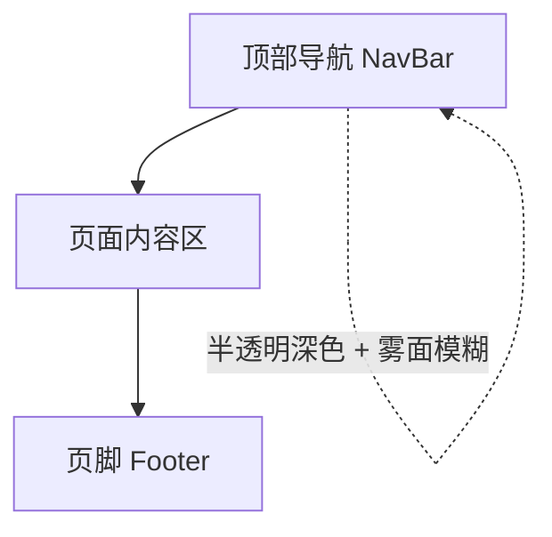
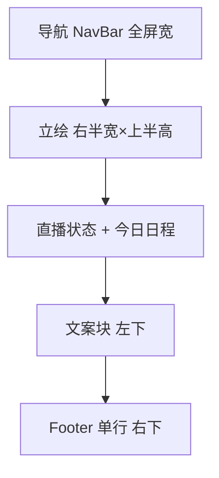
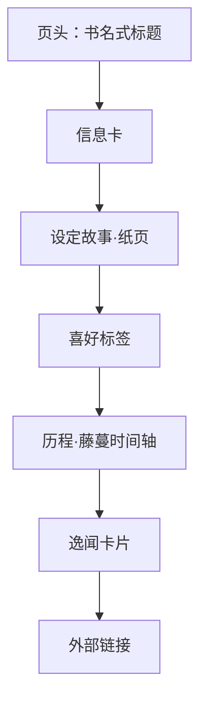
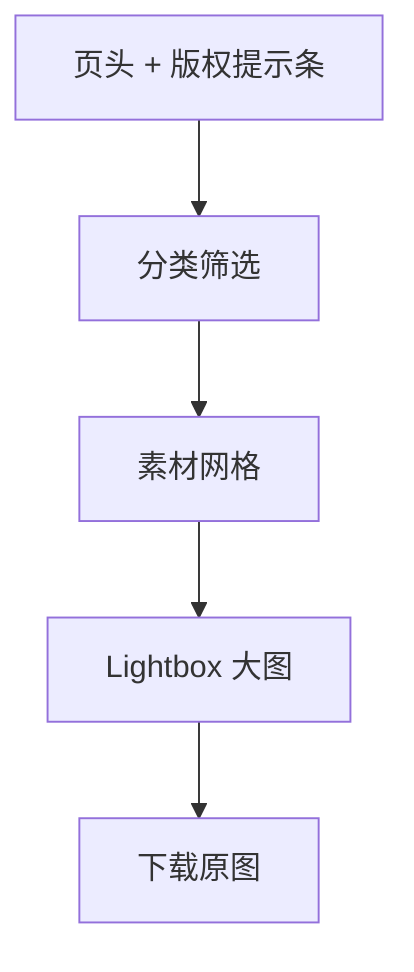

# 页面设计

本文档描述 V1 全部页面的界面细节，视觉规则遵循 [[01-visual-identity.md]]。

## 1. 全局框架

### 1.1 页面骨架

- **NavBar**：固定在顶部，半透明 `--color-bg` + 背景模糊（雾面玻璃），**内容区全屏宽**（不再限宽）。左侧「枝堇Sumire」花体标识，右侧为已上线页面入口（V1：主页 / 档案 / 素材 / 日历）+ B 站图标外链。**未上线功能不出现在导航中**；后续工具上线时在导航增加「工具」分组，数据源为工具注册表。
- **Footer**：**单行**排版——免责声明 +「B 站空间 / 直播间 / 萌娘百科」三外链。首页以**通栏贴底毛玻璃条**呈现（`border-t` + `backdrop-blur`，免责声明全端展示）；非首页流式底部。不再有应援色色条。
- **内容区**：最大宽度 `72rem` 居中，左右留白 `1.25rem`（移动）/ `2.5rem`（桌面）。

### 1.2 响应式断点

| 断点 | 宽度 | 关键变化 |
|------|------|---------|
| 移动 | < 640px | 单列；导航收起为菜单按钮；主页立绘全宽顶部裁剪 |
| 平板 | 640–1024px | 两列网格；hero 图文堆叠 |
| 桌面 | > 1024px | hero 左右布局；素材网格 3–4 列 |

## 2. 主页 `/`

**目标**：10 秒内传达"她是谁、是否在播、今天播什么、去哪看"，并建立雨夜书屋的氛围。

### 2.1 一屏封面页（100svh 不可滚动）

- 首页 `100svh` 占满整屏、**不可滚动**，所有元素在一屏内排布、不溢出。
- 背景：`--color-bg` 之上叠雾气渐变，缓慢漂移。
- **立绘**（`standing-01`）：移动端从顶部 10% 起占 90% 高、全宽并向右偏移 25% 宽裁剪展示（`ml-[25%] object-cover object-top`，不变形）；桌面端右 10% 起占 90% 高、右半宽且不偏移。作为氛围元素，不遮挡交互（`pointer-events-none`）。外包 `ParallaxLayer` 驱动**视差**（仅 `transform`，`translate3d` 平滑 lerp，常规幅度 ±12px；公开站氛围层对 reduced-motion 不降级，保持 ±12px）。
- **背景光晕粒子层**（`GlowParticles`，Canvas 2D，z 序在雾气之上/立绘之下）：「紫花微光」语言——径向渐变圆点、低 alpha 柔光（不用 `filter: blur`）；取色 `@theme` token（`flower`/`primary`/`eye`，运行时读 CSS 变量）。定稿参数：指针附近偏置生成概率 0.6、半径 160px；粒子尺寸 2–8px、生命周期 2.5–6s、初速向上微漂；粒子数上限 `min(70, 视口面积/15000)`（桌面约 ≤70）；明灭 alpha 正弦调制。公开站氛围层对 reduced-motion 不降级（粒子全上限/明灭/冲量与常规一致）。`document.hidden` 暂停。
- **文案块**（左下角，留 padding，桌面 > 移动端）错峰入场：
  - 花体小字 `VirtuaReal · 二十八期`（`--color-ink-dim`）；
  - 大名「枝堇」（Noto Serif SC，`--text-display`）+ 花体 `Sumire`（`--color-primary`）；
  - 一句话简介（官方简介原文）。**不再有应援色复制按钮**。
- **直播状态组件**（左下文案块上方）：药丸形，直播中显示状态点（`--color-eye`，呼吸动效）+「直播中」，未开播显示「未开播」，降级中性态；点击跳直播间（新窗口）。
- **今日日程组件**（直播状态下方）：「今日日程」标题 + 当天计划 `HH:mm 主题`；无计划显示「今日暂无安排」；固定尺寸骨架防跳动。
- **Footer 行**：通栏贴底毛玻璃条（免责声明全端展示 + 三外链）。
- 移动端纵向顺序：立绘（顶部 50%）→ 直播状态 → 今日日程 → 文案块 → 链接行，紧凑不滚动不溢出。

### 2.2 首页整页滚动（4 期，V4）

首页改为**整页滚动叙事容器**（`FullpageDeck`）：8 个整屏站「首页 → 档案 P1~P5 → 日历 → 素材」逐屏翻页，一次滚轮/滑动手势一屏，键盘可达；素材站为最后一站、尾部释放为自然滚动直至结尾 + 全站唯一流式 Footer。整页翻页引擎 `useFullpageScroll`（window 被动监听、rAF px 插值直写轨道 `translate3d` 不触发重渲染、hash `replaceState` 同步、挂载时解析初始 hash 直落）。公开站氛围层对 reduced-motion 不降级。

- **位置指示器** `SectionRail`：固定视口右侧竖向树状节点（模块→子内容两层，档案含 5 子节点），左侧细藤蔓线（`border-l` token 色）+ 微光紫花圆点主节点 + 档案缩进子节点（子层 `border-l` 树状连线）；当前站实时高亮（子节点精确到站、档案父节点次级高亮）、点击跳转、键盘可达；移动端（<640px）收纳为仅主节点极简形态；仅节点 `<a>` 可点。
- **粒子常驻与冲量**：`GlowParticles` 改 `fixed inset-0` 常驻视口层（z 序雾气之上/内容之下，全程 `pointer-events-none`、`aria-hidden`），覆盖所有模块与素材自然滚动区。翻页/滚动沿方向注入冲量（`impulse` 强度钳制上限、`decayFlow` 指数衰减半衰期约 0.5s，停止后滞留上浮/下坠感）；公开站氛围层对 reduced-motion 不降级（冲量照常注入）。
- **档案五屏**（P1~P5 单左双右）：桌面 `grid` 左右分栏——单数屏立绘在左、双数屏立绘在右（`order`/条件类切换），立绘 `pointer-events-none`、按屏懒加载；内容侧渲染 `features/about/parts` 对应组件，居中收缩，桌面一屏不溢出（P2/P4 字号/间距收敛不产生屏内滚动条）；移动端纵向（立绘上内容下、立绘高度收敛）；P5 末尾官方外链按钮组。立绘从 `standing-01`/`standing-02`/`illustration-01` 循环选取（不新造素材）。
- **日历站**：全幅 `immersive` 月视图——直角中号字（去圆角、日期 `text-base` 量级）、左右两侧全高翻月竖条、横向拖拽翻月；后台 `panel` 变体不变。
- **素材站**：全幅网格（`xl:grid-cols-4`）+ 尾部流式 `Footer site`（全站唯一 Footer）。
- **导航锚点化**：NavBar 导航项 href 改为锚点（`/#hero`、`/#archive-1`、`/#assets`、`/#calendar`），hash 取自站序列注册表；首页路由按 `location.hash` 匹配 navKey 高亮（档案 P1~P5 均视为「档案」），非首页按 pathname。
- **定稿参数**：翻页转场 800ms、冲量强度 520px/s / 上限 600px/s、冲量衰减半衰期 0.5s、wheel 累积阈值 48px（低于单格，慢速单格一次一屏）、touch 位移阈值 50px、冷却 400ms、素材区顶部回收死区 2px、日历拖拽阈值 60px。

## 3. 档案页 `/about`

**目标**：系统性呈现人设，阅读体验像"翻开店主留下的一册档案"。

### 3.1 页头

- Noto Serif SC 标题「枝堇图鉴」+ 花体 `Profile`，下方蕾丝细线；
- 右上一句飘浮引文：*"弹幕有点不乖啊"*（`--color-ink-dim`，花体）。

### 3.2 信息卡

- 桌面：左侧立绘②缩略（`character-full-02.png`，蕾丝边框），右侧两列定义表；
- 字段：本名 枝堇Sumire / 生日 4月2日（白羊座）/ 种族 被人寄生的藤？/ 身高 165cm（未含藤蔓）/ 身份 小书店店主 / 所属 VirtuaReal·二十八期 / 粉丝勋章 小粉螈 / 应援色 `#b4a6bf`（带色块）/ 代表 Emoji 😁 / Live2D 天雨Rainfall；
- 移动：立绘在上，表单项列。

### 3.3 设定故事

- **纸页卡片**：`--color-paper` 底 + 纸页纹理 + 四角藤蔓角饰，正文用 `--color-ink-on-paper`，Noto Serif SC 排印，段落首行缩进两字符——旧书页观感；
- 内容：官方出道设定（古老家族、魔气、破败书屋、紫色藤蔓共生）+ VirtuaReal 预告专栏简介节选；
- 引用块用 `--color-flower` 细左边线。

### 3.4 喜好标签

- 三组（及新增喜好类型组）：`喜欢`（纪录片、小说、雨水、雾、纯音乐、紫色的东西）、`不擅长`（硬核解密、茄子、唱歌——但喜欢❤️）、`常玩`（星露谷物语、泰拉瑞亚、我的世界、饥荒等）、`常读/常看`（通俗文学、悬疑、恐怖、奇幻、冒险、中式）、`常听`（东方系列、术力口、电子纯音、r&b）、`偏好类型`（模拟经营）；
- 标签样式：细描边胶囊（`--color-vine` 描边），hover 填充 `--color-bg-soft`。

### 3.5 历程时间轴

- 竖向，**轴体本身是一根藤蔓**（SVG 曲线 + 叶片），每个节点是一朵微光紫花；
- 节点：2026-08-05 开始活动·初投稿「天ノ弱」/ 2026-08-07 出道首播 / 2026-08-08 百人舰队 / 2026-08-09 一万粉丝；
- 日期用花体西文，事件用正文；左右交错（桌面）/ 单侧（移动）。

### 3.6 逸闻卡片

- 深色卡片网格（桌面两列）："妈妈"弹幕梗、😁 打 Call 表情的由来、初投稿漏左括号等；
- 卡片标题带 😁 或对应 emoji，正文 `--color-ink-dim`。

### 3.7 外部链接

- 按钮组：B 站个人空间、B 站直播间、萌娘百科词条；细描边按钮，hover 时 `--color-flower` 描边 + 微光。

## 4. 素材库 `/assets`

**目标**：找素材、看大图、下原图，同时明确版权边界。

### 4.1 版权提示条

- 页头下方常驻一条纸页提示："本站为非官方粉丝作品，素材版权归枝堇Sumire 及 VirtuaReal 所有，请勿商用"。

### 4.2 分类筛选

- 胶囊式筛选：`全部 / 立绘 / 插画 / 宣传图`（数据源为素材清单的 `category`）；
- 选中态：`--color-primary` 填充 + 深色文字。

### 4.3 素材网格

- 桌面 3 列 / 平板 2 列 / 移动 1 列，卡片等宽、图片等高比（按素材宽高比占位防跳动）；
- 卡片：缩略图 + 标题 + 分类小字；hover 时蕾丝边框浮现 + 轻微上浮（`translateY(-2px)`）；
- 点击进入 Lightbox。

### 4.4 Lightbox

- 全屏遮罩（深色 90% 不透明），大图居中适配视口；
- 信息条：标题、尺寸、分类、备注（如"出道月大航海回馈宣传图"）、署名；
- 操作：`下载原图`（主按钮，`--color-flower` 描边）、`关闭`；支持 Esc 与点击遮罩关闭；
- 当前素材（V1）：立绘①、立绘②、氛围插画、大航海宣传图、周表宣传图（见 `references/`）。

## 5. 组件清单

| 组件 | 说明 | 关键状态 |
|------|------|---------|
| `NavBar` | 全局导航，雾面玻璃（内容区全屏宽） | 滚动时加深背景；移动菜单展开 |
| `Footer` | 单行（免责声明全端展示 + 三外链）；首页通栏贴底毛玻璃条 | 首页 floating / 常规流式 |
| `VineDivider` | 藤蔓分隔线 | 生长动画 / 静态 |
| `LaceFrame` | 蕾丝边框容器 | 常显 / hover 浮现 |
| `PaperCard` | 纸页卡片 | 默认 / 带角饰 |
| `Tag` | 胶囊标签 | 默认 / hover |
| `LiveStatus` | 直播状态（首页） | 直播中 / 未开播 / 降级 |
| `TodaySchedule` | 今日日程（首页） | 有计划 / 空态 / 加载 |
| `VineTimeline` | 藤蔓时间轴 | 交错 / 单侧 |
| `AssetCard` | 素材卡片 | hover |
| `Lightbox` | 大图查看 | 打开 / 关闭，键盘可达 |
| `ExternalButton` | 外链按钮 | hover 微光 |

## 6. 交互与无障碍

- 所有交互元素键盘可达，焦点环使用 `--color-flower`；
- Lightbox 打开时锁定背景滚动，焦点困于其中；
- 图片均有 `alt`（素材标题）；
- 环境动效（雾、藤蔓生长）公开站氛围层不降级；后台 `/backdoor` 在 `prefers-reduced-motion` 下关闭。

## 7. 相关文档

- 视觉识别：[[01-visual-identity.md]]
- PRD：[[../product/requirements/reviewed/2026-08-11-sumire-fan-site-prd.md]]
- 技术方案：[[../engineering/proposals/2026-08-11-fan-site-tech-proposal.md]]
