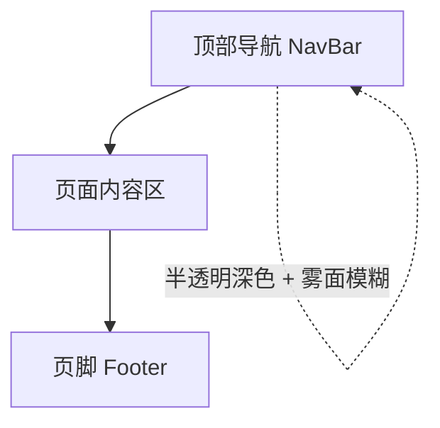
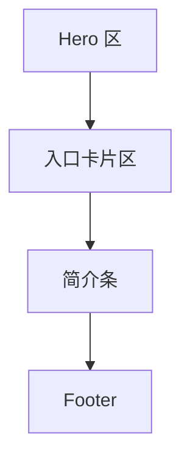
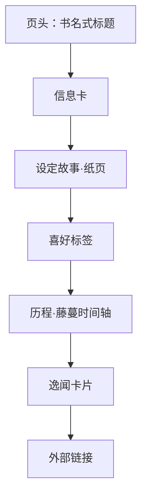
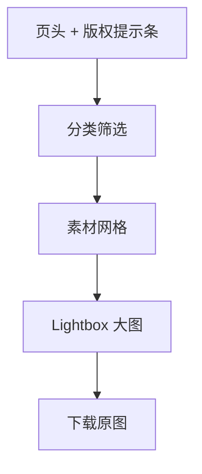

# 页面设计

本文档描述 V1 全部页面的界面细节，视觉规则遵循 [[01-visual-identity.md]]。

## 1. 全局框架

### 1.1 页面骨架

- **NavBar**：固定在顶部，半透明 `--color-bg` + 背景模糊（雾面玻璃）。左侧「枝堇Sumire」花体标识，右侧为已上线页面入口（V1：主页 / 档案 / 素材）+ B 站图标外链。**未上线功能不出现在导航中**；后续工具上线时在导航增加「工具」分组，数据源为工具注册表。
- **Footer**：顶部一条蕾丝边框。内容为：非官方粉丝作品声明、素材版权归属说明、B 站空间/直播间外链、应援色 `#b4a6bf` 色条。
- **内容区**：最大宽度 `72rem` 居中，左右留白 `1.25rem`（移动）/ `2.5rem`（桌面）。

### 1.2 响应式断点

| 断点 | 宽度 | 关键变化 |
|------|------|---------|
| 移动 | < 640px | 单列；导航收起为菜单按钮；主页立绘居中缩放 |
| 平板 | 640–1024px | 两列网格；hero 图文堆叠 |
| 桌面 | > 1024px | hero 左右布局；素材网格 3–4 列 |

## 2. 主页 `/`

**目标**：10 秒内传达"她是谁、去哪看直播"，并建立雨夜书屋的氛围。

### 2.1 Hero 区（首屏，100svh）

- 背景：`--color-bg` 之上叠雾气渐变，缓慢漂移；
- 桌面：左侧文字，右侧立绘①（`character-full-01.png`，透明底，底部没入雾中）；移动：立绘缩至文字后方、降不透明度作底；
- 文字依次（400–600ms 错峰入场）：
  - 花体小字 `VirtuaReal · 二十八期`（`--color-ink-dim`）；
  - 大名「枝堇」（Noto Serif SC，`--text-display`）+ 花体 `Sumire`（`--color-primary`）；
  - 一句话简介：*"是老书屋的一株藤蔓，喜欢雨水和雾，破旧的纸张。"*（官方简介原文）；
  - 应援色 chips：`#b4a6bf` 圆形色块 + 色值文字，点击复制色值；
- 藤蔓分隔线从 hero 底部缓慢"生长"入场。

### 2.2 入口卡片区

- 三张卡片横排（移动纵排），深色抬升面 + 藤蔓角饰，hover 时蕾丝边框浮现：
  1. **主播档案** → `/about`（图标：书）；
  2. **周边素材** → `/assets`（图标：照片）；
  3. **直播间** → B 站外链（图标：播放；附"小藤尾巴出没中"文案，`--color-eye` 小圆点点缀）。

### 2.3 简介条

- 一条纸页卡片：生日 `4.2`、种族"被人寄生的藤？"、所属 VirtuaReal、粉丝勋章「小粉螈」四个事实并列（移动两两换行），作为档案页的引子，末尾文字链"了解更多 →"。

## 3. 档案页 `/about`

**目标**：系统性呈现人设，阅读体验像"翻开店主留下的一册档案"。

### 3.1 页头

- Noto Serif SC 标题「枝堇图鉴」+ 花体 `Profile`，下方蕾丝细线；
- 右上一句飘浮引文：*"弹幕有点不乖啊"*（`--color-ink-dim`，花体）。

### 3.2 信息卡

- 桌面：左侧立绘②缩略（`character-full-02.png`，蕾丝边框），右侧两列定义表；
- 字段：本名 枝堇Sumire / 生日 4月2日（白羊座）/ 种族 被人寄生的藤？/ 身高 165cm（未含藤蔓）/ 身份 小书店店主 / 所属 VirtuaReal·二十八期 / 粉丝勋章 小粉螈 / 应援色 `#b4a6bf`（带色块）/ 代表 Emoji 😁 / Live2D 天雨Rainfall；
- 移动：立绘在上，表单项列。

### 3.3 设定故事

- **纸页卡片**：`--color-paper` 底 + 纸页纹理 + 四角藤蔓角饰，正文用 `--color-ink-on-paper`，Noto Serif SC 排印，段落首行缩进两字符——旧书页观感；
- 内容：官方出道设定（古老家族、魔气、破败书屋、紫色藤蔓共生）+ VirtuaReal 预告专栏简介节选；
- 引用块用 `--color-flower` 细左边线。

### 3.4 喜好标签

- 三组：`喜欢`（纪录片、小说、雨水、雾、纯音乐、紫色的东西）、`不擅长`（硬核解密、茄子、唱歌——但喜欢❤️）、`常玩`（星露谷物语、泰拉瑞亚、我的世界、饥荒等）；
- 标签样式：细描边胶囊（`--color-vine` 描边），hover 填充 `--color-bg-soft`。

### 3.5 历程时间轴

- 竖向，**轴体本身是一根藤蔓**（SVG 曲线 + 叶片），每个节点是一朵微光紫花；
- 节点：2026-08-05 开始活动·初投稿「天ノ弱」/ 2026-08-07 出道首播 / 2026-08-08 百人舰队 / 2026-08-09 一万粉丝；
- 日期用花体西文，事件用正文；左右交错（桌面）/ 单侧（移动）。

### 3.6 逸闻卡片

- 深色卡片网格（桌面两列）："妈妈"弹幕梗、😁 打 Call 表情的由来、初投稿漏左括号等；
- 卡片标题带 😁 或对应 emoji，正文 `--color-ink-dim`。

### 3.7 外部链接

- 按钮组：B 站个人空间、B 站直播间、萌娘百科词条；细描边按钮，hover 时 `--color-flower` 描边 + 微光。

## 4. 素材库 `/assets`

**目标**：找素材、看大图、下原图，同时明确版权边界。

### 4.1 版权提示条

- 页头下方常驻一条纸页提示："本站为非官方粉丝作品，素材版权归枝堇Sumire 及 VirtuaReal 所有，请勿商用"。

### 4.2 分类筛选

- 胶囊式筛选：`全部 / 立绘 / 插画 / 宣传图`（数据源为素材清单的 `category`）；
- 选中态：`--color-primary` 填充 + 深色文字。

### 4.3 素材网格

- 桌面 3 列 / 平板 2 列 / 移动 1 列，卡片等宽、图片等高比（按素材宽高比占位防跳动）；
- 卡片：缩略图 + 标题 + 分类小字；hover 时蕾丝边框浮现 + 轻微上浮（`translateY(-2px)`）；
- 点击进入 Lightbox。

### 4.4 Lightbox

- 全屏遮罩（深色 90% 不透明），大图居中适配视口；
- 信息条：标题、尺寸、分类、备注（如"出道月大航海回馈宣传图"）、署名；
- 操作：`下载原图`（主按钮，`--color-flower` 描边）、`关闭`；支持 Esc 与点击遮罩关闭；
- 当前素材（V1）：立绘①、立绘②、氛围插画、大航海宣传图、周表宣传图（见 `references/`）。

## 5. 组件清单

| 组件 | 说明 | 关键状态 |
|------|------|---------|
| `NavBar` | 全局导航，雾面玻璃 | 滚动时加深背景；移动菜单展开 |
| `Footer` | 声明 + 外链 + 应援色条 | — |
| `VineDivider` | 藤蔓分隔线 | 生长动画 / 静态 |
| `LaceFrame` | 蕾丝边框容器 | 常显 / hover 浮现 |
| `PaperCard` | 纸页卡片 | 默认 / 带角饰 |
| `EntryCard` | 主页入口卡片 | hover 蕾丝 + 上浮 |
| `FactTable` | 信息卡定义表 | 单列 / 两列 |
| `Tag` | 胶囊标签 | 默认 / hover |
| `VineTimeline` | 藤蔓时间轴 | 交错 / 单侧 |
| `AssetCard` | 素材卡片 | hover |
| `Lightbox` | 大图查看 | 打开 / 关闭，键盘可达 |
| `ExternalButton` | 外链按钮 | hover 微光 |

## 6. 交互与无障碍

- 所有交互元素键盘可达，焦点环使用 `--color-flower`；
- Lightbox 打开时锁定背景滚动，焦点困于其中；
- 图片均有 `alt`（素材标题）；
- 环境动效（雾、藤蔓生长）在 `prefers-reduced-motion` 下关闭。

## 7. 相关文档

- 视觉识别：[[01-visual-identity.md]]
- PRD：[[../product/requirements/reviewed/2026-08-11-sumire-fan-site-prd.md]]
- 技术方案：[[../engineering/proposals/2026-08-11-fan-site-tech-proposal.md]]
