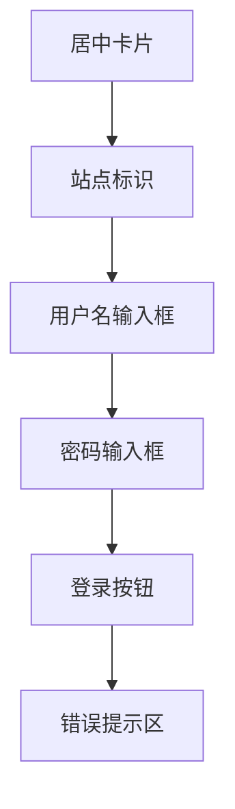
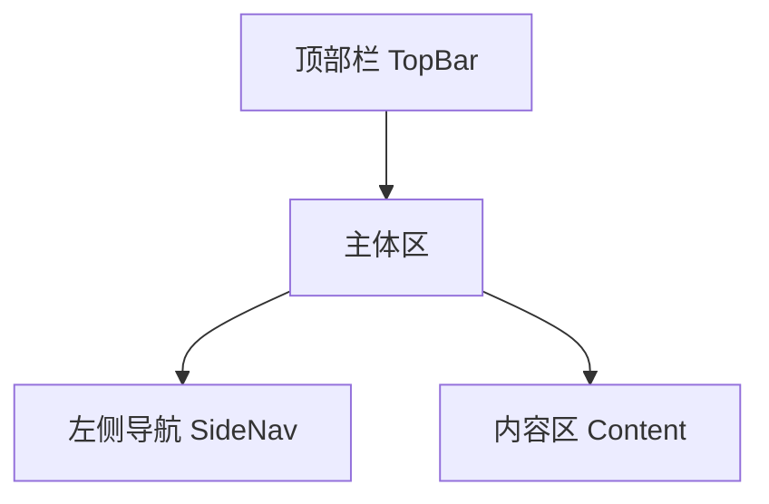

# 后台系统设计（V1）

本文档描述后台系统 V1 两个页面的界面细节：登录页 `/backdoor/login` 与仪表盘 `/backdoor`。视觉规则遵循 [[01-visual-identity.md]]，后台与书店共享同一套色彩/字体 token，但**不使用书店的氛围装饰**（雾气、藤蔓生长动画等环境动效）——后台是"店主的工作台"，气质从"雨夜氛围"转为"深夜灯下办公"，装饰克制、效率优先。

## 1. 设计定位

- 与书店同一世界观的另一面：书店是"给客人的店面"，后台是"店主自己的里屋"；
- 深色底延续（`--color-bg`），应援色点缀延续（`--color-primary`），蕾丝/藤蔓元素只保留**极少量静态点缀**（分隔细线、选中态描边），不使用动效；
- 信息密度高于书店：字号以 `--text-body` / `--text-small` 为主，控件紧凑；
- 全站（书店 + 后台）共享的设计 token 抽到公共样式源，`apps/backdoor-web` 直接引用，保证 AC-11「视觉语言一致」可机械校验。

## 2. 登录页 `/backdoor/login`

**目标**：一眼可识别是枝堇站的后台入口，同时明确"这不是公开页面"。

### 2.1 布局

- 全屏 `100svh` 居中卡片，卡片宽 `22rem`（移动横向留白 `1.25rem`）；
- 背景：`--color-bg` 纯色 + 极淡的 `--color-flower` 径向微光（固定不动，非动效），呼应"头花的微光"；
- 卡片：`--color-bg-raised` 底 + `1px` `--color-vine` 细描边 + 圆角 `0.75rem`，顶部一条 `2px` 应援色 `#b4a6bf` 色带（对应书店页脚的应援色条）。

### 2.2 内容元素

| 元素 | 规格 |
|------|------|
| 站点标识 | 「枝堇」Noto Serif SC `--text-h1` + 花体 `Backdoor`（Cormorant Garamond，`--color-primary`），下方一行 `--color-ink-dim` 小字"老书屋的里屋 · 仅店主" |
| 用户名输入框 | 标签"用户名"，深色输入面 `--color-bg-soft`，`--text-body` |
| 密码输入框 | 标签"密码"，`type="password"`，其余同上 |
| 登录按钮 | 主按钮：`--color-primary` 填充 + `--color-ink-on-paper` 文字；提交中置灰禁用并显示"登录中…" |
| 错误提示区 | 按钮下方固定高度（防布局跳动），`--color-flower` 文字，内容固定为"账号或密码错误" |

### 2.3 状态

- **默认**：两个输入框空，按钮可用；
- **提交中**：按钮禁用、输入框只读，防止重复提交；
- **失败**：错误提示区显示"账号或密码错误"，密码框清空并聚焦，用户名保留；
- **成功**：整页跳转 `/backdoor`（服务端会话已建立，无前端 loading 态）。

### 2.4 交互与无障碍

- 表单为原生 `<form>`，Enter 提交；输入框有 `label` 关联与 `autocomplete="username"` / `current-password`；
- 错误提示带 `role="alert"`，屏幕阅读器可感知；
- 焦点环使用 `--color-flower`；
- 页面上**不出现**任何注册、找回密码入口（AC-4）。

## 3. 后台布局 `/backdoor`

**目标**：标准管理界面骨架，为后续管理功能预留统一的导航与内容区。

### 3.1 页面骨架

- **顶部栏**（固定，高 `3.5rem`）：`--color-bg-raised` 底 + 底部 `1px` `--color-vine` 细线。左侧「枝堇 · 后台」（Noto Serif SC 标题 + 花体 `Backdoor` 小字），右侧「登出」按钮；
- **左侧导航**（桌面宽 `12rem`）：`--color-bg` 底，与内容区以 `1px` `--color-vine` 分隔。V1 仅一项「仪表盘」，选中态为 `--color-bg-soft` 填充 + 左侧 `3px` `--color-primary` 竖条；**不渲染任何未上线功能的占位项**（AC-9）；
- **内容区**：`--color-bg` 底，最大宽度 `64rem`，内边距 `2rem`（移动 `1.25rem`）。

### 3.2 响应式

| 断点 | 宽度 | 关键变化 |
|------|------|---------|
| 移动 | < 640px | 侧栏收起为顶部栏内菜单按钮，点击抽屉式展开；登出仍在顶部栏 |
| 桌面 | ≥ 640px | 侧栏常驻 |

后台为管理工具，桌面优先；移动端只需保证登录、登出、查看仪表盘可用（PRD §4.3）。

### 3.3 仪表盘（V1 唯一内容页）

- 欢迎区：Noto Serif SC `--text-h1`「欢迎回来，老书屋的店主」+ `--color-ink-dim` 一行提示"这里还没有打理的事务——管理功能会陆续搬进来"；
- 欢迎区下方一条静态藤蔓细线（SVG，无生长动画，呼应书店 `VineDivider` 的静态形态）；
- 当前时间/会话信息小块（`--text-small`，`--color-ink-dim`）：如"本次登录有效期至 <日期>"，让超管对 7 天会话有感知；
- **无其他卡片、无占位功能**（AC-10）。

### 3.4 登出

- 顶部栏右侧文字按钮「登出」（`--color-ink-dim`，hover 变 `--color-ink`）；
- 点击后调用登出接口，成功即跳转登录页；无二次确认（会话可低成本重建，确认弹窗是噪音）；
- 登出仅失效当前端会话（AC-8），界面上无需体现多端状态。

## 4. 组件清单

| 组件 | 说明 | 关键状态 |
|------|------|---------|
| `LoginCard` | 登录卡片（标识 + 表单 + 错误区） | 默认 / 提交中 / 失败 |
| `TextField` | 带标签输入框 | 默认 / 聚焦 / 只读（提交中） |
| `PrimaryButton` | 主按钮（应援色填充） | 默认 / hover / 禁用 |
| `TopBar` | 后台顶部栏 | 桌面 / 移动（含菜单按钮） |
| `SideNav` | 左侧导航 | 选中态；移动抽屉展开/收起 |
| `VineDivider`（静态复用） | 藤蔓分隔细线 | 静态，无动画 |
| `SessionNote` | 会话有效期小字块 | — |

图标沿用视觉识别的细线风格（Lucide，1.5px 描边）；V1 仅菜单按钮、登出需要图标。

## 5. 与书店的关系

| 维度 | 约定 |
|------|------|
| 设计 token | 共享同一份色彩/字体 token（单一来源），后台不自定义新色 |
| 装饰元素 | 书店：雾气/生长动画/蕾丝全量；后台：仅静态藤蔓细线与描边，无环境动效 |
| 互相引用 | 书店页脚「管理 →」为唯一入口；后台不提供"返回书店"链接（浏览器回退即可，避免混淆公开/受保护边界） |
| 动效规范 | 后台仅保留控件级过渡（hover、禁用，≤ 200ms），同样尊重 `prefers-reduced-motion` |

## 6. 相关文档

- 视觉识别：[[01-visual-identity.md]]
- 书店页面设计：[[02-page-design.md]]
- PRD：[[../product/requirements/draft/2026-08-12-backdoor-auth-prd.md]]
- 技术方案：[[../engineering/proposals/2026-08-12-backdoor-auth-proposal.md]]
