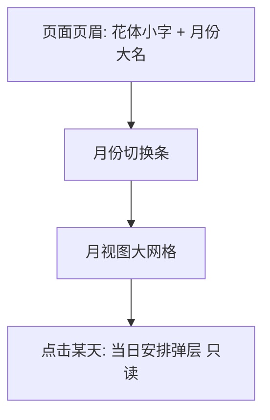
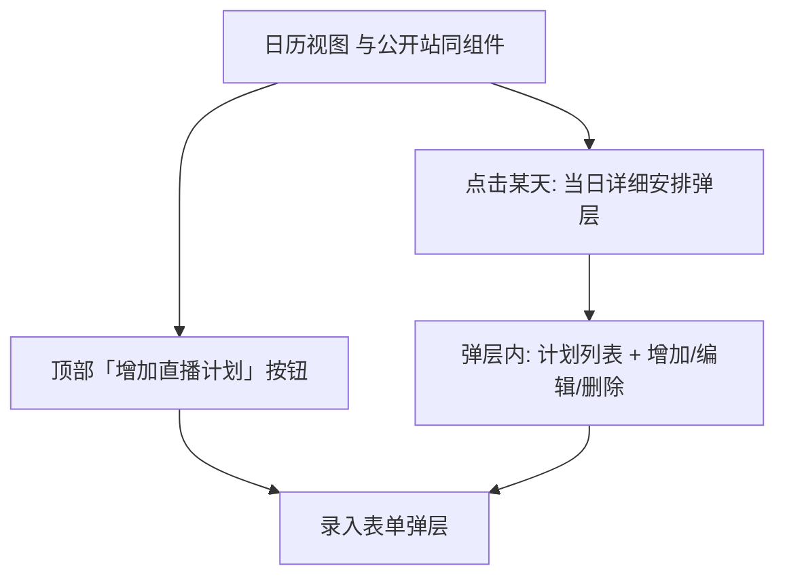

# 周表设计

本文档描述「周表」功能的界面细节，视觉规则遵循 [[01-visual-identity.md]]，全局框架与断点遵循 [[02-page-design.md]]，后台区域框架遵循 [[03-backdoor-design.md]]。设计参照官方「本周日程」宣传图（`references/promo-weekly-schedule.png`）的条列氛围，但整体气质更**大气**：大留白、大字号、大网格，让日程本身成为主角。

## 1. 设计原则

- **大气优先**：日历是本功能的唯一主角。日历页给足首屏高度与横向空间，月份标题使用展示级字号；格子宁大勿小，内容宁少勿多；
- **信息分层**：第一眼只看到「月份 + 哪天有直播」，第二眼（点击）才看到「几点播什么」。不在格子里堆叠全部信息；
- **时间感**：已播出（过去）沉下去、待播出（未来）浮上来、今天被藤蔓圈住——三种时间状态一眼可辨；
- **控件即装饰**：日期/时间选择器按站点语言定制，藤蔓描边 + 纸面浮层，不用浏览器原生默认样式。

## 2. 公开站日历页 `/calendar`

**目标**：像翻开书屋墙上挂着的大幅日历——一眼看全月，一点看当日。

### 2.1 页眉

- 居中布局，内容区最大宽度 `72rem` 之上再放宽至 `80rem`（日历需要横向空间）；
- 花体小字 `Weekly Schedule`（`--color-ink-dim`，tracking 放宽，斜体）；
- 月份大名：`2026 年 8 月`，Noto Serif SC，`--text-display`（桌面 3.5rem），数字可用花体点缀；
- 错峰入场（`animate-rise`，与主页 hero 同一节奏）。

### 2.2 月份切换条

- 月份大名下方一行：左侧「← 上月」、右侧「下月 →」文字按钮（`--color-ink-dim`，hover 转 `--color-flower`），中间一个「回到本月」小按钮（仅当浏览非当前月时出现）；
- 切换时网格内容以 200ms 淡入淡出过渡，不做复杂滑动。

### 2.3 月视图大网格

- 七列网格（周一开头，表头 `一 二 三 四 五 六 日`，`--text-tiny`，`--color-ink-dim`，tracking 加宽）；
- 桌面格子最小高度 `7.5rem`，间距 `0.75rem`，格子为 `--color-bg-raised` 抬升面 + 藤蔓色细描边，圆角 `0.75rem`；移动端格子缩为高度 `4rem` 的紧凑点标记模式（只显示日期数字与计划点）；
- 格子内：
  - 日期数字（`--text-h2`，Noto Serif SC）；
  - 有计划的日期：最多展示 2 条计划摘要（`HH:mm 主题`，`--text-tiny`，主题超出省略），更多时以「+N」收尾；
  - 非本月补位格子：透明度 35%，不展示计划；
- 时间状态：
  - **今天**：藤蔓色加粗描边 + 左上角一朵小花（`--color-flower`）点睛；
  - **待播出**（未来）：计划摘要用 `--color-ink`，时间前缀一点 `--color-eye` 小圆点；
  - **已播出**（过去）：格子整体透明度降至 60%，计划摘要 `--color-ink-dim`；
- hover（可点击的格子）：蕾丝边框浮现（沿用入口卡片手法），提示可点击查看当日；
- 空月（整月无计划）：网格照常渲染，不额外提示——空本身即信息。

### 2.4 当日安排弹层（只读）

- 点击格子弹出居中 dialog，遮罩 `--color-bg` 70% + 雾面模糊；
- 纸面浮层（`--color-paper`，`PaperCard` 质感 + 蕾丝边框），最大宽度 `28rem`；
- 标题：`8 月 15 日 · 周六`（Noto Serif SC，`--text-h2`，`--color-ink-on-paper`）；
- 计划列表：按开播时间升序，每行 `HH:mm`（等宽数字）+ 主题，行间藤蔓细线分隔；
- 空态：一行斜体小字「这一天书屋静悄悄的。」；
- 右上角关闭按钮 + 点击遮罩关闭 + `Esc` 关闭。

## 3. 主页「本周日程」入口区块

**目标**：主页上的日历入口本身即是一件装饰品，像从官方周表宣传图里裁下来的一角。

- 位置：入口卡片区与速览区之间，独占一整行（不与其他卡片并列，体现分量）；
- 容器：横向长条卡片，`--color-bg-raised` 抬升面，四角藤蔓角饰，顶部一条蕾丝边框；左侧竖排花体 `Weekly` 点缀；
- 内容：标题「本周日程」（`--text-h2`）+ 本周一至周日的横向条列（参照官方宣传图）：每天一行缎带式横条（左端日期缩写 `MON.`，右侧 `HH:mm 主题`），无计划的日子横条留空收窄；
- 数据加载中：缎条骨架（固定高度脉冲动画），避免布局跳动；
- 底部右侧「查看完整日历 →」链接（`--color-flower` 下划线装饰），点击整卡亦可进入 `/calendar`；
- 仅当后台服务已配置时渲染；未配置形态主页不出现该区块；
- 响应式：移动端缎条纵向堆叠，隐藏「本周」之外的装饰元素。

## 4. 后台「直播计划」模块 `/backdoor/schedule`

后台整体框架沿用 [[03-backdoor-design.md]]（深色抬升面、侧边导航），本模块在后台语境中保持与公开站一致的日历语言，但操作密度更高。

### 4.1 页面布局

- 页头：标题「直播计划」（`--text-h1`），右侧主按钮「增加直播计划」（`PrimaryButton`，仅 superadmin / admin 可见）；
- 日历视图复用公开站 `CalendarView`（同一份实现），格子内计划摘要交互一致；
- member 角色：只读——日历与当日弹层可看，不渲染任何增加/编辑/删除入口。

### 4.2 当日详细安排弹层（管理态）

- 在 2.4 的只读弹层基础上扩展为管理态（后台深色浮层，`--color-bg-raised` + 藤蔓描边）：
  - 计划列表每行追加两个操作：「编辑」（铅笔图标）、「删除」（垃圾桶图标，`--color-ink-dim`，hover 转警示色）；
  - 列表底部「+ 增加计划」次按钮，点击打开录入表单，**日期预填为所选日**（可修改）；
- 删除：点击后行内展开二次确认（「确认删除 08:00 早台读书？」+ 确认/取消），不另开弹层；
- 编辑：点击后打开与录入相同的表单弹层，三个字段预填当前值，标题改为「编辑直播计划」；日期可改（即改期），保存后计划归入新日期。

### 4.3 录入/编辑表单弹层

- 深色浮层居中，最大宽度 `24rem`，标题「增加直播计划」/「编辑直播计划」；
- 三个字段依次：**日期**（定制 DatePicker）、**开始时间**（定制 TimePicker）、**直播主题**（`TextField`，占位文案如「歌杂 / 早台读书…」）；
- 校验：三字段均必填；非法即行内红字提示并禁用提交；
- 操作：主按钮「确认」+ 次按钮「取消」；提交中主按钮进入 loading 态。

## 5. 日期与时间选择控件

### 5.1 DatePicker（日期选择器）

- 形态：输入框只读展示 `2026 年 8 月 15 日`，点击展开迷你月历浮层（不是原生 `<input type="date">` 下拉）；
- 迷你月历：与 `CalendarView` 同一套网格语言（周一开头、藤蔓描边格子），宽度 `18rem`；顶部「← →」切月，点击日期即选中并收起；
- 已选日期：藤蔓色描边 + `--color-bg-soft` 底；
- 键盘可达：`Tab` 聚焦、`Esc` 收起、方向键移动日期焦点；
- 支持直接键入 `YYYY-MM-DD`（失焦解析，非法则回退并提示）。

### 5.2 TimePicker（时间选择器）

- 形态：输入框只读展示 `HH:mm`（24 小时制，与官方周表一致），点击展开双列滚轮浮层：左列时（00–23）、右列分（00/15/30/45 步进，可直接键入任意分钟）；
- 滚轮：当前值居中高亮（`--color-flower`），上下值渐隐；点击或滚轮滑动选值，选中即收起；
- 常用快捷项：浮层底部一排快捷时间（`08:00 / 13:00 / 16:00 / 20:00 / 22:00`，参照官方周表常见开播时段），一键填入；
- 支持直接键入 `HH:mm`（失焦解析，非法回退并提示）；
- 键盘可达，与 DatePicker 同规。

## 6. 状态与动效

| 状态 | 表现 |
|------|------|
| 数据加载 | 日历格子骨架脉冲；主页缎条骨架；弹层内列表骨架行 |
| 加载失败 | 日历区居中提示「日程暂时翻不开了」+ 重试按钮，不影响站点其他区域 |
| 保存成功 | 表单弹层关闭，目标日期格子短暂亮起（`--color-flower` 描边呼吸一次） |
| 删除确认 | 行内展开确认条，确认后主按钮转 loading，完成即移除该行 |
| 动效基调 | 全部 150–250ms 缓动；入场沿用 `animate-rise` 错峰；禁止弹跳类动效 |

## 7. 响应式

| 断点 | 日历页 | 主页区块 | 弹层 |
|------|--------|---------|------|
| 移动 < 640px | 紧凑格子（日期数字 + 计划点），点格子看详情 | 缎条纵排 | 全宽贴底弹出 |
| 平板 640–1024px | 格子高度 5.5rem，摘要 1 条 | 缎条两列 | 居中，宽度 24rem |
| 桌面 > 1024px | 完整大网格（7.5rem 格子，摘要 2 条） | 横向条列 | 居中，宽度 28rem |

## 8. 相关文档

- [[01-visual-identity]]：色彩、字体、装饰元素
- [[02-page-design]]：全局框架、主页既有区块、断点
- [[03-backdoor-design]]：后台框架与组件
- 官方周表参考图：`references/promo-weekly-schedule.png`
- PRD：`docs/product/requirements/draft/2026-08-13-weekly-schedule-prd.md`
- 技术提案：`docs/engineering/proposals/2026-08-13-weekly-schedule-proposal.md`
