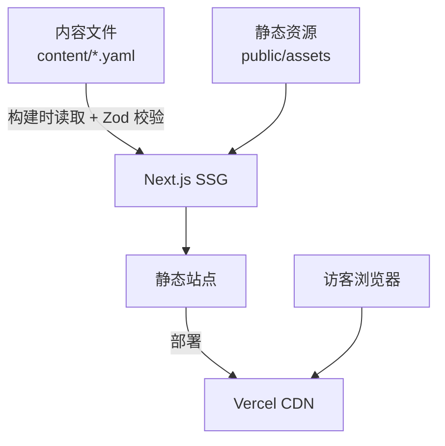
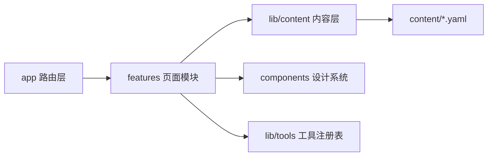
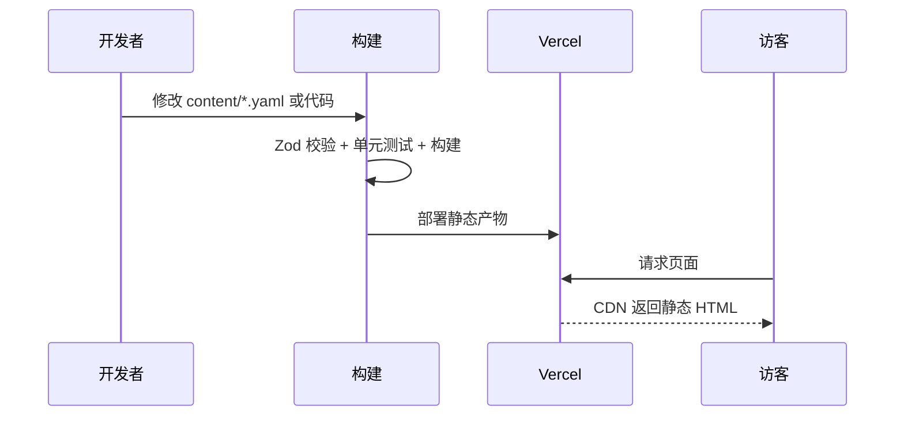

# 枝堇Sumire 粉丝站 V1 - 技术提案

**功能名称**: 枝堇Sumire 粉丝向网站 V1
**关联 PRD**: [[../product/draft/01-sumire-fan-site-prd.md]]
**技术提案版本**: v1.0
**创建日期**: 2026-08-11
**作者**: ash
**feat-branch**: `feat/fan-site-v1`

## 1. 概述

### 1.1 背景

依据 PRD，V1 交付品牌主页、主播档案、周边素材库三个页面，并为后续 5 个工具迭代（舰长礼物历史、周表生成器、歌单+歌切、弹幕后台、弹幕姬）做好架构准备。后续工具以客户端交互为主、内容以仓库管理为主，只有「弹幕后台」需要后端能力（届时单独提案）。

### 1.2 目标

- 纯静态站点，构建时生成全部页面，无运行时服务端依赖；
- 内容（档案、素材清单等）以类型安全的仓库内数据文件管理，改动走 PR 审阅；
- 工具以注册表机制接入，新增工具不动现有代码结构；
- 满足性能预算：首屏 LCP < 2.5s。

### 1.3 范围

- 做：站点框架、三个 V1 页面、内容层、设计系统组件、测试与部署流水线；
- 不做：任何后端接口、用户系统、弹幕后台服务端、占位页面。

## 2. 技术架构

### 2.1 系统架构图



### 2.2 技术栈

| 层级 | 技术选型 | 说明 |
|------|---------|------|
| 框架 | Next.js 15（App Router）+ React 19 | SSG 静态生成；后续工具需要较强客户端交互 |
| 语言 | TypeScript（strict） | |
| 样式 | Tailwind CSS v4 | 设计 token 以 CSS 变量落地，见 [[../design/01-visual-identity.md]] |
| 内容 | 仓库内 YAML + Zod | 构建时校验，类型注入页面 |
| 图片 | `next/image` + 预生成缩略图 | 素材原图放 `public/assets`，列表用缩略图 |
| 测试 | Vitest + Testing Library / Playwright | 单元测试 + E2E |
| 包管理 | pnpm | |
| 部署 | Vercel | PR 自动 preview |

### 2.3 模块划分



| 模块 | 职责 | 关键技术点 |
|------|------|-----------|
| `app/` | 路由与页面组装 | App Router，全部静态生成 |
| `features/` | 各页面/工具的业务模块 | 每个工具一个独立 feature 目录 |
| `lib/content/` | 读取并校验内容文件，导出类型化数据 | Zod schema，构建失败即报错 |
| `lib/tools/registry.ts` | 工具注册表：元数据 + 路由 + 开关 | 新工具注册即在导航出现；未注册即不存在 |
| `components/` | 设计系统组件（见设计文档） | 无业务逻辑 |
| `content/` | 站点数据（档案、素材清单等） | YAML，PR 审阅 |

## 3. API 设计

V1 无对外 API，页面数据全部构建时注入。

后续约定：需要客户端获取的内容（如素材清单的按需加载）以构建时生成的静态 JSON（`/_data/*.json`）提供；「弹幕后台」所需的真实后端不在本提案范围，立项时单独设计。

## 4. 数据模型

内容文件统一放 `content/`，每个文件对应一个 Zod schema（`lib/content/schemas.ts`）。

### 4.1 `content/profile.yaml` — 主播档案

| 字段 | 类型 | 说明 |
|------|------|------|
| name / nameEn | string | 枝堇 / Sumire |
| birthday | string | `04-02` |
| race | string | 被人寄生的藤？ |
| color | string | `#b4a6bf` |
| agency / generation | string | VirtuaReal / 二十八期 |
| fanBadge | string | 小粉螈 |
| modelArtist | string | 天雨Rainfall |
| bio / debutStory | string | 简介 / 出道设定故事 |
| likes / dislikes | string[] | 喜好 / 不擅长 |
| milestones | {date, title, note?}[] | 历程时间线 |
| anecdotes | {title, body}[] | 逸闻梗 |
| links | {label, url}[] | B 站空间、直播间等 |

### 4.2 `content/assets.yaml` — 素材清单

| 字段 | 类型 | 说明 |
|------|------|------|
| id | string | 唯一标识 |
| title | string | 素材名 |
| category | enum | `standing` 立绘 / `illustration` 插画 / `promo` 宣传图 |
| file / thumbnail | string | `public/` 下路径 |
| width / height | number | 尺寸（布局占位防 CLS） |
| credit? | string | 署名信息 |
| note? | string | 备注（如"出道月大航海宣传图"） |

### 4.3 为后续迭代预留的内容模型

以下 schema 在对应迭代立项时落地，此处仅约定方向：

| 文件 | 用途 |
|------|------|
| `content/captain-gifts.yaml` | 舰长/提督礼物历史：{period, tiers: {level, items[]}} |
| `content/songs.yaml` | 歌单与歌切：{title, originalArtist?, covers: {bvid, date}[]} |
| `content/schedule-templates.yaml` | 周表生成器模板配置 |
| （弹幕后台） | 不入仓库，届时设计服务端存储 |

## 5. 技术实现方案

### 5.1 核心流程



### 5.2 关键实现点

#### 实现点 1: 类型安全内容层

- **描述**: `lib/content/` 在构建时读取 YAML，经 Zod 校验后导出强类型对象；schema 不合规直接构建失败。
- **技术细节**: `pnpm content:check` 单独暴露校验命令，供 CI 与本地使用。
- **风险点**: YAML 书写错误 → 由构建期校验兜底。

#### 实现点 2: 工具注册表

- **描述**: 每个工具是一个 feature 模块，导出 `{ slug, name, description, icon, component }` 并在 registry 注册；导航与 `/tools` 路由从 registry 生成。V1 registry 为空，UI 自然无入口，满足"不显示占位"。
- **技术细节**: 路由用 `app/tools/[slug]/page.tsx` 动态分发到 registry；未注册 slug 返回 404。
- **风险点**: 工具间样式冲突 → 工具 UI 约束在 feature 目录内，共享设计系统组件。

#### 实现点 3: 图片策略

- **描述**: 素材原图（最大 2000×4000）直接放 `public/assets/original/` 供下载；列表与展示用构建期预生成的 webp 缩略图。
- **技术细节**: 缩略图生成脚本 `scripts/generate-thumbnails.ts`，构建前执行。
- **风险点**: 原图体积大（~2.4MB）→ 仅用户点击下载时请求。

## 6. 技术决策

### 6.1 决策列表

| 决策 | 选项 A | 选项 B | 最终选择 | 原因 |
|------|--------|--------|---------|------|
| 框架 | Next.js | Astro | Next.js | 后续工具（周表生成器、弹幕姬）客户端交互重；统一 React 生态 |
| 内容管理 | 仓库 YAML | Headless CMS | 仓库 YAML | 内容少、变更低频；PR 审阅即流程；零外部依赖 |
| 样式 | Tailwind v4 | CSS Modules | Tailwind v4 | 设计 token 化与迭代速度 |
| 后端 | 无 | 自建 API | 无 | V1 纯静态；弹幕后台立项时再议 |
| 包管理 | pnpm | npm | pnpm | 本地环境已具备 |

### 6.2 依赖与约束

| 类型 | 内容 | 说明 |
|------|------|------|
| 依赖 | Node 24、pnpm、Vercel 账号 | 本地已具备 Node 24 / pnpm |
| 约束 | 素材版权 | 仅使用已获得的素材，页面附版权声明 |
| 约束 | 无占位 | 未上线功能不得出现在 UI |

## 7. 项目结构

```
sumire/
├── app/
│   ├── layout.tsx            # 全局布局（导航/页脚/字体）
│   ├── page.tsx              # 主页
│   ├── about/page.tsx        # 档案页
│   ├── assets/page.tsx       # 素材库
│   └── tools/[slug]/page.tsx # 工具分发（registry 驱动）
├── features/                 # 各页面/工具业务模块
│   ├── home/  about/  assets/  tools/
├── components/               # 设计系统组件
├── lib/
│   ├── content/              # schemas.ts + loader
│   └── tools/registry.ts     # 工具注册表
├── content/                  # profile.yaml / assets.yaml ...
├── public/assets/            # original/ 原图 + thumbnails/
├── scripts/generate-thumbnails.ts
├── tests/                    # e2e（Playwright）
└── docs/                     # product / engineering / design
```

## 8. 测试策略

### 8.1 测试覆盖要求

- `lib/`（内容层、注册表）单元测试覆盖率 >= 80%；
- V1 无 API，不覆盖 API 测试。

### 8.2 测试类型

| 类型 | 工具 | 覆盖范围 |
|------|------|---------|
| 单元测试 | Vitest + Testing Library | schema 校验、registry、关键组件渲染 |
| E2E | Playwright | 三个页面的关键路径：导航可达、档案信息渲染、素材下载链接存在、移动端视口 |

开发遵循 TDD：先写失败测试，再实现（参考项目内 `tdd` skill）。

## 9. 部署方案

### 9.1 环境规划

| 环境 | 用途 | 部署方式 |
|------|------|---------|
| Preview | PR 审阅 | Vercel 自动 preview |
| Production | 正式站点 | 合并 main 自动部署 |

### 9.2 配置管理

V1 无密钥与运行时配置；站点级常量（外链、版权文案）放 `content/site.yaml`。

## 10. 验收标准

- [ ] 技术方案评审通过
- [ ] 三个页面 SSG 构建通过，`content:check` 通过
- [ ] 单元测试覆盖率达标，E2E 关键路径通过
- [ ] Vercel preview 可访问，LCP < 2.5s
- [ ] UI 中无未上线功能入口

## 11. 相关文档

- PRD：[[../product/draft/01-sumire-fan-site-prd.md]]
- 视觉识别：[[../design/01-visual-identity.md]]
- 页面设计：[[../design/02-page-design.md]]
