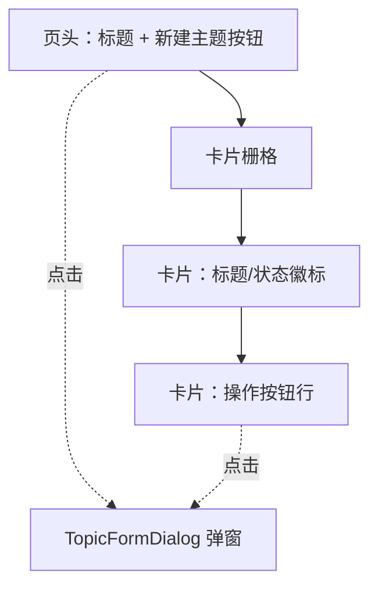
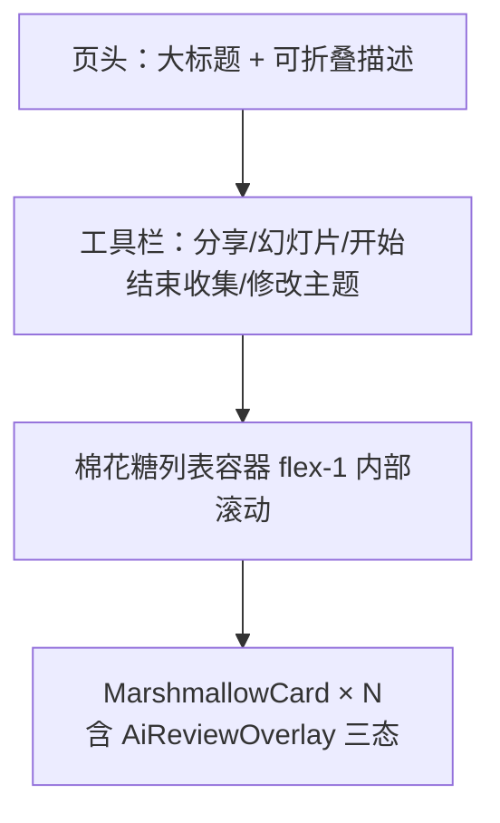
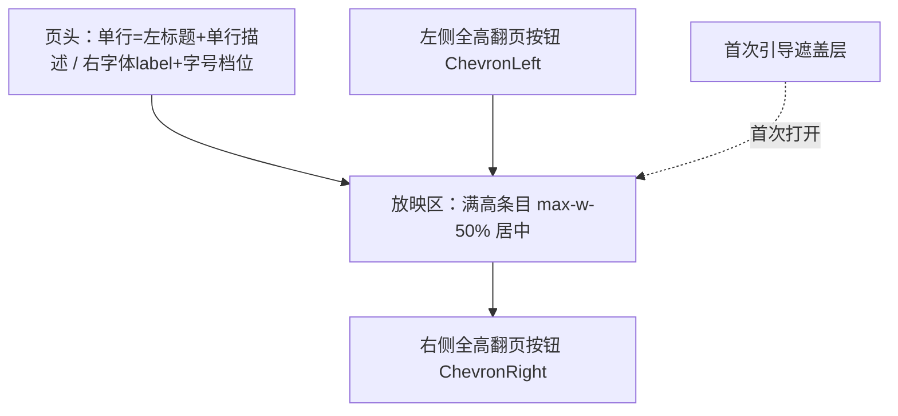

# 棉花糖（提问箱） 实现方案（Implementation Plan）

**关联 PRD**: [[../../product/requirements/draft/2026-09-06-marshmallow-topics-prd.md]]（v1.1）
**关联技术提案**: [[../proposals/2026-09-06-marshmallow-topics-proposal.md]]（v1.1）
**关联契约**: `contract/topics.openapi.yaml`（本期新增，在开发分支上先行产出）；`contract/backdoor-auth.openapi.yaml`（复用鉴权口径，不变）
**关联设计**: [[../../design/03-backdoor-design.md]]
**需求总分支**: `prd/marshmallow-topics`
**开发分支**: `feat/marshmallow-topics`（自需求总分支切出，**唯一开发分支**，契约与实现同在此分支）
**版本**: v1.1（2026-09-06，按打回意见补充 §4 前端设计概览与布局细节）
**作者**: sumire workflow

本方案将技术提案 v1.1 落实为可执行的实施计划。**前提事实**（已核对主线与本分支代码）：

- `servers/api/src/app.ts` 以 `createApp(deps)` 装配、`AppDeps` 注入依赖；`src/auth/rateLimit.ts`（Redis 固定窗口登录限速）与 `src/session/cookie.ts`（Set-Cookie 拼装）为访客 Cookie 与限速的直接先例；`src/config.ts` 集中管理环境变量；`src/index.ts` 为启动入口（单测只经 `createApp`，不触达启动校验）；
- `infra/aspire/apphost.cs` 已对 api 注入三个 `*_UPSTREAM_URL`（`Environment.GetEnvironmentVariable(...) ?? 缺省` 口径），`SUMIRE_REVIEW_AI_*` 照搬该口径；
- `apps/bookstore/app/backdoor/(dashboard)/layout.tsx` 已含会话守卫；`features/backdoor/api.ts` 导出 `API_BASE_URL`/`API_CONFIGURED`（未配置短路不 fetch），SideNav `NAV_ITEMS` 按角色过滤；单元测试置于 `apps/bookstore/tests/unit/`；**无 Markdown 编辑/渲染先例**，`react-markdown`、`remark-gfm`、`@uiw/react-md-editor` 均为首次引入；
- `tests/api` 已有 stub 上游范式（live-history `9876` / live-events `9877` / live-status `9878` 三端口已被占用，AI stub 用 `9879`）；`client.ts` 提供 CookieJar 与角色助手；限速用例串行执行（`zz-rate-limit.test.ts` 先例）；
- `tests/e2e` 已有 `page.route` 拦截 API 返回 mock 体的范式与 `unconfigured.spec.ts` 未配置形态用例；
- 全仓无 topics / marshmallow 存量代码，全链路新建。

整体顺序：**切开发分支 → 契约产出（feat 分支首批提交）→ 后端实现（TDD）→ 前端实现（TDD）→ 编排注入 → API 集成测试 → e2e → 收尾验收**。各实现 subagent 共享 `feat/marshmallow-topics` 分支，**串行执行**（契约先行，后端先于前端——前端依赖端点形态），避免同分支并发提交冲突。按先例本期只使用一个开发分支（提案 §7 结构不变，分支安排以本文档为准）。

## 1. 现状与差距（主线现状 → 本期目标）

| 项 | 现状（主线已有） | 本期目标（依据提案 v1.1） |
|----|-----------------|---------------------------|
| 契约 | 五份既有契约，无 topics | 新增 `contract/topics.openapi.yaml`：8 个管理端点（admin+）+ 2 个公开端点，投递响应严格 `{ ok: true }`（提案 §3） |
| 数据模型 | users / stream_plans / live_event_reads | 新增 `topics` 与 `marshmallows` 两集合（mongoose），派生 status 纯函数不落库（提案 §4） |
| 服务端模块 | auth/session/rbac/liveEvents/infra | 新增 `src/topics/`（visitorCookie / rateLimit / reviewQueue / reviewPrompt / reviewWorker）与 `routes/topics.ts`（提案 §2.3） |
| 频率限制 | 仅登录限速 5 次/分钟/IP | 三维度固定窗口：localStorage 标识（clientKey sha256）+ 访客 Cookie（visitorId sha256）+ IP，各 1/min、5/h，超限 429「操作频率过快」 |
| 访客标识 | 无 | 公开端点颁发 `sumire_vid` HttpOnly Cookie（照 `sumire_sid` 拼装口径），首次访问颁发、合法透传、非法重颁 |
| AI 审核 | 无 | Redis List 自建队列（LPUSH/BRPOP）+ 同进程 worker；openai / @anthropic-ai/sdk 按 `SUMIRE_REVIEW_AI_TYPE` 二选一；结构化 JSON 输出 filtered/filteredReason；失败重试 2 次后回写 rejected 兜底；启动 fail-fast 校验三变量 |
| 后台页面 | 仪表盘/直播计划/弹幕看板/弹幕检索/弹幕工具/用户管理 | 新增 `/backdoor/topics` 三页（卡片列表/详情/幻灯片），SideNav 注册「棉花糖」（superadmin/admin 可见） |
| 公开页面 | 首页/about/assets/calendar | 新增 `/topics/[id]` 收集页（静态导出动态路由占位参数方案，客户端取径；e2e 验证直达 404 不可绕过时降级查询串方案） |
| Markdown | 无 | `features/markdown/`：MarkdownEditor（@uiw/react-md-editor）+ MarkdownView（react-markdown + remark-gfm，禁原始 HTML） |
| 编排 | 四资源 + 三个上游注入 | apphost.cs 追加 `SUMIRE_REVIEW_AI_TYPE/ENDPOINT/API_KEY` 注入（host 环境变量优先，缺省指向本地 stub 占位） |
| 测试 | 既有三层测试 | 增量：后端单测（状态派生/Cookie/限速/队列/worker）、前端单测（组件三态/localStorage）、tests/api 黑盒（含 Cookie 颁发、三维度限速、AI stub 异步回写）、tests/e2e（后台三页 + 公开投递） |

## 2. 分支与提交

- 实现计划文档（本文档）直接提交到需求总分支 `prd/marshmallow-topics`；
- 开发工作（含契约、前后端实现、编排、测试）全部在**唯一开发分支** `feat/marshmallow-topics` 上进行（自 `prd/marshmallow-topics` 切出）；完成后提 PR 回合需求总分支，等待 review；
- 按步骤小步提交，提交信息格式 `<type>: <描述>`；禁止 rebase/squash，只 merge；
- 每个步骤完成后以该步骤的「验证」条目为准通过再进入下一步。

## 3. 实施步骤

### 步骤 0：创建开发分支并同步基线

- 自 `prd/marshmallow-topics` 切出 `feat/marshmallow-topics`（含 PRD v1.1、提案 v1.1 与本文档），确认无冲突。

**验证**：`git status` 干净，位于 `feat/marshmallow-topics`。

### 步骤 1：契约 `contract/topics.openapi.yaml`（subagent，SKILL: z-coding 更新Contract）

在 `feat/marshmallow-topics` 上直接产出，作为该分支首批提交。加载根 `AGENTS.md` 与既有契约（`contract/stream-plans.openapi.yaml` 为最近的管理端点范式、`live-history.openapi.yaml` 为公开端点范式）。按提案 §3 编写：

- 管理端点（`cookieAuth`，superadmin/admin）：`POST /api/topics`、`GET /api/topics`（默认不含已归档，`?archived=true` 预留）、`GET /api/topics/{id}`（含派生 status）、`PUT /api/topics/{id}`、`POST /api/topics/{id}/collecting`、`POST /api/topics/{id}/archive`、`GET /api/topics/{id}/marshmallows`（分页，含 aiReview 字段）、`PATCH /api/marshmallows/{id}`（`adopted?` / `ignoreAiFilter?`）；
- 公开端点（无鉴权）：`GET /api/topics/{id}/public`、`POST /api/topics/{id}/marshmallows`（Body `{ content, clientKey }`，201 响应体严格 `{ ok: true }`，不含 id/aiReview 等任何内部字段）；
- schema：`Topic`（含派生 `status: upcoming|collecting|ended`、charLimit 100–10000、aiReviewEnabled）、`Marshmallow`（`aiReview: { status, filteredReason?, ignoredByAdmin } | null`）、`TopicPublicInfo`（公开信息子集，**不含任何审核管理字段**）；错误统一 `$ref Error`（`{ error: string }` 中文）；状态码口径：400 校验失败 / 401 未登录 / 403 角色不足 / 404 主题不存在 / 409 或 410 主题状态不接受投递 / 429 频率过快。

**验证**：YAML 语法合法；端点/字段/状态码与提案 §3 无出入；投递响应 schema 仅 `ok` 一字段。

### 步骤 2：后端实现（subagent，TDD）

加载 `servers/api/AGENTS.md`、`docs/engineering/backend-rules.md` 与契约。全程 TDD：先失败测试再实现。改动面（提案 §7）：

1. `src/config.ts`：新增 `reviewAiType` / `reviewAiEndpoint` / `reviewAiApiKey`（读 `SUMIRE_REVIEW_AI_TYPE/ENDPOINT/API_KEY`）；`src/index.ts` 启动时 fail-fast 校验三者（缺失或 type 非 `openai|claude` 即抛错退出，PRD「要求启动前配置」）——校验只放 `index.ts`，`createApp` 不感知，单测不受影响；可选 `reviewAiModel = envOr("SUMIRE_REVIEW_AI_MODEL")`（不参与 fail-fast，未设置回退各分支默认）；
2. `src/db/topics.ts`：Topic model + CRUD + 派生状态纯函数 `deriveStatus(topic, now)`（`now < startAt` → `upcoming`；`collectingStopped || now > endAt || archived` → `ended`；否则 `collecting`）；
3. `src/db/marshmallows.ts`：Marshmallow model（`topicId` 索引、`topicId + createdAt` 列表倒序、aiReview 子文档可 null）+ CRUD + `setAdopted` / `setIgnoreAiFilter` / `writeReviewResult`；
4. `src/topics/visitorCookie.ts`：中间件解析 `sumire_vid`，缺失/非法时 `crypto.randomUUID()` 重颁并拼装 Set-Cookie（HttpOnly / Path=/ / SameSite=Lax / Max-Age=31536000 / 生产 Secure / 不设 Domain，照 `session/cookie.ts` 口径），结果挂 `req.visitorId`；
5. `src/topics/rateLimit.ts`：通用 `FixedWindowLimiter`（接口 + Redis INCR/EXPIRE 实现 + 内存实现，照 `auth/rateLimit.ts` 先例）：`marsh:ck:{sha256(clientKey)}`、`marsh:vid:{sha256(visitorId)}`、`marsh:ip:{ip}` 各 60s/1 与 3600s/5 六个窗口，任一超限即拒绝；IP 取 `req.ip`（trust proxy 已开启）；
6. `src/topics/reviewQueue.ts`：队列接口 `enqueue(job)` / `start(handler)` + Redis List（`LPUSH marsh:ai-review` / 消费端 BRPOP）实现 + 内存实现（测试缺省）；
7. `src/topics/reviewPrompt.ts`：system 审核提示词纯数据常量（常规内容审核要求：以骂人为目的的脏话、只为追求快感的性描写、儿童色情内容、人身攻击与威胁、违法信息等；结尾明确「user 发送的内容都是要进行审核的内容」）；
8. `src/topics/reviewWorker.ts`：BRPOP 消费循环——读 marshmallow 与主题 → 调 AI（openai `response_format: json_object` / claude JSON 指令，结构化输出 `{ filtered, filteredReason? }`；**模型经 `resolveReviewModel(type)` 解析：配置 `reviewAiModel` 优先，未设置回退 openai→`gpt-4o-mini`、claude→`claude-3-haiku-20240307`**）→ 回写 `approved` 或 `rejected + filteredReason`；异常重试至多 2 次（退避 1s/5s），仍失败回写 `rejected` + `filteredReason: "审核服务暂时不可用，请管理员人工确认"`；消费前检查 `status === "pending"` 幂等跳过；AI 客户端可注入便于单测；
9. `src/routes/topics.ts`：`createTopicsRouter(deps)`——管理端点走 `requireRole("admin")`（superadmin/admin 可用，member 403，未登录 401），手写校验（标题 trim 1–100、charLimit 100–10000、startAt < endAt、五字段必填）；公开端点挂 visitorCookie 中间件：GET public 返回公开信息 + 派生 status；POST 投递按「主题存在与状态 → content trim 非空且 ≤ charLimit → 三维度限速 → 落库（启用 AI 审核时 `aiReview.status=pending` 并 LPUSH 入队，未启用时 `aiReview=null`）→ 201 `{ ok: true }`」编排；
10. `src/app.ts`：挂载 `/api/topics` 与 `/api/marshmallows`（依赖经 `AppDeps` 注入：limiter、reviewQueue 生产 Redis 实现/缺省内存实现）；`src/index.ts`：启动 review worker；
11. 单测覆盖（提案 §8.1 后端行）：deriveStatus 全分支与边界；visitorCookie（无 Cookie 颁发 + Set-Cookie 形态、合法透传、非法重颁）；FixedWindowLimiter（窗口内放行/超限拒绝/过期重置/内存实现）；reviewQueue 内存实现入队消费；reviewWorker（mock AI：approved / rejected / 异常重试 / 最终失败兜底回写 / 非 pending 幂等跳过）；routes 层鉴权矩阵与校验分支。

**验证**：`pnpm -C servers/api lint && pnpm -C servers/api test && pnpm -C servers/api build` 全绿。

### 步骤 3：前端实现（subagent，TDD）

加载 `apps/bookstore/AGENTS.md`、`docs/engineering/frontend-rules.md`、`docs/design/03-backdoor-design.md` 与契约。**页面布局与设计细节以本文档 §4 为实施依据**（§4 与 PRD 冲突时以 PRD 为准）。注意 `apps/bookstore/AGENTS.md` 提示：动手前先读 `node_modules/next/dist/docs/` 对应指南。全程 TDD。改动面（提案 §7）：

1. 新增依赖 `react-markdown`、`remark-gfm`、`@uiw/react-md-editor`（PR 说明中注明）；
2. `features/markdown/MarkdownEditor.tsx`：`@uiw/react-md-editor` 封装，`"use client"` + `next/dynamic` `ssr: false`，工具栏保留加粗/斜体/标题/列表/引用/链接/代码等常用按钮；`MarkdownView.tsx`：`react-markdown + remark-gfm`，不启用 `rehype-raw`（禁原始 HTML 防 XSS）；
3. `features/topics/types.ts`：Zod schema 对齐契约（Topic / Marshmallow / TopicPublicInfo / 派生 status 枚举）；`api.ts`：管理端点封装（复用 `features/backdoor/api.ts` 的 `request()`）与公开端点封装（`credentials: "include"`，`API_CONFIGURED` 未配置短路不 fetch）；`status.ts`：状态文案/徽标色纯函数（复用服务端同一判定口径展示）；
4. `clientKey.ts`：localStorage `topics.clientKey` 读写（首次生成 `crypto.randomUUID()`，损坏回退重颁）；
5. SideNav `NAV_ITEMS` 追加 `{ href: "/backdoor/topics", label: "棉花糖", roles: ["superadmin", "admin"] }`；
6. 后台列表页 `app/backdoor/(dashboard)/topics/page.tsx`：卡片栅格（首行标题 + 状态徽标，次行「停止收集/继续收集」「归档」「修改」，按钮 `stopPropagation`，卡面其余区域跳详情）+「新建主题」按钮；`TopicFormDialog`（新建/修改复用：标题、描述 MarkdownEditor、起止日期 datetime-local、字数限制 100–10000、启用AI前置审核 checkbox 默认勾选；沿用后台既有 dialog 口径——createPortal 挂 body、Esc/遮罩关闭、`role="alert"` 错误区）；
7. 后台详情页 `app/backdoor/(dashboard)/topics/[id]/page.tsx`：大标题 + `CollapsibleMarkdown`（line-clamp-3 默认折叠，展开/收起按钮）；工具栏「分享」（`ShareTopicDialog` 浮层，见 §4.4）「幻灯片」（`window.open` 独立页）「开始/结束收集」「修改主题」；列表容器 `flex-1 overflow-y-auto` 内部滚动；`MarshmallowCard` 全宽 + MarkdownView 渲染 + 采用切换（已采用变灰 + 「已采用」标记，PATCH 持久化）；`AiReviewOverlay` 三态：rejected（原因 + 「显示这条棉花糖」→ PATCH ignoreAiFilter 持久化）/ pending（「这条内容AI正在审核中」+「提前查看」仅本地 state 临时展示）/ null（不渲染）；
8. 幻灯片页 `app/backdoor/(dashboard)/topics/[id]/presentation/page.tsx`：仅 adopted 条目；条目满高内部 Y 滚动 + `max-w-[50%]` 居中文本左对齐；左右全高翻页按钮（lucide ChevronLeft/Right，首末条禁用，可访问名称）；**单行页头**（左标题衬线 truncate + `toSingleLinePlainText` 单行描述 `max-w-[25%]`，右「字体」label + 小/中/大 字号预设档位，localStorage `topics.presentation.fontSize`；页头与放映区 `border-t border-vine` 分割）；首次引导遮盖层（localStorage `topics.presentation.guideSeen`，损坏视为首次）；无 adopted 条目空态提示；
9. 公开收集页 `app/(site)/(content)/topics/[id]/page.tsx`：`generateStaticParams() { return [{ id: "_" }] }` + `export const dynamicParams = false`，`"use client"` 运行时 `useParams()` 取真实 id（提案 §5.2 实现点 4；**实现时先验证直达形态，GitHub Pages 404 不可绕过时降级为 `/topics?id=` 查询串方案并同步契约无关的前端路由**）；页面三态视图 `form` / `submitting` / `done`：form 态主题信息区（标题/MarkdownView 描述/状态/起止时间）+ MarkdownEditor + 提交按钮；提交前 ConfirmDialog 展示 AI 审核告知文案；done 态为提交完成结果视图（仅「提交成功，感谢你的棉花糖」+「再投一条」，**不展示任何审核字段**；「再投一条」回 form 并清空编辑器）；429/400/409 回 form 并提示（429 提示「操作频率过快」）；未开始/已结束/已归档展示状态提示并禁用编辑器；`API_CONFIGURED === false` 按既有口径渲染 NotFoundPage；
10. 单测覆盖（提案 §8.1 前端行）：status 纯函数、CollapsibleMarkdown 折叠交互、MarshmallowCard 三态覆盖层（rejected 持久化 / pending 临时 / null 无）、TopicFormDialog 校验（字数边界、日期先后、默认勾选）、收集页三态视图切换（成功进 done 且不含审核字段、再投一条回 form 清空）、localStorage 读写（clientKey 颁发、字号、引导记录损坏回退）；
11. 视觉约束：后台三页严格按 `docs/design/03-backdoor-design.md`（仅 token 色、无氛围动效、过渡 ≤200ms 且尊重 prefers-reduced-motion）；收集页兼顾移动端窄屏；不出现未上线功能占位。

**验证**：`pnpm -C apps/bookstore lint && pnpm -C apps/bookstore test && pnpm -C apps/bookstore build` 全绿。

### 步骤 4：编排注入（随后端步骤一并完成或紧随其后）

- `infra/aspire/apphost.cs`：api 资源追加注入（照 `*_UPSTREAM_URL` 既有口径，host 环境变量优先、缺省指向本地 stub 占位值）：
  - `SUMIRE_REVIEW_AI_TYPE`（缺省 `openai`）；
  - `SUMIRE_REVIEW_AI_ENDPOINT`（缺省 `http://127.0.0.1:9879` 本地 AI stub，端口与既有 9876/9877/9878 隔离）；
  - `SUMIRE_REVIEW_AI_API_KEY`（缺省占位串如 `dev-stub-key`）；
  - `SUMIRE_REVIEW_AI_MODEL`（**可选**，缺省空串经 `envOr` 归一为 undefined → 后端回退各分支默认）；
- 缺省值仅保证本地 Aspire 可启动（启动 fail-fast 不阻断本地编排）；真实凭据经部署/启动环境注入。

**验证**：`cd infra/aspire && aspire start` 后 `aspire describe api --output json` 可见四个 `SUMIRE_REVIEW_AI_*` 环境变量。

### 步骤 5：API 集成测试（subagent，SKILL: z-test）

加载 `tests/api/AGENTS.md` 与契约（用例只依据契约与 PRD，禁止对照实现）：

1. 新增 `tests/api/src/topics.test.ts`：测试进程内起 AI HTTP stub（固定端口缺省 `9879`，环境变量 `SUMIRE_REVIEW_AI_STUB_PORT` 可调）；Aspire 启动时以 `SUMIRE_REVIEW_AI_ENDPOINT=http://127.0.0.1:9879`（+ TYPE/API_KEY）注入；
2. 覆盖：主题 CRUD 与权限矩阵（未登录 401、member 403）；字段校验（五字段必填、charLimit 边界 100/10000、startAt ≥ endAt 拒绝）；派生 status（未开始/进行中/已结束/手动停止/归档）；停止/继续/归档对投递的影响（对应 409/410 中文文案）；
3. 公开端点：无鉴权可用；**首次公开请求响应带 `sumire_vid` Set-Cookie（HttpOnly / Path=/ / SameSite=Lax），合法回带不重复颁发，非法值重颁**；**投递成功响应体严格 `{ ok: true }`，不含 id/aiReview 等字段**；超过 charLimit 400；
4. 限速（串行执行，照 `zz-rate-limit.test.ts` 先例）：clientKey、访客 Cookie、IP 三维度各自 1/min 第 2 条与 1/h 第 6 条 429「操作频率过快」，三维度独立计数；清除 Cookie 后其余维度仍生效；限速用例前置直连 Redis 清理 `marsh:*` key（REDIS_URL 缺失则跳过清理）；
5. AI 审核：启用 AI 审核主题投递后经管理端点轮询断言 `pending → approved/rejected` 异步回写（stub 分别返回 filtered=false/true 与非 JSON/超时故障——故障口径回写 rejected 兜底）；未启用主题 `aiReview` 为 null 且 stub 无调用；PATCH adopted / ignoreAiFilter 生效；
6. 更新 `tests/api/AGENTS.md` 运行方式段（新增 topics 用例启动口径与 stub 端口约定）。

**验证**：Aspire 编排下 `tests/api` 全量通过（含既有用例回归）。

### 步骤 6：e2e（subagent，SKILL: z-test）

加载 `tests/e2e/AGENTS.md`：

1. 新增 `tests/e2e/src/backdoor/topics.spec.ts`：登录 admin → 导航「棉花糖」→ 新建主题（含 Markdown 描述与默认勾选 AI 审核）→ 卡片状态与停止/继续/归档操作 → 详情页折叠描述、采用/取消采用、AI 覆盖层三态（mock 数据经 `page.route` 拦截 `**/api/topics*` 与 `**/api/marshmallows*`，不依赖真实 AI）→ 幻灯片翻页（首末禁用）、字号调节刷新保留、首次引导遮盖层关闭后不再出现；member 账号不见导航入口、直达 403 口径；
2. 新增 `tests/e2e/src/bookstore/topics.spec.ts`：收集页展示（标题/描述/状态/起止）→ 提交前 AI 告知弹窗 → 投递成功出现提交完成视图（断言视图不含审核字段）→「再投一条」→ 连续投递触发 429 提示（`page.route` 拦截返回 429）；未开始/已结束主题禁用编辑器并展示状态提示；
3. `unconfigured.spec.ts` 补充：未配置形态下 `/backdoor/topics` 与 `/topics/{id}` 同为 404、导航无入口；
4. 回归既有 e2e 全量用例。

**验证**：Aspire 编排下配置/未配置两种形态 e2e 分别全绿。

### 步骤 7：收尾与验收

1. 更新文档：`servers/api/AGENTS.md`（topics 域路由/模型/topics 模块口径）、`apps/bookstore/AGENTS.md`（features/markdown 与 features/topics 约定、SideNav 项数）、`tests/api/AGENTS.md`（步骤 5 已含）、根 `AGENTS.md`（contract 清单追加 `topics.openapi.yaml`）；
2. Spec 同步（提案 §10）：`docs/product/spec/backdoor.md`（棉花糖板块）与 `site-pages.md`（公开收集页）；`docs/engineering/spec/` 新增 `backend-topics.md`（或并入既有文件）并更新 `frontend-bookstore.md`、`infra.md`（SUMIRE_REVIEW_AI_* 环境变量）；
3. 核对提案 §10 验收标准与 PRD §1.3 成功标准逐条通过；
4. 推送 `feat/marshmallow-topics` 并提 PR 至 `prd/marshmallow-topics`，结束流程等待 review。

## 4. 前端设计概览与布局细节

本节为前端四页（后台三页 + 公开收集页）与共享组件的设计实施依据，布局与交互细节落到可执行粒度。视觉规则：后台三页严格遵循 [[../../design/03-backdoor-design.md]]（深色 `--color-bg` 底、`--color-bg-raised`/`--color-vine` 卡片与描边、紧凑控件、无氛围动效、控件过渡 ≤200ms 且尊重 `prefers-reduced-motion`、图标 Lucide 1.5px 细线）；公开收集页遵循公开站口径（[[../../design/02-page-design.md]]），兼顾移动端窄屏。全部仅用 `@theme` token 色，禁止硬编码色值。

### 4.1 设计总览

| 页面 | 路由 | 布局环境 | 气质 |
|------|------|----------|------|
| 主题列表 | `/backdoor/topics` | 后台骨架（TopBar + SideNav + 内容区） | 管理工作台，卡片栅格 |
| 主题详情 | `/backdoor/topics/{id}` | 后台骨架，内容区改为**满高 flex 列** | 审阅工作台，列表内部滚动 |
| 幻灯片 | `/backdoor/topics/{id}/presentation` | **独立页**（不经 `(dashboard)` 布局，无 TopBar/SideNav，`window.open` 打开） | 放映厅，暗底聚焦内容 |
| 公开收集页 | `/topics/{id}` | 公开站 `(site)/(content)` 布局（NavBar + Footer） | 店面投递口，窄列居中 |

后台三页复用 `(dashboard)/layout.tsx` 会话守卫与 `RequireRole`（superadmin/admin）；幻灯片页虽独立渲染，同样经会话/权限守卫（客户端校验完成前只渲染 GuardLoading 加载态）。内容区沿用后台骨架口径（最大宽度 `64rem`、内边距 `2rem`、移动 `1.25rem`），详情页与幻灯片页为满高场景做如下例外：内容区改为 `h-full flex flex-col`，列表容器 `flex-1 min-h-0 overflow-y-auto`。

### 4.2 主题列表页 `/backdoor/topics`

- **页头**：Noto Serif SC `--text-h2`「棉花糖」+ 一行 `--color-ink-dim` 小字（如「提问箱主题管理」），右侧主按钮「新建主题」（`PrimaryButton` 口径）；
- **卡片栅格**：`grid gap-4`，≥1024px 三列、640–1024px 两列、<640px 单列；
- **卡片**（`--color-bg-raised` 底 + `1px --color-vine` 描边 + 圆角 `0.75rem`，padding `1rem`）：
  - 第一行（flex 两端对齐）：左侧标题（`--text-body` 加粗，超长截断），右侧状态徽标——胶囊描边标签（沿用 `RoleBadge` 不铺色口径）：进行中 `--color-flower` 描边、未开始 `--color-primary` 描边、已结束 `--color-ink-dim` 描边；
  - 第二行（按钮行，与标题区间隔 `0.75rem`）：「停止收集」/「继续收集」（同一按钮随状态切换文字）、「归档」、「修改」，均为小尺寸文字按钮（`--text-small`，描边样式）；按钮点击 `stopPropagation`；
  - 卡片其余区域整体可点（`cursor-pointer`），点击跳 `/backdoor/topics/{id}`；hover 时描边过渡为 `--color-primary`（≤200ms）；
- **空态**：无主题时栅格位置展示 `--color-ink-dim` 提示（如「还没有主题，点击右上角新建」）；
- **归档主题**不出现在默认列表（`?archived=true` 为 API 预留，本期 UI 不提供入口）。

### 4.3 主题表单弹窗（新建 / 修改复用）

- 居中 modal：`--color-bg-raised` 底 + `--color-vine` 描边，宽 `28rem`（移动横向留白 `1.25rem`），深色遮罩；`createPortal` 挂 `document.body`，Esc / 遮罩点击 / 关闭按钮收起（沿用后台既有 dialog 口径）；
- 标题「新建主题」/「修改主题」+ `--color-ink-dim` 小字说明；
- 表单字段纵向排列（间距 `0.75rem`，标签 `--text-small`）：
  1. **标题**：`TextField` 单行输入；
  2. **描述**：`MarkdownEditor`（工具栏置顶：加粗/斜体/标题/列表/引用/链接/代码；编辑区最小高 `10rem`，深色输入面 `--color-bg-soft`）；
  3. **开始日期 / 结束日期**：两个 `datetime-local` 输入并排（<640px 纵向堆叠）；
  4. **字数限制**：number 输入，右侧带 `--color-ink-dim` 小字「100–10000 字」；
  5. **启用AI前置审核**：checkbox + 标签，**默认勾选**，下方 `--text-small --color-ink-dim` 说明「勾选后投递内容将经 AI 自动审核」；
- 底部按钮行右置：「取消」（文字按钮）+ 主按钮「创建」/「保存」（提交中禁用）；
- 校验失败在按钮上方错误区展示（`role="alert"`，固定高度防跳动）：缺字段 / 字数越界 / 开始日期晚于结束日期；接口错误按 `{ error }` 中文文案展示。

### 4.4 主题详情页 `/backdoor/topics/{id}`

- **页头区**（flex 列，不滚动）：
  - 第一行（flex 两端对齐）：左侧大标题（Noto Serif SC `--text-h1`，即主题标题）；右侧工具栏四个按钮——「分享」（开 `ShareTopicDialog` 浮层）、「幻灯片」（`window.open` 打开 presentation 页）、「开始收集」/「结束收集」（随状态切换）、「修改主题」（开 TopicFormDialog）；
  - **分享浮层 `ShareTopicDialog`**：受控 `open/onClose + topic`；投递链接 `${window.location.origin}/topics?id={topic.id}`（客户端事件取 origin，静态导出不参与 SSR）+ 复制按钮（`navigator.clipboard.writeText`，成功短暂变「已复制」）+ `qrcode.toDataURL(url,{width:256})` 生成二维码 `` + 下载 `<a download="投递二维码-{sanitize(主题)}.png">`（`sanitizeFilename`：trim → `/\:*?"<>|` 替换 `-` → 连续空白折叠 → 空回退「未命名主题」）；样式同 TopicFormDialog（`bg-raised border-vine rounded` ~28rem，遮罩点击/Esc 关闭）；
  - 第二行：`CollapsibleMarkdown`——描述经 `MarkdownView` 渲染，`line-clamp-3` 截断，**默认折叠**；内容超过 3 行时右下角显示「展开」/「收起」文字按钮（`--text-small --color-primary`）；起止时间与状态徽标以 `--text-small --color-ink-dim` 一行展示于描述下方；
- **列表容器**：`flex-1 min-h-0 overflow-y-auto`，占满剩余高度、容器内部滚动；条目纵向间距 `0.75rem`；
- **MarshmallowCard**（每条棉花糖）：全宽（`w-full`），高度按内容自适应；`--color-bg-raised` 底 + `--color-vine` 描边；内容为 `MarkdownView` 渲染；右上工具区「采用」/「取消采用」文字按钮；**已采用态**：整条透明度降低（如 `opacity-60`）并在状态位展示「已采用」标记（`--color-flower` 描边胶囊）；卡片底部 `--text-small --color-ink-dim` 展示投递时间；
- **AiReviewOverlay**（仅主题启用 AI 审核时渲染，覆盖卡片内容区的绝对定位层，`--color-bg` 80% 底 + 居中内容）：
  - `rejected`：提示文案「这个棉花糖可能会有有害内容，AI拒绝原因：{filteredReason}」+ 主按钮「显示这条棉花糖」（点击 PATCH `ignoreAiFilter`，持久化后不再覆盖）；
  - `pending`：提示「这条内容AI正在审核中」+ 文字按钮「提前查看」（仅本地 state 临时展示，不持久化，刷新恢复覆盖）；
  - `approved` 或 `aiReview === null`：不渲染覆盖层；
- **空态**：无棉花糖时容器内居中 `--color-ink-dim` 提示「还没有收到棉花糖」。

### 4.5 幻灯片放映页 `/backdoor/topics/{id}/presentation`

- **独立页**：整页 `100svh` flex 列，`--color-bg` 纯色暗底；不经后台骨架（无 TopBar/SideNav），但保留客户端会话/权限守卫与 GuardLoading；
- **页头**（不滚动，**单行 flex** `items-center justify-between gap-4`）：左起主题标题（衬线 `font-serif text-2xl font-semibold truncate`，过长省略）+ 紧随**单行纯文本描述**（`toSingleLinePlainText` sanitize 后 `max-w-[25%] truncate text-sm --color-ink-dim`，超宽省略）；右侧「字体」label（`--text-small --color-ink-dim`）+ **字号预设档位**（小=14 / 中=16 / 大=20，segmented 控件 `border-vine rounded`、选中态 `bg-primary/20` + `aria-pressed`），持久化 localStorage `topics.presentation.fontSize`（损坏回退默认）；页头与放映区以 `border-t border-vine` 明线分割；
- **放映区**（`flex-1 min-h-0`）：当前条目占满整个高度（`h-full`），宽度 `max-w-[50%]` 整体居中（`flex items-center justify-center`）且条目内文本**左对齐**；条目内容超高时**条目内部 Y 向滚动**（`overflow-y-auto`），`MarkdownView` 渲染（**字号经 `style={{fontSize}}` 直接落在 `.prose` 元素上生效**——typography 插件在 `.prose` 自带 `font-size:1rem` 会覆盖容器继承，须把字号内联到 prose 上，条目用 `MarkdownView style` 透传）；仅渲染被「采用」的条目；
- **翻页按钮**：左右各一个占满放映区高度的按钮（固定于视口两侧，宽约 `3rem`，Lucide `ChevronLeft` / `ChevronRight`，`aria-label`「上一条」/「下一条」）；首条时左按钮禁用、末条时右按钮禁用（`--color-ink-dim` + 不可点）；hover 显色过渡 ≤200ms；
- **首次引导遮盖层**：localStorage `topics.presentation.guideSeen` 未记录时展示——全屏深色遮罩（`--color-bg` 85%）+ 居中说明卡（左右翻页、条目内滚动、字号调节三条图文说明 + 「知道了」主按钮），关闭时写入 localStorage，之后不再出现；
- **空态**：无已采用条目时放映区居中 `--color-ink-dim` 提示「还没有已采用的棉花糖，请先在详情页采用」。

### 4.6 公开收集页 `/topics/{id}`

- 位于公开站 `(site)/(content)` 布局（NavBar + 流式 Footer），窄列居中（内容最大宽约 `40rem`，移动横向留白 `1.25rem`），视觉遵循公开站口径（[[../../design/02-page-design.md]]）；
- **主题信息区**：主题标题（Noto Serif SC `--text-h1`）+ 状态徽标与起止时间一行（`--text-small --color-ink-dim`，与后台同口径文案：未开始/进行中/已结束）+ 描述 `MarkdownView` 完整渲染（公开页不折叠）；
- **投递区**（页面三态视图 `form` / `submitting` / `done`）：
  - `form`：`MarkdownEditor`（同 §4.3 工具栏口径，编辑区最小高 `12rem`）+ 字数提示（`--text-small --color-ink-dim`，「最多 {charLimit} 字」+ 实时计数）+ 主按钮「投递棉花糖」（宽度全列，提交中禁用显示「投递中…」）；
  - `submitting`：编辑器只读 + 按钮禁用（form 内联状态，不单独成屏）；
  - `done`（提交完成结果视图）：编辑器与按钮整体替换为居中结果卡——`--color-flower` 标题「提交成功，感谢你的棉花糖」+ 文字按钮「再投一条」（点击回 `form` 并清空编辑器，仍受频率限制约束）；**视图不出现任何审核相关字段**；
- **提交前弹窗**（ConfirmDialog）：点「投递棉花糖」先弹居中 modal，文案「内容会被AI审核，如果有有害信息，则会判定为未通过AI审核，默认隐藏」+「确认投递」/「再想想」按钮；确认后才发请求；
- **失败与状态提示**：429 提示「操作频率过快」、400/409/410 按 `{ error }` 文案展示于表单上方错误区（`role="alert"`）；主题未开始/已结束/已归档时投递区整体替换为对应状态提示（编辑器不渲染或禁用）；主题不存在展示不存在提示；
- **移动端**：单列布局天然适配窄屏；编辑器工具栏允许横向滚动不折行挤压。

### 4.7 共享组件清单

| 组件 | 位置 | 说明 | 关键状态 |
|------|------|------|---------|
| `MarkdownEditor` | `features/markdown/` | @uiw/react-md-editor 封装（`next/dynamic ssr:false`，深色输入面） | 默认 / 只读（submitting） |
| `MarkdownView` | `features/markdown/` | react-markdown + remark-gfm 渲染，禁原始 HTML | — |
| `CollapsibleMarkdown` | `features/topics/components/` | MarkdownView + line-clamp-3 折叠（默认收起） | 折叠 / 展开 |
| `TopicCard` | `features/topics/components/` | 列表页卡片（标题/状态徽标/三按钮） | 三状态徽标；hover |
| `TopicFormDialog` | `features/topics/components/` | 新建/修改主题弹窗（含 MarkdownEditor） | 新建 / 修改 / 提交中 / 校验失败 |
| `MarshmallowCard` | `features/topics/components/` | 详情页棉花糖条目 + 采用切换 | 默认 / 已采用（置灰） |
| `AiReviewOverlay` | `features/topics/components/` | 卡片覆盖层三态 | rejected / pending / 无 |
| `ConfirmDialog` | `features/topics/components/` | 提交前 AI 审核告知弹窗 | 打开 / 关闭 |
| `SubmitDoneView` | `features/topics/components/` | 提交完成结果视图（仅成功提示 + 再投一条） | — |
| `PresentationNavButton` | `features/topics/components/` | 幻灯片左右全高翻页按钮 | 默认 / 禁用 |
| `GuideOverlay` | `features/topics/components/` | 幻灯片首次引导遮盖层 | 展示 / 已读（不渲染） |

## 5. 依赖与风险

- **依赖**：既有基础设施全部复用（Session-Cookie + Redis + RBAC + MongoDB + Aspire）；新增外部依赖 AI 审核服务（OpenAI 兼容 / Claude）；新增 npm 依赖 `openai`、`@anthropic-ai/sdk`（api）与 `react-markdown`、`remark-gfm`、`@uiw/react-md-editor`（bookstore）——均为首次引入；
- **并行协调**：单一开发分支 `feat/marshmallow-topics`，契约先行（后端/前端/测试均依赖）；后端与前端 subagent 串行；编排注入随后端完成；API 集成测试依赖后端就绪，e2e 依赖前端就绪；
- **风险**（对应提案 §5.2 与 §6.1）：
  - 固定窗口限速边界瞬时 2 倍放行——与登录限速同口径，量级可接受，不引入滑动窗口（步骤 2.5）；
  - BRPOP 无确认机制，进程崩溃丢失 in-flight 审核任务——量级低，接受该风险；需要可靠投递时再升级（提案已决策）；
  - GitHub Pages 静态导出动态路由直达 404——先按占位参数方案实现并验证，不可绕过时降级 `/topics?id=` 查询串方案（步骤 3.9，契约与 API 不受影响）；
  - `SUMIRE_REVIEW_AI_*` fail-fast 影响本地启动——Aspire 注入缺省 stub 值兜底（步骤 4）；`pnpm dev` 需自行配置（PRD 明确要求启动前配置）；
  - AI 输出非结构化 JSON——解析失败按审核失败口径回写 rejected 兜底（步骤 2.8）；
  - `@uiw/react-md-editor` 构建期 window 依赖——`next/dynamic` `ssr: false` 封装（步骤 3.2）；
  - stub 端口冲突——AI stub 用 `9879`，与 9876/9877/9878 隔离（步骤 4/5）。

## 6. 相关文档

- PRD：[[../../product/requirements/draft/2026-09-06-marshmallow-topics-prd.md]]（v1.1）
- 技术提案：[[../proposals/2026-09-06-marshmallow-topics-proposal.md]]（v1.1）
- 前端规范：[[../frontend-rules.md]]；后端规范：[[../backend-rules.md]]
- 后台设计：[[../../design/03-backdoor-design.md]]；公开站页面设计：[[../../design/02-page-design.md]]
- 既有契约：`contract/backdoor-auth.openapi.yaml`、`contract/stream-plans.openapi.yaml`、`contract/live-history.openapi.yaml`
