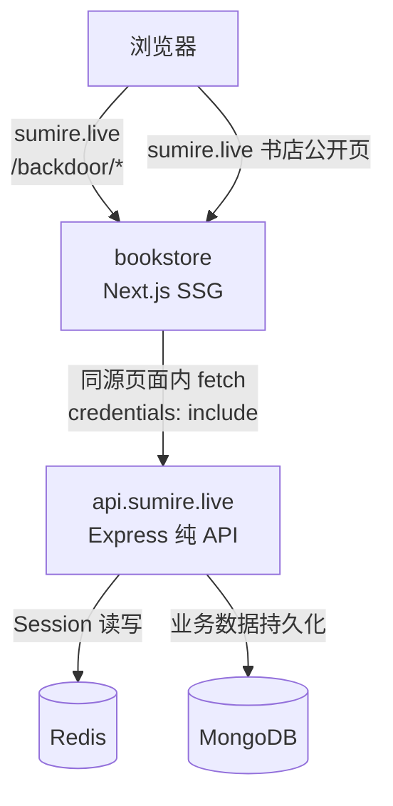
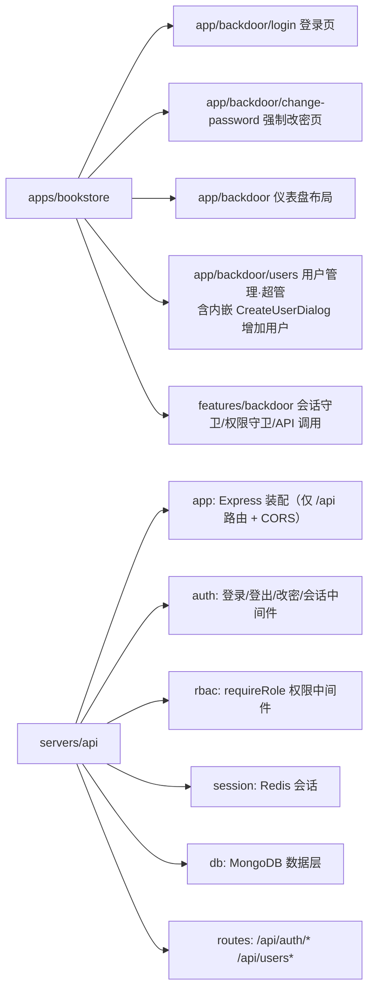

# 枝堇Sumire 后台系统 V1 - 技术提案

**功能名称**: 后台系统 V1——登入登出、角色体系与用户管理
**关联 PRD**: [[../product/requirements/draft/2026-08-12-backdoor-auth-prd.md]]
**关联设计**: [[../design/03-backdoor-design.md]]
**技术提案版本**: v1.3
**创建日期**: 2026-08-12
**作者**: ash
**feat-branch**: `feat/backdoor-auth`

## 修订记录

| 版本 | 日期 | 说明 |
|------|------|------|
| v1.0 | 2026-08-12 | 初版：Express + Session/Redis + MongoDB + Aspire 编排 |
| v1.1 | 2026-08-12 | 重写：补充 OpenAPI 契约；测试策略展开为 API/e2e 集成测试方案 |
| v1.2 | 2026-08-12 | 返工修订：后台页面并入 `apps/bookstore`（`/backdoor` 路由前缀）；`servers/api` 只提供 API |
| v1.3 | 2026-08-12 | 返工修订：引入角色体系（superadmin/admin/member）与权限中间件；新增用户管理（`GET /api/users`，仅超管）、增加用户（`POST /api/users`，按角色降级创建）、修改密码（`POST /api/auth/change-password`）；首次登录强制改密（`mustChangePassword`）；密码强度规则（≥12 位，含字母、数字、符号）；契约与测试用例同步扩充 |

## 1. 概述

### 1.1 背景

书店站点为纯静态（Next.js SSG，GitHub Pages 托管），不具备服务端能力。随着后续管理功能（素材、档案、弹幕后台等）推进，需要一个受保护的独立后台，且账号体系需支持多角色协作而不开放注册。V1 建立「鉴权 + 角色体系 + 用户管理 + 后台界面框架」骨架：**后台页面作为书店应用的 `/backdoor` 路由区实现**（与公开内容路由隔离、保持 SSG），**服务端能力由独立后端 `servers/api` 以纯 API 形式提供**。

### 1.2 目标

- 登入/登出，不开放注册；会话 7 天有效，多端同时在线、各自独立登出；
- 角色体系：`superadmin` > `admin` > `member`；用户管理（列表）仅超管；增加用户按角色降级创建（超管任意，admin 仅 member）；
- 首次登录强制修改密码；密码强度规则：≥ 12 位且含字母、数字、符号；
- 账号等业务数据持久化到 MongoDB，Redis 仅承担会话与限速等临时状态；
- 后台页面归属书店（`/backdoor` 前缀），后端只提供 API、不托管任何页面；
- 本地开发统一由 Aspire 编排（bookstore + api + Redis + MongoDB）。

### 1.3 范围

- 做：`apps/bookstore` 新增 `/backdoor` 路由区（登录页、强制改密页、仪表盘布局、用户管理——含内嵌「增加用户」dialog）、`servers/api`（Express 纯 API：鉴权 + 用户管理 + 权限中间件）、书店页脚「管理 →」入口、Redis 会话存储、MongoDB 持久化、API 契约（OpenAPI）、Aspire 编排、API 集成测试与 e2e 测试工程；
- 不做：自助注册、找回密码、删除/停用用户、修改他人密码、任何具体业务管理功能、占位导航、后端对前端页面的任何形式的托管。

## 2. 技术架构

### 2.1 系统架构图



后台页面（HTML/JS）全部由书店应用以 `/backdoor` 路由提供；页面内通过 `fetch(..., { credentials: "include" })` 调用 `api.sumire.live` 的 API。`servers/api` 只暴露 `/api/*`，不返回任何页面。

### 2.2 技术栈

| 层级 | 技术选型 | 说明 |
|------|---------|------|
| 后台页面 | Next.js（书店应用内 `/backdoor` 路由，SSG + 客户端会话/权限守卫） | `apps/bookstore/app/backdoor/*`，复用书店设计 token 与组件体系 |
| 后端框架 | Node.js + Express 5 + TypeScript（strict） | `servers/api`，纯 API 服务 |
| 鉴权方案 | **Session-Cookie + Redis 会话存储** | 服务端会话，7 天 TTL，多端独立 |
| 权限模型 | 角色层级中间件 `requireRole` | superadmin > admin > member，服务端强制 |
| 会话存储 | ioredis + Redis | 会话即 Redis key，TTL 天然过期 |
| 业务数据 | MongoDB（Mongoose） | 账号、后台业务数据持久化 |
| 密码存储 | bcrypt | 哈希存储，不落明文 |
| API 契约 | OpenAPI 3.1（YAML） | `contract/backdoor-auth.openapi.yaml`，见 §3.3 |
| 防爆破 | express-rate-limit（Redis 存储） | 登录接口限速 |
| 单元测试 | Vitest | `servers/api` 与 `apps/bookstore` 各自内部 |
| 集成测试 | Vitest（API，`tests/api`）+ Playwright（e2e，`tests/e2e`） | 详见 §8 |
| 编排 | Aspire（C# AppHost，`infra/aspire`） | bookstore + api + Redis + MongoDB 容器，见 §7 |
| 包管理 | pnpm workspace | `servers/*`、`apps/*`、`tests/*` 纳入 workspace |

### 2.3 鉴权方案选型（决策）

| 维度 | Session-Cookie + Redis（选择） | JWT |
|------|------|------|
| 登出立即失效 | ✅ 删除 Redis 会话即失效 | ❌ 服务端无法撤销，需黑名单 |
| 多端独立会话 | ✅ 每端一个 Session | ⚠️ 需管理 refresh/黑名单 |
| 会话过期控制 | ✅ Redis TTL = 7 天 | ✅ 依赖 exp |
| 实现复杂度 | 低（express-session） | 中（签发/校验/续期/撤销） |
| 适合场景 | 受控多角色、服务端可控 | 开放注册、无状态横向扩展 |

**结论**：本项目不开放注册、账号由管理者创建、要求登出立即可失效，且已引入 Redis —— Session-Cookie 是更简单可靠的方案。会话 id 存放于 httpOnly Cookie，服务端数据仅存 Redis。

### 2.4 模块划分



**守卫模型（关键决策）**：书店保持 SSG，无服务端渲染能力，因此守卫在**客户端**完成，分两层——

1. **会话守卫**：`/backdoor` 下所有页面加载后先渲染加载态，调用 `GET /api/auth/me`；401 跳转 `/backdoor/login`；返回 `mustChangePassword: true` 时跳转 `/backdoor/change-password`（改密页除外，避免循环）；
2. **权限守卫**：`/backdoor/users`（需 superadmin）在 `me` 返回后按 `role` 判定，不满足则跳转仪表盘（无权限提示）；「增加用户」以用户管理页内 dialog 形式内嵌（`CreateUserDialog`），不设独立路由；导航按 `role` 渲染对应入口。

机密性完全由 API 层保证：页面静态产物可公开缓存，用户数据一律经 API 获取并独立鉴权（401/403），页面隐藏入口只是体验层。

## 3. API 设计

### 3.1 接口总览

| 方法 | 路径 | 说明 | 权限 | 请求体 | 响应 |
|------|------|------|------|--------|------|
| POST | `/api/auth/login` | 登录 | 公开 | `{ username, password }` | 200 `{ ok, username, role, mustChangePassword }` + Set-Cookie；401 凭据错误；429 限速 |
| POST | `/api/auth/logout` | 登出（删除当前会话，幂等） | 公开 | — | 200 `{ ok }`，清除 Cookie |
| GET | `/api/auth/me` | 当前会话与角色信息 | 已登录 | — | 200 `{ ok, username, role, mustChangePassword }`；401 未登录 |
| POST | `/api/auth/change-password` | 修改自己的密码 | 已登录 | `{ oldPassword, newPassword }` | 200 `{ ok }`；400 强度不达标 / 与原密码相同；401 原密码错误 |
| GET | `/api/users` | 用户列表 | superadmin | — | 200 `{ users: [{ username, role, createdAt }] }`；403 权限不足 |
| POST | `/api/users` | 创建用户 | superadmin（任意角色）/ admin（仅 member） | `{ username, password, role }` | 201 `{ ok, username, role }`；400 参数/强度不合法；403 越权；409 用户名已存在 |

约定：

- 所有错误响应均为 `{ error: string }`，提示语为中文；
- 登录失败（401）不区分账号错误与密码错误；
- `logout` 幂等：无会话/会话已失效时同样返回 200 并清除 Cookie；
- 权限不足一律 403（已登录但角色不够），未登录一律 401；
- `servers/api` 仅暴露 `/api/*` 前缀路由，其余路径一律 404。

### 3.2 会话、密码与权限模型

- **会话存储**：Redis key `session:<id>`，value 为 JSON `{ userId, username, role, createdAt, lastSeenAt }`，TTL = 7 天，每次校验通过时滑动刷新；
- **会话 id**：`crypto.randomUUID()` 生成，不可猜测；
- **Cookie**：`sumire_sid`，`HttpOnly`、`Path=/`、`SameSite=Lax`；生产 `Secure`；`Max-Age` 7 天；**不设置 `Domain`**（host-only，落在 `api.sumire.live`）；
- **跨域模型**：页面在 `sumire.live`、API 在 `api.sumire.live`，同 site（eTLD+1 相同）跨源。`SameSite=Lax` 按 site 判定，`credentials: "include"` 的 fetch 可携带 Cookie；CORS 对 `CORS_ORIGINS` 白名单返回精确 `Access-Control-Allow-Origin`（禁用 `*`）+ `Access-Control-Allow-Credentials: true`；
- **密码强度规则**（`change-password` 的 `newPassword` 与 `POST /api/users` 的 `password` 统一执行，服务端为准）：长度 ≥ 12，且必须同时包含字母（a-zA-Z）、数字（0-9）、符号（字母数字外可见字符）。校验失败返回 400，提示缺失项；
- **改密约束**：`newPassword` 与 `oldPassword` 相同返回 400「新密码不能与原密码相同」；`oldPassword` 校验失败返回 401「原密码错误」；改密成功后将用户 `mustChangePassword` 置 `false` 并以新哈希落库，当前会话保持有效（其他端会话 V1 不下线）；
- **强制改密**：`users.mustChangePassword = true` 的账号（初始超管、被创建的新用户）登录成功但响应标记 `mustChangePassword: true`；页面守卫将其限制在改密页（见 §2.4），`change-password` 是该状态下唯一有副作用的写接口；
- **权限中间件**：`requireRole("superadmin")` 保护 `GET /api/users`；`POST /api/users` 内按创建者角色判定目标角色合法性——superadmin 可创建任意角色，admin 仅可创建 member，member 403；角色不在枚举内返回 400；
- **密码存储**：bcrypt 哈希持久化于 MongoDB `users` 集合；初始超管密码 `salamander` 的哈希由 `BACKDOOR_PASSWORD_HASH` 注入（仅种子），首次登录即被强制替换；
- **防爆破**：登录接口按 IP 限速 5 次/分钟（Redis 计数，窗口 60s），超限 429。

### 3.3 API 契约（OpenAPI）

契约式开发：鉴权与用户管理 API 的 OpenAPI 3.1 规范作为单一事实源，放置在 `contract/backdoor-auth.openapi.yaml`。实现与 `tests/api` 集成测试都以契约为准——测试用例只依据契约与 PRD 编写，禁止对照 `servers/` 实现编写（避免射箭画靶）。契约骨架：

```yaml
openapi: 3.1.0
info:
  title: sumire backdoor auth
  version: 1.3.0
paths:
  /api/auth/login:
    post:
      summary: 登录
      requestBody:
        required: true
        content:
          application/json:
            schema:
              type: object
              required: [username, password]
              properties:
                username: { type: string }
                password: { type: string }
      responses:
        "200":
          description: 登录成功，Set-Cookie 写入会话
          headers:
            Set-Cookie:
              schema: { type: string }
              description: sumire_sid=<id>; HttpOnly; Path=/; SameSite=Lax; Max-Age=604800（生产含 Secure）
          content:
            application/json:
              schema: { $ref: "#/components/schemas/MeOk" }
        "401": { $ref: "#/components/responses/InvalidCredentials" }
        "429": { $ref: "#/components/responses/RateLimited" }
  /api/auth/logout:
    post:
      summary: 登出（幂等，删除当前会话）
      responses:
        "200":
          description: 会话已删除，Set-Cookie 立即过期
          content: { application/json: { schema: { $ref: "#/components/schemas/Ok" } } }
  /api/auth/me:
    get:
      summary: 当前会话与角色信息
      responses:
        "200":
          description: 已登录
          content: { application/json: { schema: { $ref: "#/components/schemas/MeOk" } } }
        "401": { $ref: "#/components/responses/Unauthorized" }
  /api/auth/change-password:
    post:
      summary: 修改自己的密码（改密成功后 mustChangePassword=false）
      requestBody:
        required: true
        content:
          application/json:
            schema:
              type: object
              required: [oldPassword, newPassword]
              properties:
                oldPassword: { type: string }
                newPassword: { type: string, description: "≥12 位，含字母、数字、符号，且不同于原密码" }
      responses:
        "200":
          description: 修改成功
          content: { application/json: { schema: { $ref: "#/components/schemas/Ok" } } }
        "400": { $ref: "#/components/responses/BadRequest" }
        "401": { $ref: "#/components/responses/WrongOldPassword" }
  /api/users:
    get:
      summary: 用户列表（仅 superadmin）
      responses:
        "200":
          description: 用户列表
          content:
            application/json:
              schema:
                type: object
                properties:
                  users:
                    type: array
                    items: { $ref: "#/components/schemas/User" }
        "401": { $ref: "#/components/responses/Unauthorized" }
        "403": { $ref: "#/components/responses/Forbidden" }
    post:
      summary: 创建用户（superadmin 任意角色；admin 仅 member）
      requestBody:
        required: true
        content:
          application/json:
            schema:
              type: object
              required: [username, password, role]
              properties:
                username: { type: string }
                password: { type: string, description: "初始密码，≥12 位，含字母、数字、符号" }
                role: { $ref: "#/components/schemas/Role" }
      responses:
        "201":
          description: 创建成功（新用户 mustChangePassword=true）
          content:
            application/json:
              schema:
                type: object
                properties:
                  ok: { type: boolean, const: true }
                  username: { type: string }
                  role: { $ref: "#/components/schemas/Role" }
        "400": { $ref: "#/components/responses/BadRequest" }
        "401": { $ref: "#/components/responses/Unauthorized" }
        "403": { $ref: "#/components/responses/Forbidden" }
        "409": { $ref: "#/components/responses/Conflict" }
components:
  schemas:
    Role:   { type: string, enum: [superadmin, admin, member] }
    Ok:     { type: object, properties: { ok: { type: boolean, const: true } } }
    MeOk:
      type: object
      properties:
        ok: { type: boolean, const: true }
        username: { type: string }
        role: { $ref: "#/components/schemas/Role" }
        mustChangePassword: { type: boolean }
    User:
      type: object
      properties:
        username: { type: string }
        role: { $ref: "#/components/schemas/Role" }
        createdAt: { type: string, format: date-time }
    Error:  { type: object, properties: { error: { type: string } } }
  responses:
    InvalidCredentials:
      description: 账号或密码错误
      content: { application/json: { schema: { $ref: "#/components/schemas/Error" } } }
    Unauthorized:
      description: 未登录或会话已失效
      content: { application/json: { schema: { $ref: "#/components/schemas/Error" } } }
    WrongOldPassword:
      description: 原密码错误
      content: { application/json: { schema: { $ref: "#/components/schemas/Error" } } }
    BadRequest:
      description: 参数不合法（含密码强度不达标、新密码与原密码相同、角色非法）
      content: { application/json: { schema: { $ref: "#/components/schemas/Error" } } }
    Forbidden:
      description: 已登录但角色权限不足
      content: { application/json: { schema: { $ref: "#/components/schemas/Error" } } }
    Conflict:
      description: 用户名已存在
      content: { application/json: { schema: { $ref: "#/components/schemas/Error" } } }
    RateLimited:
      description: 尝试过于频繁
      content: { application/json: { schema: { $ref: "#/components/schemas/Error" } } }
```

## 4. 路由规划

后台页面与书店同站（`sumire.live` 的 `/backdoor` 前缀），API 挂在 `api.sumire.live`；`servers/api` 只提供 API。

| 路由 | 提供方 | 说明 |
|------|--------|------|
| `https://sumire.live/backdoor/login` | bookstore | 登录页（静态页面，无需会话） |
| `https://sumire.live/backdoor/change-password` | bookstore | 修改密码页（需会话；强制改密时唯一可达页） |
| `https://sumire.live/backdoor` | bookstore | 仪表盘（需会话，客户端守卫） |
| `https://sumire.live/backdoor/users` | bookstore | 用户管理（需会话 + superadmin 权限守卫） |
| `https://sumire.live/backdoor/users` | bookstore | 用户管理（需会话 + superadmin 权限守卫）；「增加用户」为页内 dialog，无独立路由 |
| `https://api.sumire.live/api/auth/*`、`/api/users` | api | 鉴权与用户管理 API（仅 `/api` 前缀，其余 404） |
| 书店 `/` | bookstore | 页脚右下角「管理 →」链接跳转同站 `/backdoor` |

页面与 API 为同 site 跨源：会话 Cookie host-only 落在 `api.sumire.live`，书店页面以 `credentials: "include"` 调用 API 时携带；api 通过 `CORS_ORIGINS` 白名单 + `Allow-Credentials` 放行书店来源（见 §3.2、§7.2）。

## 5. 数据模型

- **MongoDB（业务数据持久化）**：
  - `users`：`{ username, passwordHash, role, mustChangePassword, createdAt }`；`role ∈ { superadmin, admin, member }`；种子超管 `supersumire`（`role: "superadmin"`，`mustChangePassword: true`）；`POST /api/users` 创建的用户 `mustChangePassword: true`；
  - 后续管理功能（素材、档案等）的集合在此扩展。
- **Redis（临时状态）**：
  - 会话：`session:<id>` → JSON `{ userId, username, role, createdAt, lastSeenAt }`，TTL 7 天，滑动过期；
  - 登录限速：`login:<ip>` 计数，窗口 60 秒。
- 账号初始化：启动时若 `users` 集合无超管记录，以环境变量 `BACKDOOR_USERNAME` / `BACKDOOR_PASSWORD_HASH`（bcrypt）种子插入（`mustChangePassword: true`）；已存在则不覆盖。

## 6. 项目结构

```
sumire/
├── contract/
│   └── backdoor-auth.openapi.yaml  # 鉴权 + 用户管理 API 契约（§3.3）
├── servers/
│   └── api/                        # Express 纯 API 后端（无页面托管）
│       ├── src/
│       │   ├── index.ts            # 服务入口
│       │   ├── app.ts              # Express 装配（仅挂载 /api 路由 + CORS）
│       │   ├── auth/               # 登录/登出/改密/会话中间件
│       │   ├── rbac/               # requireRole 权限中间件
│       │   ├── session/            # Redis 会话
│       │   ├── db/                 # MongoDB 连接与模型（users）
│       │   └── routes/             # /api/auth/*、/api/users
│       ├── tests/                  # 单元测试（Vitest）
│       └── package.json
├── apps/
│   └── bookstore/                  # 书店 + 后台页面（/backdoor 路由区）
│       ├── app/
│       │   └── backdoor/
│       │       ├── login/          # 登录页（静态）
│       │       ├── change-password/# 修改密码页（强制改密落地页）
│       │       ├── users/          # 用户管理（超管；内含 CreateUserDialog 增加用户）
│       │       └── page.tsx        # 仪表盘（布局 + 守卫）
│       ├── features/backdoor/      # 会话守卫、权限守卫、API 调用（credentials: include）
│       └── components/             # 复用书店组件体系 + 后台布局组件（顶栏/侧栏）
├── tests/
│   ├── api/                        # API 集成测试（Vitest，见 §8.2）
│   └── e2e/                        # e2e 集成测试（Playwright，见 §8.3）
├── infra/aspire/                   # AppHost（编排 bookstore + api + Redis + MongoDB）
└── docs/
```

`/backdoor` 路由区与书店公开页共享构建与部署，通过独立的路由分组与布局与公开内容隔离；公开页导航不出现后台入口（仅页脚「管理 →」链接）。

## 7. 编排方案（Aspire）

本地开发由 Aspire 统一编排，AppHost 位于 `infra/aspire/apphost.cs`（C# 单文件，Aspire 13 SDK）。V1 编排 bookstore、api、Redis、MongoDB 四个资源，实现一条命令启动全部依赖。现有 `apphost.cs` 仅含 bookstore，本方案按 §7.2 扩展。

### 7.1 资源清单

| 资源名 | 类型 | 说明 |
|--------|------|------|
| `bookstore` | Next.js App | 书店（含 `/backdoor` 页面），`AddNextJsApp` + `.WithPnpm()` |
| `api` | Node.js App | 纯 API 后端，`AddNodeApp("api", "../../servers/api", ...)` |
| `redis` | Redis 容器 | 会话与限速存储 |
| `mongodb` | MongoDB 容器 | 业务数据持久化 |

### 7.2 依赖与注入

- `api` 通过 `.WithReference(redis)` / `.WithReference(mongodb)` 注入连接配置（`ConnectionStrings__redis` / `ConnectionStrings__mongodb` 由 api 侧映射为 `REDIS_URL` / `MONGODB_URL`），`WaitFor(redis)` / `WaitFor(mongodb)` 确保存储就绪后再启动；
- `api` 使用 `.WithHttpEndpoint(env: "PORT")` 暴露 http 端点；
- **跨域白名单**：`api` 必须 `.WithReference(bookstore)`，将 bookstore 的 http endpoint 以 `CORS_ORIGINS` 注入（需同时放行凭证，见 §3.2）；本地为书店 dev server 地址，生产替换为 `https://sumire.live`；
- **bookstore 感知 api 地址**：`.WithReference(api)` 将 api 端点以 `NEXT_PUBLIC_API_BASE_URL` 注入 bookstore；生产为 `https://api.sumire.live`；
- `api` 所需环境变量（`SESSION_SECRET`、`BACKDOOR_PASSWORD_HASH` 等）由 `.WithEnvironment()` 注入。

```csharp
// infra/aspire/apphost.cs（目标形态示意）
#:sdk Aspire.AppHost.Sdk@13.4.6
#:package Aspire.Hosting.JavaScript@*
#:package Aspire.Hosting.Redis@*
#:package Aspire.Hosting.MongoDB@*

#pragma warning disable ASPIREJAVASCRIPT001

var builder = DistributedApplication.CreateBuilder(args);

var redis = builder.AddRedis("redis");
var mongodb = builder.AddMongoDB("mongodb");

var api = builder.AddNodeApp("api", "../../servers/api", "server.js")
    .WithHttpEndpoint(env: "PORT")
    .WithExternalHttpEndpoints()
    .WithReference(redis).WaitFor(redis)
    .WithReference(mongodb).WaitFor(mongodb)
    .WithEnvironment("SESSION_SECRET", "dev-secret")
    .WithEnvironment("BACKDOOR_USERNAME", "supersumire")
    .WithEnvironment("BACKDOOR_PASSWORD_HASH", "<dev bcrypt hash>");

var bookstore = builder
    .AddNextJsApp("bookstore", "../../apps/bookstore", runScriptName: "dev")
    .WithPnpm()
    .WithHttpEndpoint(env: "PORT")
    .WithExternalHttpEndpoints()
    .WithReference(api)
    .WithEnvironment("NEXT_PUBLIC_API_BASE_URL", api.GetEndpoint("http"));

// api 的 CORS 白名单引用 bookstore 端点（声明在 bookstore 之后）
api.WithEnvironment("CORS_ORIGINS", bookstore.GetEndpoint("http"));

builder.Build().Run();
```

### 7.3 本地启动

```bash
cd infra/aspire
aspire start
```

启动后 `aspire describe` 应展示四个资源全部 `Running/Healthy`；访问 bookstore 端点的 `/backdoor` 即后台，api 端点仅提供 `/api/*`。

### 7.4 验证要点

- `aspire restore` 恢复依赖、`aspire start` 启动、`aspire describe` 确认资源状态；
- bookstore 与 api、redis、mongodb 均健康；未登录访问 `/backdoor` 跳转登录页；
- 跨域校验：api 的 `CORS_ORIGINS` 为 bookstore 端点，书店来源的带凭证请求被允许，其他来源被拒绝；api 直接访问非 `/api` 路径返回 404。

## 8. 测试策略

测试分三层：单元测试随实现走（Vitest，各包内部）；**API 集成测试**与 **e2e 集成测试**为独立工程（`tests/api`、`tests/e2e`），只依据契约与 PRD 编写用例，禁止对照实现编写。集成测试运行依赖 Aspire 拉起完整环境，目标 endpoint 通过 `aspire describe` 获取并以环境变量注入测试工程。

### 8.1 测试范围与验收追踪

测试范围 = PRD §3.2 验收标准（AC-1 ~ AC-27）+ 契约中的全部接口行为。每条 AC 至少被一条集成用例覆盖：

| AC | 描述摘要 | 覆盖位置 |
|----|---------|---------|
| AC-1 | 未登录访问 `/backdoor` 跳转登录页 | e2e `auth-redirect` |
| AC-2 | 正确凭据登录进入后台首页 | e2e `login-success`、api `login-200` |
| AC-3 | 错误凭据提示且不区分原因 | e2e `login-failure`、api `login-401` |
| AC-4 | 无自助注册入口 | api `no-register-route`（契约外路径 404） |
| AC-5 | 7 天内刷新保持登录 | api `session-persist`、e2e `login-success` 含 reload |
| AC-6 | 后台可点击登出 | e2e `logout-entry` |
| AC-7 | 登出后会话立即失效 | e2e `logout-invalidates`、api `logout-200` |
| AC-8 | 多端会话独立 | api `multi-session` |
| AC-9 | 布局为顶栏 + 侧栏 + 内容区 | e2e `dashboard-layout` |
| AC-10 | 仪表盘欢迎语、无占位 | e2e `dashboard-content` |
| AC-11 | 视觉与书店一致 | e2e `visual-sanity` |
| AC-12~14 | 书店页脚「管理 →」链接 | e2e `bookstore-footer-link` |
| AC-15 | 首次登录强制改密，未改密限制在改密页 | e2e `force-change-password`、api `me-flag` |
| AC-16 | 新密码同原密码 / 强度不达标被拒 | api `change-password-400` 系列、e2e `change-password-invalid` |
| AC-17 | 改密成功进入后台且不再强制 | e2e `change-password-success`、api `change-password-200` |
| AC-18 | 新用户首次登录同样强制改密 | api `create-user-then-first-login`、e2e `new-user-force-change` |
| AC-19 | 超管可见用户管理列表 | e2e `users-list-superadmin`、api `users-list-200` |
| AC-20 | 非超管不可见/不可用用户管理 | e2e `users-list-hidden`、api `users-list-403` |
| AC-21 | 超管可创建任意角色 | api `create-user-superadmin` |
| AC-22 | 管理员仅可创建成员 | api `create-user-admin-member` / `create-user-admin-403` |
| AC-23 | 成员无创建能力 | api `create-user-member-403`、e2e `nav-by-role` |
| AC-24 | 创建参数校验（强度/空/重名） | api `create-user-400` / `create-user-409` |
| AC-25~26 | 密码强度规则 | api `password-policy` 用例组 |
| AC-27 | 导航按角色渲染 | e2e `nav-by-role` |
| — | 登录限速 429 | api `login-rate-limit` |
| — | Cookie 安全属性 | api `cookie-attributes` |
| — | api 不托管页面（纯 API） | api `api-only-surface` |
| — | CORS 凭证与白名单 | api `cors-credentials` |

### 8.2 API 集成测试（`tests/api`）

- **技术选型**：TypeScript + Vitest + `fetch`（Node 22 内置），手工维护 Cookie jar（从 `Set-Cookie` 解析 `sumire_sid`，随后续请求回带）。不引入 supertest——测试目标是**运行中的服务**而非 Express app 实例，与契约的黑盒定位一致；
- **目录结构**：

```
tests/api/
├── src/
│   └── api/
│       ├── client.ts               # fetch 封装：baseURL、Cookie jar、JSON/Origin 助手
│       ├── login.test.ts           # 登录用例
│       ├── logout.test.ts          # 登出用例
│       ├── session.test.ts         # 会话/me/限速用例
│       ├── change-password.test.ts # 改密与密码强度用例
│       ├── users.test.ts           # 用户列表/创建与权限矩阵用例
│       └── surface.test.ts         # 服务边界：纯 API 表面、CORS
├── tests/api/AGENTS.md             # 工程约定（创建时写入）
├── package.json
└── vitest.config.ts
```

- **用例清单**（依据契约 §3.3 与 PRD，黑盒；测试基态：超管 `supersumire` / 初始密码，以及用例内按需创建的账号——创建类用例一律先以超管登录）：

| 用例 | 步骤 | 断言 |
|------|------|------|
| `login-200` | POST `/api/auth/login` 正确凭据 | 200；`{ ok, username, role, mustChangePassword }` 字段齐全；含 `Set-Cookie: sumire_sid=...` |
| `cookie-attributes` | 同上，解析 Set-Cookie | 含 `HttpOnly`、`Path=/`、`SameSite=Lax`、`Max-Age=604800`；不含 `Domain`；生产含 `Secure` |
| `login-401` | 错误密码 / 不存在用户各一次 | 均 401；`{ error }` 文案相同，均为"账号或密码错误"；不下发 Cookie |
| `login-400` | 缺 `username` 或 `password` 字段 | 4xx + `{ error }` |
| `no-register-route` | POST `/api/auth/register`（契约外） | 404 |
| `me-200` | 登录后带 Cookie GET `/api/auth/me` | 200，含 `username`/`role`/`mustChangePassword` |
| `me-401` | 无 Cookie / 伪造 sid | 401 `{ error }` |
| `me-flag` | 初始密码登录后 `me` | `mustChangePassword: true`；改密后为 `false` |
| `session-persist` | 登录后间隔再次请求 `me` | 连续两次 200（TTL 滑动刷新的可用性间接断言） |
| `logout-200` | 登录 → logout → 带原 Cookie 请求 `me` | logout 200；Set-Cookie 使 `sumire_sid` 过期；后续 `me` 401 |
| `logout-idempotent` | 未登录直接 logout | 200（幂等） |
| `multi-session` | 同一凭据登录两次得 sid₁/sid₂；sid₁ logout | sid₂ `me` 仍 200，sid₁ `me` 401 |
| `login-rate-limit` | 同 IP 1 分钟内连续 6 次错误登录 | 前 5 次 401，第 6 次 429 `{ error }` |
| `change-password-200` | 初始密码登录 → 改密（合规新密码） → `me` → 旧密码登录 / 新密码登录 | 改密 200；`me.mustChangePassword=false`；旧密码登录 401，新密码登录 200 |
| `change-password-same-as-old` | `newPassword` = `oldPassword` | 400 `{ error }`「新密码不能与原密码相同」 |
| `change-password-wrong-old` | `oldPassword` 错误 | 401 `{ error }`「原密码错误」 |
| `password-policy`（用例组） | `newPassword` 分别：长度 11 / 纯字母+数字 ≥12 / 缺数字 / 缺符号 / 合规对照 | 前四类 400 且提示对应规则；对照 200。同一规则组在 `POST /api/users` 的初始密码上复验一遍 |
| `users-list-200` | 超管登录 GET `/api/users` | 200；`users` 数组元素含 `username`/`role`/`createdAt`；含 `supersumire` |
| `users-list-403` | admin / member 登录后 GET `/api/users` | 403 `{ error }` |
| `users-list-401` | 未登录 GET `/api/users` | 401 |
| `create-user-superadmin` | 超管分别创建 member / admin / superadmin | 均 201 `{ ok, username, role }`；`GET /api/users` 可见新用户 |
| `create-user-admin-member` | admin 创建 member | 201 |
| `create-user-admin-403` | admin 创建 admin / superadmin | 403 `{ error }` |
| `create-user-member-403` | member 创建任意角色 | 403 |
| `create-user-400` | 角色枚举外 / 用户名为空 / 初始密码强度不达标 | 400 `{ error }` |
| `create-user-409` | 创建已存在用户名 | 409 `{ error }`「用户名已存在」 |
| `create-user-then-first-login` | 超管创建 member → 新用户初始密码登录 → `me` | 登录 200 且 `mustChangePassword: true` |
| `api-only-surface` | GET `/`、`/backdoor`、`/backdoor/login` | 一律 404；`GET /api/auth/me` 可达（401 而非 404） |
| `cors-credentials` | 带 `Origin: <bookstore>` 的预检与实际请求 | 预检返回精确 `Access-Control-Allow-Origin`（非 `*`）+ `Allow-Credentials: true`；非白名单 Origin 无 CORS 头 |

- **测试数据隔离**：创建类用例使用带随机后缀的用户名（如 `t_<uuid8>`），避免用例间冲突；改密类用例只操作本用例创建的账号，不改 `supersumire` 种子的密码（保留基态供其他用例使用）；限速用例放在最后执行（或独立 `describe.sequential`）。
- **运行方式**：

```bash
cd infra/aspire && aspire start          # 拉起 bookstore + api + redis + mongodb
aspire describe api --output json         # 取 api 的 http endpoint
aspire describe bookstore --output json   # 取 bookstore 端点（CORS 用例的 Origin）
cd tests/api && API_BASE_URL=http://localhost:<port> \
  BOOKSTORE_ORIGIN=http://localhost:<bookstore-port> \
  pnpm vitest run
```

`API_BASE_URL` 为必需环境变量，`BOOKSTORE_ORIGIN` 仅 CORS 用例需要；测试运行前用 `GET /api/auth/me` 轮询等待服务就绪（超时 30s）。

- **分支与评审**：基于开发分支创建 `test/<slug>` 分支编写用例，提 PR（description 附用例清单）评审通过后再运行；失败用例由 subagent 按 `docs/engineering` 与契约修复，修复落在同一 test 分支，全绿后合并回开发分支。

### 8.3 e2e 集成测试（`tests/e2e`）

- **技术选型**：Playwright（与 bookstore 现有 e2e 选型一致）；测试目标只有一个前端应用——bookstore（公开页 + `/backdoor` 后台页面），API 行为在 `tests/api` 覆盖；
- **目录结构**：

```
tests/e2e/
├── src/
│   ├── backdoor/
│   │   ├── auth.spec.ts             # 守卫重定向、登录成功/失败、登出
│   │   ├── change-password.spec.ts  # 强制改密流程
│   │   ├── users.spec.ts            # 用户管理/增加用户/角色导航
│   │   └── dashboard.spec.ts        # 布局、欢迎语、视觉走查
│   ├── bookstore/
│   │   └── footer-link.spec.ts      # 页脚「管理 →」入口
│   └── tools/                       # 排查用临时脚本（不入用例集）
├── playwright.config.ts
├── tests/e2e/AGENTS.md              # 工程约定（创建时写入）
└── package.json
```

- **用例清单**（依据 PRD 验收标准与设计文档）：

| 用例 | 覆盖 AC | 操作路径与断言 |
|------|--------|--------------|
| `auth-redirect` | AC-1 | 未登录访问 `BOOKSTORE_BASE_URL/backdoor` → 加载态后 URL 变为 `/backdoor/login`，登录表单可见 |
| `login-success` | AC-2、AC-5 | 已完成改密的账号登录 → 进入 `/backdoor`，欢迎语可见；`page.reload()` 后仍在仪表盘 |
| `login-failure` | AC-3 | 错误密码 → 停留登录页，出现"账号或密码错误"；密码框清空可重试 |
| `force-change-password` | AC-15 | 初始密码账号登录 → URL 落在 `/backdoor/change-password`；直接访问 `/backdoor`、`/backdoor/users` 均被引导回改密页 |
| `change-password-invalid` | AC-16、AC-25 | 改密页提交：新密码=原密码 / 弱密码（长度不足、缺符号等）→ 分别出现对应错误提示，停留改密页 |
| `change-password-success` | AC-17 | 提交合规新密码 → 进入 `/backdoor`；登出后用新密码登录直接进仪表盘，不再强制改密 |
| `new-user-force-change` | AC-18 | 超管创建成员 → 新账号初始密码登录 → 落在改密页 |
| `users-list-superadmin` | AC-19、AC-21 | 超管登录 → 导航含「用户管理」；打开列表可见 `supersumire` 及新建账号的用户名/角色/创建时间；创建管理员账号成功并出现在列表 |
| `users-list-hidden` | AC-20 | 管理员/成员登录 → 导航无「用户管理」；直接访问 `/backdoor/users` 被引导回仪表盘 |
| `create-user-by-admin` | AC-22 | 超管在用户管理页打开「增加用户」dialog → 角色选项含管理员/成员；创建成员成功 |
| `nav-by-role` | AC-23、AC-27 | 三种角色分别登录核对导航：成员仅「仪表盘」；管理员仅「仪表盘」；超管另有「用户管理」 |
| `dashboard-layout` | AC-9 | 顶部栏（站点名 + 登出）、左侧导航、内容区齐全 |
| `dashboard-content` | AC-10 | 欢迎语（含"欢迎回来"）可见，无占位文案 |
| `visual-sanity` | AC-11 | 根元素背景 `--color-bg`（`#16121c`）、主按钮应援色系；附整页截图供人工核对 |
| `logout-entry` / `logout-invalidates` | AC-6、AC-7 | 点击「登出」→ 回登录页；再访问 `/backdoor` 重新跳登录页 |
| `bookstore-footer-link` | AC-12~14 | 书店首页页脚右下角「管理 →」链接 `href` 为 `/backdoor`；点击落在后台登录页 |

- **编写标准**：每条用例编写阶段必须有截图验证——操作前一张、操作完成后一张；调试完成后移除截图逻辑，仅保留断言行（`visual-sanity` 截图保留为 artifact）。Cookie 属性、CORS 头、权限矩阵的接口层断言在 API 测试中覆盖，e2e 不重复。
- **测试数据**：e2e 依赖的「已完成改密的超管」「管理员」「成员」账号由 `globalSetup` 通过 API 准备（超管改密一次 + 创建两个角色账号），用户名带运行标识后缀，避免与 `tests/api` 基态相互污染。
- **运行方式**：

```bash
cd infra/aspire && aspire start
aspire describe bookstore --output json  # bookstore endpoint（页面 + 后台同站）
cd tests/e2e && BOOKSTORE_BASE_URL=http://localhost:<bookstore-port> pnpm playwright test
```

`playwright.config.ts` 不使用 `webServer` 自动拉起（服务由 Aspire 统一管理），`BOOKSTORE_BASE_URL` 由环境变量注入。

- **分支与评审**：同 API 测试流程——`e2e/<slug>` 分支、PR 附用例清单评审、失败修复同分支、全绿合并。

### 8.4 单元测试（实现侧）

- `servers/api`：bcrypt 校验、密码强度校验函数（长度/字母/数字/符号各分支）、会话中间件、`requireRole` 权限矩阵（各角色 × 各受保护路由）、创建用户的角色降级规则、改密的 same-as-old 与 wrong-old 分支、限速计数、种子插入幂等、非 `/api` 路径 404；
- `apps/bookstore`：登录/改密/创建用户表单状态（提交中禁用、错误提示、强度规则提示）、会话守卫（me 200/401/mustChangePassword 三分支）、权限守卫（role 判定与导航渲染）、页脚「管理 →」链接渲染。

## 9. 部署方案

### 9.1 环境规划

| 环境 | 用途 | 部署方式 |
|------|------|---------|
| 本地开发 | 联调 | Aspire 编排：bookstore + api + Redis + MongoDB 容器 |
| 生产 | 书店 + 后台页面 | `apps/bookstore` 静态产物托管于 `sumire.live`（SSG 不变，`/backdoor` 页面为静态页 + 客户端守卫） |
| 生产 | 鉴权与用户管理 API | `servers/api` 独立进程托管于 `api.sumire.live`，配套 Redis/MongoDB，仅暴露 `/api/*` |

### 9.2 配置管理

| 变量 | 说明 |
|------|------|
| `REDIS_URL` | Redis 连接串（api） |
| `MONGODB_URL` | MongoDB 连接串（api） |
| `CORS_ORIGINS` | CORS 允许来源（api；本地为 bookstore 端点，生产为 `https://sumire.live`） |
| `BACKDOOR_USERNAME` | 初始超管用户名（默认 `supersumire`，仅首次种子，`mustChangePassword=true`） |
| `BACKDOOR_PASSWORD_HASH` | 初始超管密码 bcrypt 哈希（仅首次种子；首次登录即被强制改密替换） |
| `SESSION_SECRET` | 会话签名密钥 |
| `COOKIE_SECURE` | 生产置 true |
| `NEXT_PUBLIC_API_BASE_URL` | 书店页面调用 API 的 base URL（bookstore；本地为 api 端点，生产为 `https://api.sumire.live`） |

## 10. 验收标准

- [ ] 未登录访问 `/backdoor` 跳转 `/backdoor/login`（客户端守卫）
- [ ] 登录成功进入仪表盘；错误凭据提示"账号或密码错误"
- [ ] 初始密码账号首次登录被强制改密；新密码须不同于原密码且满足强度规则（≥12 位，含字母、数字、符号）
- [ ] 用户管理（列表）仅超管可见/可用；非超管页面与接口均被拒（403）
- [ ] 超管可创建任意角色用户；管理员仅可创建成员；成员无创建能力
- [ ] 新创建用户首次登录同样强制改密
- [ ] 登出后会话立即失效；多端各自独立；会话 7 天有效，`HttpOnly` Cookie，登录接口限速 5 次/分钟
- [ ] 书店页脚右下角「管理 →」链接可跳转同站 `/backdoor`
- [ ] `servers/api` 仅提供 `/api/*`，非 API 路径一律 404，不托管任何页面
- [ ] CORS 白名单精确来源 + 放行凭证，非白名单来源被拒绝
- [ ] `contract/backdoor-auth.openapi.yaml` 与实现一致
- [ ] 单元测试 + `tests/api` + `tests/e2e` 全绿；Aspire 本地编排可一键启动

## 11. 相关文档

- PRD：[[../product/requirements/draft/2026-08-12-backdoor-auth-prd.md]]
- 后台设计：[[../design/03-backdoor-design.md]]
- 视觉识别：[[../design/01-visual-identity.md]]
- 前端规范：[[frontend-rules.md]]
