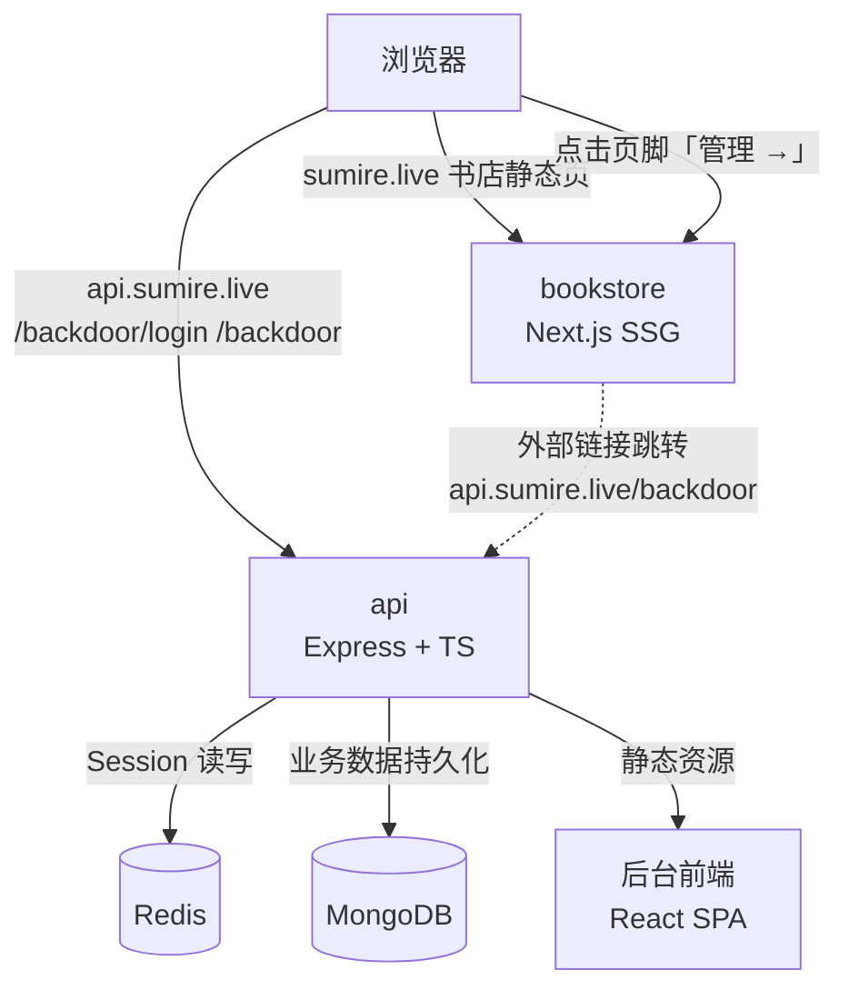
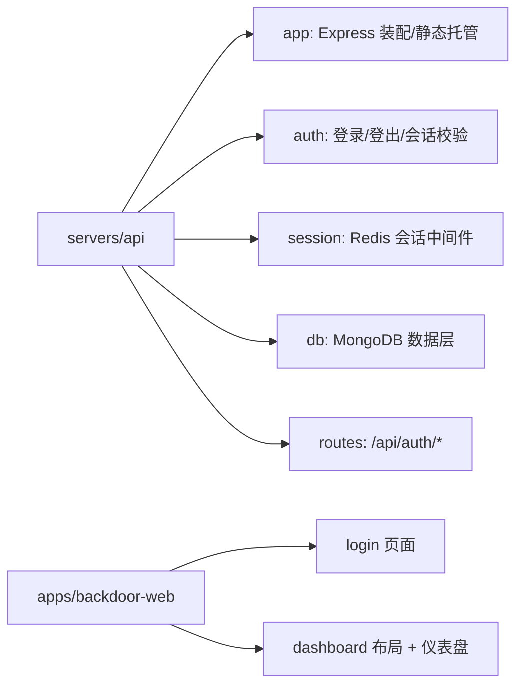

# 枝堇Sumire 后台系统 V1 - 技术提案

**功能名称**: 后台系统 V1——登入登出
**关联 PRD**: [[../product/requirements/draft/2026-08-12-backdoor-auth-prd.md]]
**技术提案版本**: v1.0
**创建日期**: 2026-08-12
**作者**: ash
**feat-branch**: `feat/backdoor-auth`

## 1. 概述

### 1.1 背景

书店站点为纯静态（Next.js SSG，GitHub Pages 托管），不具备服务端能力。随着后续管理功能（素材、档案、弹幕后台等）推进，需要一个受保护的独立后台。V1 建立「鉴权 + 后台界面框架」骨架，为后续管理功能提供统一入口。

### 1.2 目标

- 提供登入/登出能力，不开放注册，超管单账号（`supersumire`）；
- 会话 7 天有效，允许多端同时在线、各自独立登出；
- 账号等业务数据持久化到 MongoDB，Redis 仅承担会话与限速等临时状态；
- 后台与书店路由/服务相互独立，互不阻塞发布；
- 本地开发统一由 Aspire 编排（bookstore + api + Redis + MongoDB）。

### 1.3 范围

- 做：`servers/api`（Express 后端 + 鉴权）、后台前端框架（登录页 + 仪表盘布局）、书店页脚「管理 →」入口、Redis 会话存储、MongoDB 持久化、Aspire 编排；
- 不做：注册、多管理员账号、任何具体管理功能、占位导航。

## 2. 技术架构

### 2.1 系统架构图



后台前端为 React SPA，构建产物由 `servers/api` 静态托管；书店仅提供入口链接，不感知后台状态。

### 2.2 技术栈

| 层级 | 技术选型 | 说明 |
|------|---------|------|
| 后端框架 | Node.js + Express 5 + TypeScript（strict） | `servers/api` |
| 鉴权方案 | **Session-Cookie + Redis 会话存储** | 服务端会话，7 天 TTL，多端独立 |
| 会话存储 | ioredis + Redis | 会话即 Redis key，TTL 天然过期 |
| 业务数据 | MongoDB（Mongoose） | 账号、后台业务数据持久化 |
| 密码存储 | bcrypt | 哈希存储，不落明文 |
| 后台前端 | React + Vite + Tailwind CSS v4 | `apps/backdoor-web`，复用书店设计 token |
| 防爆破 | express-rate-limit（Redis 存储） | 登录接口限速 |
| 测试 | Vitest（单元）+ Playwright（E2E） | |
| 编排 | Aspire（C# AppHost，`infra/aspire`） | bookstore + api + Redis + MongoDB 容器，见 §7 |
| 包管理 | pnpm workspace | `servers/*`、`apps/*` 纳入 workspace |

### 2.3 鉴权方案选型（决策）

| 维度 | Session-Cookie + Redis（选择） | JWT |
|------|------|------|
| 登出立即失效 | ✅ 删除 Redis 会话即失效 | ❌ 服务端无法撤销，需黑名单 |
| 多端独立会话 | ✅ 每端一个 Session | ⚠️ 需管理 refresh/黑名单 |
| 会话过期控制 | ✅ Redis TTL = 7 天 | ✅ 依赖 exp |
| 实现复杂度 | 低（express-session） | 中（签发/校验/续期/撤销） |
| 适合场景 | 单一超管、服务端可控 | 开放注册、无状态横向扩展 |

**结论**：本项目不开放注册、仅超管单账号、要求登出立即可失效，且已引入 Redis —— Session-Cookie 是更简单可靠的方案。会话 id 存放于 httpOnly Cookie，服务端数据仅存 Redis。

### 2.4 模块划分



## 3. API 设计

### 3.1 鉴权接口

| 方法 | 路径 | 说明 | 请求体 | 响应 |
|------|------|------|--------|------|
| POST | `/api/auth/login` | 登录 | `{ username, password }` | 200 `{ ok: true }`，Set-Cookie session；401 `{ error: "账号或密码错误" }`；429 限速 |
| POST | `/api/auth/logout` | 登出（删除会话） | — | 200，清除 Cookie |
| GET | `/api/auth/me` | 当前会话校验 | — | 200 `{ ok: true, username }`；401 未登录 |

### 3.2 会话与安全模型

- **会话存储**：Redis key `session:<id>`，TTL = 7 天（登录时刷新）；
- **Cookie**：`sumire_sid`，`HttpOnly`、`SameSite=Lax`；生产 `Secure`；
- **密码**：`supersumire` 的 bcrypt 哈希持久化于 MongoDB `users` 集合，不写入代码仓库；默认密码 `salamander` 的哈希由部署方生成，文档提示上线前修改；
- **防爆破**：登录接口按 IP 限速（如 5 次/分钟），Redis 计数；
- **会话校验**：受保护路由（`/backdoor` 下非 `/login`）由中间件校验 Cookie → Redis，失效则 302 至 `/backdoor/login`。

## 4. 路由规划

`servers/api` 独立部署于线上域名 `api.sumire.live`，后台与鉴权接口均挂在该域名下；书店静态站保持 `sumire.live` 托管，仅以外部链接指向后台。

| 路由 | 提供方 | 说明 |
|------|--------|------|
| `https://api.sumire.live/backdoor/login` | api | 登录页（无需会话） |
| `https://api.sumire.live/backdoor` | api | 后台首页（需会话，未登录重定向） |
| `https://api.sumire.live/backdoor/*` | api | 后续管理功能页面（需会话） |
| `https://api.sumire.live/api/auth/*` | api | 鉴权 API |
| 书店 `/` | bookstore | 页脚右下角「管理 →」链接跳转 `https://api.sumire.live/backdoor` |

`api.sumire.live` 与 `sumire.live` 为跨域部署。会话 Cookie 落在 `api.sumire.live` 域下（`SameSite=Lax` 不跨域携带），后台鉴权全部在同域内完成，不受跨域影响；书店与后台仅通过显式外链跳转，无接口调用。

## 5. 数据模型

- **MongoDB（业务数据持久化）**：
  - `users`：`{ username, passwordHash, role, createdAt }`，V1 种子超管记录（`supersumire`），密码 bcrypt 哈希；
  - 后续管理功能（素材、档案等）的集合在此扩展。
- **Redis（临时状态）**：
  - 会话：`session:<id>` → JSON `{ userId, username, createdAt, lastSeenAt }`，TTL 7 天；
  - 登录限速：`login:<ip>` 计数。
- 账号凭据初始化：启动时若 `users` 集合无超管记录，以环境变量 `BACKDOOR_PASSWORD_HASH`（bcrypt）种子插入。

## 6. 项目结构

```
sumire/
├── servers/
│   └── api/                      # Express 后端 + 鉴权
│       ├── src/
│       │   ├── index.ts          # 服务入口
│       │   ├── app.ts            # Express 装配、静态托管
│       │   ├── auth/             # 登录/登出/会话中间件
│       │   ├── session/          # Redis 会话
│       │   ├── db/               # MongoDB 连接与模型
│       │   └── routes/           # /api/auth/*
│       ├── tests/
│       └── package.json
├── apps/
│   ├── bookstore/                # 书店（不变，仅页脚加链接）
│   └── backdoor-web/             # 后台前端（React + Vite）
│       ├── src/
│       │   ├── pages/            # Login / Dashboard
│       │   ├── components/       # 后台布局（顶栏/侧栏）
│       │   └── api/              # 鉴权 API 调用
│       ├── tests/
│       └── package.json
├── infra/aspire/                 # AppHost（编排 bookstore + api + Redis + MongoDB）
└── docs/
```

## 7. 编排方案（Aspire）

本地开发由 Aspire 统一编排，AppHost 位于 `infra/aspire/apphost.cs`（C# 单文件）。V1 编排 bookstore、api、Redis、MongoDB 四个资源，实现一条命令启动全部依赖。

### 7.1 资源清单

| 资源名 | 类型 | 说明 |
|--------|------|------|
| `bookstore` | Next.js App | 现有书店，`AddNextJsApp` + `.WithPnpm()` |
| `api` | Node.js App | 后端服务，`AddNodeApp("api", "../../servers/api", ...)` |
| `redis` | Redis 容器 | 会话与限速存储 |
| `mongodb` | MongoDB 容器 | 业务数据持久化 |

### 7.2 依赖与注入

- `api` 通过 `.WithReference(redis)` / `.WithReference(mongodb)` 注入连接配置，`waitFor(redis)` / `waitFor(mongodb)` 确保存储就绪后再启动；
- `api` 使用 `.WithHttpEndpoint(env: "PORT")` 暴露 http 端点；
- `bookstore` 保持独立，不依赖 api（后台为跨域外链，无接口调用）；
- `api` 所需环境变量（`SESSION_SECRET`、`BACKDOOR_PASSWORD_HASH` 等）由 `.WithEnvironment()` 注入。

```csharp
// infra/aspire/apphost.cs（示意）
#:package Aspire.Hosting.JavaScript@*
#:package Aspire.Hosting.Redis@*
#:package Aspire.Hosting.MongoDB@*

var builder = DistributedApplication.CreateBuilder(args);

var bookstore = builder.AddNextJsApp("bookstore", "../../apps/bookstore")
    .WithPnpm()
    .WithHttpEndpoint(env: "PORT")
    .WithExternalHttpEndpoints();

var redis = builder.AddRedis("redis");
var mongodb = builder.AddMongoDB("mongodb");

var api = builder.AddNodeApp("api", "../../servers/api", "server.js")
    .WithHttpEndpoint(env: "PORT")
    .WithExternalHttpEndpoints()
    .WithReference(redis).WaitFor(redis)
    .WithReference(mongodb).WaitFor(mongodb)
    .WithEnvironment("SESSION_SECRET", "dev-secret");

builder.Build().Run();
```

### 7.3 本地启动

```bash
cd infra/aspire
aspire start
```

启动后 `aspire describe` 应展示四个资源全部 `Running/Healthy`；访问 dashboard 中 api 的端点即后台（`/backdoor`），bookstore 端点即书店。

### 7.4 验证要点

- `aspire restore` 恢复依赖、`aspire start` 启动、`aspire describe` 确认资源状态；
- bookstore 与 api、redis、mongodb 均健康；未登录访问后台跳转登录页。

## 8. 测试策略

- **单元（Vitest）**：登录/登出逻辑、会话中间件、密码哈希校验、限速；
- **E2E（Playwright）**：未登录访问 `/backdoor` 重定向登录页 → 正确凭据登录进仪表盘 → 登出后重定向登录页；错误凭据提示；多端独立登出；
- 书店回归：页脚链接存在且可跳转。

## 9. 部署方案

### 9.1 环境规划

| 环境 | 用途 | 部署方式 |
|------|------|---------|
| 本地开发 | 联调 | Aspire 编排：bookstore + api + Redis + MongoDB 容器 |
| 生产 | 后台服务 | `servers/api` 独立进程托管于 `api.sumire.live`，配套 Redis/MongoDB；Cookie 域与 SameSite 均按同域处理 |

### 9.2 配置管理

| 变量 | 说明 |
|------|------|
| `REDIS_URL` | Redis 连接串 |
| `MONGODB_URL` | MongoDB 连接串 |
| `BACKDOOR_USERNAME` | 超管用户名（默认 `supersumire`，仅首次种子） |
| `BACKDOOR_PASSWORD_HASH` | 超管密码 bcrypt 哈希（仅首次种子） |
| `SESSION_SECRET` | 会话签名密钥 |
| `COOKIE_SECURE` | 生产置 true |

## 10. 验收标准

- [ ] 未登录访问 `/backdoor` 重定向 `/backdoor/login`
- [ ] 超管凭据登录成功进入仪表盘；错误凭据提示"账号或密码错误"
- [ ] 登出后会话立即失效；多端各自独立
- [ ] 会话 7 天有效，`HttpOnly` Cookie，登录接口限速
- [ ] 书店页脚右下角「管理 →」链接可跳转
- [ ] 单元测试 + E2E 全绿；Aspire 本地编排可一键启动

## 11. 相关文档

- PRD：[[../product/requirements/draft/2026-08-12-backdoor-auth-prd.md]]
- 视觉识别：[[../design/01-visual-identity.md]]
- 前端规范：[[frontend-rules.md]]
