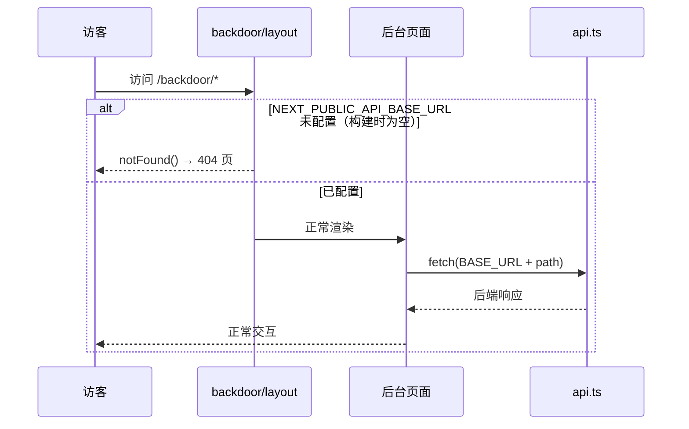

# 登录优化 - 技术提案

**功能名称**: 登录优化（后台入口收敛）
**关联 PRD**: `docs/product/requirements/draft/2026-08-13-login-optimization-prd.md`
**技术提案版本**: v1.0
**创建日期**: 2026-08-13
**作者**: sumire workflow
**feat-branch**: `feat/login-optimization`

## 1. 概述

### 1.1 背景

关联 PRD 要求收敛后台管理区（`/backdoor`）的暴露面：

1. 公开站点页脚的「管理 →」链接（`apps/bookstore/components/Footer.tsx:50-55`，由 `app/(site)/layout.tsx:16` 挂载，公开站每个页面右下角均可见）需要移除；
2. bookstore 为 `output: "export"` 全静态站点，后台 API 基址取自 `NEXT_PUBLIC_API_BASE_URL`（`apps/bookstore/features/backdoor/api.ts:16`）。该变量未配置时基址退化为空串，请求变成相对路径而 fallback 到主域名（静态站自身），用户看到的是请求失败后的无意义错误，而非 404。

### 1.2 目标

- 公开站点交付内容中不再包含指向 `/backdoor` 的链接；
- 构建时未配置 `NEXT_PUBLIC_API_BASE_URL` 的站点，访问 `/backdoor` 任意路由一律呈现 404 页（`not-found`），且不再发出发往主域名的 API 请求；
- 已配置时 `/backdoor` 行为与现状完全一致。

### 1.3 范围

- **做**：移除 Footer 中的「管理 →」链接并同步其单测；在 `/backdoor` 路由区增加「未配置 API 基址即 404」的守卫；补充单元测试与 e2e 覆盖。
- **不做**：不改动 `servers/api`；不改登录/管理功能本身；不处理「已配置但服务不可用」的运行时错误体验；不变更 API 契约（`contract/backdoor-auth.openapi.yaml` 不动）。

## 2. 技术架构

### 2.1 系统架构图

```mermaid
graph TD
    A[公开站 (site) 路由组] --> B[Footer 组件]
    C[/backdoor 路由区/] --> D{构建时守卫:<br/>NEXT_PUBLIC_API_BASE_URL 已配置?}
    D -->|否| E[notFound 404 页]
    D -->|是| F[后台页面]
    F -->|fetch credentials:include| G[servers/api /api/*]
```

### 2.2 技术栈

| 层级 | 技术选型 | 说明 |
|------|---------|------|
| 前端 | Next.js（App Router, `output: "export"`）+ React + TS | 唯一受影响的应用 |
| 后端 | Express 5（servers/api） | 本提案不改动 |
| 测试 | Vitest（单元）、Playwright（e2e） | 复用现有设施 |

### 2.3 模块划分

| 模块 | 职责 | 关键技术点 |
|------|------|-----------|
| `components/Footer.tsx` | 公开站页脚 | 删除「管理 →」`<a href="/backdoor">` |
| `app/backdoor/layout.tsx` | 后台路由区统一布局 | 构建时守卫，未配置即 `notFound()` |
| `features/backdoor/api.ts` | API 调用封装 | 复用已导出的 `API_BASE_URL` 作为唯一判断源 |

## 3. API 设计

本提案不新增、不变更任何 API；`contract/backdoor-auth.openapi.yaml` 保持不变。未配置基址时前端在发起请求之前即以 404 短路，不产生任何网络请求。

## 4. 数据模型

无数据模型与缓存变更。

## 5. 技术实现方案

### 5.1 核心流程



### 5.2 关键实现点

#### 实现点 1: 移除 Footer「管理 →」链接

- **描述**: 删除 `apps/bookstore/components/Footer.tsx:50-55` 中指向 `/backdoor` 的 `<a>`，同时移除不再使用的 `ml-auto` 布局影响（如有）并保持页脚其余内容不变。
- **技术细节**: 同步更新 `apps/bookstore/tests/unit/footer-link.test.tsx:19-22`——将「渲染管理链接」的断言改为「不渲染指向 /backdoor 的链接」。
- **风险点**: 无；该链接为普通 `<a>`，无客户端状态依赖。

#### 实现点 2: `/backdoor` 未配置 API 基址即 404

- **描述**: 在 `apps/bookstore/app/backdoor/layout.tsx`（Server Component）中读取 `process.env.NEXT_PUBLIC_API_BASE_URL`（与 `api.ts:16` 同一来源，统一由 `api.ts` 导出的常量判断），为空时调用 `notFound()`，渲染路由区就近的 `not-found` 页面。
- **技术细节**: `NEXT_PUBLIC_*` 变量在静态导出构建期内联，因此「未配置」在构建时确定，`notFound()` 的产物即静态 404 内容；`api.ts` 中集中导出判断结果（如 `API_CONFIGURED`），layout 与 `api.ts` 共用，避免两处判断口径漂移。
- **风险点**: 守卫发生在构建时——同一构建产物无法通过运行时注入基址切换形态；本地联调（Aspire 注入端点）与 Pages 生产构建需分别以配置/不配置该变量构建，已在测试策略中覆盖两种构建形态。

## 6. 技术决策

### 6.1 决策列表

| 决策 | 选项 A | 选项 B | 最终选择 | 原因 |
|------|--------|--------|---------|------|
| 404 守卫位置 | `app/backdoor/layout.tsx` 服务端 `notFound()` | 各页面/`api.ts` 客户端判断后渲染 404 组件 | A | 单点守卫覆盖整个路由区；构建期内联变量天然适配；不依赖客户端 JS 即可得到 404 |
| 判断来源 | 复用 `api.ts` 导出的基址/布尔常量 | layout 内独立读取环境变量 | A | 单一事实源，避免与请求层口径不一致 |
| Footer 链接处理 | 直接删除 | 按「API 已配置」条件显示 | A | PRD 明确要求「去掉」，且项目约定未上线功能不留占位/暴露入口；后台地址由运营者自持 |

### 6.2 依赖与约束

| 类型 | 内容 | 说明 |
|------|------|------|
| 依赖 | `apps/bookstore/features/backdoor/api.ts` 既有封装 | 守卫复用其基址判断 |
| 约束 | 静态导出（GitHub Pages） | 无服务端运行时，守卫必须构建时生效 |
| 约束 | 分支 `feat/login-optimization` 自 `prd/login-optimization` 切出 | 遵循 `<type>/<slug>` 约定 |

## 7. 项目结构

```
apps/bookstore/
├── app/
│   ├── (site)/layout.tsx          # 不变（Footer 挂载点）
│   └── backdoor/
│       └── layout.tsx             # 新增未配置即 notFound() 守卫
├── components/
│   └── Footer.tsx                 # 删除「管理 →」链接
├── features/backdoor/
│   └── api.ts                     # 导出统一的「已配置」判断
└── tests/unit/
    └── footer-link.test.tsx       # 更新断言
tests/e2e/                         # 新增：未配置构建形态下 /backdoor 返回 404
```

## 8. 测试策略

### 8.1 测试覆盖要求

- 单元测试：`Footer` 不再渲染指向 `/backdoor` 的链接；守卫判断（已配置/未配置两分支）。
- e2e：以未配置 `NEXT_PUBLIC_API_BASE_URL` 的构建访问 `/backdoor` 呈现 404；以已配置形态回归后台登录流程（复用现有用例）。

### 8.2 测试类型

| 类型 | 工具 | 覆盖范围 |
|------|------|---------|
| 单元测试 | Vitest + Testing Library | Footer 渲染、守卫判断 |
| E2E 测试 | Playwright | 未配置形态 404、已配置形态回归 |

## 9. 部署方案

### 9.1 环境规划

| 环境 | 用途 | 部署方式 |
|------|------|---------|
| 本地联调 | 已配置形态（Aspire 注入 API 端点） | `aspire start` |
| GitHub Pages 生产 | 纯静态、不配置后台服务 | 现有 Pages 流水线，构建时不设 `NEXT_PUBLIC_API_BASE_URL` |

### 9.2 配置管理

| 配置项 | 说明 |
|--------|------|
| `NEXT_PUBLIC_API_BASE_URL` | 后台 API 基址；构建期注入，缺省即「未配置」形态，`/backdoor` 呈现 404 |

## 10. 验收标准

- [ ] 技术方案评审通过
- [ ] 公开站各页面（含首页）不再出现指向 `/backdoor` 的链接
- [ ] 未配置基址的构建中 `/backdoor` 任意路由呈现 404，且无发往主域名的 API 请求
- [ ] 已配置基址时后台登录与管理流程回归通过
- [ ] 单元测试与 e2e 全部通过

## 11. 相关文档

- 关联 PRD：`docs/product/requirements/draft/2026-08-13-login-optimization-prd.md`
- 关联 Contract：`contract/backdoor-auth.openapi.yaml`（不变更）
- 开发规范：`docs/engineering/frontend-rules.md`
- 既有提案：[[2026-08-12-backdoor-auth-proposal]]
