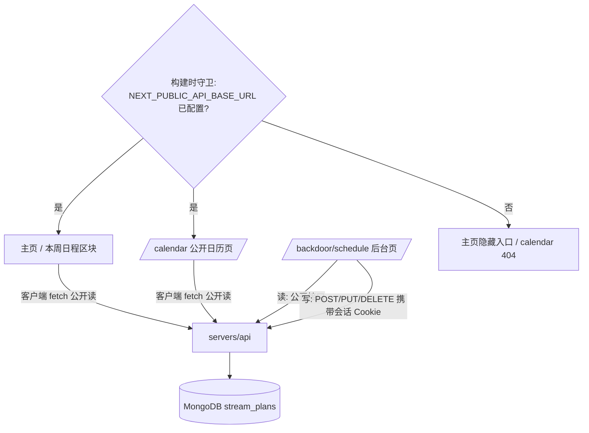
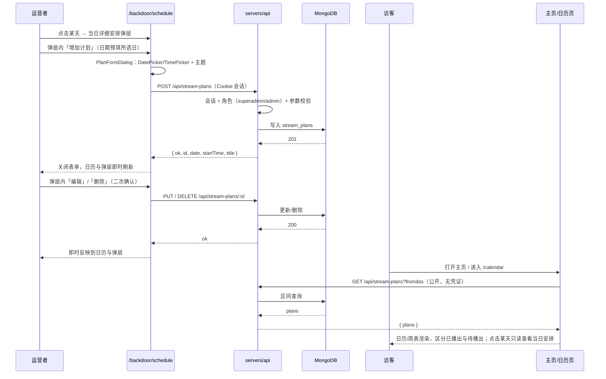

# 周表 - 技术提案

**功能名称**: 周表（直播日程日历）
**关联 PRD**: `docs/product/requirements/draft/2026-08-13-weekly-schedule-prd.md`
**技术提案版本**: v1.1
**创建日期**: 2026-08-13
**作者**: sumire workflow
**feat-branch**: `feat/weekly-schedule`

> 修订记录：v1.1（2026-08-13，评审返工）——数据模型新增 `startTime`（结束时间 TBD 不做）；新增编辑（PUT）与删除（DELETE）接口及对应 UI；后台日历新增「当日详细安排」弹层（列表/增加预填日期/编辑/删除）；日期/时间输入改为定制 DatePicker/TimePicker；补充设计文档 `docs/design/04-weekly-schedule-design.md`，界面按「大气」基调设计。

## 1. 概述

### 1.1 背景

关联 PRD（v1.1）要求围绕一份持久化的「直播计划」（**日期 + 开始时间 + 直播主题**）提供三处能力：

1. 可复用的日历视图组件（月视图，覆盖历史与未来计划，点击某天查看当日安排），公开站与后台共用；
2. 后台 `/backdoor` 新增「直播计划」模块：侧边导航入口、日历视图、「增加直播计划」按钮、当日详细安排弹层（查看/增加/编辑/删除）；
3. 主页新增大气的、有设计感的「日历」入口区块，点击进入公开站日历页。

界面设计以 `docs/design/04-weekly-schedule-design.md` 为准。现有基础：`servers/api`（Express 5）已具备会话鉴权（`auth/session.ts`）、角色体系（`rbac/roles.ts`：superadmin / admin / member）与 MongoDB 连接（`db/users.ts` 的 mongoose）；bookstore 为 `output: "export"` 纯静态站，后台数据经 `NEXT_PUBLIC_API_BASE_URL` 在客户端运行时拉取，且已有「未配置基址即 404 / 隐藏入口」的守卫模式（`app/backdoor/layout.tsx`、`features/backdoor/api.ts` 的 `API_CONFIGURED`）。

### 1.2 目标

- `servers/api` 新增直播计划 CRUD 接口：公开读（无需登录）、受限写（superadmin / admin，含新增/编辑/删除），MongoDB 持久化；
- bookstore 新增共享日历视图组件、公开站日历页（`/calendar`）、后台「直播计划」页（`/backdoor/schedule`，含当日安排弹层与录入/编辑表单）、定制 DatePicker/TimePicker、主页「本周日程」入口区块；
- 未配置 `NEXT_PUBLIC_API_BASE_URL` 的纯静态形态下：主页不出现入口、`/calendar` 呈现 404，与既有后台守卫口径一致。

### 1.3 范围

- **做**：契约定义直播计划 CRUD 接口；`servers/api` 新增 `stream-plans` 路由与 MongoDB 集合；bookstore 新增 `features/schedule/`（日历组件、当日安排弹层、录入/编辑表单、DatePicker/TimePicker、API 封装）、`/calendar` 公开页、`/backdoor/schedule` 页与主页入口区块；单元测试、API 集成测试与 e2e 覆盖。
- **不做**：结束时间字段（TBD）；直播封面/链接等扩展字段；与 B 站数据自动同步；Redis 缓存（数据量小，直接读库，后续按需再加）。

## 2. 技术架构

### 2.1 系统架构图



### 2.2 技术栈

| 层级 | 技术选型 | 说明 |
|------|---------|------|
| 前端 | Next.js（App Router, `output: "export"`）+ React + TS | 日历组件/弹层/选择器为 Client Component，数据运行时拉取 |
| 后端 | Express 5（servers/api） | 新增 `/api/stream-plans` 路由（CRUD） |
| 数据库 | MongoDB（mongoose） | 新增 `stream_plans` 集合，复用现有连接 |
| 测试 | Vitest（单元 / API 集成）、Playwright（e2e） | 复用现有设施 |

### 2.3 模块划分

| 模块 | 职责 | 关键技术点 |
|------|------|-----------|
| `servers/api/src/db/streamPlans.ts` | 直播计划持久化 | mongoose schema + 日期索引 |
| `servers/api/src/routes/streamPlans.ts` | CRUD 接口 | 公开读、RBAC 受限写、参数校验、409 判重 |
| `apps/bookstore/features/schedule/CalendarView.tsx` | 可复用月视图日历组件 | 客户端组件，翻月 + 计划摘要 + 选中某日回调 |
| `apps/bookstore/features/schedule/DayDetailDialog.tsx` | 当日详细安排弹层 | 只读/管理双模式，管理态含增加/编辑/删除 |
| `apps/bookstore/features/schedule/PlanFormDialog.tsx` | 录入/编辑表单弹层 | 三字段（日期/开始时间/主题），编辑态预填 |
| `apps/bookstore/features/schedule/DatePicker.tsx` / `TimePicker.tsx` | 定制日期/时间选择控件 | 迷你月历浮层 / 双列滚轮 + 快捷项 |
| `apps/bookstore/features/schedule/api.ts` | 前端 API 封装 | 复用 `API_BASE_URL` / `API_CONFIGURED` 口径 |
| `apps/bookstore/app/(site)/calendar/page.tsx` | 公开站日历页 | 未配置基址即 404 守卫 |
| `apps/bookstore/features/home/WeeklySchedule.tsx` | 主页「本周日程」入口区块 | 大气缎条设计，链接至 `/calendar` |
| `apps/bookstore/app/backdoor/(dashboard)/schedule/page.tsx` | 后台直播计划页 | 日历 + 当日弹层 + 表单弹层状态编排 |

## 3. API 设计

### 3.1 API 契约

新增契约文件 `contract/stream-plans.openapi.yaml`（不动 `backdoor-auth.openapi.yaml`），作为直播计划接口的单一事实源。

#### 接口 1: 查询直播计划（公开）

- **请求**
  - Method: GET
  - Path: `/api/stream-plans?from=YYYY-MM-DD&to=YYYY-MM-DD`
  - 无需登录；`from`/`to` 可选，缺省返回全部（按 `date` + `startTime` 升序）。
- **响应**
  - Status: 200 / 400（日期格式非法）
  - Body:
    ```json
    {
      "plans": [
        { "id": "66f…", "date": "2026-08-15", "startTime": "20:00", "title": "杂谈", "createdAt": "2026-08-13T12:00:00.000Z" }
      ]
    }
    ```

#### 接口 2: 新增直播计划（受限）

- **请求**
  - Method: POST
  - Path: `/api/stream-plans`
  - 需登录，角色限 `superadmin` / `admin`（复用 `rbac/roles.ts` 判定）。
  - Body:
    ```json
    { "date": "2026-08-15", "startTime": "20:00", "title": "杂谈" }
    ```
- **响应**
  - Status: 201 / 400（字段缺失或非法）/ 401（未登录）/ 403（角色不足）/ 409（同日同时间同主题重复）
  - Body (201):
    ```json
    { "ok": true, "id": "66f…", "date": "2026-08-15", "startTime": "20:00", "title": "杂谈" }
    ```

#### 接口 3: 编辑直播计划（受限）

- **请求**
  - Method: PUT
  - Path: `/api/stream-plans/:id`
  - 需登录，角色限 `superadmin` / `admin`；三个字段均可改（改日期即改期）。
  - Body:
    ```json
    { "date": "2026-08-16", "startTime": "21:00", "title": "歌杂" }
    ```
- **响应**
  - Status: 200 / 400 / 401 / 403 / 404（计划不存在）/ 409（与他人计划重复）
  - Body (200): 同 201 结构。

#### 接口 4: 删除直播计划（受限）

- **请求**
  - Method: DELETE
  - Path: `/api/stream-plans/:id`
  - 需登录，角色限 `superadmin` / `admin`。
- **响应**
  - Status: 200 `{ "ok": true }` / 401 / 403 / 404

### 3.2 内部接口

- `db/streamPlans.ts` 导出 `listStreamPlans(from?, to?)`、`createStreamPlan({ date, startTime, title, createdBy })`、`updateStreamPlan(id, { date, startTime, title })`、`deleteStreamPlan(id)`、`findStreamPlan(date, startTime, title, excludeId?)`，与 `db/users.ts` 同风格（`lean()` 查询、显式类型）。

## 4. 数据模型

### 4.1 数据库设计

#### 集合: `stream_plans`

| 字段 | 类型 | 说明 |
|------|------|------|
| `_id` | ObjectId | 主键，序列化为 `id` 字符串返回 |
| `date` | String | 直播日期，`YYYY-MM-DD` 格式（存字符串避免时区歧义），建索引 |
| `startTime` | String | 开播时间，`HH:mm`（24 小时制，对齐官方周表），必填；结束时间 TBD 本期不存 |
| `title` | String | 直播主题，trim 后 1–50 字符 |
| `createdBy` | String | 录入者用户名 |
| `createdAt` | Date | 创建时间，默认 `Date.now` |
| `updatedAt` | Date | 最近编辑时间 |

说明：一天允许多场计划（参照官方周表）；以 `(date, startTime, title)` 判重（编辑时排除自身），重复返回 409。

### 4.2 缓存设计

本期不引入缓存：计划数据量小，日历按区间直读 MongoDB。后续若公开读压力上升，可用既有 Redis 做短 TTL 缓存（key 形如 `stream-plans:{from}:{to}`，写操作时失效）。

## 5. 技术实现方案

### 5.1 核心流程



### 5.2 关键实现点

#### 实现点 1: 日历视图组件 `CalendarView`

- **描述**: 月视图网格日历（客户端组件），props 接收 `plans`、`onMonthChange(from, to)` 与 `onSelectDay(date)` 回调；翻月时由父组件按新区间拉取数据，点击格子上抛所选日期。有计划日期展示至多 2 条 `HH:mm 主题` 摘要（更多以「+N」收尾），过去日期弱化（已播出）、未来日期高亮（待播出）、今天藤蔓描边。视觉细节遵循 `docs/design/04-weekly-schedule-design.md` 第 2 节（桌面 7.5rem 大格子、移动端紧凑点标记）。
- **技术细节**: 自实现月网格（周一开头，对齐中文语境与官方周表 MON–SUN 排列），不引入日历库——依赖体积与样式定制成本均不划算；日期计算用原生 `Date`，`date`/`startTime` 全部按字符串比较（排序键 `date + startTime`），规避时区问题。组件置于 `features/schedule/`，公开页与后台页共用同一份实现（PRD 约束）。
- **风险点**: 跨月边界（月初/月末补位格子）与闰年计算，单测覆盖边界月份。

#### 实现点 2: 当日详细安排弹层 `DayDetailDialog`

- **描述**: 双模式弹层。只读模式（公开站）：纸面浮层列出当日计划（时间升序），空态一句氛围文案；管理模式（后台）：深色浮层，每条计划带「编辑」「删除」操作（删除行内二次确认），底部「+ 增加计划」按钮——点击打开 `PlanFormDialog` 且 `date` 预填所选日。模式由 prop（如 `readOnly`）切换，公开站永不渲染管理操作。
- **技术细节**: 弹层数据由父页面按日过滤已拉取的 `plans` 得到，不单独发请求；编辑/删除成功后父组件刷新当前月区间数据并同步弹层列表。member 角色按 `session` 角色信息降级为只读模式。
- **风险点**: 编辑改期后计划移出当前弹层所选日——保存成功后若 `plan.date` 已不等于弹层日期，弹层列表移除该条并提示「已移至 X 月 X 日」。

#### 实现点 3: 录入/编辑表单 `PlanFormDialog` 与定制选择控件

- **描述**: 表单含三字段：日期（`DatePicker`）、开始时间（`TimePicker`）、直播主题（`TextField` 复用）。编辑态与录入态同一组件，编辑态预填现值、标题切换。提交前前端校验（三字段必填、`HH:mm` 合法），失败行内提示。
- **技术细节**:
  - `DatePicker`：只读输入框 + 迷你月历浮层（复用 `CalendarView` 的网格生成函数，抽为 `features/schedule/monthGrid.ts` 纯函数），支持键入 `YYYY-MM-DD` 解析；不用原生 `<input type="date">`（样式不可控，设计文档明确禁止原生默认样式）。
  - `TimePicker`：只读输入框 + 时/分双列滚轮浮层（分钟 15 分钟步进），底部快捷项（`08:00 / 13:00 / 16:00 / 20:00 / 22:00`，取自官方周表常见开播时段），支持键入 `HH:mm` 解析。
  - 两个控件共用一套浮层机制（点击外部收起、`Esc` 收起、焦点管理）。
- **风险点**: 键入解析的容错（如 `9:5` 归一为 `09:05`）与非法回退，单测覆盖；移动端滚轮改为纵向堆叠点选（设计文档 6/7 节）。

#### 实现点 4: 主页「本周日程」入口区块与公开日历页

- **描述**: 主页新增 `features/home/WeeklySchedule.tsx` 区块：独占整行的横向长条卡片（藤蔓角饰 + 蕾丝边框），本周一至周日缎带式横条（`MON.` + `HH:mm 主题`，参照官方宣传图，设计文档第 3 节），底部「查看完整日历 →」链接至 `/calendar`。客户端组件，拉取本周区间数据，加载中为缎条骨架（固定高度，避免布局跳动）；仅在 `API_CONFIGURED` 时由主页挂载。`app/(site)/calendar/page.tsx` 复用既有守卫模式：未配置基址时直接渲染 `NotFoundPage`（不加载日历 chunk、不发请求），已配置时渲染页眉 + `CalendarView` + 只读 `DayDetailDialog`。
- **风险点**: 主页为静态 SSG 页面，周表区块必须客户端取数；「本周」按访客本地时区计算周一~周日区间，与 `YYYY-MM-DD` 字符串口径一致。

#### 实现点 5: 后端路由与校验

- **描述**: `routes/streamPlans.ts` 挂到 `app.ts` 的 `api` 路由器（`api.use("/stream-plans", …)`）。GET 公开、不校验会话；POST/PUT/DELETE 走 `req.user` 判定（401/403，角色限 superadmin/admin）+ 参数校验：`date` 必须匹配 `YYYY-MM-DD` 且为真实日期，`startTime` 必须匹配 `HH:mm` 且为真实时间（`00:00`–`23:59`），`title` trim 后 1–50 字符；新增/编辑按 `(date, startTime, title)` 判重 409（编辑排除自身）；PUT/DELETE 对不存在 id 返回 404。CORS 沿用现有白名单（公开 GET 不带凭证，无额外配置）。
- **技术细节**: `:id` 需为合法 ObjectId 字符串，否则直接 400；写操作记录 `updatedAt`。
- **风险点**: 公开读接口的注入面——mongoose 查询参数全部走显式字符串校验后的 `$gte`/`$lte`，不接受任意对象。

## 6. 技术决策

### 6.1 决策列表

| 决策 | 选项 A | 选项 B | 最终选择 | 原因 |
|------|--------|--------|---------|------|
| 契约文件 | 新增 `contract/stream-plans.openapi.yaml` | 扩展 `backdoor-auth.openapi.yaml` | A | 现有文件语义限定于鉴权；直播计划是独立领域，单文件单一事实源更清晰 |
| 公开读鉴权 | 无需登录 | 需登录 | A | PRD 要求访客无需登录即可查看；计划内容本身来自官方公开信息 |
| 写入角色（增/改/删） | superadmin + admin | 全部已登录角色 | A | 内容维护收敛到管理角色；member 只读，降低误录/误删风险 |
| 时间建模 | `startTime` 必填、无 `endTime` | `endTime` 可选字段 | A | 评审明确「开始时间必须有、结束时间 TBD」；不存暂无来源的字段，后续需要时再迁移 |
| 日期/时间选择器 | 定制 DatePicker/TimePicker | 原生 `<input type="date"/"time">` | A | 评审明确要求专门设计；原生控件样式不可控，破坏站点视觉一致性 |
| 日历组件 | 自实现月网格 | 引入日历组件库 | A | 月网格逻辑简单；避免新依赖体积与样式覆写成本，贴合站点定制视觉 |
| 日期/时间存储 | `YYYY-MM-DD` / `HH:mm` 字符串 | `Date`（UTC） | A | 直播日程是「日历日 + 本地时刻」概念，字符串无时区歧义，排序与区间查询直观 |
| 删除交互 | 行内二次确认 | 独立确认弹层 | A | 弹层之上不再叠弹层，减少层级复杂度（设计文档 4.2 节） |
| 未配置形态 | 主页隐藏入口 + `/calendar` 404 | 展示「暂不可用」占位 | A | 项目约定未上线/不可用功能不留占位入口；复用既有 `API_CONFIGURED` 守卫口径 |

### 6.2 依赖与约束

| 类型 | 内容 | 说明 |
|------|------|------|
| 依赖 | `servers/api` 既有会话/RBAC/MongoDB 设施 | 路由复用 `req.user`、`isRole`、mongoose 连接 |
| 依赖 | `features/backdoor/api.ts` 的 `API_BASE_URL` / `API_CONFIGURED` | 前端取数与守卫判断的单一事实源 |
| 依赖 | 设计文档 `docs/design/04-weekly-schedule-design.md` | 界面实现以该文档为准 |
| 约束 | 静态导出（GitHub Pages） | 日历数据只能客户端运行时拉取；未配置守卫构建时生效 |
| 约束 | 分支 `feat/weekly-schedule` 自 `prd/weekly-schedule` 切出 | 遵循 `<type>/<slug>` 约定 |

## 7. 项目结构

```
contract/
└── stream-plans.openapi.yaml        # 新增：直播计划 CRUD 契约
servers/api/src/
├── db/streamPlans.ts                # 新增：mongoose 模型与查询函数
├── routes/streamPlans.ts            # 新增：GET（公开）/ POST / PUT / DELETE（受限）
└── app.ts                           # 挂载 /api/stream-plans
apps/bookstore/
├── app/
│   ├── (site)/
│   │   ├── page.tsx                 # 挂载 WeeklySchedule 区块（API_CONFIGURED 时）
│   │   └── calendar/page.tsx        # 新增：公开日历页（未配置即 404）
│   └── backdoor/(dashboard)/
│       └── schedule/page.tsx        # 新增：后台直播计划页（日历+弹层编排）
├── features/
│   ├── schedule/
│   │   ├── CalendarView.tsx         # 新增：可复用月视图日历组件
│   │   ├── DayDetailDialog.tsx      # 新增：当日详细安排弹层（只读/管理双模式）
│   │   ├── PlanFormDialog.tsx       # 新增：录入/编辑表单弹层
│   │   ├── DatePicker.tsx           # 新增：定制日期选择器（迷你月历浮层）
│   │   ├── TimePicker.tsx           # 新增：定制时间选择器（双列滚轮+快捷项）
│   │   ├── monthGrid.ts             # 新增：月网格生成纯函数（日历与 DatePicker 共用）
│   │   └── api.ts                   # 新增：前端取数封装
│   └── home/WeeklySchedule.tsx      # 新增：主页「本周日程」入口区块
├── features/backdoor/components/SideNav.tsx  # 新增「直播计划」导航项
└── tests/unit/                      # 月网格、选择器解析、表单校验、弹层双模式、导航项、守卫分支
tests/api/                           # 新增：stream-plans CRUD / 鉴权 / 校验 / 判重用例
tests/e2e/                           # 新增：录入→编辑→删除闭环、公开查看、主页入口、未配置形态
```

## 8. 测试策略

### 8.1 测试覆盖要求

- 单元测试：月网格生成（边界月份、闰年）、计划摘要与已播出/待播出区分、`DatePicker`/`TimePicker` 键入解析与非法回退、表单三字段校验、`DayDetailDialog` 只读/管理双模式渲染与 member 降级、SideNav 新导航项按角色渲染、主页区块未配置不渲染；
- API 测试覆盖的端点：`GET /api/stream-plans`（区间过滤、排序、非法参数 400）、`POST /api/stream-plans`（201、字段校验 400、401 未登录、403 member、409 重复）、`PUT /api/stream-plans/:id`（200 改期/改时间/改主题、404、409 排除自身判重）、`DELETE /api/stream-plans/:id`（200、404）；写后 GET 可读验证持久化；
- e2e：后台点击某日 → 弹层增加（日期预填）→ 编辑改期 → 删除（二次确认）全闭环；公开 `/calendar` 只读查看当日安排；主页入口区块可点击进日历页；member 角色无管理入口；未配置构建形态下主页无入口、`/calendar` 为 404。

### 8.2 测试类型

| 类型 | 工具 | 覆盖范围 |
|------|------|---------|
| 单元测试 | Vitest + Testing Library | 日历组件、选择器、表单、弹层、导航与守卫 |
| API 集成测试 | Vitest + fetch（tests/api） | stream-plans 端点全路径 |
| E2E 测试 | Playwright（tests/e2e） | 管理闭环、公开查看、角色降级、未配置形态 |

## 9. 部署方案

### 9.1 环境规划

| 环境 | 用途 | 部署方式 |
|------|------|---------|
| 本地联调 | 已配置形态（Aspire 注入 API 端点 + MongoDB） | `aspire start` |
| GitHub Pages 生产 | 纯静态、不配置后台服务 | 主页无入口、`/calendar` 404 |

### 9.2 配置管理

| 配置项 | 说明 |
|--------|------|
| `NEXT_PUBLIC_API_BASE_URL` | 复用：构建期注入；缺省即「未配置」形态，主页无入口、`/calendar` 404 |
| `MONGODB_URL` 等连接串 | 复用现有注入链（`ConnectionStrings__sumire` 等），`stream_plans` 集合由 mongoose 自动创建 |

## 10. 验收标准

- [ ] 技术方案评审通过
- [ ] `contract/stream-plans.openapi.yaml` 评审通过
- [ ] 后台可录入（日期 + 开始时间 + 主题）、编辑（含改期）、删除直播计划并持久化（重启后仍在）
- [ ] 后台日历点击某天弹出当日详细安排弹层，弹层内增加计划日期预填所选日
- [ ] 日期/时间选择控件为定制实现，符合设计文档
- [ ] 公开站与后台日历视图复用同一组件且数据一致
- [ ] 主页入口区块大气、有设计感，未配置形态不出现
- [ ] 单元测试、API 测试、E2E 测试全部通过

## 11. 相关文档

- 关联 PRD：`docs/product/requirements/draft/2026-08-13-weekly-schedule-prd.md`（v1.1）
- 关联 Contract：`contract/stream-plans.openapi.yaml`（新增）
- 设计文档：`docs/design/04-weekly-schedule-design.md`（新增）
- 开发规范：`docs/engineering/frontend-rules.md`、`docs/engineering/backend-rules.md`
- 视觉识别：`docs/design/01-visual-identity.md`；官方周表参考图：`docs/design/references/promo-weekly-schedule.png`
- 既有提案：[[2026-08-12-backdoor-auth-proposal]]、[[2026-08-13-login-optimization-proposal]]
