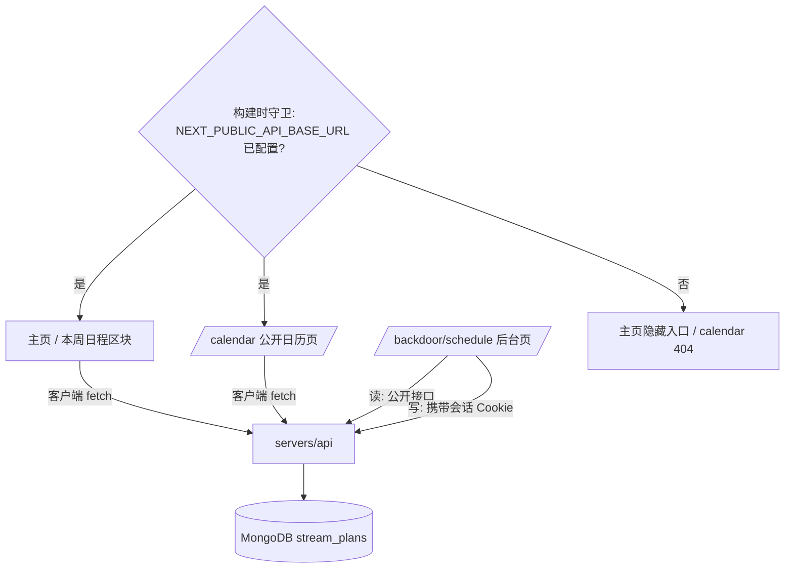
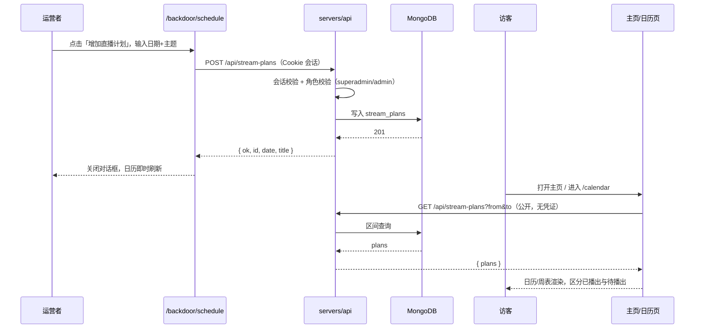

# 周表 - 技术提案

**功能名称**: 周表（直播日程日历）
**关联 PRD**: `docs/product/requirements/draft/2026-08-13-weekly-schedule-prd.md`
**技术提案版本**: v1.0
**创建日期**: 2026-08-13
**作者**: sumire workflow
**feat-branch**: `feat/weekly-schedule`

## 1. 概述

### 1.1 背景

关联 PRD 要求围绕一份持久化的「直播计划」（日期 + 直播主题）提供三处能力：

1. 可复用的日历视图组件（月视图，覆盖历史与未来计划），公开站与后台共用；
2. 后台 `/backdoor` 新增「直播计划」模块：侧边导航入口、日历视图、「增加直播计划」按钮与录入表单；
3. 主页新增有设计感的「日历」入口区块，点击进入公开站日历页。

现有基础：`servers/api`（Express 5）已具备会话鉴权（`auth/session.ts`）、角色体系（`rbac/roles.ts`：superadmin / admin / member）与 MongoDB 连接（`db/users.ts` 的 mongoose）；bookstore 为 `output: "export"` 纯静态站，后台数据经 `NEXT_PUBLIC_API_BASE_URL` 在客户端运行时拉取，且已有「未配置基址即 404 / 隐藏入口」的守卫模式（`app/backdoor/layout.tsx`、`features/backdoor/api.ts` 的 `API_CONFIGURED`）。

### 1.2 目标

- `servers/api` 新增直播计划读写接口：公开读（无需登录）、受限写（superadmin / admin），MongoDB 持久化；
- bookstore 新增共享日历视图组件、公开站日历页（`/calendar`）、后台「直播计划」页（`/backdoor/schedule`）与主页「本周日程」入口区块；
- 未配置 `NEXT_PUBLIC_API_BASE_URL` 的纯静态形态下：主页不出现入口、`/calendar` 呈现 404，与既有后台守卫口径一致。

### 1.3 范围

- **做**：契约新增直播计划接口定义；`servers/api` 新增 `stream-plans` 路由与 MongoDB 集合；bookstore 新增 `features/schedule/`（日历组件 + API 封装）、`/calendar` 公开页、`/backdoor/schedule` 页与主页入口区块；单元测试、API 集成测试与 e2e 覆盖。
- **不做**：计划的编辑/删除；开播时间等扩展字段；与 B 站数据自动同步；Redis 缓存（数据量小，直接读库，后续按需再加）。

## 2. 技术架构

### 2.1 系统架构图



### 2.2 技术栈

| 层级 | 技术选型 | 说明 |
|------|---------|------|
| 前端 | Next.js（App Router, `output: "export"`）+ React + TS | 日历组件为 Client Component，数据运行时拉取 |
| 后端 | Express 5（servers/api） | 新增 `/api/stream-plans` 路由 |
| 数据库 | MongoDB（mongoose） | 新增 `stream_plans` 集合，复用现有连接 |
| 测试 | Vitest（单元 / API 集成）、Playwright（e2e） | 复用现有设施 |

### 2.3 模块划分

| 模块 | 职责 | 关键技术点 |
|------|------|-----------|
| `servers/api/src/db/streamPlans.ts` | 直播计划持久化 | mongoose schema + 日期索引 |
| `servers/api/src/routes/streamPlans.ts` | 读写接口 | 公开读、RBAC 受限写、参数校验 |
| `apps/bookstore/features/schedule/CalendarView.tsx` | 可复用月视图日历组件 | 客户端组件，翻月 + 计划标记 |
| `apps/bookstore/features/schedule/api.ts` | 前端 API 封装 | 复用 `API_BASE_URL` / `API_CONFIGURED` 口径 |
| `apps/bookstore/app/(site)/calendar/page.tsx` | 公开站日历页 | 未配置基址即 404 守卫 |
| `apps/bookstore/features/home/WeeklySchedule.tsx` | 主页「本周日程」入口区块 | 设计感区块，链接至 `/calendar` |
| `apps/bookstore/app/backdoor/(dashboard)/schedule/page.tsx` | 后台直播计划页 | 日历 + 「增加直播计划」对话框 |

## 3. API 设计

### 3.1 API 契约

新增契约文件 `contract/stream-plans.openapi.yaml`（不动 `backdoor-auth.openapi.yaml`），作为直播计划接口的单一事实源。

#### 接口 1: 查询直播计划（公开）

- **请求**
  - Method: GET
  - Path: `/api/stream-plans?from=YYYY-MM-DD&to=YYYY-MM-DD`
  - 无需登录；`from`/`to` 可选，缺省返回全部（按日期升序）。
- **响应**
  - Status: 200 / 400（日期格式非法）
  - Body:
    ```json
    {
      "plans": [
        { "id": "66f…", "date": "2026-08-15", "title": "杂谈", "createdAt": "2026-08-13T12:00:00.000Z" }
      ]
    }
    ```

#### 接口 2: 新增直播计划（受限）

- **请求**
  - Method: POST
  - Path: `/api/stream-plans`
  - 需登录，角色限 `superadmin` / `admin`（复用 `rbac/roles.ts` 判定）。
  - Body:
    ```json
    { "date": "2026-08-15", "title": "杂谈" }
    ```
- **响应**
  - Status: 201 / 400（日期格式非法、主题为空或超长）/ 401（未登录）/ 403（角色不足）/ 409（同日同主题重复）
  - Body (201):
    ```json
    { "ok": true, "id": "66f…", "date": "2026-08-15", "title": "杂谈" }
    ```

### 3.2 内部接口

- `db/streamPlans.ts` 导出 `listStreamPlans(from?, to?)`、`createStreamPlan({ date, title, createdBy })`、`findStreamPlan(date, title)`，与 `db/users.ts` 同风格（`lean()` 查询、显式类型）。

## 4. 数据模型

### 4.1 数据库设计

#### 集合: `stream_plans`

| 字段 | 类型 | 说明 |
|------|------|------|
| `_id` | ObjectId | 主键，序列化为 `id` 字符串返回 |
| `date` | String | 直播日期，`YYYY-MM-DD` 格式（存字符串避免时区歧义），建索引 |
| `title` | String | 直播主题，trim 后 1–50 字符 |
| `createdBy` | String | 录入者用户名 |
| `createdAt` | Date | 创建时间，默认 `Date.now` |

说明：一天允许多场计划（参照官方周表）；以 `(date, title)` 判重，重复提交返回 409。

### 4.2 缓存设计

本期不引入缓存：计划数据量小，日历按区间直读 MongoDB。后续若公开读压力上升，可用既有 Redis 做短 TTL 缓存（key 形如 `stream-plans:{from}:{to}`）。

## 5. 技术实现方案

### 5.1 核心流程



### 5.2 关键实现点

#### 实现点 1: 日历视图组件 `CalendarView`

- **描述**: 月视图网格日历（客户端组件），props 接收 `plans` 与可选的 `onMonthChange(from, to)` 回调；翻月时由父组件按新区间拉取数据。有计划日期展示主题标记，过去日期弱化（已播出）、未来日期高亮（待播出）、今天描边。
- **技术细节**: 自实现月网格（按周一开头，对齐中文语境与官方周表 MON–SUN 排列），不引入日历库——依赖体积与样式定制成本均不划算；日期计算用原生 `Date`，全部按 `YYYY-MM-DD` 字符串比较，规避时区问题。组件置于 `features/schedule/`，公开页与后台页共用同一份实现（PRD 约束）。
- **风险点**: 跨月边界（月初/月末补位格子）与闰年计算，单测覆盖边界月份。

#### 实现点 2: 后台「直播计划」模块

- **描述**: `app/backdoor/(dashboard)/schedule/page.tsx` 复用 `(dashboard)/layout.tsx` 的会话守卫；页面含 `CalendarView` 与「增加直播计划」按钮（`PrimaryButton`），点击弹出对话框（参照 `CreateUserDialog` 模式），表单为日期输入（`<input type="date">`）+ 主题输入（`TextField`），前端校验非空后提交，成功后本地追加计划并刷新日历。SideNav 增加 `{ href: "/backdoor/schedule", label: "直播计划", roles: ["superadmin", "admin", "member"] }`；member 角色只读，不渲染「增加直播计划」按钮（与后端 403 判定一致）。
- **风险点**: 前后端角色口径需一致（member 只读），e2e 覆盖 member 视角。

#### 实现点 3: 主页「本周日程」入口区块与公开日历页

- **描述**: 主页新增 `features/home/WeeklySchedule.tsx` 区块：遵循视觉识别（藤蔓角饰、蕾丝边框、PaperCard 质感、应援色 `#b4a6bf`），参照官方「本周日程」宣传图按周条列本周计划（MON–SUN 行，有计划展示主题，无计划留空态），底部「查看完整日历 →」链接至 `/calendar`。该区块为客户端组件，拉取本周区间数据，加载中有过渡态；仅在 `API_CONFIGURED` 时由主页挂载（未配置形态不留占位入口）。`app/(site)/calendar/page.tsx` 复用既有守卫模式：未配置基址时直接渲染 `NotFoundPage`（不加载日历 chunk、不发请求），已配置时渲染 `CalendarView`。
- **风险点**: 主页为静态 SSG 页面，周表区块必须客户端取数，注意 hydration 边界——区块初始渲染为加载骨架，避免布局跳动（预留固定最小高度）。

#### 实现点 4: 后端路由与校验

- **描述**: `routes/streamPlans.ts` 挂到 `app.ts` 的 `api` 路由器（`api.use("/stream-plans", …)`）。GET 公开、不校验会话；POST 走 `req.user` 判定（401/403）+ 参数校验：`date` 必须匹配 `YYYY-MM-DD` 且为真实日期，`title` trim 后 1–50 字符，同日同主题 409。CORS 沿用现有白名单（公开 GET 不带凭证，无额外配置）。
- **风险点**: 公开读接口的注入面——mongoose 查询参数全部走显式字符串校验后的 `$gte`/`$lte`，不接受任意对象。

## 6. 技术决策

### 6.1 决策列表

| 决策 | 选项 A | 选项 B | 最终选择 | 原因 |
|------|--------|--------|---------|------|
| 契约文件 | 新增 `contract/stream-plans.openapi.yaml` | 扩展 `backdoor-auth.openapi.yaml` | A | 现有文件语义限定于鉴权；直播计划是独立领域，单文件单一事实源更清晰 |
| 公开读鉴权 | 无需登录 | 需登录 | A | PRD 要求访客无需登录即可查看；计划内容本身来自官方公开信息 |
| 写入角色 | superadmin + admin | 全部已登录角色 | A | 内容维护收敛到管理角色；member 只读，降低误录风险 |
| 日历组件 | 自实现月网格 | 引入日历组件库 | A | 月网格逻辑简单；避免新依赖体积与样式覆写成本，贴合站点定制视觉 |
| 日期存储 | `YYYY-MM-DD` 字符串 | `Date`（UTC 午夜） | A | 直播日期是「日历日」概念而非时刻，字符串无时区歧义，区间查询直观 |
| 未配置形态 | 主页隐藏入口 + `/calendar` 404 | 展示「暂不可用」占位 | A | 项目约定未上线/不可用功能不留占位入口；复用既有 `API_CONFIGURED` 守卫口径 |

### 6.2 依赖与约束

| 类型 | 内容 | 说明 |
|------|------|------|
| 依赖 | `servers/api` 既有会话/RBAC/MongoDB 设施 | 路由复用 `req.user`、`isRole`、mongoose 连接 |
| 依赖 | `features/backdoor/api.ts` 的 `API_BASE_URL` / `API_CONFIGURED` | 前端取数与守卫判断的单一事实源 |
| 约束 | 静态导出（GitHub Pages） | 日历数据只能客户端运行时拉取；未配置守卫构建时生效 |
| 约束 | 分支 `feat/weekly-schedule` 自 `prd/weekly-schedule` 切出 | 遵循 `<type>/<slug>` 约定 |

## 7. 项目结构

```
contract/
└── stream-plans.openapi.yaml        # 新增：直播计划接口契约
servers/api/src/
├── db/streamPlans.ts                # 新增：mongoose 模型与查询函数
├── routes/streamPlans.ts            # 新增：GET（公开）/ POST（受限）
└── app.ts                           # 挂载 /api/stream-plans
apps/bookstore/
├── app/
│   ├── (site)/
│   │   ├── page.tsx                 # 挂载 WeeklySchedule 区块（API_CONFIGURED 时）
│   │   └── calendar/page.tsx        # 新增：公开日历页（未配置即 404）
│   └── backdoor/(dashboard)/
│       └── schedule/page.tsx        # 新增：后台直播计划页
├── features/
│   ├── schedule/
│   │   ├── CalendarView.tsx         # 新增：可复用月视图日历组件
│   │   ├── CreatePlanDialog.tsx     # 新增：录入对话框（日期+主题）
│   │   └── api.ts                   # 新增：前端取数封装
│   └── home/WeeklySchedule.tsx      # 新增：主页「本周日程」入口区块
├── features/backdoor/components/SideNav.tsx  # 新增「直播计划」导航项
└── tests/unit/                      # 日历网格、表单校验、导航项、守卫分支
tests/api/                           # 新增：stream-plans 读/写/鉴权/校验用例
tests/e2e/                           # 新增：录入→日历可见、主页入口、未配置形态
```

## 8. 测试策略

### 8.1 测试覆盖要求

- 单元测试：日历网格生成（边界月份、闰年）、计划标记与已播出/待播出区分、表单非空校验、SideNav 新导航项按角色渲染、主页区块未配置不渲染；
- API 测试覆盖的端点：`GET /api/stream-plans`（区间过滤、非法参数 400）、`POST /api/stream-plans`（201、400 校验、401 未登录、403 member、409 重复、持久化后 GET 可读）；
- e2e：后台录入计划 → 日历即时可见 → 公开 `/calendar` 可见；主页入口区块可点击进日历页；未配置构建形态下主页无入口、`/calendar` 为 404。

### 8.2 测试类型

| 类型 | 工具 | 覆盖范围 |
|------|------|---------|
| 单元测试 | Vitest + Testing Library | 日历组件、表单、导航与守卫 |
| API 集成测试 | Vitest + fetch（tests/api） | stream-plans 端点全路径 |
| E2E 测试 | Playwright（tests/e2e） | 录入闭环、公开查看、未配置形态 |

## 9. 部署方案

### 9.1 环境规划

| 环境 | 用途 | 部署方式 |
|------|------|---------|
| 本地联调 | 已配置形态（Aspire 注入 API 端点 + MongoDB） | `aspire start` |
| GitHub Pages 生产 | 纯静态、不配置后台服务 | 主页无入口、`/calendar` 404 |

### 9.2 配置管理

| 配置项 | 说明 |
|--------|------|
| `NEXT_PUBLIC_API_BASE_URL` | 复用：构建期注入；缺省即「未配置」形态，主页无入口、`/calendar` 404 |
| `MONGODB_URL` 等连接串 | 复用现有注入链（`ConnectionStrings__sumire` 等），`stream_plans` 集合由 mongoose 自动创建 |

## 10. 验收标准

- [ ] 技术方案评审通过
- [ ] `contract/stream-plans.openapi.yaml` 评审通过
- [ ] 后台可录入直播计划并持久化（重启后仍在）
- [ ] 公开站与后台日历视图复用同一组件且数据一致
- [ ] 主页入口区块有设计感，未配置形态不出现
- [ ] 单元测试、API 测试、E2E 测试全部通过

## 11. 相关文档

- 关联 PRD：`docs/product/requirements/draft/2026-08-13-weekly-schedule-prd.md`
- 关联 Contract：`contract/stream-plans.openapi.yaml`（新增）
- 开发规范：`docs/engineering/frontend-rules.md`、`docs/engineering/backend-rules.md`
- 视觉识别：`docs/design/01-visual-identity.md`；官方周表参考图：`docs/design/references/promo-weekly-schedule.png`
- 既有提案：[[2026-08-12-backdoor-auth-proposal]]、[[2026-08-13-login-optimization-proposal]]
