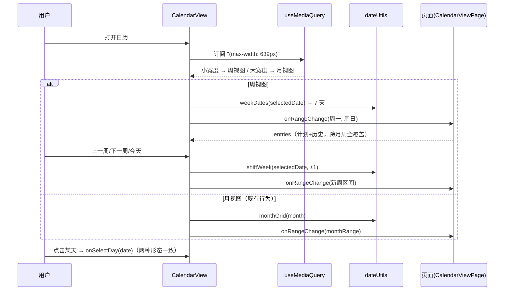

# 移动端日历周视图 - 技术提案

**功能名称**: 移动端日历周视图
**关联 PRD**: `docs/product/requirements/draft/2026-08-15-calendar-mobile-week-prd.md`
**技术提案版本**: v1.0
**创建日期**: 2026-08-15
**作者**: sumire workflow
**feat-branch**: `feat/calendar-mobile-week`

## 1. 概述

### 1.1 背景

`apps/bookstore/features/schedule/CalendarView.tsx` 固定渲染 6×7 月视图网格（`grid grid-cols-7`，格子 `min-h-16`），整个 `features/schedule/` 内无日历本体的断点适配。小宽度设备上单日格子约 40–50px 宽，条目摘要不可读。关联 PRD 要求：小宽度下改为展示一周的日程并支持周切换；大宽度保持月视图零回归。

现有基础：`CalendarView`（Client Component，props：`entries: CalendarEntry[]`、`onMonthChange(from, to)`、`onSelectDay(date)`）公开站 `/calendar` 与后台 `/backdoor/schedule` 共用；`dateUtils.ts` 提供 `monthGrid`/`monthRange`/`shiftMonth`/`toDateStr` 等纯函数（纯 `YYYY-MM-DD` 字符串比较，无日期库）；取数链路 `listPlans(from, to)` 支持任意日期区间。

### 1.2 目标

- `CalendarView` 增加响应式双形态：`< 640px`（Tailwind `sm` 断点以下）渲染周视图（单周 7 天 + 周切换 + 回到本周），`≥ 640px` 维持既有月视图；
- 周视图复用月视图的条目渲染与视觉语言（今天标记、过去弱化、历史记录来源样式、`+N` 收口），点天行为不变；
- 周计算抽为纯函数并完整单测；取数回调语义泛化为「可见范围变更」以覆盖跨月周；
- 不新增后端接口、不改契约。

### 1.3 范围

- **做**：`dateUtils.ts` 扩展周计算纯函数；新增 `useMediaQuery` hook；`CalendarView` 改造为月/周双形态（含 DayCell 提取、周切换头）；取数回调语义泛化；单元测试与 e2e（移动端视口）覆盖。
- **不做**：手势滑动切换；用户手动切换视图形态；单日列表形态；任何后端/契约变更。

## 2. 技术架构

### 2.1 系统架构图

```mermaid
graph TD
    P[/calendar 公开页 与 /backdoor/schedule 后台页/] --> CV[CalendarView]
    CV --> MQ[useMediaQuery<br/>max-width: 639px]
    MQ -->|小宽度| W[周视图: weekDates + 周切换头]
    MQ -->|大宽度| M[既有月视图: monthGrid]
    W --> DC[DayCell 共用格子渲染]
    M --> DC
    CV -->|onRangeChange(from, to)| PAGE[页面取数 listPlans(from,to)]
    CV -->|onSelectDay(date)| DIALOG[DayDetailDialog 不变]
```

### 2.2 技术栈

| 层级 | 技术选型 | 说明 |
|------|---------|------|
| 前端 | Next.js（`output: "export"`）+ React + TS strict | 改造仅限 Client Component `CalendarView` 与纯函数 |
| 样式 | Tailwind v4（@theme token） | 沿用既有 token，无硬编码色值 |
| 断点检测 | `window.matchMedia` | 见 6.1 决策（对比 CSS 双渲染方案） |
| 后端 | 无变更 | 不新增接口、不改契约 |
| 测试 | Vitest（单元）、Playwright（e2e，移动端视口） | 复用现有设施 |

### 2.3 模块划分

| 模块 | 职责 | 关键技术点 |
|------|------|-----------|
| `features/schedule/dateUtils.ts` | 扩展周计算纯函数 | `weekDates(dateStr) → string[7]`、`shiftWeek(dateStr, delta)`、`formatWeekRange(from, to)` |
| `lib/useMediaQuery.ts` | 断点判定 hook | `useSyncExternalStore` 封装 matchMedia，SSR 快照固定 `false` |
| `features/schedule/CalendarView.tsx` | 月/周双形态 | DayCell 提取、周切换头（上一周/下一周/今天）、选中日期单一事实源 |
| `CalendarViewPage.tsx` / `backdoor/schedule/page.tsx` | 回调改名适配 | `onMonthChange` → `onRangeChange`（签名不变） |
| `tests/unit/`、`tests/e2e/` | 测试覆盖 | 周计算、双形态渲染、周切换、移动端视口 e2e |

## 3. API 设计

### 3.1 API 契约

无变更。取数复用 `GET /api/stream-plans?from&to`（支持任意区间，跨月周天然覆盖）与 `GET /api/live-history`。

### 3.2 内部接口

- `CalendarView` props 调整：
  - `onMonthChange(from: string, to: string)` **改名**为 `onRangeChange(from: string, to: string)`，语义从「展示月份变更」泛化为「可见日期范围变更」：月视图传 `monthRange(month)`，周视图传该周周一~周日。签名不变，仅两处调用点（公开页与后台页）与相关测试适配；
  - `entries`、`onSelectDay` 不变。
- 新增纯函数（`dateUtils.ts`）：
  - `weekDates(dateStr: string): string[]` — 含 `dateStr` 的周一~周日 7 个 `YYYY-MM-DD`（周一为首日，与月视图口径一致）；
  - `shiftWeek(dateStr: string, delta: number): string` — 以 7 天为步长平移（跨月/跨年正确）；
  - `formatWeekRange(from: string, to: string): string` — 周区间可读标签（如 `8/10 – 8/16`，跨年/跨月完整呈现月份）。
- 新增 hook：`useMediaQuery(query: string): boolean`（`lib/useMediaQuery.ts`），`useSyncExternalStore` 实现，`getServerSnapshot` 固定返回 `false`（桌面/月视图为 SSR 与首帧形态）。

## 4. 数据模型

无变更。周视图是纯前端渲染形态切换，不引入新数据；条目模型 `CalendarEntry`（计划/历史双来源）原样复用。

## 5. 技术实现方案

### 5.1 核心流程



### 5.2 关键实现点

#### 实现点 1: 周计算纯函数（`dateUtils.ts` 扩展）

- **描述**: `weekDates`/`shiftWeek`/`formatWeekRange` 三个纯函数，与既有 `monthGrid`/`shiftMonth` 同风格：基于 `YYYY-MM-DD` 字符串与本地时区 `Date` 换算，不引入日期库。周一为一周首日（月视图已是周一开头，口径天然一致）。
- **技术细节**: `weekDates` 以 `dateStr` 构造 `Date`，按 `getDay()`（周日=0 需映射为 6）回推到周一后顺推 7 天；`shiftWeek` 等价于 `date ± delta*7 天`，复用字符串↔`Date` 换算；单测覆盖跨月（8/31 所在周含 9/1）、跨年（2026-12-28 所在周含 2027-01-01）、周一切换边界。
- **风险点**: 时区——构造 `Date` 时用 `new Date(y, m-1, d)` 本地时区构造（与既有 `parseDateStr` 一致），避免 `new Date("YYYY-MM-DD")` 的 UTC 解析陷阱。

#### 实现点 2: 断点 hook `useMediaQuery.ts`

- **描述**: `useSyncExternalStore(subscribe, getSnapshot, getServerSnapshot)` 封装 `matchMedia`：subscribe 监听 `change` 事件，getSnapshot 返回 `mql.matches`，getServerSnapshot 固定 `false`。
- **技术细节**: 用 `useSyncExternalStore` 而非 `useState + useEffect`，避免 effect 二次渲染与 hydration 不一致告警；SSR/首帧恒为月视图，移动设备首帧后即刻切换为周视图（单帧内完成，闪烁可忽略——页面为静态导出的小页面，无 CLS 敏感布局之上的折叠内容）。若评审认为首帧闪烁不可接受，备选为 6.1 的 CSS 双渲染方案。
- **风险点**: 极老浏览器无 `matchMedia` 时按 `false`（月视图）兜底，可接受。

#### 实现点 3: `CalendarView` 双形态改造

- **描述**: 引入「选中日期」`selectedDate`（初始今天）作为单一事实源：月视图展示 `selectedDate` 所在月，周视图展示 `selectedDate` 所在周；形态切换（断点跨越）时不丢选中日期，两种视图互相定位到同一日期。月视图现有的月切换按钮在周视图替换为周切换按钮（`‹` / `›`）与「今天」快捷钮；周标题为「2026 年 8 月 · 8/10 – 8/16」样式（跨月时区间两端各带月份）。
- **技术细节**: 提取 `DayCell` 子组件（同文件内）承载单日格子渲染（日期数字、今天标记、过去弱化、条目摘要、`+N` 收口、历史来源样式），月/周两形态共用，差异仅容器布局与格子高度（周视图格子加高如 `min-h-28`，摘要展示上限由 2 提至 4，超出仍 `+N`）。周视图单行 `grid grid-cols-7`。可见范围变更时统一经 `onRangeChange(from, to)` 上抛，取数与合并逻辑（`mergeEntries`、历史降级）零改动。
- **风险点**: DayCell 提取属同文件内重构，须保持月视图既有像素与交互零回归——以既有单元测试（`schedule-calendar-view.test.tsx`）全绿为准绳，先跑通再扩展。

#### 实现点 4: 调用点与测试适配

- **描述**: 两处调用点（`app/(site)/calendar/page.tsx` 经 `CalendarViewPage`、`app/backdoor/(dashboard)/schedule/page.tsx`）把 `onMonthChange` 改为 `onRangeChange`；回调体逻辑不变（仍是按区间 `listPlans(from, to)`）。历史记录为全量最近 100 条独立加载，不受可见范围影响，无需改动。
- **技术细节**: e2e 用 Playwright 移动端视口（如 `viewport: { width: 390, height: 844 }`）断言周视图渲染 7 天、周切换区间变化、点天弹层可用；桌面视口断言月视图回归。
- **风险点**: 无——回调签名不变，改动机械。

## 6. 技术决策

### 6.1 决策列表

| 决策 | 选项 A | 选项 B | 最终选择 | 原因 |
|------|--------|--------|---------|------|
| 断点判定方式 | JS `matchMedia` hook + 条件渲染 | CSS 双渲染（月/周两棵子树，断点类互斥显隐） | A | 双渲染会让两份交互树同时存在于 DOM（周切换状态、按钮均可达性混乱），且可见范围上抛语义无法随断点切换；JS 条件渲染语义干净，代价仅移动端首帧一次切换 |
| SSR 快照形态 | 固定月视图（`getServerSnapshot: false`） | 固定周视图 | A | 桌面是主要管理场景；移动端的单帧切换代价低于桌面端 |
| 断点阈值 | Tailwind `sm`（`< 640px` 为周视图） | `md`（`< 768px`） | A | 月视图在 640–768px 平板竖屏下格子已可读；阈值越小对既有体验侵入越少。评审可调整 |
| 周定位事实源 | 单一 `selectedDate`，月/周各自派生 | 月视图记 month、周视图记 week 两个状态 | A | 形态切换不丢失上下文（选中日期不变），状态最少 |
| 周切换粒度 | 整周平移（`±7 天`） | 保留月切换 + 周滑动 | A | PRD 口径：小宽度下以周替代月切换，交互最简单 |
| 格子渲染复用 | 提取 `DayCell` 子组件共用 | 周视图独立写一份格子渲染 | A | 避免视觉语言两处漂移；同文件内提取，不跨模块抽象 |
| 后端变更 | 无 | 新增按周取数接口 | A | 既有 `listPlans(from, to)` 已支持任意区间 |

### 6.2 依赖与约束

| 类型 | 内容 | 说明 |
|------|------|------|
| 依赖 | 既有 `CalendarView` / `dateUtils` / `mergeEntries` / 取数链路 | 改造基底 |
| 约束 | 静态导出（GitHub Pages） | 断点判定在客户端完成；SSR 快照固定月视图 |
| 约束 | Tailwind token 色、禁硬编码色值 | 沿用 `frontend-rules.md` |
| 约束 | 公开站与后台共用同一组件 | 双形态对两处同时生效 |
| 约束 | 分支 `feat/calendar-mobile-week` 自 `prd/calendar-mobile-week` 切出 | 遵循 `<type>/<slug>` 约定 |

## 7. 项目结构

```
apps/bookstore/
├── lib/
│   └── useMediaQuery.ts             # 新增：useSyncExternalStore 封装的断点 hook
├── features/schedule/
│   ├── dateUtils.ts                 # 扩展：weekDates / shiftWeek / formatWeekRange
│   └── CalendarView.tsx             # 改造：月/周双形态（DayCell 提取、周切换头、onRangeChange）
├── features/schedule/CalendarViewPage.tsx   # 适配：onMonthChange → onRangeChange
├── app/backdoor/(dashboard)/schedule/page.tsx # 适配：onMonthChange → onRangeChange
└── tests/unit/
    ├── schedule-calendar-view.test.tsx      # 扩展：周形态渲染、周切换、断点跨越
    └── schedule-date-utils-week.test.ts     # 新增：周计算（跨月/跨年/周一边界）
tests/e2e/                           # 新增：移动端视口周视图闭环 + 桌面视口月视图回归
```

后端（`servers/api`）、契约（`contract/`）、编排（`infra/aspire`）零变更。

## 8. 测试策略

### 8.1 测试覆盖要求

- 单元测试：`weekDates`（含跨月、跨年、当天为周一/周日边界）、`shiftWeek`（±1、±N 跨界）、`formatWeekRange`（同月/跨月/跨年标签）；`CalendarView` 周形态（mock `matchMedia` 为真：渲染 7 天、默认今天所在周、周切换回调上抛正确区间、「今天」回到本周、点天回调一致）、月形态回归（mock 为假：既有断言全绿）、形态切换保持选中日期；
- API 测试：无（零后端变更）；
- e2e：移动端视口（390×844）打开 `/calendar` 渲染周视图、切换上一周/下一周标题区间变化、点天弹层正常；桌面视口月视图无回归；后台页同口径抽查。

### 8.2 测试类型

| 类型 | 工具 | 覆盖范围 |
|------|------|---------|
| 单元测试 | Vitest + Testing Library | 周计算纯函数、双形态渲染与切换、hook（mock matchMedia） |
| E2E 测试 | Playwright（tests/e2e） | 移动端视口周视图闭环、桌面视口回归 |

## 9. 部署方案

### 9.1 环境规划

| 环境 | 用途 | 部署方式 |
|------|------|---------|
| 本地联调 | Aspire 编排（既有四资源） | `aspire start`，无配置变更 |
| GitHub Pages 生产 | 纯静态 | 无新增配置项 |

### 9.2 配置管理

无新增配置项。`NEXT_PUBLIC_API_BASE_URL` 等既有配置不变。

## 10. 验收标准

- [ ] 技术方案评审通过
- [ ] 小宽度（`< 640px`）日历渲染周视图：默认今天所在周、格子可读、周切换跨月/跨年正确、「今天」可回到本周
- [ ] 大宽度月视图零回归（既有单元测试与桌面视口 e2e 全绿）
- [ ] 周视图点天弹层、历史记录混合展示与降级行为与月视图一致
- [ ] 单元测试与 e2e（移动端视口）全部通过，`pnpm lint && pnpm test && pnpm build` 全绿

## 11. 相关文档

- 关联 PRD：`docs/product/requirements/draft/2026-08-15-calendar-mobile-week-prd.md`（v1.0）
- 关联 Contract：`contract/stream-plans.openapi.yaml`、`contract/live-history.openapi.yaml`（均复用，不变）
- 一期/二期文档：[[2026-08-13-weekly-schedule-prd]]、[[2026-08-15-weekly-schedule-v2-prd]]、`docs/engineering/proposals/2026-08-15-weekly-schedule-v2-proposal.md`
- 开发规范：`docs/engineering/frontend-rules.md`
