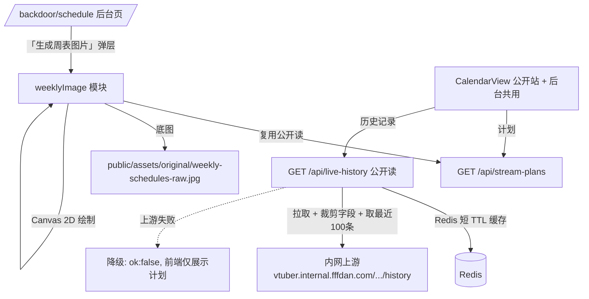
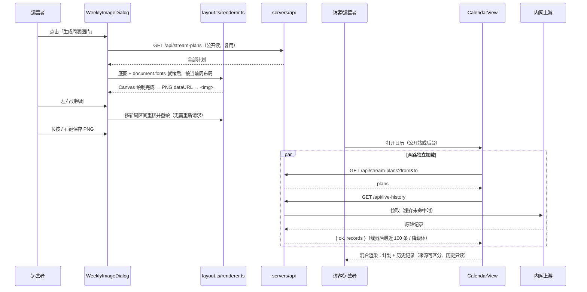

# 周表二期 - 技术提案

**功能名称**: 周表二期（周表图片生成 + 历史直播混合展示）
**关联 PRD**: `docs/product/requirements/draft/2026-08-15-weekly-schedule-v2-prd.md`
**技术提案版本**: v1.0
**创建日期**: 2026-08-15
**作者**: sumire workflow
**feat-branch**: `feat/weekly-schedule-v2`

## 1. 概述

### 1.1 背景

关联 PRD 在一期「直播计划 + 日历视图」基础上提出两块能力：

1. 后台「直播计划」页新增「生成周表图片」：以素材 `weekly-schedules-raw.jpg`（1665×1080，位于 `apps/bookstore/public/assets/original/`，每日绘制区域坐标见同目录 `AGENTS.md`）为底图，纯前端把已定直播计划文字绘制到图片上，支持周切换与长按/右键保存；
2. 日历视图混合展示官方历史直播记录，数据源为内网接口 `http://vtuber.internal.fffdan.com/api/b/live/1727076670/history`，仅取 `title`、`startDate`、`stopDate`，本期固定取最近 100 条。

现有基础：`features/schedule/` 已具备 `CalendarView`（月视图，公开站与后台共用）、`DayDetailDialog`（只读/管理双模式）、`api.ts`（`listPlans` 公开读）；`servers/api` 具备公开读/受限写路由模式与 MongoDB；Aspire 编排含 Redis 可用作缓存。

### 1.2 目标

- bookstore 新增「生成周表图片」弹层：周切换器（ISO 周，周一为一周首日，与日历口径一致）+ Canvas 绘制 + 保存提示，数据源复用 `GET /api/stream-plans`（公开读），不新增图片生成接口；
- `servers/api` 新增历史直播代理接口 `GET /api/live-history`（公开读）：服务端拉取内网上游、裁剪为 `title`/`startDate`/`stopDate`、取最近 100 条，Redis 短 TTL 缓存，上游失败返回可降级响应；
- 日历组件扩展为「计划 + 历史记录」混合渲染，来源可区分，历史记录只读；公开站与后台自动共享该能力。

### 1.3 范围

- **做**：`contract/live-history.openapi.yaml` 新契约；`servers/api` 新增 `live-history` 路由（代理 + 裁剪 + 缓存 + 降级）；bookstore 新增 `features/schedule/weeklyImage/`（周计算、布局纯函数、Canvas 渲染、生成弹层）、日历混合渲染改造（`CalendarView` / `DayDetailDialog` / `api.ts`）；单元测试、API 集成测试与 e2e 覆盖。
- **不做**：历史记录按日期区间取数（后续迭代）；图片的服务端生成/存储；历史记录与计划的对账标记；历史记录参与周表图片渲染（PRD 明确不渲染）。

## 2. 技术架构

### 2.1 系统架构图



### 2.2 技术栈

| 层级 | 技术选型 | 说明 |
|------|---------|------|
| 前端 | Next.js（`output: "export"`）+ React + TS，Canvas 2D | 生成弹层为 Client Component；布局计算抽为纯函数便于单测 |
| 后端 | Express 5（servers/api） | 新增 `GET /api/live-history` 公开读代理路由 |
| 缓存 | Redis（Aspire 既有资源） | 上游响应短 TTL 缓存 |
| 数据库 | 无新增 | 图片渲染仅读既有 `stream_plans` |
| 测试 | Vitest（单元 / API 集成）、Playwright（e2e） | 复用现有设施 |

### 2.3 模块划分

| 模块 | 职责 | 关键技术点 |
|------|------|-----------|
| `servers/api/src/routes/liveHistory.ts` | 历史直播代理接口 | 上游拉取、字段裁剪、最近 100 条、Redis 缓存、失败降级 |
| `apps/bookstore/features/schedule/weeklyImage/weekUtils.ts` | ISO 周计算 | 周一为一周首日，「2026 年第 xx 周」标签与日期区间 |
| `apps/bookstore/features/schedule/weeklyImage/layout.ts` | 布局纯函数 | 计划 → 每日绘制指令（文本、字号自适应、截断） |
| `apps/bookstore/features/schedule/weeklyImage/renderer.ts` | Canvas 渲染 | 底图加载、字体就绪等待、按坐标绘制、导出 PNG dataURL |
| `apps/bookstore/features/schedule/weeklyImage/WeeklyImageDialog.tsx` | 生成弹层 | 周切换器 + 预览 `` + 保存提示 |
| `apps/bookstore/features/schedule/api.ts` | 前端取数扩展 | 新增 `listLiveHistory()`，失败返回空并标记不可用 |
| `apps/bookstore/features/schedule/CalendarView.tsx` / `DayDetailDialog.tsx` | 混合渲染 | 统一条目模型（计划/历史双来源），历史记录只读样式 |
| `servers/api/src/infra/redis.ts`（按既有设施就近放置） | Redis 客户端 | 复用 Aspire 注入的连接串 |

## 3. API 设计

### 3.1 API 契约

新增契约文件 `contract/live-history.openapi.yaml`（不动既有两份契约），作为历史直播接口的单一事实源。周表图片生成复用既有 `GET /api/stream-plans`，契约不变。

#### 接口 1: 查询历史直播记录（公开）

- **请求**
  - Method: GET
  - Path: `/api/live-history`
  - 无需登录；无参数（本期固定返回最近 100 条，按 `startDate` 倒序）。
- **响应**
  - Status: 200（含降级形态）/ 502（上游异常且不走降级体时的保留状态，默认不使用——见降级设计）
  - Body:
    ```json
    {
      "ok": true,
      "records": [
        { "title": "歌杂", "startDate": "2026-08-12T20:00:00+08:00", "stopDate": "2026-08-12T23:05:00+08:00" }
      ]
    }
    ```
  - 降级形态（上游不可达/超时/返回非法）：HTTP 200 + `{ "ok": false, "records": [] }`。前端据 `ok:false` 静默降级为仅展示计划。选择 200 而非 502 的理由：历史记录是增量信息，失败不应表现为日历错误；`ok` 字段保留语义通道。

### 3.2 内部接口

- `routes/liveHistory.ts` 内部组织：上游地址来自环境变量 `LIVE_HISTORY_UPSTREAM_URL`（Aspire 注入，缺省值为 PRD 给定地址）；`fetch` 超时 5s；响应 JSON 解析后逐条裁剪为 `{ title, startDate, stopDate }`（缺 `title` 或 `startDate` 的条目丢弃），按 `startDate` 倒序取前 100 条；
- Redis 缓存：key `live-history:latest`，TTL 5 分钟；缓存命中直接返回；上游失败且有过期缓存时返回过期缓存（stale-if-error），仍无缓存则返回降级体；
- 前端 `features/schedule/api.ts` 新增：
  - `listLiveHistory(): Promise<{ ok: boolean; records: LiveRecord[] }>`，其中 `interface LiveRecord { title: string; startDate: string; stopDate?: string }`；`API_CONFIGURED` 为假或请求失败时返回 `{ ok: false, records: [] }`。

## 4. 数据模型

### 4.1 数据库设计

无新增集合。历史直播记录不落库——它是上游系统的实时数据，服务端只做中转、裁剪与缓存。

### 4.2 缓存设计

| key | 内容 | TTL | 说明 |
|-----|------|-----|------|
| `live-history:latest` | 裁剪后的最近 100 条记录 JSON | 300s | 写于上游拉取成功时；stale-if-error 兜底 |

## 5. 技术实现方案

### 5.1 核心流程



### 5.2 关键实现点

#### 实现点 1: ISO 周计算 `weekUtils.ts`

- **描述**: 纯函数模块：`getISOWeek(date) → { year, week }`、`getWeekRange(year, week) → { monday, sunday }`（`YYYY-MM-DD` 字符串）、`shiftWeek(year, week, delta)`、`formatWeekLabel(year, week) → "2026 年第 33 周"`。周一为一周首日，与日历组件口径一致；弹层打开时默认选中「今天所在周」。
- **技术细节**: 自实现 ISO-8601 周数算法（1 月 4 日所在周为第 1 周），不引入日期库——与一期 `dateUtils.ts` 同风格；年末/年初跨界（如 2026-12-28 属 2027 年第 1 周）单测覆盖。
- **风险点**: ISO 周与民间「周数」口径差异——以 ISO 为准并在 PRD 示例中锚定，评审确认。

#### 实现点 2: 布局纯函数 `layout.ts`

- **描述**: 输入 `plans`（已按 `date+startTime` 升序）与周一日期，输出 7 天的绘制指令数组：`{ dayIndex, x, y, width, height, text, fontSize }[]`。坐标常量来自素材 `AGENTS.md`：`x=365`，`y` 依次为 `278/379/480/580/681/782/883`（周一至周日），区域 `715×70`。同日多场按时间升序以「 / 」连接为单行；字号从基准（约 40px）起按文本实测宽度 shrink-to-fit 纳入 715 宽度，触底仍超宽则截断加「…」。
- **技术细节**: 文本宽度测量依赖 Canvas `measureText`，因此布局函数接收一个注入的 `measure(text, fontSize) → number`，单测用桩测量（按字符数近似）验证缩档与截断逻辑，真实渲染用 Canvas 实现。纯函数化是本功能的测试接缝。
- **风险点**: 超小字号下的可读性——设字号下限（如 22px），低于下限即截断；极端长主题在一期已被限制为 ≤50 字符，风险可控。

#### 实现点 3: Canvas 渲染与导出 `renderer.ts` + `WeeklyImageDialog.tsx`

- **描述**: 弹层打开时并行预加载：底图 `new Image()`（同源 public 资源，画布不污染，可自由导出）与 `document.fonts.load('600 40px "Noto Serif SC"')`（站点标题字体，贴合素材衬线花体气质；绘制前必须就绪，否则成品缺字）。就绪后按布局指令绘制：底图 `drawImage` 全幅铺底，逐日绘制 `HH:mm 主题`，文字色取站点纸页文字色 `#342a40`（实现时按素材底色微调对比度），基线对齐每日区域垂直居中。绘制完成 `canvas.toDataURL('image/png')` 赋给预览 ``——长按/右键保存直接作用于该 ``，移动端长按与桌面端右键均为浏览器原生行为，无需自实现下载逻辑。画布固定 1665×1080 内部分辨率，CSS 自适应弹层宽度。
- **技术细节**: 切换周只重跑布局 + 重绘（底图与字体已就绪，< 16ms 量级），不重发请求；`prefers-reduced-motion` 无关（无动画）。保存提示小字「长按保存图片，或右键另存为」置于预览下方（`--text-tiny`，`--color-ink-dim`）。
- **风险点**: 若部署形态把素材置于跨域 CDN，画布会被污染导致 `toDataURL` 抛错——本期素材随站点同源分发，无此问题；文档中标注该约束。字体加载失败（网络异常）时降级为已加载的 serif 族并继续绘制，同时控制台告警。

#### 实现点 4: 日历混合渲染改造

- **描述**: `CalendarView` 的数据入口从 `plans: StreamPlan[]` 扩展为统一条目 `CalendarEntry = { kind: "plan", plan: StreamPlan } | { kind: "history", record: LiveRecord, date: string, startTime: string }`。历史记录在前端归一化：`startDate`（ISO 时间戳，按访客本地时区）折算为 `date`（`YYYY-MM-DD`）与 `startTime`（`HH:mm`），与计划同键混排。格子内历史条目前缀改用藤蔓/墨色区分样式并带「实录」点标记（沿用 `--color-ink-dim` 弱化 + `--color-eye` 点的既有时间状态语言，历史记录恒为「已播出」样式）；`DayDetailDialog` 混合列出，历史行加「实际播出」小标签，任何角色均无编辑/删除入口，展示 `HH:mm 主题` 与（悬停/移动端次级行）`stopDate` 折算的结束时刻。两路数据独立加载：计划失败沿用一期错误提示，历史失败静默不渲染历史条目。
- **技术细节**: 归一化与合并抽为纯函数 `mergeEntries(plans, records, now)`，单测覆盖排序、跨天归日（按 `startDate` 归开播当日）、缺字段丢弃、来源样式映射。主页「本周日程」缎条区块**不混入**历史记录（缎条是计划入口，保持一期语义），改造仅限日历视图组件与当日弹层。
- **风险点**: 上游时间戳时区——以本地时区折算并在实现时用真实上游样本校准；记录与计划同日同时不合并去重（PRD 明确两条都展示）。

#### 实现点 5: 历史直播代理路由 `liveHistory.ts`

- **描述**: `app.ts` 挂载 `api.use("/live-history", …)`，仅 GET、公开读。处理链：读 Redis 缓存 → 命中即返回；未命中则 `fetch` 上游（5s 超时）→ 校验 JSON 结构 → 逐条裁剪 `{ title, startDate, stopDate }`（缺 `title`/`startDate` 丢弃）→ 按 `startDate` 倒序取 100 条 → 写缓存（TTL 300s）→ 返回 `{ ok: true, records }`；任一环节失败 → 有旧缓存返回旧缓存，否则 `{ ok: false, records: [] }`（HTTP 200）。
- **技术细节**: 上游地址走 `LIVE_HISTORY_UPSTREAM_URL` 环境变量（Aspire `infra/aspire` 中为 api 资源注入，本地缺省用 PRD 地址），内网地址不进前端 bundle、不进公开仓库配置之外的任何客户端可见位置。响应体上游字段原样透传这三个字符串，日期合法性交由前端归一化时校验。
- **风险点**: 上游不可达是常态风险（内网拓扑依赖部署环境），降级体 + 前端静默降级为双保险；API 集成测试以 mock 上游（本机起 stub server）覆盖成功/超时/非法 JSON/缺字段四类路径。

## 6. 技术决策

### 6.1 决策列表

| 决策 | 选项 A | 选项 B | 最终选择 | 原因 |
|------|--------|--------|---------|------|
| 图片绘制方式 | Canvas 2D 直接绘制 | DOM 布局 + html2canvas 截图 | A | 素材坐标已精确标注，Canvas 可控且零新依赖；html2canvas 体积大、对定制字体/阴影还原差 |
| 成品导出形态 | Canvas 转 PNG dataURL 赋给 `` | 直接展示 `<canvas>` | A | 长按/右键保存是 `` 的原生行为，移动端兼容最好；免自实现下载 |
| 渲染字体 | Noto Serif SC（站点标题字体） | 系统衬线回退 | A | PRD 要求符合站点设计；`document.fonts.load` 保证绘制前字体就绪 |
| 周口径 | ISO-8601 周（周一起） | 自然周（周日起）或简单计数 | A | 与日历组件周一开头、官方周表 MON–SUN 排列一致 |
| 历史记录接入 | 服务端代理（新增公开读接口） | 前端直连内网上游 | A | 上游是内网地址：前端直连有 CORS 与部署可达性问题，且会把内网地址暴露进公开 bundle；代理可裁剪字段、加缓存、失败降级 |
| 上游失败响应 | HTTP 200 + `{ ok: false, records: [] }` | HTTP 502 | A | 历史记录是增量信息，失败不应让日历「报错」；前端按 `ok` 静默降级 |
| 契约组织 | 新增 `contract/live-history.openapi.yaml` | 扩展 `stream-plans.openapi.yaml` | A | 历史直播是独立领域（外部数据中转），与计划 CRUD 不同生命周期 |
| 历史记录持久化 | 不落库，Redis 短 TTL 缓存 | 落 MongoDB | A | 上游是事实源，落库会引入同步与一致性负担；数据量小，缓存足够 |
| 周表图数据源 | 仅人工计划 | 计划 + 历史记录混合 | A | PRD 1.5 明确混合展示的日程不渲染 |
| 主页缎条区块 | 不混入历史记录 | 一并混合 | A | 缎条是「本周计划」入口，保持一期语义；混合仅发生在日历视图 |

### 6.2 依赖与约束

| 类型 | 内容 | 说明 |
|------|------|------|
| 依赖 | 一期 `features/schedule/` 组件与 `GET /api/stream-plans` | 图片数据源与日历基础 |
| 依赖 | 素材 `weekly-schedules-raw.jpg` 及坐标标注 | `apps/bookstore/public/assets/original/`，须同源分发（否则画布污染无法导出） |
| 依赖 | 内网上游 `…/api/b/live/1727076670/history` | 部署环境网络可达；字段结构以真实样本校准 |
| 依赖 | Redis（Aspire 既有资源） | 历史记录缓存 |
| 约束 | 静态导出（GitHub Pages） | 全部数据客户端运行时拉取；历史记录必须经服务端代理 |
| 约束 | 分支 `feat/weekly-schedule-v2` 自 `prd/weekly-schedule-v2` 切出 | 遵循 `<type>/<slug>` 约定 |

## 7. 项目结构

```
contract/
└── live-history.openapi.yaml        # 新增：历史直播代理接口契约
servers/api/src/
├── routes/liveHistory.ts            # 新增：GET /api/live-history（代理+裁剪+缓存+降级）
└── app.ts                           # 挂载 /api/live-history
infra/aspire/                        # 为 api 资源注入 LIVE_HISTORY_UPSTREAM_URL 与 Redis 引用
apps/bookstore/
├── app/backdoor/(dashboard)/schedule/page.tsx  # 新增「生成周表图片」按钮与弹层编排
├── features/schedule/
│   ├── weeklyImage/
│   │   ├── weekUtils.ts             # 新增：ISO 周计算纯函数
│   │   ├── layout.ts                # 新增：绘制布局纯函数（注入 measure，shrink-to-fit）
│   │   ├── renderer.ts              # 新增：底图/字体加载、Canvas 绘制、PNG 导出
│   │   └── WeeklyImageDialog.tsx    # 新增：生成弹层（周切换器 + 预览 + 保存提示）
│   ├── api.ts                       # 扩展：listLiveHistory()、LiveRecord 类型
│   ├── mergeEntries.ts              # 新增：计划+历史归一化合并纯函数
│   ├── CalendarView.tsx             # 改造：混合渲染（来源可区分）
│   └── DayDetailDialog.tsx          # 改造：历史行「实际播出」标签、只读
└── tests/unit/                      # 周计算、布局缩档/截断、合并归一化、弹层渲染、降级分支
tests/api/                           # 新增：live-history 成功/超时/非法/缺字段/缓存用例
tests/e2e/                           # 新增：生成弹层周切换与保存提示、日历混合展示与来源区分、上游失败降级
```

## 8. 测试策略

### 8.1 测试覆盖要求

- 单元测试：ISO 周计算（年末/年初跨界、周一切换）；布局纯函数（同日多场连接、字号缩档、超长截断「…」、无计划周输出空指令）；`mergeEntries`（混排排序、跨天归日、缺字段丢弃、来源样式映射）；弹层渲染（周标签、切换回调、保存提示文案）；历史失败时日历仅渲染计划；
- API 测试覆盖的端点：`GET /api/live-history`（200 成功且仅含三字段、条数 ≤100 且倒序、上游超时降级 `ok:false`、上游非法 JSON 降级、缺字段条目丢弃、二次请求命中缓存——可用 Redis key 或响应一致性佐证）；
- e2e：后台打开「生成周表图片」→ 周切换器标签变化 → 预览 `` 存在且 `src` 为 PNG dataURL → 保存提示可见；日历（公开站与后台）同日出现计划与历史记录且来源样式可辨；历史记录在弹层中无编辑/删除入口；上游失败时日历正常仅显示计划。

### 8.2 测试类型

| 类型 | 工具 | 覆盖范围 |
|------|------|---------|
| 单元测试 | Vitest + Testing Library | 周计算、布局、合并、弹层与日历降级 |
| API 集成测试 | Vitest + fetch（tests/api） | live-history 端点全路径（stub 上游） |
| E2E 测试 | Playwright（tests/e2e） | 生成弹层闭环、日历混合展示、降级 |

## 9. 部署方案

### 9.1 环境规划

| 环境 | 用途 | 部署方式 |
|------|------|---------|
| 本地联调 | Aspire 编排（bookstore + api + Redis + MongoDB），api 注入上游地址 | `aspire start` |
| GitHub Pages 生产 | 纯静态、不配置后台服务 | 后台不可达、日历 404（沿用一期口径） |

### 9.2 配置管理

| 配置项 | 说明 |
|--------|------|
| `LIVE_HISTORY_UPSTREAM_URL` | 新增：历史直播上游地址，Aspire 注入 api 资源；缺省为 PRD 给定内网地址 |
| Redis 连接串 | 复用 Aspire 既有注入链 |
| `NEXT_PUBLIC_API_BASE_URL` | 复用：前端经此前缀访问 `/api/live-history`，内网地址不进 bundle |

## 10. 验收标准

- [ ] 技术方案评审通过
- [ ] `contract/live-history.openapi.yaml` 评审通过
- [ ] 后台「生成周表图片」弹层可按周渲染计划到素材底图，文字落位 715×70 区域、字体贴合设计、同日多场完整呈现
- [ ] 预览图片可长按/右键保存；提示小字可见
- [ ] 周表图片仅含人工计划，历史记录不渲染
- [ ] 日历（公开站与后台同组件）混合展示计划与最近 100 条历史记录，来源可区分、历史只读
- [ ] 上游失败时日历静默降级仅展示计划
- [ ] 单元测试、API 测试、E2E 测试全部通过

## 11. 相关文档

- 关联 PRD：`docs/product/requirements/draft/2026-08-15-weekly-schedule-v2-prd.md`（v1.0）
- 关联 Contract：`contract/live-history.openapi.yaml`（新增）、`contract/stream-plans.openapi.yaml`（复用，不变）
- 一期文档：[[2026-08-13-weekly-schedule-prd]]、`docs/engineering/proposals/2026-08-13-weekly-schedule-proposal.md`
- 设计文档：`docs/design/01-visual-identity.md`、`docs/design/04-weekly-schedule-design.md`
- 素材坐标说明：`apps/bookstore/public/assets/original/AGENTS.md`
- 开发规范：`docs/engineering/frontend-rules.md`、`docs/engineering/backend-rules.md`
