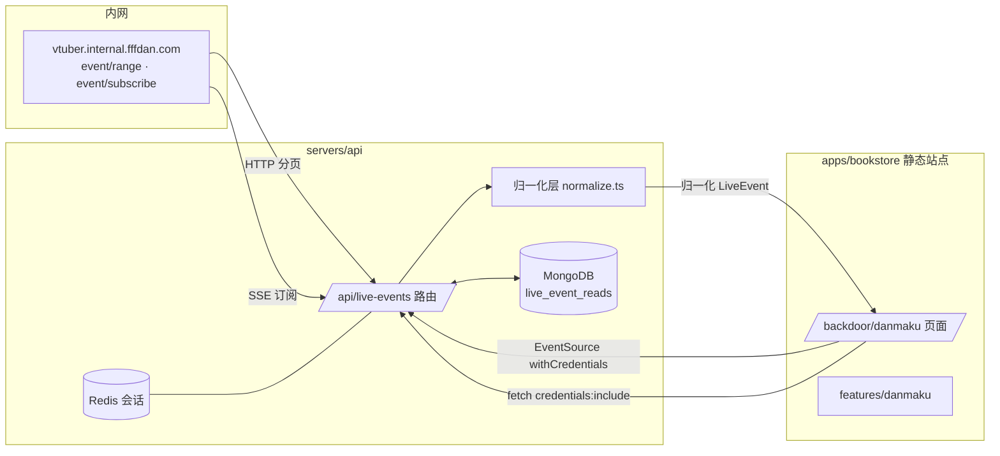
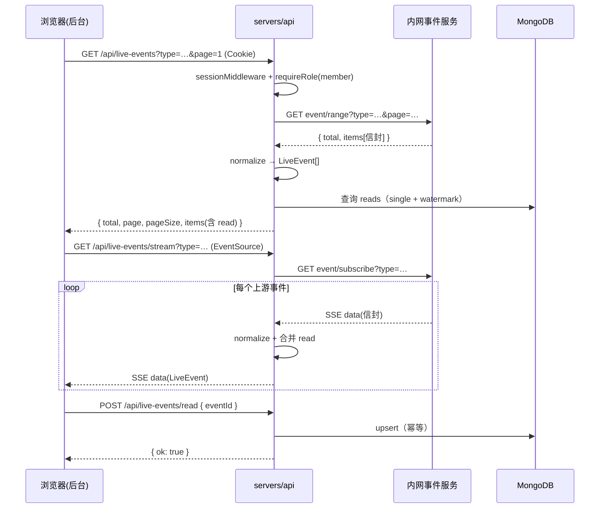

# 弹幕后台技术提案

**功能名称**: 弹幕后台（Danmaku Backdoor）
**关联 PRD**: `docs/product/requirements/draft/2026-08-16-danmaku-backdoor-prd.md`
**技术提案版本**: v1.0
**创建日期**: 2026-08-16
**作者**: sumire workflow
**feat-branch**: `feat/danmaku-backdoor`

## 1. 概述

### 1.1 背景

后台需新增「弹幕后台」模块，展示直播间弹幕 / SC / 礼物 / 上船事件。数据源为内网服务（仅服务端可达）：

- 历史检索：`GET http://vtuber.internal.fffdan.com/api/b/live/1727076670/event/range?type=…&page=1&pageSize=50`
- 实时推送：`GET http://vtuber.internal.fffdan.com/api/b/live/1727076670/event/subscribe?type=…`（SSE）

已于 2026-08-16 对线上服务实测采样：

- 事件类型为 `danmaku`、`super_chat`、`gift`、`guard_buy`（`guard` 无数据，上船类型名为 `guard_buy`）；
- 信封结构统一：`{ roomId, type, occurredAt, liveSessionId, payload }`，`payload` 为 B 站原始 cmd（`DANMU_MSG` / `SUPER_CHAT_MESSAGE` / `SEND_GIFT` / `GUARD_BUY`），结构混乱且各类型差异大；
- 上船（`GUARD_BUY`）payload 仅有 `uid/username/guard_level/num/price/gift_name`，**无头像、无粉丝团牌子**；
- SSE 订阅端点在无事件时不主动刷响应头，行为需在实现期进一步验证（心跳、重连）。

### 1.2 目标

- `servers/api` 新增 `live-events` 域：历史检索代理 + SSE 组合订阅 + 已读状态持久化，全部鉴权；
- 上游原始 payload 在服务端归一化为稳定 `LiveEvent` 模型，前端不感知 B 站结构；
- `apps/bookstore` 后台新增 `/backdoor/danmaku` 页面：分栏可配置、虚拟化信息流、已读管理、滚动稳定与回到顶部。

### 1.3 范围

**做**：

- `contract/live-events.openapi.yaml` 新契约（契约步骤在 `contract/danmaku-backdoor` 分支产出）；
- `servers/api`：`/api/live-events` 路由（检索 / SSE / 已读读写）、归一化层、`live_event_reads` 集合；
- `apps/bookstore`：`/backdoor/danmaku` 页面与 `features/danmaku/` 模块（公共 Sender 组件、四类条目、虚拟化栏容器、栏位配置）；
- API 集成测试与 e2e 关键路径。

**不做**：

- 事件数据本身持久化；
- 弹幕过滤/屏蔽、统计报表、栏位配置服务端同步（PRD「后续可能」）。

## 2. 技术架构

### 2.1 系统架构图



### 2.2 技术栈

| 层 | 技术 |
|----|------|
| 前端 | Next.js 16 App Router（`output: "export"` SSG）+ React 19 + TS strict + Tailwind v4 |
| 虚拟列表 | `@tanstack/react-virtual`（新增依赖，见 6.1-D5） |
| 实时推送 | SSE（原生 `EventSource`，`withCredentials: true`） |
| 后端 | Express 5 + TS strict，`create*Router()` 工厂 + `AppDeps` 注入 |
| 持久化 | MongoDB（Mongoose，`live_event_reads`）；会话沿用 Redis |
| 测试 | Vitest（API 集成 + 前端单测）、Playwright（e2e） |

### 2.3 模块划分

| 模块 | 职责 | 关键技术点 |
|------|------|-----------|
| `servers/api/src/routes/liveEvents.ts` | 检索/已读读写/SSE 四个端点 | 工厂函数、sessionMiddleware + requireRole |
| `servers/api/src/liveEvents/upstream.ts` | 内网服务 HTTP/SSE 客户端 | fetch 分页、SSE 解析、错误兜底 |
| `servers/api/src/liveEvents/normalize.ts` | payload → `LiveEvent` 归一化、事件 ID 派生 | 各 cmd 字段映射、防御式解析 |
| `servers/api/src/db/liveEventReads.ts` | 已读状态 Mongoose 模型 | 唯一索引、幂等 upsert |
| `apps/bookstore/features/danmaku/` | 页面业务组件与 hooks | Sender 公共组件、虚拟栏、滚动锚定 |
| `apps/bookstore/app/backdoor/(dashboard)/danmaku/page.tsx` | 路由组装 | 复用 dashboard 会话守卫 |

## 3. API 设计

### 3.1 API 契约

新增契约文件 `contract/live-events.openapi.yaml`（单一事实源，按契约步骤在 `contract/danmaku-backdoor` 分支产出并提 PR 审批）。端点摘要：

**`GET /api/live-events`** — 历史事件检索（member 及以上）

- Query：`type`（可重复：`danmaku`/`super_chat`/`gift`/`guard_buy`）、`page`（默认 1）、`pageSize`（默认 50，上限 100）
- 200：`{ total, page, pageSize, items: LiveEvent[] }`（`LiveEvent` 见 4.2，`read` 已合并）
- 401：未登录；上游失败：502 `{ error: "上游事件服务不可用" }`

**`GET /api/live-events/stream`** — SSE 实时事件流（member 及以上）

- Query：`type`（可重复，同上）
- 响应：`Content-Type: text/event-stream`；每条 `data: <LiveEvent JSON>\n\n`；每 30s 发送 `: ping` 心跳注释保活
- 401：未登录；上游断流时服务端指数退避重连（1s→30s 上限），重连成功前不关闭客户端连接

**`POST /api/live-events/read`** — 单条标记已读（admin 及以上）

- Body：`{ eventId: string }`；200：`{ ok: true }`（幂等 upsert）；403：member；400：`{ error: "eventId 不能为空" }`

**`POST /api/live-events/unread`** — 单条取消已读（admin 及以上）

- Body：`{ eventId: string }`；200：`{ ok: true }`（幂等）；403：member
- 语义：撤销单条已读标记；对因「全部已读」水位线而置灰的条目，写入一条显式未读覆盖记录（优先级高于水位线）

**`POST /api/live-events/read-all`** — 按类型全部已读（admin 及以上）

- Body：`{ type: "super_chat" | "guard_buy" }`；200：`{ ok: true, marked: number }`
- 语义：为该类型当前已知的最新事件记一条「水位线」（`readBefore: occurredAt`），检索/推送时 `occurredAt <= readBefore` 即视为已读。避免对历史全量事件逐条写入（SC 样本 total=276，全量 upsert 也可接受，水位线更省）

### 3.2 内部接口

- `upstream.fetchRange(types, page, pageSize): Promise<UpstreamPage>`；
- `upstream.subscribe(types, onEvent, signal): void`（内部逐行解析 SSE）；
- `normalize.toLiveEvent(envelope): LiveEvent | null`（无法识别的事件返回 null 并记日志，不中断流）；
- `reads.markRead(eventId, user)` / `reads.markUnread(eventId, user)` / `reads.markAllRead(type, user)` / `reads.resolveReadState(events)`（批量合并已读标记）。

## 4. 数据模型

### 4.1 数据库设计

集合 `live_event_reads`（MongoDB / Mongoose）：

| 字段 | 类型 | 说明 |
|------|------|------|
| `eventId` | string | 事件唯一 ID（见 4.2 派生规则）；水位线记录用 `watermark:{type}` |
| `type` | string | `super_chat` / `guard_buy` |
| `kind` | string | `read`（单条已读）/ `unread`（单条显式未读，用于撤销水位线覆盖）/ `watermark` |
| `readBefore` | Date? | 水位线：该时间及之前事件均视为已读 |
| `readBy` | string | 操作人用户名 |
| `readAt` | Date | 标记时间 |

索引：`{ eventId: 1 }` 唯一；`{ type: 1, kind: 1 }`。同一 `eventId` 至多一条单条记录，`kind` 在 `read` / `unread` 间随最新操作覆盖。

已读判定规则（检索与推送出口统一）：单条记录存在时以 `kind === "read"` 为准（`unread` 显式覆盖水位线）；无单条记录时 `occurredAt <= readBefore` 即已读。

事件数据本身**不落库**。Redis 无新增用途（会话/限速沿用）。

### 4.2 归一化 LiveEvent 模型

```ts
interface LiveEvent {
  eventId: string;        // 见下方派生规则
  type: "danmaku" | "super_chat" | "gift" | "guard_buy";
  occurredAt: string;     // ISO，沿用信封 occurredAt
  sender: {
    uid: number;
    name: string;
    face: string | null;          // guard_buy 无头像 → null，前端兜底
    medal: { name: string; level: number; color: string } | null;
  };
  content?: string;       // danmaku 文本 / SC 留言
  price?: number;         // 元：SC 直接用 data.price；礼物=金瓜子 combo_total_coin/1000（银瓜子=0）；上船=price/1000
  scColors?: { backgroundStart: string; backgroundEnd: string; fontColor: string };
  gift?: { name: string; count: number };
  guard?: { level: number; name: string; count: number };  // level 3/2/1 → 舰长/提督/总督
  read: boolean;          // 服务端合并
}
```

`eventId` 派生（归一化时生成，保证幂等去重）：

- `danmaku`：`dm:{extra.id_str}`（dm_v2 extra JSON 内含 `id_str`）；
- `super_chat`：`sc:{data.id}`；
- `gift`：`gift:{batch_combo_id ?? combo_id}`；
- `guard_buy`：`guard:{uid}:{start_time}`。

上游字段映射（基于 2026-08-16 实测样本，实现期以样本固化单测夹具）：

| 目标字段 | danmaku (DANMU_MSG) | super_chat | gift (SEND_GIFT) | guard_buy |
|----------|--------------------|-----------|------------------|-----------|
| uid / name / face | `info[15].user.base.{uid?→info[2][0], name, face}` | `data.uid` / `data.uinfo.base.{name,face}` | `data.{uid,uname,face}` | `data.uid` / `data.username` / 无 |
| medal | `info[15].user.medal`（name/level/color） | `data.medal_info`（medal_name/medal_level/medal_color） | `data.medal_info` | 无 |
| content | `extra.content`（或 `info[1]`） | `data.message` | — | — |
| price | — | `data.price`（元） | `data.combo_total_coin/1000`（`coin_type==="gold"`，否则 0） | `data.price/1000` |
| scColors | — | `data.{background_color_start, background_color_end, message_font_color}` | — | — |
| gift | — | — | `data.{giftName, combo_send.combo_num}` | — |
| guard | — | — | — | `data.{guard_level, gift_name, num}` |

## 5. 技术实现方案

### 5.1 核心流程



### 5.2 关键实现点

**K1 上游代理与归一化（服务端）**

- 描述：`upstream.ts` 封装内网服务访问；`normalize.ts` 将四类 cmd 映射为 `LiveEvent`。
- 技术细节：上游地址经配置注入（`LIVE_EVENTS_UPSTREAM_URL`，缺省回退内网地址，与 `liveHistory` 既有口径一致）；归一化对缺失字段防御式解析（可选链 + 默认值），解析失败返回 null 并 `console.warn`，不抛断流；样本 JSON 固化为 `servers/api/tests` 夹具驱动单测。
- 风险点：B 站 payload 结构漂移——归一化层集中一处，配合夹具测试兜底；上船无头像/牌子属上游事实，前端兜底渲染。

**K2 SSE 组合转发（服务端）**

- 描述：按请求 `type` 组合向上游发起一条订阅，将事件逐条归一化后写往客户端。
- 技术细节：采用**按连接透传**（每个客户端连接对应一条上游订阅），而非共享上游连接扇出；Express 5 下 `res.write` + `flushHeaders()`，30s 心跳注释防代理断连；客户端断开（`req.on("close")`）即中止上游请求（AbortController）；上游断流指数退避重连。
- 风险点：后台同时在线人数少（个位数），按连接透传的上游压力可忽略；上游无事件时不刷头（实测），须在实现期验证并确保服务端主动 `flushHeaders()` 先下 200 + 头。

**K3 已读状态合并与水位线**

- 描述：检索与推送出口统一经 `resolveReadState` 合并已读标记；全部已读用水位线避免全量写入；单条取消已读可撤销水位线覆盖。
- 技术细节：单次查询取该类型单条记录（eventId → kind 映射）与最新 `watermark`；`read = 单条记录 ? kind === "read" : occurredAt <= readBefore`；`markAllRead` 取当前检索第一页最新 `occurredAt` 写水位线（upsert，只前进不后退）；`read` / `unread` 均为同一 eventId 上的幂等 upsert（覆盖 kind）。
- 风险点：水位线时刻之后到达的历史乱序事件会被判未读——上游按时间倒序分页，乱序概率低，可接受；单条标记可补。

**K4 虚拟化信息流与滚动锚定（前端）**

- 描述：栏容器基于 `@tanstack/react-virtual`，倒序信息流顶部插入新事件；用户离开顶部时保持可视内容不动。
- 技术细节：滚动容器 `ref` + `useVirtualizer({ count, getScrollElement, estimateSize, overscan })`；新事件 prepend 前记录 `scrollHeight` 与 `scrollTop`，渲染后 `scrollTop += 新 scrollHeight - 旧 scrollHeight`（仅当 `scrollTop > 阈值`，贴顶时保持贴顶跟随最新）；`scrollTop > 200` 时显示「回到顶部」悬浮按钮（`scrollTo({ top: 0 })`）；项高不固定，virtualizer 动态测量（`measureElement`）。
- 风险点：prepend + 动态测高组合下锚定误差——以 e2e「滚动中插入新事件位置不跳」断言兜底。

**K5 实时接入与去重（前端）**

- 描述：`useLiveEventStream(types)` hook 建立 `EventSource(`${API_BASE_URL}/api/live-events/stream?…`, { withCredentials: true })`，事件按类型分发进各栏状态。
- 技术细节：事件入列前按 `eventId` 在内存 Set 中去重（历史首屏 + SSE 重叠、重连重推）；断线由 EventSource 内建自动重连；连接状态暴露给页面显示提示条。
- 风险点：跨域 SSE 依赖 Cookie + CORS credentials——沿用既有 CORS 白名单口径，e2e 经 Aspire 编排验证。

**K6 已读交互（前端）**

- 描述：SC / 上船条目双击切换已读状态（未读→已读置灰，已读→取消已读去除置灰），栏头「标记全部已读」按钮；member 角色不渲染交互。
- 技术细节：双击处理用 `onDoubleClick`（单击穿透 B 站空间链接不冲突：链接在头像/昵称上，空白区双击触发已读切换）；按当前 `read` 状态分别调用 `read` / `unread` 接口；乐观更新本地状态，失败回滚并提示；「全部已读」确认后调用 read-all 并整体置灰，此后单条双击仍可通过 unread 单独取消。
- 风险点：误触——双击阈值天然防误触；全部已读加二次确认。

**K7 分栏布局配置（前端）**

- 描述：默认 3 栏（弹幕 | SC | 礼物+上船），每栏事件类型组合可配置，配置存 localStorage。
- 技术细节：配置模型 `ColumnConfig[] = { id, types: LiveEventType[] }[]`，key `danmaku-backdoor.columns`；<1024px 纵向堆叠（Tailwind 响应式，纯 CSS 无需 JS）。
- 风险点：配置损坏（手改 localStorage）——读取时 Zod 校验，非法回退默认。

## 6. 技术决策

### 6.1 决策列表

| 决策 | 选项 A | 选项 B | 最终选择 | 原因 |
|------|--------|--------|----------|------|
| D1 SSE 上游连接模式 | 按连接透传 | 共享上游连接 + 内存扇出 | A | 后台并发个位数，透传零共享状态、实现简单；扇出引入连接生命周期管理复杂度 |
| D2 归一化位置 | 服务端归一化 | 前端直解原始 payload | A | 契约稳定、前端不感知 B 站结构漂移；与「通过 api 对外提供服务」一致 |
| D3 全部已读实现 | 水位线（readBefore） | 全量逐条 upsert | A | 写入恒定 O(1)；乱序漏判可用单条标记补 |
| D4 栏位配置持久化 | localStorage | 服务端账号体系 | A | 布局属个人偏好，PRD 未要求跨设备；避免 users 模型膨胀 |
| D5 虚拟化方案 | 新增 `@tanstack/react-virtual` | 手写虚拟列表 | A | 动态测高 + 滚动 API 成熟；手写成本高且易错。新增依赖需随 feat 分支 PR 说明 |
| D6 已读写权限 | admin 及以上 | member 亦可 | A | 与后台「member 只读降级」既有口径一致 |
| D7 事件 ID | 服务端派生 | 前端派生 | A | 已读持久化依赖稳定 ID，须服务端权威 |

### 6.2 依赖与约束

| 项 | 说明 |
|----|------|
| 内网事件服务 | 仅服务端可达；地址走配置 `LIVE_EVENTS_UPSTREAM_URL` |
| 新增前端依赖 | `@tanstack/react-virtual`（仅此一项） |
| 既有体系 | Session-Cookie + Redis 会话 + RBAC、MongoDB、Aspire 编排、CORS 白名单，全部复用不改造 |
| SSG 约束 | 后台维持客户端会话守卫，页面数据全部客户端拉取 |

## 7. 项目结构

```
contract/
└── live-events.openapi.yaml                 # 新增（契约步骤，contract/danmaku-backdoor 分支）

servers/api/src/
├── config.ts                                # 改造：新增 liveEventsUpstreamUrl
├── app.ts                                   # 改造：挂载 /api/live-events
├── liveEvents/                              # 新增
│   ├── upstream.ts                          # 内网服务 HTTP/SSE 客户端
│   └── normalize.ts                         # payload → LiveEvent、eventId 派生
├── db/
│   └── liveEventReads.ts                    # 新增：已读/水位线 Mongoose 模型
└── routes/
    └── liveEvents.ts                        # 新增：createLiveEventsRouter(deps)

apps/bookstore/
├── app/backdoor/(dashboard)/danmaku/
│   └── page.tsx                             # 新增：路由组装
└── features/
    ├── backdoor/components/SideNav.tsx      # 改造：注册「弹幕后台」入口
    └── danmaku/                             # 新增
        ├── api.ts                           # 检索/已读写 fetch 封装
        ├── types.ts                         # LiveEvent、ColumnConfig（Zod）
        ├── useLiveEventStream.ts            # SSE hook（去重、连接状态）
        ├── useAnchoredFeed.ts               # prepend 锚定 + 回到顶部
        ├── columns.ts                       # 栏位配置读写（localStorage + Zod）
        └── components/
            ├── Sender.tsx                   # 公共：头像+昵称+牌子+空间链接
            ├── DanmakuItem.tsx
            ├── SuperChatItem.tsx            # 两行 + scColors + 置灰层
            ├── GiftItem.tsx
            ├── GuardItem.tsx                # 船型映射 + 置灰层
            ├── FeedColumn.tsx               # 虚拟化栏容器 + 回到顶部
            └── DanmakuDashboard.tsx         # 分栏布局 + 栏位配置 UI

tests/api/                                   # 新增 live-events 集成测试（mock 上游）
tests/e2e/                                   # 新增 danmaku-backdoor e2e 关键路径
```

## 8. 测试策略

### 8.1 覆盖要求

- 遵循 TDD：先失败测试再实现；
- 归一化层以实测样本夹具全覆盖四类事件 + 缺字段容错；
- API 集成测试经 mock 上游（本地 HTTP/SSE stub），不依赖真实内网服务；
- e2e 覆盖关键路径（Aspire 编排注入端点）。

### 8.2 测试类型

| 类型 | 内容 |
|------|------|
| 后端单测/集成 | 未认证 401 矩阵（四端点）；member 写操作 403；归一化四类事件映射正确性；eventId 稳定性；read/unread 幂等与 kind 覆盖；unread 显式撤销水位线覆盖；read-all 水位线只前进；SSE 帧格式与心跳；上游 5xx → 502 中文错误；非 /api 404 回归 |
| 前端单测 | `columns.ts` Zod 校验回退；`useAnchoredFeed` 锚定偏移计算；船型/金额换算；Sender 缺牌子/缺头像渲染 |
| e2e | 登录 → 进入弹幕后台 → 三栏渲染；滚动中注入新事件位置不跳 + 回到顶部；双击 SC 置灰且刷新后保持；member 不见已读交互 |

## 9. 部署方案

### 9.1 环境规划

- 本地联调：Aspire 编排新增 `LIVE_EVENTS_UPSTREAM_URL` 注入（默认内网地址，可被 stub 覆盖供测试）；
- 生产：后台 API 与 MongoDB/Redis 沿用既有部署，无新增基础设施。

### 9.2 配置管理

| 配置 | 位置 | 说明 |
|------|------|------|
| `LIVE_EVENTS_UPSTREAM_URL` | servers/api 环境变量 | 内网事件服务 base URL，缺省 `http://vtuber.internal.fffdan.com` |
| `NEXT_PUBLIC_API_BASE_URL` | bookstore 构建变量 | 沿用既有口径，未配置则后台整体 404 |

## 10. 验收标准

- [ ] 契约 `contract/live-events.openapi.yaml` 经 PR 审批合并回 feat 分支；
- [ ] 四端点鉴权矩阵符合 3.1（401/403）；
- [ ] 四类事件归一化输出与 4.2 模型一致，eventId 稳定；
- [ ] SSE 单连接多 type 组合推送，断线可恢复；
- [ ] 单条已读/取消已读/全部已读持久化，刷新后保持，已读置灰、取消已读去除置灰；
- [ ] 默认 3 栏布局，栏位配置刷新后保留，窄屏堆叠；
- [ ] 滚动中新事件插入位置不跳，回到顶部可用；
- [ ] 全部信息流虚拟化；
- [ ] `pnpm lint && pnpm test && pnpm build`（bookstore）与 `pnpm lint && pnpm test`（servers/api）全绿，API 集成与 e2e 通过。

## 11. 相关文档

- PRD：`docs/product/requirements/draft/2026-08-16-danmaku-backdoor-prd.md`
- 前端规范：`docs/engineering/frontend-rules.md`；后端规范：`docs/engineering/backend-rules.md`
- 后台设计：`docs/design/03-backdoor-design.md`
- 既有契约：`contract/backdoor-auth.openapi.yaml`、`contract/live-history.openapi.yaml`
