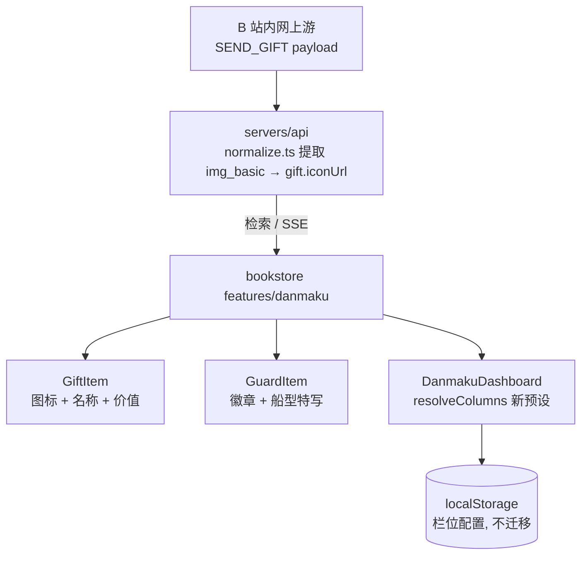
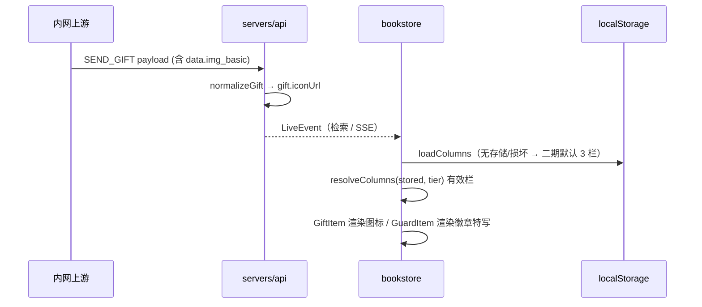

# 弹幕看板二期 - 技术提案

**功能名称**: 弹幕看板二期（Danmaku Board v2）
**关联 PRD**: `docs/product/requirements/draft/2026-08-16-danmaku-board-v2-prd.md`
**技术提案版本**: v1.0
**创建日期**: 2026-08-16
**作者**: sumire workflow
**feat-branch**: `feat/danmaku-board-v2`

## 1. 概述

### 1.1 背景

弹幕看板一期已上线并归档（现态见 `docs/product/spec/danmaku.md`）。二期为展示层四点改造：

1. **文案更名**：「弹幕后台」→「弹幕看板」，涉及 `SideNav` NAV_ITEMS、`app/backdoor/(dashboard)/danmaku/page.tsx` 两处页头标题及对应单测；
2. **默认分栏调整**：`columns.ts` 的 `DEFAULT_COLUMNS` 与 `COLUMN_PRESETS` 现态为 3 栏「礼物 | SC+上船 混排 | 弹幕」、2 栏「SC+上船 混排 | 弹幕+礼物 混排」，二期要求 3 栏「礼物 | 上船+SC 分节 | 弹幕」、2 栏「上船+SC 分节 | 礼物+弹幕 混排」、1 栏不变；
3. **礼物图标**：`contract/live-events.openapi.yaml` 的 `gift` schema 仅有 `name`/`count`，无图标字段；前端 `GiftItem` 纯文字。上游 B 站 `SEND_GIFT` payload 携带 `data.img_basic`（现存 fixture `tests/fixtures/live-events/gift.json` 未含该字段，需以实测样本确认）；
4. **上船特写**：`GuardItem` 现态已有船型色竖条/chip/条目打底，`Sender` 头像已有本地徽章挂件（`guardBadgeAsset`：舰长/提督/总督三枚 PNG）。二期要求在条目一级视觉按船型特写，但克制不加动效。

### 1.2 目标

- 全部用户可见文案更名「弹幕看板」，路由不变；
- `DEFAULT_COLUMNS` / `COLUMN_PRESETS[2]` 按二期口径调整（分节/混排与栏内类型顺序），存量 localStorage 配置不迁移；
- 契约 `gift` 增加可选 `iconUrl`，服务端归一化提取上游 `img_basic`，前端 `GiftItem` 固定尺寸渲染、失败隐藏；
- `GuardItem` 船型 chip 前置本地徽章图标 + 船型名强调，逐级区分舰长/提督/总督；
- 一期既有能力（已读管理、虚拟化、视口自适应）零回归。

### 1.3 范围

- **做**：前端文案更名（SideNav/页头/单测）；`columns.ts` 预设调整；契约 `gift.iconUrl` 增补 + 服务端归一化 + `GiftItem` 图标渲染；`GuardItem` 船型特写；单元测试更新。
- **不做**：路由变更；栏位配置强制迁移；礼物图标代理/缓存；任何已读/检索/SSE 接口行为变更；编排与基础设施变更。

## 2. 技术架构

### 2.1 系统架构图



### 2.2 技术栈

| 层级 | 技术选型 | 说明 |
|------|---------|------|
| 前端 | Next.js（App Router）+ React + TS strict | 改造集中在 `features/danmaku/` 与侧栏/页头 |
| 样式 | Tailwind v4（@theme token） | 沿用一期船型色 token（eye/flower/crimson），禁硬编码色值 |
| 后端 | Express 5 + TS strict | 仅 `liveEvents/normalize.ts` 增加 `img_basic` 提取 |
| 契约 | `contract/live-events.openapi.yaml` | `gift` schema 增加可选 `iconUrl`（单一事实源） |
| 素材 | 本地徽章 PNG（既有 `public/assets/original/guard-badge-*.png`） | 复用 `guardBadgeAsset`，不新增素材 |
| 测试 | Vitest（前端单元 + 服务端单测） | 无 API/e2e 新增端点 |

### 2.3 模块划分

| 模块 | 职责 | 关键技术点 |
|------|------|-----------|
| `features/backdoor/components/SideNav.tsx` | 导航文案更名 | NAV_ITEMS label |
| `app/backdoor/(dashboard)/danmaku/page.tsx` | 页头标题更名 | 两处 h1（普通/全屏） |
| `features/danmaku/columns.ts` | 二期默认分栏与预设 | `DEFAULT_COLUMNS`、`COLUMN_PRESETS[2]` |
| `contract/live-events.openapi.yaml` | 礼物图标契约 | `gift.iconUrl` 可选字段 |
| `servers/api/src/liveEvents/normalize.ts` | 图标归一化 | `normalizeGift` 提取 `data.img_basic` |
| `features/danmaku/types.ts` | 前端模型对齐契约 | `gift` Zod schema 增 `iconUrl` 可选 |
| `features/danmaku/components/GiftItem.tsx` | 图标渲染 | 固定尺寸 ``、onError 隐藏 |
| `features/danmaku/components/GuardItem.tsx` | 船型特写 | chip 前置徽章 ``（复用 `guardBadgeAsset`）+ 船型名字级/字重强调 |

## 3. API 设计

### 3.1 API 契约

端点、参数、鉴权均无变更。仅 `LiveEvent.gift` schema 增加一个可选字段：

```yaml
gift:
  type: object
  required: [name, count]
  description: 礼物信息（仅 gift；连击事件经 batch_combo_id ?? combo_id 去重）
  properties:
    name: { type: string, description: 礼物名 }
    count: { type: integer, description: 数量（连击为 combo_num） }
    iconUrl: { type: string, description: 礼物图标 URL（上游 data.img_basic；缺失时不下发该字段） }
```

- 可选、向后兼容：旧前端忽略未知字段，新前端对缺字段兜底（不渲染图标）；
- 字段透传不做 URL 白名单校验（来源为可信内网上游），前端仅 `` 渲染。

### 3.2 内部接口

- `normalizeGift`（`servers/api/src/liveEvents/normalize.ts`）：`iconUrl = asString(data.img_basic)`，为空串/缺失则不含该字段；
- `guardBadgeAsset(level)`（`features/danmaku/format.ts`）：既有纯函数，直接复用，不改动；
- `COLUMN_PRESETS` / `DEFAULT_COLUMNS`（`features/danmaku/columns.ts`）：

```ts
export const DEFAULT_COLUMNS: ColumnConfig[] = [
  { id: "gift", types: ["gift"], mode: "split" },
  { id: "guard_sc", types: ["guard_buy", "super_chat"], mode: "split" },
  { id: "danmaku", types: ["danmaku"], mode: "split" },
];

export const COLUMN_PRESETS = {
  1: [{ id: "all", types: ["super_chat", "guard_buy", "gift", "danmaku"], mode: "mixed" }], // 不变
  2: [
    { id: "guard_sc", types: ["guard_buy", "super_chat"], mode: "split" },   // 上船+SC 分节
    { id: "gift_danmaku", types: ["gift", "danmaku"], mode: "mixed" },       // 礼物+弹幕 混排
  ],
  3: DEFAULT_COLUMNS,
};
```

栏内类型顺序即分节渲染顺序（上船节在上、SC 节在下），与既有 `FeedColumn` 逐类型分节渲染逻辑一致，无需改渲染层。

## 4. 数据模型

无数据库变更。栏位配置仍为 localStorage `danmaku-backdoor.columns`（`ColumnConfigSchema` 不变，`mode` 沿用可选缺省 split）；存量配置不迁移（见 6.1 决策）。

## 5. 技术实现方案

### 5.1 核心流程



### 5.2 关键实现点

#### 实现点 1: 文案更名

- **描述**: `SideNav.tsx` NAV_ITEMS label「弹幕后台」→「弹幕看板」；`page.tsx` 两处 h1 同步；`backdoor-sidenav.test.tsx` 断言更新。代码内注释（types.ts/api.ts/format.ts/DanmakuDashboard.tsx/AGENTS.md 等「弹幕后台」表述）随实现 PR 一并刷新为新名。
- **技术细节**: 纯文案替换，路由 `/backdoor/danmaku` 不变；`grep -r "弹幕后台" apps/bookstore` 清扫确认用户可见处归零。
- **风险点**: 无。

#### 实现点 2: 默认分栏二期（columns.ts）

- **描述**: `DEFAULT_COLUMNS` 中栏由「SC+上船 混排」改为「上船+SC 分节」（`id` 由 `sc_guard` 更名 `guard_sc`，类型顺序 guard_buy 在前）；`COLUMN_PRESETS[2]` 第一栏同步改为分节、第二栏「礼物+弹幕 混排」（礼物类型在前）；1 栏不变。
- **技术细节**: `resolveColumns`、断点逻辑、`FeedColumn` 渲染层零改动——预设只是数据变更。存量 localStorage 配置经 Zod 校验后原样生效（旧 `sc_guard` id 不影响解析，id 仅作 React key/节 key 命名空间）。
- **风险点**: 已存一期默认 3 栏配置（用户未自定义但已落盘）的用户看到旧布局——按 PRD 口径属个人偏好不迁移；一期上线窗口极短，影响面可忽略。

#### 实现点 3: 礼物图标（契约 + 归一化 + GiftItem）

- **描述**: 契约 `gift.iconUrl` 可选；`normalizeGift` 提取 `data.img_basic`；前端 `types.ts` schema 对齐；`GiftItem` 在「礼物」chip 与礼物名同行前置固定尺寸图标（如 `h-5 w-5 rounded-sm object-contain`），`loading="lazy"`，`onError` 置 state 隐藏。
- **技术细节**: 图标容器尺寸固定（即使隐藏也预留/或隐藏后移除占位——行高由文字行决定，图标 `h-5` 小于文字行高，不影响虚拟化行高）；缺 `iconUrl` 时直接不渲染 ``。归一化单测：fixture 增补 `img_basic` 样本断言透传、缺失时不含字段。前端单测：有图标渲染 ``、无图标不渲染、onError 后隐藏。
- **风险点**: 现存 gift fixture 无 `img_basic` 字段，上游实测是否稳定携带需以真实样本验证；若上游缺失则字段恒不下发、前端恒走无图标兜底——功能降级但不破版（验收按「携带则渲染」口径）。

#### 实现点 4: 上船船型特写（GuardItem）

- **描述**: 船型 chip（「上船 · 舰长/提督/总督」）前置 16px 本地徽章（复用 `guardBadgeAsset(level)`：舰长/提督/总督三枚 PNG），chip 字号升一档（`text-[10px]` → `text-xs`）并保持 `font-semibold`；船型配色沿用一期 `guardLevelTone`（蓝/紫/红）。未知等级不渲染徽章、样式不变。
- **技术细节**: 徽章为静态本地素材（`` 固定 `h-4 w-4`），与头像挂件同源素材但尺寸独立，无动画/光效；已读置灰（`opacity-60`）与「New」标记样式不动。行高变化由 chip 内 `leading` 控制，保持虚拟化行高稳定。
- **风险点**: 徽章 PNG 已在一期头像挂件生产使用，无新增资源加载风险。

## 6. 技术决策

### 6.1 决策列表

| 决策 | 选项 A | 选项 B | 最终选择 | 原因 |
|------|--------|--------|---------|------|
| 栏位 id 更名（`sc_guard`→`guard_sc`） | 随类型顺序更名 | 保留旧 id | A | id 即分节顺序语义；旧存储 id 仅作 key，Zod 不约束取值，兼容无成本 |
| 存量配置处理 | 不迁移，保持原样 | bump storage key 强制重置为新默认 | A | 栏位属个人偏好（一期既定口径）；强制重置会丢失用户自定义 |
| 礼物图标来源 | 上游 `img_basic` 透传 | 本地维护礼物图标映射表 | A | B 站礼物成百上千且会更新，本地映射不可维护；透传零维护成本 |
| 图标加载失败处理 | onError 隐藏图标 | 显示占位图 | A | 占位图增加噪音；PRD 口径「无破图、无布局错乱」 |
| 上船特写强度 | 徽章 + 字级/字重强调 | 整条放大/动效/光效 | A | PRD 明确「稍作特写，但不夸张」；动效干扰盯屏阅读 |
| 特写徽章素材 | 复用 `guardBadgeAsset` 本地 PNG | 新绘一套 | A | 与头像挂件视觉同源，素材已上线验证 |

### 6.2 依赖与约束

| 类型 | 内容 | 说明 |
|------|------|------|
| 依赖 | 上游 `SEND_GIFT` 携带 `data.img_basic` | 需实测样本确认；缺失则功能降级不破版 |
| 依赖 | 一期弹幕看板全部既有实现 | 改造基底 |
| 约束 | Tailwind token 色、禁硬编码色值 | `frontend-rules.md` |
| 约束 | 静态导出（GitHub Pages） | 全部客户端行为，无 SSR 依赖 |
| 约束 | 分支 `feat/danmaku-board-v2` 自 main 切出 | `<type>/<slug>` 约定 |

## 7. 项目结构

```
contract/
└── live-events.openapi.yaml          # gift 增 iconUrl（可选）

servers/api/
├── src/liveEvents/normalize.ts       # normalizeGift 提取 img_basic
└── tests/liveEventsNormalize.test.ts # 图标透传/缺失用例（fixture 增补 img_basic 样本）

apps/bookstore/
├── app/backdoor/(dashboard)/danmaku/page.tsx   # 页头文案更名
├── features/
│   ├── backdoor/components/SideNav.tsx         # 导航文案更名
│   └── danmaku/
│       ├── columns.ts                          # 二期 DEFAULT_COLUMNS / COLUMN_PRESETS[2]
│       ├── types.ts                            # gift.iconUrl 对齐契约
│       └── components/
│           ├── GiftItem.tsx                    # 礼物图标渲染
│           └── GuardItem.tsx                   # 船型徽章特写
└── tests/unit/
    ├── backdoor-sidenav.test.tsx               # 文案断言更新
    ├── danmaku-columns.test.ts                 # 新预设断言
    ├── danmaku-items.test.tsx                  # GiftItem 图标 / GuardItem 徽章用例
    └── danmaku-dashboard.test.tsx              # 默认 3 栏断言更新
```

编排（`infra/aspire`）、已读/检索/SSE 接口零变更。

## 8. 测试策略

### 8.1 测试覆盖要求

- 单元测试（前端）：`columns.ts` 新 `DEFAULT_COLUMNS`/`COLUMN_PRESETS[2]` 内容断言（分节/混排与类型顺序）、`resolveColumns` 既有用例适配；`SideNav` 与页头「弹幕看板」断言、`grep` 级无旧文案；`GiftItem` 图标有/无/加载失败三态；`GuardItem` 三档徽章与未知等级回退；`DanmakuDashboard` 默认 3 栏分节断言更新。
- 服务端单测：`normalizeGift` 携带 `img_basic` → `gift.iconUrl` 透传；缺失/空串 → 字段不下发。
- API 测试：无新增端点；既有 `live-events` API 测试保持绿（schema 向后兼容）。
- e2e：无新增（纯展示层改造；既有 e2e 若含「弹幕后台」文案断言需同步更名）。

### 8.2 测试类型

| 类型 | 工具 | 覆盖范围 |
|------|------|---------|
| 单元测试 | Vitest + Testing Library | 预设、文案、图标三态、徽章特写 |
| 服务端单测 | Vitest | normalizeGift 图标归一化 |

## 9. 部署方案

### 9.1 环境规划

| 环境 | 用途 | 部署方式 |
|------|------|---------|
| 本地联调 | Aspire 编排（既有四资源） | `aspire start`，无配置变更 |
| GitHub Pages 生产 | 纯静态 | 无新增配置项 |

### 9.2 配置管理

无新增配置项。`NEXT_PUBLIC_API_BASE_URL`、`LIVE_EVENTS_UPSTREAM_URL` 等既有配置不变。

## 10. 验收标准

- [ ] 技术方案评审通过
- [ ] 契约 `gift.iconUrl` 评审通过（向后兼容）
- [ ] 用户可见文案全部更名「弹幕看板」，路由不变
- [ ] 无配置用户默认 3 栏「礼物 | 上船+SC 分节 | 弹幕」、2 栏预设「上船+SC 分节 | 礼物+弹幕 混排」、1 栏不变；存量配置不迁移
- [ ] 礼物图标有则渲染、无/失败则隐藏不破版
- [ ] 舰长/提督/总督条目徽章+船型名特写逐级可辨，未知等级回退
- [ ] 单元测试与服务端单测全绿，`pnpm lint && pnpm test && pnpm build` 全绿

## 11. 相关文档

- 关联 PRD：`docs/product/requirements/draft/2026-08-16-danmaku-board-v2-prd.md`
- 关联 Contract：`contract/live-events.openapi.yaml`（增补 `gift.iconUrl`）
- 产品 Spec（现态）：`docs/product/spec/danmaku.md`
- 一期提案：`docs/engineering/proposals/archived/2026-08-16-danmaku-backdoor-proposal.md`
- 移动端栏位提案：`docs/engineering/proposals/archived/2026-08-16-danmaku-mobile-columns-proposal.md`
- 开发规范：`docs/engineering/frontend-rules.md`、`docs/engineering/backend-rules.md`
