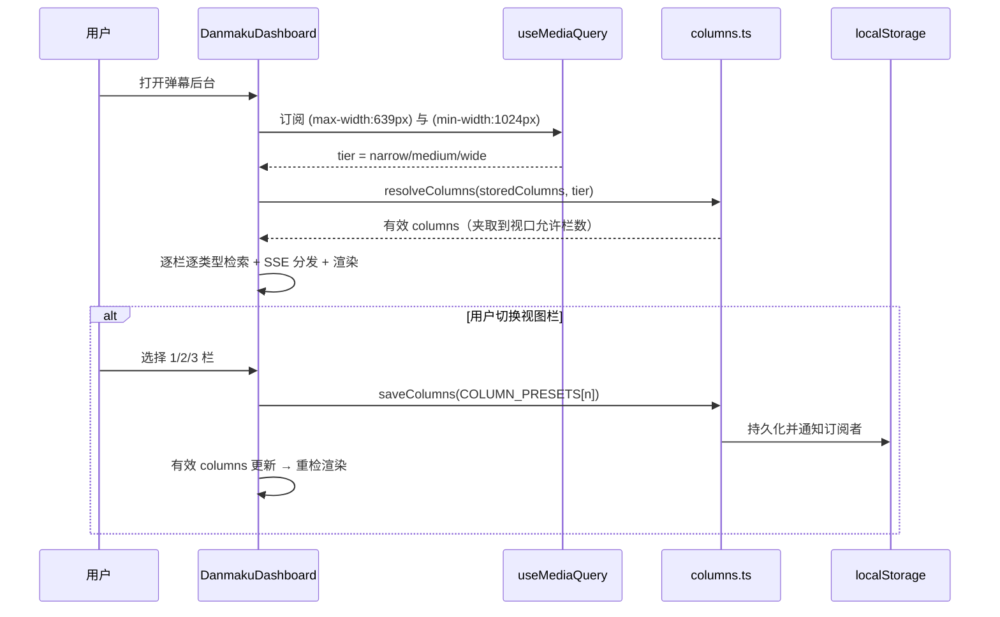

# 弹幕后台移动端优化 - 技术提案

**功能名称**: 弹幕后台移动端优化（栏数自适应 + 视图栏选择器）
**关联 PRD**: `docs/product/requirements/draft/2026-08-16-danmaku-backdoor-prd.md`（F10）
**技术提案版本**: v1.0
**创建日期**: 2026-08-16
**作者**: sumire workflow
**feat-branch**: `feat/danmaku-mobile-columns`

## 1. 概述

### 1.1 背景

`DanmakuDashboard` 默认渲染 3 栏（弹幕+礼物 | SC | 上船），`<1024px` 仅做 `flex-col → lg:flex-row` 纯 CSS 纵向堆叠：三栏各自仍是独立滚动容器，手机上形成三段碎片化信息流，交互体验差。PRD F10 要求：移动端折叠为单栏并展示全部事件类型，平板/桌面按视口约束提供「视图栏」选择器（1/2/3 栏）供用户调整。

现有基础：栏位配置 `columns.ts`（`ColumnConfig[]`，localStorage `danmaku-backdoor.columns`，Zod 校验回退默认 3 栏）；`lib/useMediaQuery.ts`（`useSyncExternalStore` 封装 matchMedia，SSR 快照固定 false，已在日历周视图验证）；`DanmakuDashboard` 按 `columns` 逐栏逐类型检索/SSE 分发/渲染。

### 1.2 目标

- 视口 <640px：渲染单栏（全部四类事件），「配置栏位」面板全部勾选，不显示「视图栏」选择器；
- 视口 640px ~ <1024px：显示「视图栏」选择器（1 栏 / 2 栏），默认 1 栏；2 栏分组「上船+SC | 礼物+弹幕」；
- 视口 ≥1024px：显示「视图栏」选择器（2 栏 / 3 栏），默认 3 栏（沿用「礼物+上船 | SC | 弹幕」）；
- 栏数/类型配置持久化；视口自适应为纯视图层折叠，不覆盖已保存配置（仅在用户显式操作时写入）；
- 零后端/契约变更，桌面 3 栏既有行为零回归。

### 1.3 范围

- **做**：`columns.ts` 新增栏数预设 `COLUMN_PRESETS` 与纯函数 `resolveColumns`；`DanmakuDashboard` 接入断点 tier、派生有效栏、新增「视图栏」选择器、`toggleColumnType` 改为作用于有效栏；单元测试（纯函数 + 三档视口渲染/选择器）。
- **不做**：服务端同步栏位配置；拖拽换栏；栏内排序；任何后端/契约/编排变更。

## 2. 技术架构

### 2.1 系统架构图

```mermaid
graph TD
    DASH[DanmakuDashboard] --> MQ[useMediaQuery x2<br/>max-width:639px / min-width:1024px]
    MQ -->|narrow <640| T1[单栏: 全部类型, 无选择器]
    MQ -->|medium 640-1023| T2[选择器 1/2 栏, 默认 1 栏]
    MQ -->|wide >=1024| T3[选择器 2/3 栏, 默认 3 栏]
    DASH --> RES[resolveColumns storedColumns, tier]
    RES --> FEED[FeedColumn 渲染]
    SEL[视图栏 select] -->|saveColumns PRESET[n]| LS[(localStorage)]
    RES --> SEL[选择器当前值 = 有效栏数]
```

### 2.2 技术栈

| 层级 | 技术选型 | 说明 |
|------|---------|------|
| 前端 | Next.js（App Router）+ React + TS strict | 改造仅限 `features/danmaku/columns.ts` 与 `DanmakuDashboard.tsx` |
| 样式 | Tailwind v4（@theme token） | 沿用既有 token，选择器复用「全屏模式」按钮风格 |
| 断点检测 | `window.matchMedia`（复用 `lib/useMediaQuery.ts`） | 两个查询（`max-width:639px`、`min-width:1024px`） |
| 后端 | 无变更 | 不新增接口、不改契约 |
| 测试 | Vitest（单元） | 纯函数 + 三档视口渲染/选择器（mock matchMedia） |

### 2.3 模块划分

| 模块 | 职责 | 关键技术点 |
|------|------|-----------|
| `features/danmaku/columns.ts` | 新增栏数预设与纯函数 | `COLUMN_PRESETS`、`ViewportTier`、`resolveColumns(columns, tier)` |
| `features/danmaku/components/DanmakuDashboard.tsx` | 响应式有效栏 + 视图栏选择器 | `useMediaQuery` ×2、`useMemo` 派生 `columns`、select 写入预设、`toggleColumnType` 改作用于有效栏 |
| `tests/unit/danmaku-columns.test.ts` | 纯函数单测 | `COLUMN_PRESETS` 内容、`resolveColumns` 三档/夹取 |
| `tests/unit/danmaku-dashboard.test.tsx` | 渲染/选择器单测 | mock matchMedia 三档视口 |

## 3. API 设计

### 3.1 API 契约

无变更。事件检索/实时流/已读接口复用既有契约 `contract/live-events.openapi.yaml`。

### 3.2 内部接口

- 新增纯函数（`columns.ts`）：
  - `COLUMN_PRESETS: Readonly<Record<1 | 2 | 3, ColumnConfig[]>>`：
    - `1`: `[{ id: "all", types: ["danmaku", "super_chat", "gift", "guard_buy"] }]`；
    - `2`: `[{ id: "sc_guard", types: ["guard_buy", "super_chat"] }, { id: "gift_danmaku", types: ["gift", "danmaku"] }]`（上船+SC | 礼物+弹幕）；
    - `3`: `DEFAULT_COLUMNS`（礼物+上船 | SC | 弹幕）。
  - `resolveColumns(columns: ColumnConfig[], tier: "narrow" | "medium" | "wide"): ColumnConfig[]`：
    - `narrow`：`columns.length === 1 ? columns : COLUMN_PRESETS[1]`；
    - `medium`：`columns.length <= 2 ? columns : COLUMN_PRESETS[1]`；
    - `wide`：`columns.length >= 2 ? columns : COLUMN_PRESETS[2]`。
- `DanmakuDashboard` 内部：`storedColumns`（`useSyncExternalStore`）→ `tier`（`useMediaQuery`）→ `columns = useMemo(resolveColumns(storedColumns, tier))`，后续检索/流/渲染/`toggleColumnType` 均以 `columns`（有效栏）为准；`toggleColumnType` 改从有效栏计算并 `saveColumns(next)`。

## 4. 数据模型

无变更。栏数即 `columns.length`；`COLUMN_PRESETS` 为固定预设，类型分布仍是既有 `ColumnConfigSchema`（Zod 校验不变）。

## 5. 技术实现方案

### 5.1 核心流程



### 5.2 关键实现点

#### 实现点 1: 栏数预设与纯函数（`columns.ts`）

- **描述**: `COLUMN_PRESETS` 定义 1/2/3 栏的默认类型分布；`resolveColumns` 按视口 tier 把任意 `ColumnConfig[]` 夹取到允许栏数（越界用预设覆盖，界内原样保留，不丢用户自定义分布）。
- **技术细节**: 1 栏顺序沿用 `LiveEventTypeSchema.options`（弹幕/SC/礼物/上船），与「配置栏位」勾选框顺序一致；2 栏按 PRD「上船+SC | 礼物+弹幕」分组。`resolveColumns` 为纯函数，单测覆盖三档 × {1,2,3,4} 栏输入。
- **风险点**: 跨视口夹取会丢弃「越界」栏的自定义分布（如桌面 3 栏 → 平板夹取为单栏预设），属预期——返回桌面后恢复原 3 栏配置（`storedColumns` 未变）。

#### 实现点 2: 断点 tier 派生

- **描述**: `useMediaQuery("(max-width: 639px)")` 得 `isNarrow`、`useMediaQuery("(min-width: 1024px)")` 得 `isWide`；`tier = isNarrow ? "narrow" : isWide ? "wide" : "medium"`。
- **技术细节**: SSR/无 matchMedia 时两者皆 false → tier `medium`；`useMediaQuery` 的 `getServerSnapshot` 恒 false，服务端渲染与 hydration 首帧一致（不产生 hydration 告警），客户端首帧后按真实视口切换。弹幕后台页处于 `(dashboard)/layout` 会话守卫内（守卫期渲染加载态），静态 HTML 不暴露栏布局，无闪烁风险。
- **风险点**: 无——`useMediaQuery` 已在日历周视图生产使用。

#### 实现点 3: 视图栏选择器与 toggleColumnType 改造

- **描述**: 有效 `columns` 上方渲染「视图栏」选择器（`narrow` 隐藏）：`medium` 选项 `1栏/2栏`，`wide` 选项 `2栏/3栏`；`value` 为 `columns.length`（恒在选项内），`onChange` 调 `saveColumns(COLUMN_PRESETS[n])`。`toggleColumnType` 改为从有效 `columns` 计算并 `saveColumns(next)`，使勾选面板作用于用户所见栏。
- **技术细节**: 选择器样式沿用「全屏模式」按钮 token（`border-vine/50`、hover `border-flower`）。`columns` 经 `useMemo` 派生保证引用稳定，避免 `useEffect` 检索代际与 SSE 订阅抖动。
- **风险点**: `toggleColumnType` 从有效栏写入——当有效栏为夹取预设（如平板夹取单栏）时取消某类型会持久化为自定义单栏，属用户显式操作，符合 PRD「仅在用户显式操作时写入」。

## 6. 技术决策

### 6.1 决策列表

| 决策 | 选项 A | 选项 B | 最终选择 | 原因 |
|------|--------|--------|---------|------|
| 折叠机制 | 视图层派生有效栏（不改存储） | 进入窄屏即改写 localStorage | A | PRD 要求「自适应为纯视图层折叠，不覆盖已保存配置」；返回桌面恢复原配置 |
| 栏数选择入口 | 头部 select「视图栏」（1/2/3） | 复用每栏「配置栏位」勾选面板 | A | 栏数是最直观的自适应旋钮，勾选面板仍保留用于类型微调 |
| 断点阈值 | `sm` 640 / `lg` 1024（与既有断点一致） | 引入 1200 | A | 与 `flex-col → lg:flex-row`、日历 `sm` 断点一致，无新阈值 |
| 2 栏默认分组 | 上船+SC | 礼物+弹幕 | A | PRD F10 口径（已读管理类型聚合一栏） |
| SSR 快照 | tier 默认 `medium`（`getServerSnapshot: false`） | 固定 wide | A | 守卫期不渲染栏布局；hydrate 后按真实视口切换 |
| 夹取策略 | 越界用预设覆盖、界内原样保留 | 强制恒用预设 | A | 保留用户界内自定义分布（如 2 栏下勾选调整） |

### 6.2 依赖与约束

| 类型 | 内容 | 说明 |
|------|------|------|
| 依赖 | 既有 `columns.ts` / `useMediaQuery.ts` / `DanmakuDashboard` | 改造基底 |
| 约束 | 静态导出（GitHub Pages） | 断点判定客户端完成 |
| 约束 | Tailwind token 色、禁硬编码色值 | 沿用 `frontend-rules.md` |
| 约束 | 分支 `feat/danmaku-mobile-columns` 自 main 切出 | 遵循 `<type>/<slug>` 约定 |

## 7. 项目结构

```
apps/bookstore/
├── features/danmaku/
│   ├── columns.ts                    # 扩展：COLUMN_PRESETS / ViewportTier / resolveColumns
│   └── components/DanmakuDashboard.tsx  # 改造：tier 派生有效栏 + 视图栏选择器 + toggleColumnType
└── tests/unit/
    ├── danmaku-columns.test.ts       # 扩展：预设内容 + resolveColumns 三档/夹取
    └── danmaku-dashboard.test.tsx    # 扩展：三档视口渲染 + 选择器 + 类型切换
```

后端（`servers/api`）、契约（`contract/`）、编排（`infra/aspire`）零变更。

## 8. 测试策略

### 8.1 测试覆盖要求

- 单元测试：`COLUMN_PRESETS` 三档内容（含 2 栏「上船+SC | 礼物+弹幕」分组）；`resolveColumns` 三档 × 栏数 {1,2,3,4} 输入（narrow 恒单栏、medium 夹取到 ≤2、wide 夹取到 ≥2、界内保留）；`DanmakuDashboard` mock matchMedia 三档：narrow 渲染单栏且请求全部四类、无「视图栏」选择器、配置面板全部勾选；medium 选择器仅 1/2 栏、默认 1 栏、选 2 栏后按预设分组检索；wide 选择器仅 2/3 栏、默认 3 栏（既有三栏断言）；选择器切换后 `saveColumns` 持久化且刷新保留；`toggleColumnType` 作用于有效栏。
- API 测试：无（零后端变更）。
- e2e：无新增（栏布局为纯客户端视口行为，单元测试 mock matchMedia 覆盖；弹幕后台 e2e 视口断言可在后续补充）。

### 8.2 测试类型

| 类型 | 工具 | 覆盖范围 |
|------|------|---------|
| 单元测试 | Vitest + Testing Library | 纯函数、三档视口渲染、选择器、类型切换（mock matchMedia） |

## 9. 部署方案

### 9.1 环境规划

| 环境 | 用途 | 部署方式 |
|------|------|---------|
| 本地联调 | Aspire 编排（既有四资源） | `aspire start`，无配置变更 |
| GitHub Pages 生产 | 纯静态 | 无新增配置项 |

### 9.2 配置管理

无新增配置项。`NEXT_PUBLIC_API_BASE_URL` 等既有配置不变。

## 10. 验收标准

- [ ] 技术方案评审通过
- [ ] 视口 <640px 渲染单栏（全部四类）、配置面板全部勾选、无「视图栏」选择器
- [ ] 视口 640–1023px 选择器仅 1/2 栏、默认 1 栏；2 栏分组「上船+SC | 礼物+弹幕」
- [ ] 视口 ≥1024px 选择器仅 2/3 栏、默认 3 栏；桌面三栏既有行为零回归
- [ ] 选择栏数刷新后保留；跨视口自适应不覆盖已保存配置
- [ ] 单元测试全绿，`pnpm lint && pnpm test && pnpm build` 全绿

## 11. 相关文档

- 关联 PRD：`docs/product/requirements/draft/2026-08-16-danmaku-backdoor-prd.md`（F10）
- 关联 Contract：`contract/live-events.openapi.yaml`（复用，不变）
- 一期提案：`docs/engineering/proposals/2026-08-16-danmaku-backdoor-proposal.md`
- 断点参考：`docs/engineering/proposals/2026-08-15-calendar-mobile-week-proposal.md`、`lib/useMediaQuery.ts`
- 开发规范：`docs/engineering/frontend-rules.md`
