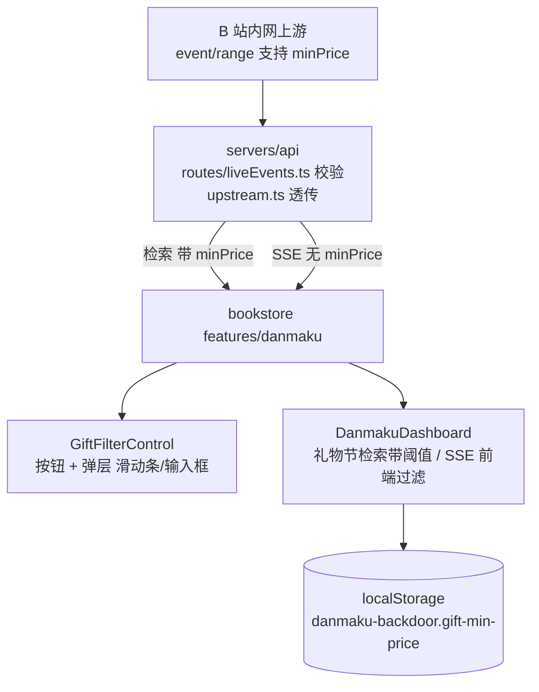
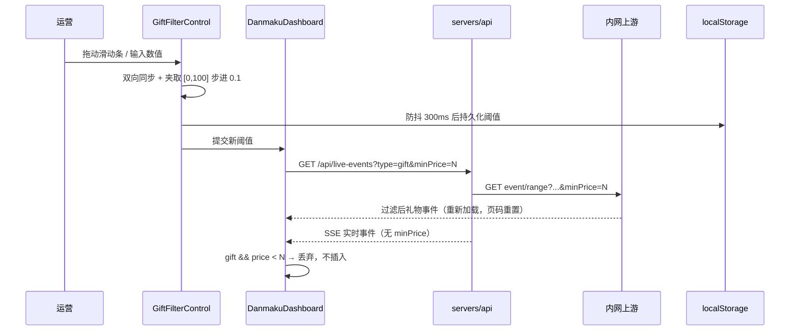

# 弹幕看板礼物金额筛选 - 技术提案

**功能名称**: 弹幕看板礼物金额筛选（Danmaku Gift Min-Price Filter）
**关联 PRD**: `docs/product/requirements/draft/2026-08-17-danmaku-gift-min-price-prd.md`
**技术提案版本**: v1.0
**创建日期**: 2026-08-17
**作者**: sumire workflow
**feat-branch**: `feat/danmaku-gift-min-price`

## 1. 概述

### 1.1 背景

弹幕看板现态（`docs/product/spec/danmaku.md`）：历史检索按「栏 × 类型」分节请求 `GET /api/live-events`（`DanmakuDashboard.loadSection/loadMoreSection`），服务端 `liveEvents/upstream.ts` 的 `fetchRange` 代理上游 `GET {base}/api/b/live/1727076670/event/range`（多 `type=` 重复参数，5s 超时）；实时事件经 SSE 订阅（上游 subscribe 无金额过滤能力）由 `handleStreamEvent` prepend 进各栏。

上游检索接口已支持 `minPrice` 参数（如 `…/event/range?pageSize=1&type=gift&page=1&minPrice=1`），按礼物金额（元）过滤。本期需求：看板新增「礼物筛选」入口，弹层内含「最低礼物价值」label、滑动条（0 起步，step 0.1，上限 100）与输入框，礼物信息流按阈值过滤。

### 1.2 目标

- 契约 `GET /api/live-events` 增加可选查询参数 `minPrice`（0–100，非法 400），服务端透传上游 `event/range`；
- 前端新增「礼物筛选」按钮与弹层组件，滑动条与输入框双向同步、防抖生效；
- 阈值 > 0 时礼物历史检索（首屏 + 加载更多）携带 `minPrice`，修改阈值后礼物分节重新检索（页码重置）；阈值 = 0 不带参数，行为与现状一致；
- SSE 实时礼物事件在前端按阈值过滤（上游 subscribe 无 minPrice 能力）；
- 阈值持久化 localStorage，损坏回退 0；
- 弹幕/SC/上船事件检索、展示、已读管理零回归。

### 1.3 范围

- **做**：契约 `minPrice` 增补；服务端参数校验 + 透传；前端筛选控件（按钮+弹层、滑动条/输入框同步、防抖、夹取）；`DanmakuDashboard` 礼物检索接入阈值与 SSE 过滤；阈值持久化；单元测试 / 服务端单测 / API 测试。
- **不做**：SSE 上游订阅侧过滤；按栏独立阈值；SC/上船金额筛选；阈值预设快捷档位；编排与基础设施变更。

## 2. 技术架构

### 2.1 系统架构图



### 2.2 技术栈

| 层级 | 技术选型 | 说明 |
|------|---------|------|
| 前端 | Next.js（App Router）+ React + TS strict | 改造集中在 `features/danmaku/` |
| 样式 | Tailwind v4（@theme token） | 弹层沿用既有 token（vine/flower/ink/raised），禁硬编码色值 |
| 后端 | Express 5 + TS strict | `routes/liveEvents.ts` 校验 + `liveEvents/upstream.ts` 透传 |
| 契约 | `contract/live-events.openapi.yaml` | `minPrice` 查询参数（单一事实源） |
| 测试 | Vitest（前端单元 + 服务端单测）+ tests/api | 无 e2e 新增 |

### 2.3 模块划分

| 模块 | 职责 | 关键技术点 |
|------|------|-----------|
| `contract/live-events.openapi.yaml` | 筛选参数契约 | `GET /api/live-events` 增可选 `minPrice`（number，0–100） |
| `servers/api/src/routes/liveEvents.ts` | 参数解析与校验 | 非法值 400；合法值透传 |
| `servers/api/src/liveEvents/upstream.ts` | 上游 URL 构造 | `buildRangeUrl`/`fetchRange` 增可选 minPrice |
| `features/danmaku/api.ts` | 前端检索封装 | `listLiveEvents` 增可选 minPrice |
| `features/danmaku/giftMinPrice.ts` | 阈值持久化 | localStorage 读写 + Zod 校验夹取（仿 columns.ts 口径） |
| `features/danmaku/components/GiftFilterControl.tsx` | 筛选控件 | 按钮 + 弹层；滑动条/输入框双向同步；非法输入夹取；300ms 防抖提交 |
| `features/danmaku/components/DanmakuDashboard.tsx` | 阈值接入 | 礼物节检索带阈值；阈值变化重载礼物节；SSE 礼物过滤 |

## 3. API 设计

### 3.1 API 契约

仅 `GET /api/live-events` 增加一个可选查询参数，其余端点、鉴权、响应模型均无变更：

```yaml
- name: minPrice
  in: query
  description: 最低礼物价值（元），仅对 gift 类型生效；0 或不传表示不筛选
  schema: { type: number, minimum: 0, maximum: 100 }
```

- 可选、向后兼容：旧客户端不传参数行为不变；
- 校验口径：非数字、负数、>100 → 400（并入既有「分页参数非法」文案口径）；`minPrice=0` 与不传等价（服务端可不向上游追加该参数）；
- 语义：`minPrice` 只影响上游礼物事件的过滤；当 `type` 不含 gift 时透传无副作用（上游口径），前端也只对礼物节请求携带。

### 3.2 内部接口

- `buildRangeUrl(base, types, page, pageSize, minPrice?)`（`liveEvents/upstream.ts`）：`minPrice > 0` 时 `url.searchParams.set("minPrice", String(minPrice))`；`fetchRange` 签名同步扩展（可选末参，调用方兼容）；
- `listLiveEvents(types, page, pageSize, minPrice?)`（`features/danmaku/api.ts`）：`minPrice > 0` 时追加查询参数；
- `loadGiftMinPrice() / saveGiftMinPrice(v)`（新增 `giftMinPrice.ts`）：localStorage `danmaku-backdoor.gift-min-price`，JSON number；读取时 Zod 校验并夹取 [0, 100]、按 0.1 步进取齐，非法回退 0。

## 4. 数据模型

无数据库变更。阈值仅存浏览器 localStorage：

- key：`danmaku-backdoor.gift-min-price`；值：JSON number（0–100，0.1 步进）；
- 损坏/越界回退 0（不筛选），与栏位配置「损坏回退默认」口径一致；
- 不做跨标签页实时同步（栏位配置有跨标签同步是先例，但阈值属轻量偏好，简化处理；刷新后一致即可）。

## 5. 技术实现方案

### 5.1 核心流程



### 5.2 关键实现点

#### 实现点 1: 契约与服务端透传

- **描述**: 契约增加 `minPrice` 可选查询参数；`routes/liveEvents.ts` 解析：缺省/`0` → 不筛选；非有限数字、<0、>100 → 400；合法值传入 `fetchRange`，`buildRangeUrl` 追加 `minPrice`。
- **技术细节**: 解析沿用路由既有 `page`/`pageSize` 的 Number 校验模式；`fetchRange` 末参可选，既有调用（read-all 上游首页取水位的调用若走 fetchRange）不传即不变。
- **风险点**: 上游对 `type` 不含 gift 时携带 `minPrice` 的行为未文档化——前端只对礼物节请求携带，服务端不主动剥离（透传口径，上游自行解释）；API 测试以 gift 类型验证。

#### 实现点 2: 阈值持久化模块（giftMinPrice.ts）

- **描述**: 仿 `columns.ts` 的存储口径：`loadGiftMinPrice()` 读 localStorage、Zod number 校验、夹取 [0,100]、四舍五入到 0.1 步进，任何异常回退 0；`saveGiftMinPrice(v)` 写入。SSR 快照恒 0（与栏位配置 SSR 回退同口径）。
- **技术细节**: 纯函数 `clampMinPrice(v: unknown): number` 独立导出便于单测；`useSyncExternalStore` 非必需（无跨组件订阅需求），阈值由 `DanmakuDashboard` 持有 state，挂载时 `loadGiftMinPrice()` 初始化。
- **风险点**: 无（与既有 localStorage 模块同构）。

#### 实现点 3: 筛选控件（GiftFilterControl.tsx）

- **描述**: 「礼物筛选」按钮置于 `DanmakuDashboard` 栏位区上方工具区（与连接状态提示同级的 flex 行）。点击切换弹层（小窗口，绝对定位于按钮下方，`border-vine/50 bg-raised` 沿用既有弹层视觉）；再点按钮或点击弹层外（overlay 监听 / `onBlur` 口径以既有组件先例为准）关闭。弹层内：
  - `<label htmlFor>`「最低礼物价值」；
  - `<input type="range" min={0} max={100} step={0.1}>`；
  - `<input type="number" min={0} max={100} step={0.1}>`。
- **技术细节**: 控件内部维护草稿值字符串（输入框允许中间态如 `1.`），滑动条与输入框展示同步；提交（防抖 300ms 或输入框 blur/Enter）时 `clampMinPrice` 夹取并回调 `onChange(committed)`。阈值 > 0 时按钮加激活态视觉（如 `border-flower text-ink`），一眼可辨筛选生效中。
- **风险点**: range 与 number 输入同步的中间态处理——以「草稿字符串 + 提交时夹取」规避受控死循环，单测覆盖。

#### 实现点 4: 看板接入（DanmakuDashboard）

- **描述**: `DanmakuDashboard` 持有 `minPrice` state（挂载时自 localStorage 初始化）；`loadSection`/`loadMoreSection` 对 `type === "gift"` 的请求携带当前阈值（经 ref 读取，避免 callback 依赖频繁重建）；`handleStreamEvent` 对 `type === "gift" && (event.price ?? 0) < minPrice` 的事件直接丢弃。
- **技术细节**: 阈值变化时递增 `generationRef` 并仅对礼物分节触发 `loadSection`（页码重置为 1，与既有「columns 变化整树重载」同机制、范围收窄到 gift 节）；非礼物节数据不动，避免无关请求。阈值提交同时 `saveGiftMinPrice`。
- **风险点**: 阈值修改瞬间在途的旧阈值请求——沿用既有代际机制作废旧结果；SSE 过滤读取 ref 保证闭包内阈值新鲜。

## 6. 技术决策

### 6.1 决策列表

| 决策 | 选项 A | 选项 B | 最终选择 | 原因 |
|------|--------|--------|---------|------|
| 历史过滤位置 | 服务端透传上游 minPrice | 前端检索后本地过滤 | A | 上游已原生支持；本地过滤会破坏分页 total 语义、造成空页 |
| SSE 实时过滤位置 | 前端过滤 | 服务端订阅侧过滤 | A | 上游 subscribe 无 minPrice 能力；服务端过滤需改流式链路，收益不成比例 |
| 阈值生效时机 | 防抖 300ms 提交 | 拖动逐帧实时提交 | A | 逐帧提交每个滑动位置都触发检索，浪费请求且抖动 |
| 阈值作用范围 | 全局统一阈值 | 每栏独立阈值 | A | PRD 口径；多栏共享礼物类型时独立阈值徒增复杂度 |
| 非法输入处理 | 提交时夹取 [0,100] + 步进取齐 | 实时拦截按键 | A | 实时拦截破坏输入中间态体验；夹取口径简单可测 |
| 持久化 | localStorage | 仅内存 state | A | 与栏位配置同口径，刷新保持偏好；损坏回退 0 |
| `minPrice=0` | 不带参数（不筛选） | 显式传 0 | A | 与现状请求完全同构，零回归 |

### 6.2 依赖与约束

| 类型 | 内容 | 说明 |
|------|------|------|
| 依赖 | 上游 `event/range` 支持 `minPrice` | 已确认（需求方提供实测 URL） |
| 依赖 | 弹幕看板一期/二期既有实现 | 改造基底（分节检索、代际机制、SSE 分发） |
| 约束 | Tailwind token 色、禁硬编码色值 | `frontend-rules.md` |
| 约束 | 静态导出（GitHub Pages） | 全部客户端行为，无 SSR 依赖 |
| 约束 | 分支 `feat/danmaku-gift-min-price` 自 `prd/danmaku-gift-min-price` 切出 | `<type>/<slug>` 约定 |

## 7. 项目结构

```
contract/
└── live-events.openapi.yaml              # GET /api/live-events 增 minPrice 查询参数

servers/api/
├── src/liveEvents/upstream.ts            # buildRangeUrl/fetchRange 增可选 minPrice
├── src/routes/liveEvents.ts              # minPrice 解析校验 + 透传
└── tests/                                # buildRangeUrl 携带 minPrice 单测

apps/bookstore/
└── features/danmaku/
    ├── api.ts                            # listLiveEvents 增可选 minPrice
    ├── giftMinPrice.ts                   # 新增：阈值持久化 + clampMinPrice
    └── components/
        ├── GiftFilterControl.tsx         # 新增：按钮 + 弹层（滑动条/输入框）
        └── DanmakuDashboard.tsx          # 礼物节检索带阈值 / SSE 过滤 / 阈值变化重载

tests/api/                                # live-events 检索带 minPrice（200 透传、非法 400）
```

编排（`infra/aspire`）、已读接口、SSE 链路零变更。

## 8. 测试策略

### 8.1 测试覆盖要求

- 单元测试（前端）：`clampMinPrice` 夹取/步进取齐/非法回退；`giftMinPrice` 存储读写与损坏回退；`GiftFilterControl` 滑动条↔输入框同步、非法输入夹取、防抖提交、激活态；`DanmakuDashboard` 阈值>0 时礼物节请求携带 minPrice、阈值变化重载礼物节且页码重置、非礼物节不受影响、SSE 低价礼物被丢弃/达标礼物正常插入。
- 服务端单测：`buildRangeUrl` 携带/不携带 minPrice 的 URL；路由层非法 minPrice 400。
- API 测试（`tests/api`）：`GET /api/live-events?type=gift&minPrice=1` 200 且透传（mock 上游断言 URL）；`minPrice=-1` / `minPrice=abc` / `minPrice=101` → 400；不带参数回归既有用例。
- e2e：无新增（控件交互以单元测试覆盖）。

### 8.2 测试类型

| 类型 | 工具 | 覆盖范围 |
|------|------|---------|
| 单元测试 | Vitest + Testing Library | 控件同步/夹取/防抖、看板接入、持久化 |
| 服务端单测 | Vitest | URL 构造、路由校验 |
| API 测试 | Vitest + fetch | minPrice 透传与 400 校验 |

## 9. 部署方案

### 9.1 环境规划

| 环境 | 用途 | 部署方式 |
|------|------|---------|
| 本地联调 | Aspire 编排（既有四资源） | `aspire start`，无配置变更 |
| GitHub Pages 生产 | 纯静态 | 无新增配置项 |

### 9.2 配置管理

无新增配置项。`NEXT_PUBLIC_API_BASE_URL`、`LIVE_EVENTS_UPSTREAM_URL` 等既有配置不变。

## 10. 验收标准

- [ ] 技术方案评审通过
- [ ] 契约 `minPrice` 评审通过（向后兼容）
- [ ] 「礼物筛选」按钮 + 弹层（label「最低礼物价值」、滑动条 0–100 步进 0.1、输入框）可用，双控件同步、非法输入夹取
- [ ] 阈值 > 0 时礼物历史检索与加载更多只含价值 ≥ 阈值的礼物；阈值变化重载且页码重置；阈值 = 0 行为与现状一致
- [ ] SSE 实时低价礼物被过滤，达标礼物正常插入
- [ ] 阈值持久化 localStorage，刷新保持，损坏回退 0
- [ ] 弹幕/SC/上船零回归；单元/服务端/API 测试全绿，`pnpm lint && pnpm test && pnpm build` 全绿

## 11. 相关文档

- 关联 PRD：`docs/product/requirements/draft/2026-08-17-danmaku-gift-min-price-prd.md`
- 关联 Contract：`contract/live-events.openapi.yaml`（增补 `minPrice`）
- 产品 Spec（现态）：`docs/product/spec/danmaku.md`
- 后端直播域 Spec（现态）：`docs/engineering/spec/backend-live.md`
- 二期提案：`docs/engineering/proposals/2026-08-16-danmaku-board-v2-proposal.md`
- 开发规范：`docs/engineering/frontend-rules.md`、`docs/engineering/backend-rules.md`
