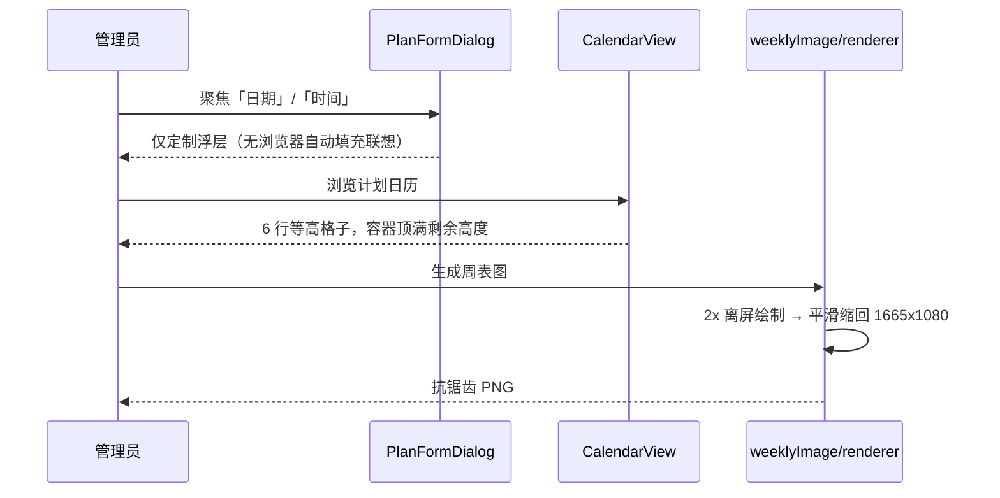

# 直播计划体验优化 - 技术提案

**功能名称**: 直播计划体验优化（Schedule UX Polish）
**关联 PRD**: `docs/product/requirements/draft/2026-08-17-schedule-ux-polish-prd.md`
**技术提案版本**: v1.0
**创建日期**: 2026-08-17
**作者**: sumire workflow
**feat-branch**: `feat/schedule-ux-polish`

## 1. 概述

### 1.1 背景

直播计划功能已上线（现态见 `docs/product/spec/calendar.md`、`docs/product/spec/schedule-admin.md`）。四点体验问题的代码现态已定位：

1. **表单自动填充**：`features/schedule/DatePicker.tsx:70-90` 与 `TimePicker.tsx:58-78` 的 `<input>` 未声明 `type`/`autocomplete`，浏览器默认自动填充联想会盖在定制浮层上；全仓库仅登录/改密卡片设置了 `autoComplete`；
2. **周表图锯齿**：`features/schedule/weeklyImage/renderer.ts` 固定 1665×1080 1× 渲染，未设置 `imageSmoothingEnabled`/`imageSmoothingQuality`，无超采样——部分浏览器 `fillText` 抗锯齿表现差，文字发虚；
3. **日历布局**：`app/backdoor/(dashboard)/schedule/page.tsx:125-153` 根容器无固定高度，骨架（`min-h-64`）与日历高度不一致导致跳变；`CalendarView.tsx:107` 月视图格子仅 `min-h-16`，行高随内容不齐；
4. **骨架闪烁**：全站骨架统一使用 Tailwind v4 内置 `animate-pulse`（默认 2s 周期），未 token 化自定义。

### 1.2 目标

- `DatePicker`/`TimePicker` 输入框显式 `autoComplete="off"`，定制浮层交互不变；
- 周表图渲染改 2× 超采样 + 高质量平滑缩放，导出尺寸/版式/配色不变；
- 后台计划页日历容器顶满视口剩余高度，月视图 6 行格子等高均分，加载态无高度跳变；
- `@theme` 自定义 `--animate-pulse` 时长 ~3.2s，全站骨架统一降速，`prefers-reduced-motion` 兜底不变。

### 1.3 范围

- **做**：`DatePicker.tsx`/`TimePicker.tsx` 增加 `autoComplete="off"`；`renderer.ts` 超采样抗锯齿；`schedule/page.tsx` 与 `CalendarView.tsx` 布局改造；`globals.css` pulse 时长 token 化；相关单元测试更新。
- **不做**：API/契约/数据模型变更；公开页日历展示规则变更；周表图布局坐标与素材变更；登录/改密表单 autocomplete 口径变更。

## 2. 技术架构

### 2.1 系统架构图

```mermaid
graph TD
    PAGE[app/backdoor/&#40;dashboard&#41;/schedule/page.tsx<br/>flex 顶满容器] --> CAL[CalendarView.tsx<br/>月视图 6 行 1fr 等高]
    PAGE --> DIALOG[PlanFormDialog.tsx]
    DIALOG --> DP[DatePicker.tsx<br/>autoComplete=off]
    DIALOG --> TP[TimePicker.tsx<br/>autoComplete=off]
    PAGE --> WEEKLY[WeeklyImageDialog.tsx]
    WEEKLY --> RENDER[weeklyImage/renderer.ts<br/>2x 超采样 → 平滑缩回 1665x1080]
    CSS[app/globals.css<br/>--animate-pulse 3.2s] --> PAGE
    CSS --> SITE[公开页骨架 / 弹幕看板骨架]
```



### 2.2 技术栈

| 层级 | 技术选型 | 说明 |
|------|---------|------|
| 前端 | Next.js（App Router）+ React + TS strict | 改造集中在 `features/schedule/` 与计划页 |
| 样式 | Tailwind v4（@theme token） | 动画时长经 `--animate-pulse` token 覆盖，禁硬编码色值 |
| Canvas | Canvas 2D API | 超采样 + `imageSmoothingQuality: "high"` |
| 测试 | Vitest + Testing Library | 无 API/e2e 新增 |

### 2.3 模块划分

| 模块 | 职责 | 关键技术点 |
|------|------|-----------|
| `features/schedule/DatePicker.tsx` | 日期输入 | `<input>` 增 `autoComplete="off"` |
| `features/schedule/TimePicker.tsx` | 时间输入 | `<input>` 增 `autoComplete="off"` |
| `features/schedule/weeklyImage/renderer.ts` | 周表图渲染 | 2× 离屏 canvas 超采样，平滑缩放回目标尺寸 |
| `app/backdoor/(dashboard)/schedule/page.tsx` | 计划页容器 | 纵向 flex、`flex-1 min-h-0` 顶满，骨架同占满 |
| `features/schedule/CalendarView.tsx` | 日历网格 | 月视图 `grid-rows-6` + 行 `1fr` 均分、格子 `min-h-0` |
| `app/globals.css` | 动画 token | `@theme` 覆盖 `--animate-pulse` 时长 |

## 3. API 设计

无 API 变更。契约 `contract/stream-plans.openapi.yaml` 不动。

## 4. 数据模型

无数据库与存储变更。

## 5. 技术实现方案

### 5.1 核心流程



### 5.2 关键实现点

#### 实现点 1: 输入框关闭自动填充

- **描述**: `DatePicker.tsx`（行 70-90 `<input>`）与 `TimePicker.tsx`（行 58-78 `<input>`）增加 `autoComplete="off"`。输入框无 `name` 属性（现状），`readOnly={!open}` 与聚焦开浮层逻辑不动。
- **技术细节**: 标准浏览器对无 `name` 的输入框仍可能基于 `id`/`placeholder` 联想历史表单值，显式 `autoComplete="off"` 是标准抑制手段；登录/改密卡片的既有 `autoComplete` 口径（`username`/`current-password`/`new-password`）不动。
- **风险点**: 个别密码管理器扩展无视 `autocomplete="off"`——属扩展行为，PRD 已明确不对抗。

#### 实现点 2: 周表图超采样抗锯齿

- **描述**: `renderImage` 内部改为两段渲染：① 创建 3330×2160（`CANVAS_WIDTH*2 × CANVAS_HEIGHT*2`）离屏 canvas，`ctx.scale(2, 2)` 后按原逻辑绘制底图与全部文字（布局坐标不变）；② 创建 1665×1080 目标 canvas，设 `imageSmoothingEnabled = true`、`imageSmoothingQuality = "high"`，`drawImage(离屏, 0, 0, 1665, 1080)` 缩回，`toDataURL("image/png")` 导出。
- **技术细节**: 底图 `drawImage` 同步受益于平滑缩放；`FONT_SPEC`、字号、坐标（`layout.ts`）零改动——超采样对调用方透明。测量用 `canvasMeasure()` 逻辑不变（字号计算基于逻辑坐标，与渲染倍率无关）。
- **风险点**: 内存占用短暂上升（3330×2160×4B ≈ 28MB），生成完成即释放，无可感知影响；超老设备上生成耗时略增，实测在毫秒级增幅内。

#### 实现点 3: 后台日历等高与顶满

- **描述**:
  - `app/backdoor/(dashboard)/layout.tsx` 不动（`main.flex-1` 已是 flex 子项）；`schedule/page.tsx` 根容器由 `flex flex-col gap-6` 增加 `h-full`（或 `min-h-0 flex-1`，视 main 实际拉伸口径，实现时以 `main` 增 `flex flex-col` 配合），头部操作区保持自然高度，日历容器 `flex-1 min-h-0`；
  - 骨架态与加载完成态使用同一占满容器（骨架 `h-full` 替代 `min-h-64`），消除跳变；
  - `CalendarView.tsx` 月视图网格容器 `grid h-full grid-rows-6`（现有 7 列不变），`DayCell` 由 `min-h-16` 改 `h-full min-h-0`，内容超出截断（`overflow-hidden`，沿用每日 ≤2 条口径）。
- **技术细节**: 周视图（窄屏 <640px 回退）与 `DayDetailDialog` 不动；公开页 `CalendarViewPage` 的日历是内容流式布局，不做顶满改造（仅 F4 骨架降速生效）。
- **风险点**: 极小视口高度下格子过矮——保留一个 `min-h` 兜底（如容器 `min-h-[480px]`，允许页面滚动），实现时以目检确认。

#### 实现点 4: 骨架动画降速

- **描述**: `app/globals.css` 的 `@theme` 中覆盖 Tailwind v4 默认 token：`--animate-pulse: pulse 3.2s cubic-bezier(0.4, 0, 0.6, 1) infinite;`（keyframe `pulse` 为 Tailwind 内置，仅改时长），全站 `animate-pulse` 统一降速。
- **技术细节**: 全局 `prefers-reduced-motion` 兜底（`globals.css:135-151` 已将所有动画压到 0.01ms）继续生效，无需新增；后台「过渡 ≤200ms」规范针对交互动效，骨架为持续动画，不在该约束范围。
- **风险点**: 无（纯 CSS 时长调整）。

## 6. 技术决策

### 6.1 决策列表

| 决策 | 选项 A | 选项 B | 最终选择 | 原因 |
|------|--------|--------|---------|------|
| 抑制自动填充 | `autoComplete="off"` | 换 `type="date"`/`type="time"` 原生控件 | A | 原生控件会替换定制浮层交互，改动面大且样式失控；off 一行解决 |
| 抗锯齿方案 | 2× 超采样缩回 | 直接 1× 渲染设 smoothing / 换 SVG 导出 | A | Canvas 无文字抗锯齿开关，超采样是通用可靠手段；SVG 导出需重写渲染层 |
| 超采样倍率 | 2× | 3×/devicePixelRatio 自适应 | 2× | 导出图面向传播查看，2× 已足够平滑；3× 内存/耗时翻倍收益递减 |
| 格子等高 | grid `grid-rows-6` + `1fr` | 固定像素行高 | A | 固定像素无法顶满剩余高度且不同视口要多套值；fr 均分天然满足 F3 两条诉求 |
| 骨架降速 | 覆盖 `--animate-pulse` token | 新增独立 `--animate-skeleton` 并逐处替换 | A | 一处改动全站生效；现有所有骨架本就统一用 `animate-pulse`，无需新 token |

### 6.2 依赖与约束

| 类型 | 内容 | 说明 |
|------|------|------|
| 依赖 | 既有 `features/schedule` 全部实现 | 改造基底 |
| 约束 | Tailwind token 色、禁硬编码色值 | `frontend-rules.md`（renderer 既有 `#342a40` 为 Canvas 内既有值，本期不动） |
| 约束 | 导出尺寸 1665×1080、布局坐标不变 | `public/assets/original/AGENTS.md` 素材坐标口径 |
| 约束 | 静态导出（GitHub Pages） | 全部客户端行为，无 SSR 依赖 |
| 约束 | 分支 `feat/schedule-ux-polish` 自 main 切出 | `<type>/<slug>` 约定 |

## 7. 项目结构

```
apps/bookstore/
├── app/
│   ├── globals.css                                  # @theme 覆盖 --animate-pulse 时长
│   └── backdoor/(dashboard)/schedule/page.tsx       # 容器顶满 + 骨架同占满
├── features/schedule/
│   ├── DatePicker.tsx                               # autoComplete="off"
│   ├── TimePicker.tsx                               # autoComplete="off"
│   ├── CalendarView.tsx                             # 月视图 6 行等高
│   └── weeklyImage/renderer.ts                      # 2x 超采样抗锯齿
└── tests/unit/
    ├── schedule-pickers.test.tsx                    # autocomplete 断言
    ├── schedule-calendar-view.test.tsx              # 等高布局 class 断言
    └── schedule-weekly-image-dialog.test.tsx        # 渲染管线打桩适配
```

契约、服务端、编排（`infra/aspire`）零变更。

## 8. 测试策略

### 8.1 测试覆盖要求

- 单元测试（前端）：
  - `schedule-pickers.test.tsx`：DatePicker/TimePicker 输入框 `autoComplete="off"` 断言；聚焦开浮层、只读切换既有用例保持绿；
  - `schedule-calendar-view.test.tsx`：月视图网格 `grid-rows-6`、格子等高 class 断言；条目截断不破行；
  - `schedule-weekly-image-dialog.test.tsx`：`renderImage` 打桩适配新管线（生成/导出行为不变）；
  - renderer 超采样逻辑如拆出纯函数（如 `renderSupersampled(draw, scale)`）则补直接单测。
- e2e：既有计划相关 e2e 保持绿；无新增 e2e（展示层改造）。

### 8.2 测试类型

| 类型 | 工具 | 覆盖范围 |
|------|------|---------|
| 单元测试 | Vitest + Testing Library | 输入框属性、布局 class、周表图管线 |

## 9. 部署方案

### 9.1 环境规划

| 环境 | 用途 | 部署方式 |
|------|------|---------|
| 本地联调 | Aspire 编排（既有四资源） | `aspire start`，无配置变更 |
| GitHub Pages 生产 | 纯静态 | 无新增配置项 |

### 9.2 配置管理

无新增配置项。

## 10. 验收标准

- [ ] 技术方案评审通过
- [ ] 「日期」「时间」输入框不再弹出浏览器自动填充，定制浮层行为不变
- [ ] 周表图导出 1665×1080 PNG，Chrome/Firefox/Safari 文字平滑无锯齿
- [ ] 后台日历月视图 6 行等高、容器顶满剩余高度，加载/翻月无高度跳变
- [ ] 全站骨架呼吸周期 ~3.2s，减少动态偏好下静态呈现
- [ ] 单元测试全绿，`pnpm lint && pnpm test && pnpm build` 全绿

## 11. 相关文档

- 关联 PRD：`docs/product/requirements/draft/2026-08-17-schedule-ux-polish-prd.md`
- 产品 Spec（现态）：`docs/product/spec/calendar.md`、`docs/product/spec/schedule-admin.md`
- 开发规范：`docs/engineering/frontend-rules.md`、`apps/bookstore/AGENTS.md`
- 周表图既有提案：`docs/engineering/proposals/archived/2026-08-13-weekly-schedule-proposal.md`、`docs/engineering/proposals/archived/2026-08-15-weekly-schedule-v2-proposal.md`
