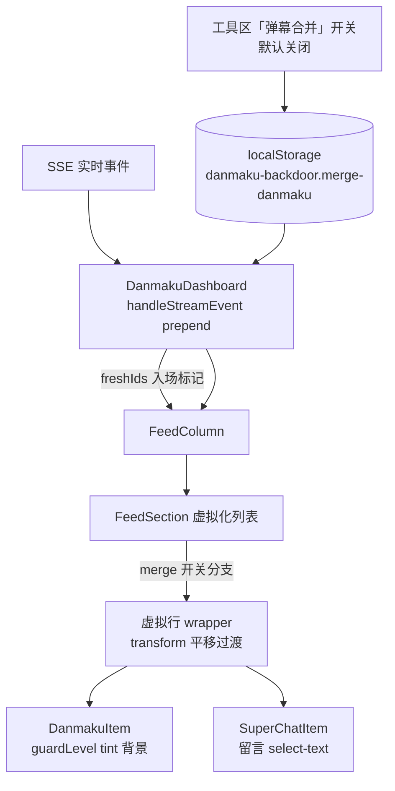
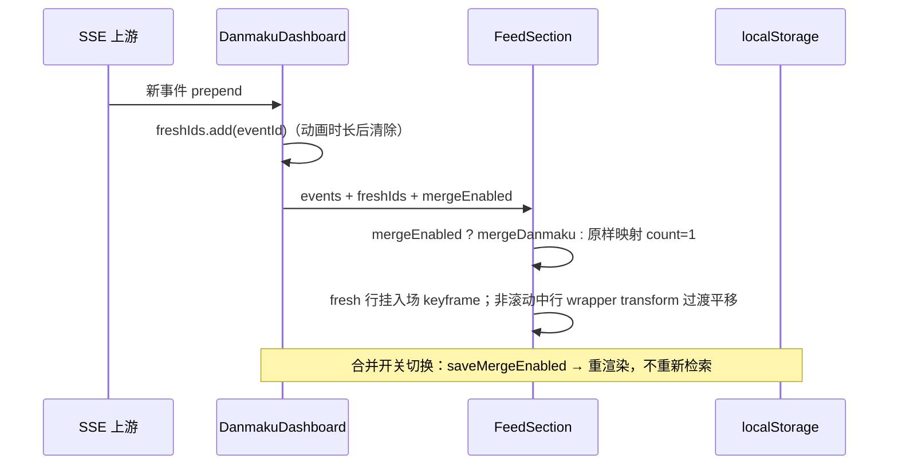

# 弹幕看板视觉优化 - 技术提案

**功能名称**: 弹幕看板视觉优化（Danmaku Board Visual Polish）
**关联 PRD**: `docs/product/requirements/draft/2026-08-19-danmaku-board-visual-polish-prd.md`
**技术提案版本**: v1.0
**创建日期**: 2026-08-19
**作者**: sumire workflow
**prd-branch**: `prd/danmaku-board-visual-polish`（需求总分支）
**feat-branch**: `feat/danmaku-board-visual-polish`（开发分支，实现时自需求总分支合入 main 后切出）

## 1. 概述

### 1.1 背景

弹幕看板现态（`docs/product/spec/danmaku.md`）：`FeedSection` 以 `@tanstack/react-virtual` 虚拟化渲染单类型信息流，虚拟行绝对定位 + `transform: translateY(start)`；SSE 新事件经 `DanmakuDashboard.handleStreamEvent` prepend 到各分节顶部，`useAnchoredFeed` 保证滚动锚定不跳；`mergeDanmaku`（`merge.ts`）恒开启折叠重复弹幕；`SuperChatItem` 容器挂 `select-none`（服务双击已读），留言文字不可选中；`DanmakuItem` 无发送者身份视觉区分。本期四项纯前端改造：

1. **视觉动效**：现况新事件 prepend 后所有虚拟行 transform 瞬变，无插入/平移反馈；
2. **合并开关**：`FeedSection` 无条件 `mergeDanmaku(events)`，无关闭入口；
3. **SC 复制**：`SuperChatItem` 根节点 `cursor-pointer select-none`（admin 时），留言气泡继承不可选中；
4. **船型背景**：`sender.guardLevel` 已在 `Sender` 内用于徽章/chip，但条目级无底色；船型色 token 已有 `guardLevelTone`（eye/flower/crimson）。

### 1.2 目标

- 虚拟化列表支持克制的插入/平移动效（transform/opacity，reduced-motion 降级）；
- 弹幕合并开关（默认关闭）持久化 localStorage，全局生效、即时切换；
- SC 留言气泡 `select-text` 可复制，与双击已读互不干扰；
- `DanmakuItem` 按 `sender.guardLevel` 渲染船型色 0.5% 透明度背景；
- 既有能力（锚定、分页、已读、折叠逻辑）零回归。

### 1.3 范围

- **做**：`FeedSection`/`FeedColumn` 动效改造；新增合并开关存储模块与工具区开关控件；`SuperChatItem` 选中隔离；`DanmakuItem` 船型淡色背景；`format.ts` 增补 tint 纯函数；单元测试。
- **不做**：契约/服务端/接口变更；新事件提示音；动效用户级总开关；透明度档位可调；编排与基础设施变更。

## 2. 技术架构

### 2.1 系统架构图



### 2.2 技术栈

| 层级 | 技术选型 | 说明 |
|------|---------|------|
| 前端 | Next.js（App Router）+ React + TS strict | 改造集中在 `features/danmaku/` |
| 样式 | Tailwind v4（@theme token）+ CSS keyframes | 动效仅 transform/opacity；token 色禁硬编码 |
| 虚拟化 | `@tanstack/react-virtual`（既有） | 行定位 `translateY` 上叠加 transition |
| 存储 | localStorage（既有口径） | 新增 key `danmaku-backdoor.merge-danmaku` |
| 测试 | Vitest + Testing Library | 无 API/e2e 变更 |

### 2.3 模块划分

| 模块 | 职责 | 关键技术点 |
|------|------|-----------|
| `features/danmaku/mergeEnabled.ts`（新增） | 合并开关存取 | `loadMergeEnabled()`/`saveMergeEnabled()`，JSON boolean，损坏回退 `false` |
| `features/danmaku/components/DanmakuDashboard.tsx` | 开关状态与工具区控件；SSE freshIds 维护 | 开关传至各栏；`handleStreamEvent` 记录入场 eventId（动画结束后清除） |
| `features/danmaku/components/FeedColumn.tsx` | 透传 | `mergeEnabled`/`freshIds` 透传各 `FeedSection` |
| `features/danmaku/components/FeedSection.tsx` | 动效与合并分支 | 虚拟行 wrapper 条件 transition；freshId 行入场 keyframe；`mergeEnabled=false` 时不折叠 |
| `features/danmaku/components/SuperChatItem.tsx` | 留言可复制 | 气泡 `select-text` + dblclick 隔离；容器去 `select-none` |
| `features/danmaku/components/DanmakuItem.tsx` | 船型淡色背景 | `guardDanmakuTint(sender.guardLevel)` 类名 |
| `features/danmaku/format.ts` | tint 纯函数 | 3/2/1 → eye/flower/crimson 0.5% 透明度类；其余 null |
| `app/globals.css`（或既有样式入口） | 入场 keyframes | `danmaku-enter` 短时长淡入+下落；`motion-reduce` 降级 |

## 3. API 设计

无契约/接口变更。事件检索、SSE、已读接口与数据模型均不变；`sender.guardLevel` 为既有契约字段，直接消费。

## 4. 数据模型

无数据库变更。新增一个 localStorage key：

| Key | 值 | 缺省/损坏回退 |
|-----|----|----|
| `danmaku-backdoor.merge-danmaku` | JSON boolean | `false`（关闭） |

存取口径对齐既有 `giftMinPrice.ts`（`JSON.parse` try/catch、类型校验、损坏回退默认）。既有栏位配置 key `danmaku-backdoor.columns` 不变、不迁移。

## 5. 技术实现方案

### 5.1 核心流程



### 5.2 关键实现点

#### 实现点 1: 信息流插入/平移动效（FeedSection + DanmakuDashboard）

- **平移**：虚拟行 wrapper 现以 `style={{ transform: translateY(start) }}` 绝对定位。给 wrapper 加条件类 `transition-transform duration-200 motion-reduce:transition-none`；利用 `useVirtualizer` 返回的 `isScrolling` 标志，滚动中挂 `transition-none`（避免滚动时 transform 过渡滞后抖动），静止时恢复过渡——列表内容变化（prepend/append/折叠）引起的 translateY 变化即平滑平移。
- **插入**：`DanmakuDashboard.handleStreamEvent` 是 SSE 到达的唯一入口，将 eventId 记入 `freshIds: ReadonlySet<string>` state（`setTimeout` 300ms 后删除，批量到达共用计时器）；经 `FeedColumn` 透传至 `FeedSection`，`freshIds.has(row.event.eventId)` 的行挂 `animate-danmaku-enter motion-reduce:animate-none`。历史首屏/分页 append 不经过 `handleStreamEvent`，天然不触发动画。
- **keyframes**（`globals.css`，对齐既有 token 命名）：

  ```css
  @keyframes danmaku-enter {
    from { opacity: 0; transform: translateY(-8px); }
    to   { opacity: 1; transform: translateY(0); }
  }
  ```

  仅 transform/opacity，合成层动画，不触发重排；时长 200ms ease-out。
- **风险点**: ① `measureElement` 测量与动画同时进行——入场动画只作用 wrapper 内层内容（或行高由内容决定、translateY(-8px) 不改高度），不干扰测量；实现时动画类挂内层 item 容器而非被测量节点。② 高密度 SSE 连续插入时 `freshIds` 计时器重置，新批次直接替换进行中动画，不叠加。③ `getItemKey` 用 eventId（既有），prepend 复用 DOM 节点时动画类由 freshIds 驱动而非 mount，避免分页 append 复用节点误播动画。

#### 实现点 2: 弹幕合并开关（mergeEnabled.ts + 工具区）

- **描述**: 新增 `mergeEnabled.ts`（仿 `giftMinPrice.ts`）：`loadMergeEnabled(): boolean`（`danmaku-backdoor.merge-danmaku`，JSON boolean，损坏回退 `false`）、`saveMergeEnabled(v: boolean)`。`DanmakuDashboard` 顶层工具区（`GiftFilterControl` 同级）渲染开关控件（`role="switch"`、`aria-checked`、label「弹幕合并」），默认关。状态经 `FeedColumn` 透传各 `FeedSection`。
- **FeedSection 分支**:

  ```ts
  const rows = useMemo<MergedDanmaku[]>(
    () => (mergeEnabled ? mergeDanmaku(events) : events.map((event) => ({ event, count: 1 }))),
    [events, mergeEnabled],
  );
  const folded = mergeEnabled && rows.length < events.length;
  ```

  关闭时 `count` 恒 1，`DanmakuItem` 不渲染「×N」；`folded=false` 时「未铺满自动填充」逻辑不触发（维持短列表手动「加载更多」口径，与 PRD 边界一致）。切换即时生效（`rows` 重算），不重新检索。
- **风险点**: 折叠计数既有单测需适配开关默认关闭的新口径（测试内显式开启合并验证折叠逻辑）。

#### 实现点 3: SC 留言文字可复制（SuperChatItem）

- **描述**: 容器去掉 `select-none`（保留 `cursor-pointer` 与双击已读）；留言气泡 `<p>` 加 `select-text cursor-text`，并 `onDoubleClick={(e) => e.stopPropagation()}`——气泡上双击/拖选不冒泡到条目容器的 `onDoubleClick`，选中复制与已读切换互不干扰；气泡外区域双击行为不变。member 无 `onToggleRead`，本就无冲突。
- **风险点**: 无。罗马音行在气泡内一并可选。

#### 实现点 4: 弹幕条目船型淡色背景（format.ts + DanmakuItem）

- **描述**: `format.ts` 新增纯函数：

  ```ts
  /** 弹幕条目船型淡色背景：舰长蓝/提督紫/总督红 0.5% 透明度；无等级/未知等级返回 null。 */
  export function guardDanmakuTint(level: number | null | undefined): string | null {
    switch (level) {
      case 3: return "bg-eye/[0.5%]";
      case 2: return "bg-flower/[0.5%]";
      case 1: return "bg-crimson/[0.5%]";
      default: return null;
    }
  }
  ```

  `DanmakuItem` 根节点拼接 `guardDanmakuTint(event.sender.guardLevel)` 与 `rounded-md`；合并代表行按其代表事件（末次出现者）等级渲染，天然满足。
- **技术细节**: 0.5% 透明度为需求原文口径；若 Tailwind v4 斜杠修饰符不接受 `0.5%` 任意值，回退 `bg-[color-mix(in_srgb,var(--color-eye)_0.5%,transparent)]`（v4 token 即 CSS 变量，等价）。静态类名须可被 Tailwind 扫描（写全字面量，不拼接）。
- **风险点**: 无。

## 6. 技术决策

### 6.1 决策列表

| 决策 | 选项 A | 选项 B | 最终选择 | 原因 |
|------|--------|--------|---------|------|
| 平移实现 | 虚拟行 transform transition（isScrolling 时禁用） | FLIP 手工计算位移 | A | 虚拟行本就以 transform 定位，transition 零额外计算；FLIP 在虚拟化增删行场景复杂且收益低 |
| 入场动画触发源 | Dashboard 记录 SSE freshIds 透传 | FeedSection diff events 推断新行 | A | `handleStreamEvent` 是 SSE 唯一入口，语义明确；diff 无法区分分页 append 复用节点 |
| 动画降级 | `motion-reduce` 变体 | JS 读 matchMedia 分支渲染 | A | 纯 CSS 降级无运行时分支，与 Tailwind 习惯一致 |
| 合并开关默认值 | 关闭（需求口径） | 保持现况默认开启 | A | 需求明确「默认关闭」 |
| 合并开关作用域 | 全局单开关（工具区） | 每栏独立开关 | A | 需求为「弹幕合并功能增加开关」单数语义；每栏开关徒增配置面 |
| SC 复制与已读冲突 | 气泡 select-text + dblclick 隔离 | 已读改为其他手势（如长按） | A | 双击已读为既有交互（一期契约口径），不迁移用户习惯；隔离成本最低 |
| 船型背景透明度 | 0.5%（需求原文） | 5% 等更高辨识度档位 | A | 忠实需求；评审可在提案评审环节调档（仅改 tint 类一处） |
| 船型背景色来源 | 复用船型强调色 token（eye/flower/crimson） | 读取上游 badge 颜色字段 | A | 契约无 badge 颜色字段；船型色为一二期既定口径 |

### 6.2 依赖与约束

| 类型 | 内容 | 说明 |
|------|------|------|
| 依赖 | 弹幕看板一二期与礼物筛选既有实现 | 改造基底 |
| 依赖 | `@tanstack/react-virtual` 既有版本 | `isScrolling` 标志驱动 transition 开关 |
| 约束 | Tailwind token 色、禁硬编码色值 | `frontend-rules.md`；tint 类走 token/变量 |
| 约束 | 静态导出（GitHub Pages） | 全部客户端行为，无 SSR 依赖（开关默认值 SSR/首帧一致：默认关闭与 localStorage 读取的闪烁按既有 `giftMinPrice` 口径处理） |
| 约束 | 动效克制 + `prefers-reduced-motion` 降级 | PRD 非功能需求 |
| 约束 | 分支 `<type>/<slug>`；禁 rebase/squash | `prd/danmaku-board-visual-polish` 需求总分支 |

## 7. 项目结构

```
apps/bookstore/
├── features/danmaku/
│   ├── mergeEnabled.ts                    # 新增：合并开关 localStorage 存取
│   ├── format.ts                          # 新增 guardDanmakuTint
│   └── components/
│       ├── DanmakuDashboard.tsx           # 开关控件 + freshIds 维护
│       ├── FeedColumn.tsx                 # 透传 mergeEnabled / freshIds
│       ├── FeedSection.tsx                # 合并分支 + 平移/入场动效
│       ├── SuperChatItem.tsx              # 留言 select-text + dblclick 隔离
│       └── DanmakuItem.tsx                # 船型淡色背景
├── app/globals.css                        # danmaku-enter keyframes
└── tests/unit/
    ├── danmaku-merge-enabled.test.ts      # 新增：开关存取/损坏回退
    ├── danmaku-items.test.tsx             # 更新：DanmakuItem tint / SuperChatItem 选中隔离
    └── danmaku-dashboard.test.tsx         # 更新：默认不合并断言、开关切换
```

契约（`contract/`）、服务端（`servers/api`）、编排（`infra/aspire`）零变更。

## 8. 测试策略

### 8.1 测试覆盖要求

- 单元测试（前端）：
  - `mergeEnabled.ts`：默认值 false、存取往返、非法值回退 false；
  - `FeedSection`：`mergeEnabled=false` 时逐条渲染无「×N」、true 时折叠计数与现况一致；freshId 行带入场类、非 fresh 行不带；
  - `SuperChatItem`：气泡 `select-text`；气泡上 dblclick 不触发 `onToggleRead`、气泡外触发；
  - `DanmakuItem`：guardLevel 3/2/1 分别带 eye/flower/crimson tint 类，无等级/未知等级不带；
  - `DanmakuDashboard`：默认合并关闭、开关切换即时生效且持久化（mock localStorage）。
- API 测试：无变更，既有 `live-events` 测试保持绿。
- e2e：无新增（纯展示层）；既有弹幕看板 e2e 若断言折叠行为需适配默认关闭口径。

### 8.2 测试类型

| 类型 | 工具 | 覆盖范围 |
|------|------|---------|
| 单元测试 | Vitest + Testing Library | 开关存取、合并分支、动效类、选中隔离、tint 类 |

## 9. 部署方案

### 9.1 环境规划

| 环境 | 用途 | 部署方式 |
|------|------|---------|
| 本地联调 | Aspire 编排（既有四资源） | `aspire start`，无配置变更 |
| GitHub Pages 生产 | 纯静态 | 无新增配置项 |

### 9.2 配置管理

无新增配置项。

## 10. 验收标准

- [ ] 技术方案评审通过
- [ ] SSE 新事件插入有入场效果、既有条目平移让位；历史加载/分页不动画；reduced-motion 全降级
- [ ] 弹幕合并开关默认关闭、即时全局生效、localStorage 持久化、损坏回退关闭
- [ ] SC 留言（含罗马音）可选中复制，与双击已读互不干扰
- [ ] 舰长/提督/总督弹幕条目呈对应船型色 0.5% 透明度背景，其余无背景
- [ ] 单元测试全绿，`pnpm lint && pnpm test && pnpm build` 全绿

## 11. 相关文档

- 关联 PRD：`docs/product/requirements/draft/2026-08-19-danmaku-board-visual-polish-prd.md`
- 产品 Spec（现态）：`docs/product/spec/danmaku.md`
- 二期提案：`docs/engineering/proposals/2026-08-16-danmaku-board-v2-proposal.md`
- 开发规范：`docs/engineering/frontend-rules.md`
