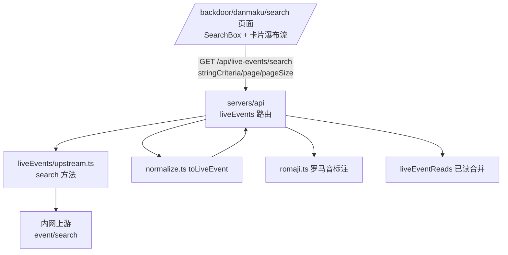
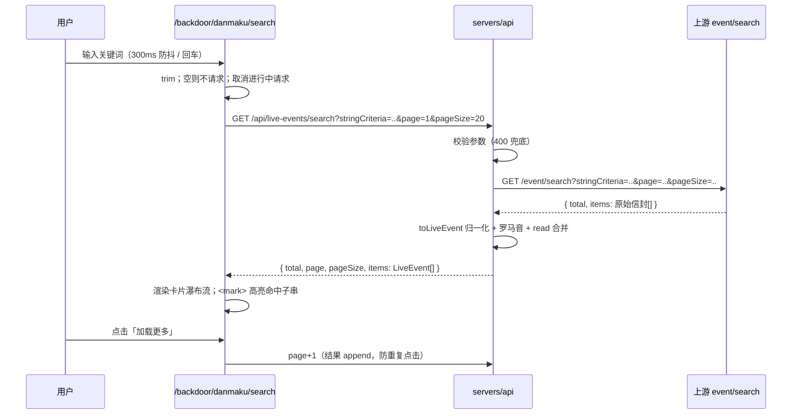

# 弹幕检索 - 技术提案

**功能名称**: 弹幕检索（Danmaku Search）
**关联 PRD**: `docs/product/requirements/draft/2026-08-20-danmaku-search-prd.md`
**技术提案版本**: v1.0
**创建日期**: 2026-08-20
**作者**: sumire workflow
**prd-branch**: `prd/danmaku-search`（需求总分支）
**feat-branch**: `feat/danmaku-search`（开发分支，实现时自需求总分支合入 main 后切出）

## 1. 概述

### 1.1 背景

弹幕看板（`/backdoor/danmaku`）现态只有时间倒序分页浏览，无关键词检索。上游直播事件服务已交付搜索接口：

```
GET http://vtuber.internal.fffdan.com/api/b/live/1727076670/event/search?stringCriteria=<关键词>&page=1&pageSize=20
```

实测确认（2026-08-20）：

- 响应信封 `{ total, page, pageSize, items }` 与 `event/range` 完全一致，`items` 为相同的原始事件信封（`roomId/type/occurredAt/liveSessionId/payload`）——`normalize.ts` 的 `toLiveEvent` 可直接复用；
- `stringCriteria` 必填、非空、≤200 字符，否则 400 `{"error":"stringCriteria must be non-empty and at most 200 characters."}`；
- `page` 非法值上游钳制为 1（不报错）；
- 实测命中均为 `danmaku`（`DANMU_MSG`）事件，但契约按全类型 `LiveEvent` 建模，不人为收窄。

服务端现状：`src/liveEvents/upstream.ts` 以 `LIVE_EVENTS_UPSTREAM_URL`（缺省 `http://vtuber.internal.fffdan.com`）为 base、硬编码路径前缀 `/api/b/live/1727076670`，暴露 `LiveEventsUpstream { fetchRange, subscribe }`；路由 `src/routes/liveEvents.ts` 负责参数校验、归一化、罗马音标注与已读合并。前端 `features/danmaku/` 已有完整的事件展示组件（`DanmakuItem`/`Sender`/`format.ts`）。

### 1.2 目标

- 契约新增 `GET /api/live-events/search`（member 及以上），服务端代理上游 `event/search` 并归一化 + 合并已读；
- 前端新增 `/backdoor/danmaku/search` 页面：防抖输入、卡片换行瀑布流、关键词高亮、分页加载更多；
- 看板页头新增「弹幕检索」入口。

### 1.3 范围

- **做**：契约端点；`upstream.ts` 增加 `search`；路由新增 `/search`；前端 `features/danmaku/search/` 模块与页面；API 集成测试、前端单测、e2e 覆盖。
- **不做**：组合筛选（uid/时间/类型）；多关键词；检索历史；看板信息流本身改动。

## 2. 技术架构

### 2.1 系统架构图



### 2.2 技术栈

| 层级 | 技术选型 | 说明 |
|------|---------|------|
| 前端 | Next.js（App Router）+ React + TS strict | 新页面 + `features/danmaku/search/` 模块 |
| 样式 | Tailwind v4（@theme token） | 卡片瀑布流 `flex flex-wrap`；token 色禁硬编码 |
| 后端 | Express 5 + TS strict | live-events 域新增端点 |
| 契约 | OpenAPI 3.1（`contract/live-events.openapi.yaml`） | 单一事实源，先改契约 |
| 测试 | Vitest（API + 前端单测）、Playwright（e2e） | 既有组织方式 |

### 2.3 模块划分

| 模块 | 职责 | 关键技术点 |
|------|------|-----------|
| `contract/live-events.openapi.yaml` | 新增 `/api/live-events/search` | 参数/响应/错误码定义 |
| `servers/api/src/liveEvents/upstream.ts` | `search(criteria, page, pageSize)` | 复用 base URL/前缀/5s 超时；返回原始信封 |
| `servers/api/src/routes/liveEvents.ts` | `GET /search` | 参数校验（非空/≤200/page/pageSize≤100）→ upstream.search → 归一化 → 罗马音 → 已读合并；上游 5xx → 502 |
| `apps/bookstore/features/danmaku/search/api.ts`（新增） | `searchLiveEvents()` | 复用 `features/backdoor/api.ts` 的 `request()` |
| `apps/bookstore/features/danmaku/search/useDanmakuSearch.ts`（新增） | 检索状态机 | 防抖 300ms、AbortController 取消、页码/总数/追加 |
| `apps/bookstore/features/danmaku/search/components/…`（新增） | SearchBox / SearchResultCard / 瀑布流容器 | 复用 `Sender`、`format.ts`；`<mark>` 高亮 |
| `apps/bookstore/app/backdoor/(dashboard)/danmaku/search/page.tsx`（新增） | 路由组装 | 页头 + 返回看板链接 |
| `apps/bookstore/app/backdoor/(dashboard)/danmaku/page.tsx` | 页头加入口 | 一行链接 |

## 3. API 设计

契约 `contract/live-events.openapi.yaml` 新增（单一事实源，以下为要点）：

```yaml
/api/live-events/search:
  get:
    summary: 关键词检索直播事件（member 及以上）
    parameters:
      - name: stringCriteria
        in: query
        required: true
        schema: { type: string, minLength: 1, maxLength: 200 }
        description: 检索关键词，trim 后非空、最长 200 字符
      - name: page
        in: query
        schema: { type: integer, minimum: 1, default: 1 }
      - name: pageSize
        in: query
        schema: { type: integer, minimum: 1, maximum: 100, default: 20 }
    responses:
      "200": { total, page, pageSize, items: LiveEvent[] }   # 与 /api/live-events 同信封
      "400": { error }   # stringCriteria 缺失/为空/超长，或分页参数非法
      "401": 未登录
      "502": 上游事件服务不可用
```

要点：

- 响应复用既有 `LiveEvent` 模型与分页信封，归一化、罗马音标注、`read` 合并口径与 `GET /api/live-events` 完全一致；
- `stringCriteria` 校验在服务端路由层完成（trim 后 1–200 字符），非法 400 中文错误；分页参数校验口径同既有端点（page/pageSize 非正整数或 pageSize>100 → 400）；
- 上游 4xx（如关键词超长漏网）不穿透，统一按 502/400 口径收敛：上游返回非 2xx → 502；
- 检索结果不新增事件类型过滤参数（上游不支持）。

## 4. 数据模型

无数据库变更。已读状态复用既有 `liveEventReads` 合并逻辑（仅影响 `read` 字段，前端本期不渲染已读交互）。

## 5. 技术实现方案

### 5.1 核心流程



### 5.2 关键实现点

#### 实现点 1: 服务端 search 端点（upstream.ts + liveEvents.ts）

- **upstream.ts**：接口 `LiveEventsUpstream` 增加 `search(params: { stringCriteria: string; page: number; pageSize: number }): Promise<UpstreamPage>`，URL 拼接 `${base}/api/b/live/1727076670/event/search`，复用既有 5s 超时与错误包装；`app.ts` 装配处同步更新 stub 注入点。
- **路由**：`router.get("/search", requireRole("member"), …)`：
  - `stringCriteria`：缺失/trim 后为空/长度 >200 → 400 `{ error: "stringCriteria 不能为空/超长" }`；
  - `page`/`pageSize` 校验复用既有解析逻辑（pageSize 上限 100、默认 20）；
  - 成功路径与 `/api/live-events` 共用归一化管道：`items.map(toLiveEvent)` → `annotateRomaji` → 合并 read；
  - 上游异常/非 2xx/返回非法 → 502 `{ error: "上游事件服务不可用" }`。
- **风险点**: 上游 `page` 非法值会被钳制而非报错（实测 page=0 → page=1），服务端仍以契约口径先行 400，不透传钳制行为。

#### 实现点 2: 检索状态 hook（useDanmakuSearch.ts）

- **描述**：状态 `{ criteria, results: LiveEvent[], total, page, status: "idle" | "loading" | "error" | "done", loadingMore }`。输入变化 → 防抖 300ms → 置 `criteria` 并重置 `results/page=1`；`criteria` 或 `page` 变化触发请求；每次请求新建 `AbortController`，effect 清理时 abort——关键词快速变化时旧请求自然失效，不覆盖新结果。「加载更多」`page+1` 并 append；`results.length >= total` 隐藏按钮。
- **风险点**: ① 防抖与回车并存——回车立即 flush 当前输入（跳过等待）。② 竞态以 abort 为准，不额外加序号戳（保持简单）。

#### 实现点 3: 卡片瀑布流与高亮（SearchResultCard + 容器）

- **布局**：结果容器 `flex flex-wrap gap-3`，卡片 `w-full sm:w-[calc(50%-6px)] lg:w-[calc(33.333%-8px)]`（断点沿用项目 token 口径），一行排满自动换行即「横向排布的换行瀑布流」。
- **卡片**：复用 `Sender`（头像/昵称/罗马音/牌子/船型徽章）与 `format.ts` 时间格式；内容区渲染 `content`/`emote`（表情图）；无双击已读、无 `select-none` 限制（天然可复制）。
- **高亮**：纯函数 `splitByKeyword(content, keyword): { text, hit }[]`（`indexOf` 循环、大小写不敏感按上游匹配口径——上游为子串匹配，实测按原样大小写；保持简单：区分大小写的朴素子串切分，命中段包 `<mark>`，token 背景色如 `bg-eye/30`），连续命中合并展示即可，不做多关键词。
- **风险点**: 关键词含正则元字符——用 `indexOf` 而非正则，天然规避。

#### 实现点 4: 页面与入口

- `app/backdoor/(dashboard)/danmaku/search/page.tsx`：client 组件，页头（标题「弹幕检索」+ 返回看板链接）+ SearchBox + 结果区；鉴权沿用 `(dashboard)` 布局既有口径。
- 看板页头新增「弹幕检索」链接（与「回到看板」对称）。

## 6. 技术决策

### 6.1 决策列表

| 决策 | 选项 A | 选项 B | 最终选择 | 原因 |
|------|--------|--------|---------|------|
| 检索能力落点 | 服务端代理上游 event/search | 本地持久化全量事件自建索引 | A | 上游已交付且实测可用；自建索引成本高、与既有代理架构不一致 |
| 响应模型 | 复用 LiveEvent + 分页信封 | 新增精简 SearchResult 模型 | A | 归一化/罗马音/已读管道与展示组件全部复用；契约一致性最好 |
| 结果类型范围 | 契约按全类型建模，UI 按弹幕卡片渲染 | 契约/实现收窄为 danmaku only | A | 上游未提供类型参数，实测返回弹幕；收窄会丢失未来兼容性，UI 层按 PRD 只承诺弹幕样式 |
| 触发方式 | 防抖自动检索 + 回车 | 仅搜索按钮 | A | PRD「输入字符后调用搜索接口」；按钮保留为可访问性兜底可后期补 |
| 分页方式 | 「加载更多」append | 页码翻页器 | A | 与看板「加载更多」口径一致，瀑布流追加体验自然 |
| 竞态处理 | AbortController 取消 | 请求序号比对 | A | fetch 原生语义，代码最少 |
| 高亮实现 | indexOf 子串切分 + `<mark>` | 正则替换 | A | 规避正则元字符转义问题 |

### 6.2 依赖与约束

| 类型 | 内容 | 说明 |
|------|------|------|
| 依赖 | 上游 `event/search`（已交付） | 信封与 range 一致，归一化零改动 |
| 依赖 | 既有归一化/罗马音/已读管道 | `normalize.ts`/`romaji.ts`/`liveEventReads.ts` |
| 约束 | 契约先行 | 先改 `contract/live-events.openapi.yaml`，测试与实现以契约为准 |
| 约束 | 后端规范 | `docs/engineering/backend-rules.md`：错误 `{error}` 中文、401/403、TDD |
| 约束 | 前端规范 | `docs/engineering/frontend-rules.md`：features 分层、token 色、`pnpm lint && pnpm test && pnpm build` 全绿 |
| 约束 | 分支 `<type>/<slug>`；禁 rebase/squash | `prd/danmaku-search` 需求总分支 |

## 7. 项目结构

```
contract/
└── live-events.openapi.yaml                 # 新增 /api/live-events/search
servers/api/src/
├── liveEvents/upstream.ts                   # 新增 search 方法
└── routes/liveEvents.ts                     # 新增 GET /search
apps/bookstore/
├── app/backdoor/(dashboard)/danmaku/
│   ├── page.tsx                             # 页头加「弹幕检索」入口
│   └── search/page.tsx                      # 新增检索页
├── features/danmaku/search/                 # 新增模块
│   ├── api.ts
│   ├── useDanmakuSearch.ts
│   ├── highlight.ts                         # splitByKeyword 纯函数
│   └── components/
│       ├── SearchBox.tsx
│       ├── SearchResultCard.tsx
│       └── SearchResults.tsx               # 瀑布流容器 + 三态 + 加载更多
└── tests/unit/
    ├── danmaku-search-highlight.test.ts     # 新增
    └── danmaku-search-hook.test.ts          # 新增
tests/api/src/
└── live-events.test.ts                      # 新增 /search describe 分组
tests/e2e/                                   # 新增弹幕检索页用例
```

## 8. 测试策略

### 8.1 测试覆盖要求

- 契约：OpenAPI 校验通过（既有契约 lint 口径）。
- API 集成测试（`tests/api/src/live-events.test.ts` 新增分组，stub 上游模拟 `event/search`）：
  - 鉴权矩阵：未登录 401、member 200；
  - 参数：`stringCriteria` 缺失/空/201 字符 → 400；`pageSize>100` → 400；
  - 代理：参数透传（criteria/page/pageSize）、响应信封形状、items 已归一化且含 read；
  - 上游 5xx/超时/非法返回 → 502。
- 前端单测：
  - `highlight.ts`：命中/未命中/多段命中/空关键词/正则元字符关键词；
  - `useDanmakuSearch`：防抖、取消旧请求、加载更多 append、错误态；
  - `SearchResultCard`：发送者/内容/时间/表情渲染，`<mark>` 存在。
- e2e（Playwright）：登录后进入检索页，输入关键词出结果卡片，加载更多追加；失败态展示（可 stub 路由）。

### 8.2 测试类型

| 类型 | 工具 | 覆盖范围 |
|------|------|---------|
| API 集成 | Vitest + fetch + CookieJar + stub 上游 | /search 鉴权、参数、代理、错误 |
| 单元测试 | Vitest + Testing Library | 高亮、hook、卡片组件 |
| e2e | Playwright | 检索页端到端主流程 |

## 9. 部署方案

### 9.1 环境规划

| 环境 | 用途 | 部署方式 |
|------|------|---------|
| 本地联调 | Aspire 编排（既有四资源） | `aspire start`，`LIVE_EVENTS_UPSTREAM_URL` 既有注入，无配置变更 |
| 生产 | GitHub Pages（前端）+ 既有 API 部署 | 无新增配置项 |

### 9.2 配置管理

无新增配置项；上游地址沿用 `LIVE_EVENTS_UPSTREAM_URL`。

## 10. 验收标准

- [ ] 技术方案评审通过
- [ ] 契约含 `/api/live-events/search` 且通过校验；服务端实现与契约一致
- [ ] 检索页输入 300ms 防抖自动检索、回车立检、空关键词不请求、旧请求可取消
- [ ] 结果卡片横向排布自动换行，关键词 `<mark>` 高亮，三态反馈完整
- [ ] 「加载更多」分页 append，达到 total 后消失；失败可重试不丢已有结果
- [ ] API 测试、前端单测、e2e 全绿；`pnpm lint && pnpm test && pnpm build` 全绿
- [ ] Spec 同步：上线 PR 内更新 `docs/product/spec/danmaku.md` 与 `docs/engineering/spec/` 对应文件

## 11. 相关文档

- 关联 PRD：`docs/product/requirements/draft/2026-08-20-danmaku-search-prd.md`
- 产品 Spec（现态）：`docs/product/spec/danmaku.md`
- 契约：`contract/live-events.openapi.yaml`
- 开发规范：`docs/engineering/frontend-rules.md`、`docs/engineering/backend-rules.md`
