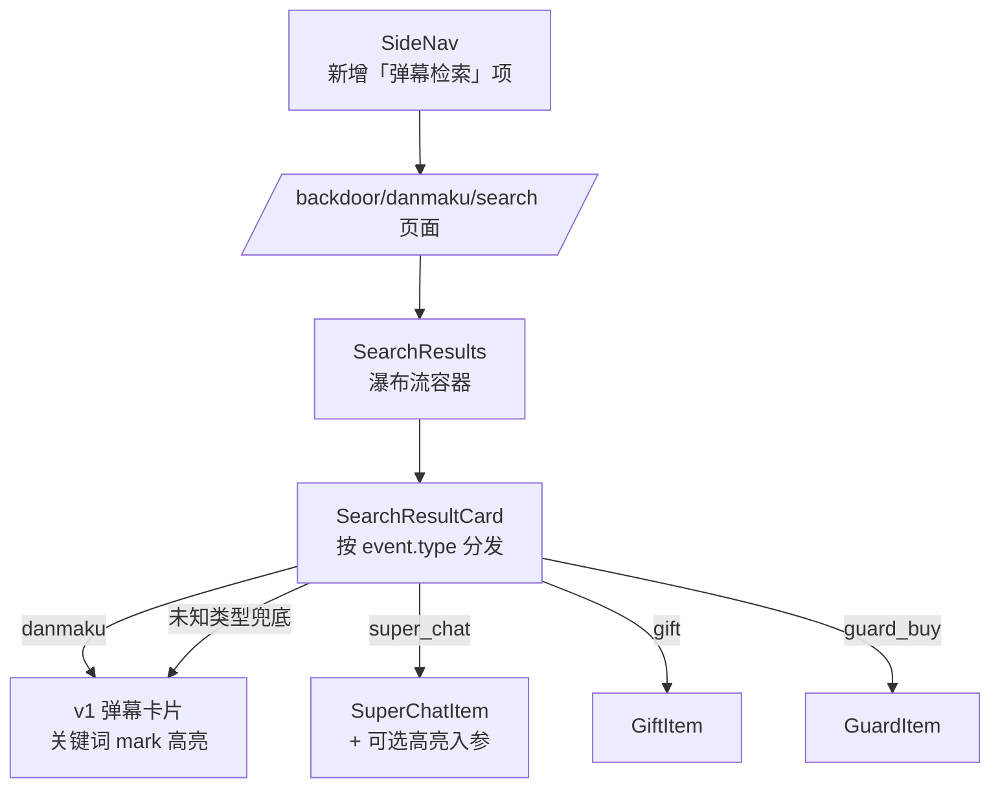
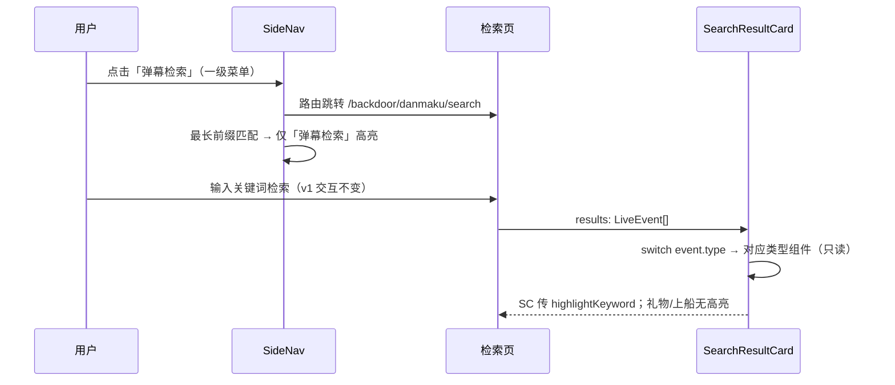

# 弹幕检索 v2 - 技术提案

**功能名称**: 弹幕检索 v2（Danmaku Search v2：入口与分类型渲染）
**关联 PRD**: `docs/product/requirements/draft/2026-08-20-danmaku-search-v2-prd.md`
**技术提案版本**: v1.0
**创建日期**: 2026-08-20
**作者**: sumire workflow
**prd-branch**: `prd/danmaku-search-v2`（需求总分支）
**feat-branch**: `feat/danmaku-search-v2`（开发分支，实现时自需求总分支合入 main 后切出）

## 1. 概述

### 1.1 背景

弹幕检索 v1 已上线（PR #64 / #65，现态见 `docs/product/spec/danmaku.md`「弹幕检索」）。两个待改进点（本期 PRD 输入）：

1. **入口层级**：检索页仅能从看板页头链接进入；后台左侧导航 `SideNav`（`apps/bookstore/features/backdoor/components/SideNav.tsx`）现态 4 项：仪表盘 / 直播计划 / 弹幕看板 / 用户管理，无「弹幕检索」；
2. **结果样式**：`SearchResultCard`（`features/danmaku/search/components/SearchResultCard.tsx`）对全部事件类型一律按弹幕卡片渲染，SC 的金额分档配色 / `scColors`、礼物图标、上船徽章等类型特征全部丢失。看板侧已有现成的四类条目组件：`DanmakuItem` / `SuperChatItem` / `GiftItem` / `GuardItem`（分发示例见 `FeedSection.tsx` 的 `renderItem`）。

选中态冲突隐患：`SideNav` 现以 `pathname.startsWith(item.href)` 判定激活，若直接新增 `href: "/backdoor/danmaku/search"` 菜单项，检索页会同时命中「弹幕看板」与「弹幕检索」两项高亮，必须先修复匹配口径。

### 1.2 目标

- 左侧导航新增「弹幕检索」一级菜单项（与「弹幕看板」同级，member 及以上可见），并修复选中态前缀冲突；
- 检索结果按 `event.type` 分发渲染，复用看板条目组件（只读口径）；SC 留言正文支持关键词高亮；
- 纯前端变更：不改契约、不改服务端。

### 1.3 范围

- **做**：`SideNav` 菜单项与选中态逻辑；`features/danmaku/search/` 结果卡片分类型分发；`SuperChatItem` 可选高亮入参；前端单测与 e2e 覆盖。
- **不做**：契约 / 服务端改动；弹出窗口式检索；类型筛选；检索结果已读交互。

## 2. 技术架构

### 2.1 系统架构图



### 2.2 技术栈

| 层级 | 技术选型 | 说明 |
|------|---------|------|
| 前端 | Next.js（App Router）+ React + TS strict | 仅前端变更 |
| 样式 | Tailwind v4（@theme token） | 沿用既有 token，无新增色值 |
| 测试 | Vitest + Testing Library（单测）、Playwright（e2e） | 既有组织方式 |

### 2.3 模块划分

| 模块 | 职责 | 关键技术点 |
|------|------|-----------|
| `features/backdoor/components/SideNav.tsx` | 新增菜单项；修复选中态 | 最长前缀匹配激活 |
| `features/danmaku/search/components/SearchResultCard.tsx` | 按 type 分发渲染 | switch 分发 + 未知类型兜底 |
| `features/danmaku/components/SuperChatItem.tsx` | 支持留言关键词高亮 | 新增可选 `highlightKeyword` 入参 |
| `features/danmaku/search/highlight.ts` | 高亮切分 | `splitByKeyword` 直接复用，无改动 |

## 3. API 设计

无契约变更。检索仍走 `GET /api/live-events/search`（v1 已交付），响应 `LiveEvent[]` 本身携带 `type` 字段，前端分发无需新增字段。

## 4. 数据模型

无数据模型与持久化变更。`LiveEvent.type` 为四值枚举（`danmaku` / `super_chat` / `gift` / `guard_buy`，见 `features/danmaku/types.ts`），分发即按此枚举。

## 5. 技术实现方案

### 5.1 核心流程



### 5.2 关键实现点

#### 实现点 1: SideNav 菜单项与选中态修复

- `NAV_ITEMS` 在「弹幕看板」后插入 `{ href: "/backdoor/danmaku/search", label: "弹幕检索", roles: ["superadmin", "admin", "member"] }`；
- 激活判定改为**最长前缀匹配**：候选为 `pathname === href || pathname.startsWith(href + "/")` 的项，取 `href` 最长者激活（`/backdoor` 精确匹配规则被该口径自然覆盖：`/backdoor/schedule` 不会命中 `/backdoor`，因为要求 `href + "/"` 前缀）；
- **风险点**：直接保留 `startsWith` 会导致检索页双高亮——必须随菜单项一并修复，并为「看板页仅看板高亮 / 检索页仅检索高亮」补单测。

#### 实现点 2: 结果卡片按类型分发（SearchResultCard）

- `SearchResultCard` 改为分发器：`switch (event.type)`：
  - `danmaku`：保持 v1 现有卡片 JSX 不变（可抽为内部 `DanmakuCard` 局部组件）；
  - `super_chat`：`<SuperChatItem event={event} isNew={false} highlightKeyword={keyword} />`（不传 `onToggleRead` 即只读，组件现态已支持可选回调，见 `FeedSection` 中 member 口径）；
  - `gift`：`<GiftItem event={event} />`；
  - `guard_buy`：`<GuardItem event={event} isNew={false} />`；
  - `default`（防御未知类型）：回退 v1 弹幕卡片，不抛错；
- 非弹幕类型外套与 v1 卡片同宽的响应式容器（`w-full sm:w-[calc(50%-6px)] lg:w-[calc(33.333%-8px)]`），保证瀑布流栅格一致；条目组件自带背景/边框，容器不再叠加卡片底色；
- **风险点**：① 看板条目组件为整行信息流设计，放入定宽卡片列需目检 SC 渐变卡片在窄列下的表现（`scColors` 背景完整保留，内部已 `min-w-0` 换行）；② 检索态不传 `onToggleRead` 时组件不得出现可点击已读的误导样式（member 口径已是此行为，复用即可）。

#### 实现点 3: SuperChatItem 可选关键词高亮

- 新增可选入参 `highlightKeyword?: string`（缺省 `undefined`，看板调用方零改动）；
- 非空时对留言 `content` 复用 `splitByKeyword(content, highlightKeyword)` 切分，命中段包 `<mark>`（样式与 v1 检索卡片一致：`bg-eye/30`）；`contentRomaji` 罗马音行不高亮（关键词命中口径为原文子串）；
- **风险点**：高亮仅在检索场景传入，看板路径不传参、渲染输出与现态逐字节一致，回归风险为零；单测覆盖传参/不传参两条路径。

#### 实现点 4: 高亮范围约定

- 仅 `danmaku.content`（v1 既有）与 `super_chat.content`（本期新增）做 `<mark>` 高亮；礼物名、船名等结构化字段不高亮（PRD 口径：礼物/上船无文字内容字段）。

## 6. 技术决策

### 6.1 决策列表

| 决策 | 选项 A | 选项 B | 最终选择 | 原因 |
|------|--------|--------|---------|------|
| 入口形态 | 左侧导航一级菜单项 | 全局弹出检索窗口 | A | PRD 二选一；导航项改动最小、与后台信息架构一致，弹出窗口需新增全局状态与焦点管理，成本高 |
| 选中态修复 | 最长前缀匹配 | 逐项手写例外 | A | 一处通用逻辑覆盖现有与未来菜单项，无特例 |
| 分类型渲染 | 复用看板条目组件 | 检索侧自写四套卡片 | A | 与看板渲染口径天然一致，杜绝双份实现漂移 |
| SC 高亮 | SuperChatItem 加可选入参 | 检索侧包装/复制 SC 组件 | A | 可选入参对看板零影响；复制组件会立即产生样式漂移 |
| 只读口径 | 不传 onToggleRead、isNew=false | 给条目加 readonly 模式开关 | A | 组件现态已支持可选回调（member 口径），无需新抽象 |

### 6.2 依赖与约束

| 类型 | 内容 | 说明 |
|------|------|------|
| 依赖 | 弹幕检索 v1（已上线） | `features/danmaku/search/` 模块与路由 |
| 依赖 | 看板条目组件 | `DanmakuItem` / `SuperChatItem` / `GiftItem` / `GuardItem` |
| 约束 | 纯前端变更 | 不改契约、不改服务端、无配置变更 |
| 约束 | 前端规范 | `docs/engineering/frontend-rules.md`：features 分层、token 色、`pnpm lint && pnpm test && pnpm build` 全绿 |
| 约束 | 分支 `<type>/<slug>`；禁 rebase/squash | `prd/danmaku-search-v2` 需求总分支 |

## 7. 项目结构

```
apps/bookstore/
├── features/backdoor/components/
│   └── SideNav.tsx                            # 新增菜单项 + 最长前缀匹配激活
├── features/danmaku/
│   ├── components/
│   │   └── SuperChatItem.tsx                  # 新增可选 highlightKeyword 入参
│   └── search/components/
│       └── SearchResultCard.tsx               # 按 event.type 分发渲染
└── tests/unit/
    ├── sidenav-active.test.tsx                # 新增：导航选中态
    ├── danmaku-search-result-card.test.tsx    # 新增：类型分发与只读口径
    └── super-chat-item-highlight.test.tsx     # 新增：高亮入参两条路径
tests/e2e/                                     # 既有检索用例补：导航入口可见可达
```

## 8. 测试策略

### 8.1 测试覆盖要求

- 前端单测：
  - `SideNav`：检索页路径仅「弹幕检索」激活；看板页路径仅「弹幕看板」激活；member 角色可见检索项；
  - `SearchResultCard`：四种类型分别渲染为对应组件结构；未知类型兜底弹幕卡片不抛错；检索态无双击已读回调；
  - `SuperChatItem`：传 `highlightKeyword` 时命中子串包 `<mark>`；不传时输出与现态一致；
- e2e（Playwright）：后台左侧导航可见「弹幕检索」，点击进入检索页且导航选中态正确；检索主流程沿用 v1 用例不回归。

### 8.2 测试类型

| 类型 | 工具 | 覆盖范围 |
|------|------|---------|
| 单元测试 | Vitest + Testing Library | 导航选中态、类型分发、SC 高亮 |
| e2e | Playwright | 导航入口可达性与选中态、检索主流程回归 |

## 9. 部署方案

### 9.1 环境规划

| 环境 | 用途 | 部署方式 |
|------|------|---------|
| 本地联调 | Aspire 编排（既有四资源） | 无配置变更 |
| 生产 | GitHub Pages（前端静态导出） | 无新增配置项 |

### 9.2 配置管理

无新增配置项。

## 10. 验收标准

- [ ] 技术方案评审通过
- [ ] 左侧导航新增「弹幕检索」一级菜单项，看板/检索两页选中态互不干扰
- [ ] 检索结果按 type 分发渲染：SC / 礼物 / 上船 / 弹幕各呈其看板样式，未知类型兜底不崩溃
- [ ] SC 留言正文命中关键词 `<mark>` 高亮；弹幕高亮行为无回归
- [ ] 检索结果只读：无已读交互、无 New 标记；看板侧条目渲染零变化
- [ ] 前端单测、e2e 全绿；`pnpm lint && pnpm test && pnpm build` 全绿
- [ ] Spec 同步：上线 PR 内更新 `docs/product/spec/danmaku.md`「弹幕检索」小节

## 11. 相关文档

- 关联 PRD：`docs/product/requirements/draft/2026-08-20-danmaku-search-v2-prd.md`
- 前置提案（v1）：`docs/engineering/proposals/2026-08-20-danmaku-search-proposal.md`
- 产品 Spec（现态）：`docs/product/spec/danmaku.md`
- 前端规范：`docs/engineering/frontend-rules.md`
