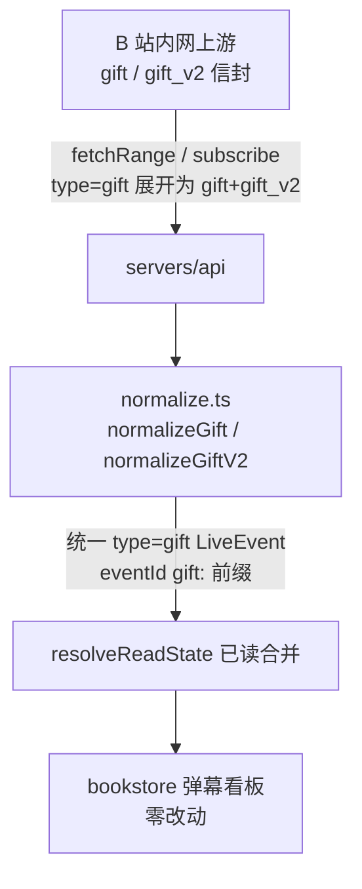
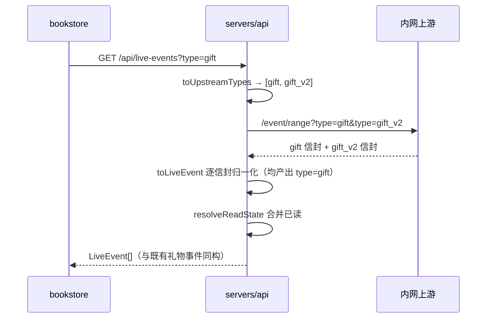

# 礼物事件 gift_v2 支持 - 技术提案

**功能名称**: 礼物事件 gift_v2 支持（Gift v2 Support）
**关联 PRD**: `docs/product/requirements/draft/2026-08-20-gift-v2-prd.md`
**技术提案版本**: v1.0
**创建日期**: 2026-08-20
**作者**: sumire workflow
**feat-branch**: `feat/gift-v2`

## 1. 概述

### 1.1 背景

内网直播事件服务（`vtuber.internal.fffdan.com`，检索 `/event/range`、订阅 `/event/subscribe`）新增 `gift_v2` 类型礼物事件。现态链路：

- 归一化层 `servers/api/src/liveEvents/normalize.ts` 的 `toLiveEvent` 只识别四类信封 `type`（danmaku/super_chat/gift/guard_buy，见 `EVENT_TYPES`），`gift_v2` 命中「未知事件类型」分支被丢弃并 `console.warn`；
- 路由层 `routes/liveEvents.ts` 将契约 type 参数原样透传为上游 `type=` 查询参数（`fetchRange(types, …)` / `subscribe(types, …)`），客户端请求 `gift` 时上游不会返回 `gift_v2`。

因此 gift_v2 事件在检索与 SSE 两条链路上均不可见。本期目标：服务端两处改造（归一化识别 + 上游请求扩参），gift_v2 并入既有 gift 事件流，契约/前端/数据库零变更。

### 1.2 目标

- `normalize.ts` 识别 `gift_v2` 信封，新增 `normalizeGiftV2` 映射为既有 `gift` LiveEvent（`type: "gift"`，eventId `gift:` 前缀）；
- `liveEvents.ts` 路由层向上游请求时，将契约 `gift` 展开为 `["gift", "gift_v2"]`（检索与 SSE 一致），契约 `type` 枚举不变；
- 字段口径与既有 `normalizeGift` 对齐（金额/图标/牌子/上船等级），已读、minPrice 筛选等下游链路天然生效；
- 既有四类事件零回归。

### 1.3 范围

- **做**：`normalize.ts`（EVENT_TYPES + normalizeGiftV2 + toLiveEvent 分发）；`routes/liveEvents.ts`（上游请求类型扩参）；单测与实测样本夹具（`tests/fixtures/live-events/gift_v2.json`）。
- **不做**：契约变更；前端任何改动；数据库/已读模型变更；编排与基础设施变更；下线旧 gift 归一化路径。

## 2. 技术架构

### 2.1 系统架构图



### 2.2 技术栈

| 层级 | 技术选型 | 说明 |
|------|---------|------|
| 后端 | Express 5 + TS strict | 改造集中在 `liveEvents/normalize.ts` 与 `routes/liveEvents.ts` |
| 契约 | `contract/live-events.openapi.yaml` | **不变**（对前端透明是硬约束） |
| 测试 | Vitest（服务端单测）+ 既有 API 集成测试 | 新增 gift_v2 实测样本夹具 |

### 2.3 模块划分

| 模块 | 职责 | 关键技术点 |
|------|------|-----------|
| `src/liveEvents/normalize.ts` | gift_v2 归一化 | `EVENT_TYPES` 增 `"gift_v2"`；新增 `normalizeGiftV2`；`toLiveEvent` 分发 |
| `src/routes/liveEvents.ts` | 上游请求扩参 | 契约 type → 上游 type 映射（`gift` → `["gift", "gift_v2"]`），检索/SSE 共用 |
| `tests/liveEventsNormalize.test.ts` | 归一化单测 | gift_v2 正常/缺图标/银瓜子/畸形用例 |
| `tests/fixtures/live-events/gift_v2.json` | 实测样本夹具 | 开发前置：抓取真实 gift_v2 信封落盘 |

## 3. API 设计

### 3.1 API 契约

无变更。`GET /api/live-events` 的 `type` 枚举仍为四类，**不接受 `gift_v2` 作为查询参数**（非法仍 400）；`LiveEvent` schema 不变。gift_v2 事件以 `type: "gift"` 形态下发，旧前端天然兼容。

### 3.2 内部接口

#### normalize.ts

- `EVENT_TYPES` 增加 `"gift_v2"`（仅归一化层内部识别，不进入契约枚举 `LIVE_EVENT_TYPES`）；
- `toLiveEvent` 分发：`type === "gift" → normalizeGift`，`type === "gift_v2" → normalizeGiftV2`，二者均产出 `type: "gift"` 的 LiveEvent；
- `normalizeGiftV2(payload, occurredAt)`：字段映射以实测样本为准（开发前置，见 5.2 实现点 1），映射口径对齐 `normalizeGift`：
  - eventId：`gift:{v2 稳定唯一 id}`——取 v2 payload 中等价于 `batch_combo_id ?? combo_id` 的连击去重标识；若无等价字段，回退 `gift:{uid}:{giftId}:{timestamp}` 派生；
  - 金额：金瓜子按 v2 等价字段 /1000，银瓜子记 0；
  - `gift.name` / `gift.count` / 可选 `gift.iconUrl`；发送者 uid/昵称/头像/牌子/上船等级（v2 若为 uinfo 结构则复用 `guardLevelFromUinfo` / `medalFromMedalInfo`）；
  - 防御式解析、失败返回 null + console.warn 的既定口径不变。

#### routes/liveEvents.ts

- `parseTypesParam` 不变（契约口径校验）；新增内部映射：向上游发请求前将 `gift` 展开为 `["gift", "gift_v2"]`：

```ts
/** 契约 type → 上游 type 查询参数：gift 并入 gift_v2 来源（前端透明）。 */
function toUpstreamTypes(types: string[]): string[] {
  return types.flatMap((t) => (t === "gift" ? ["gift", "gift_v2"] : [t]));
}
```

- 检索 `GET /` 与 SSE `GET /stream` 两处调用点统一走 `toUpstreamTypes`；`read-all` 的 `fetchRange([type], …)` 仅支持 super_chat/guard_buy，不涉及。

## 4. 数据模型

无数据库变更。eventId 保持 `gift:` 前缀，`typeFromEventId` 映射、已读单条记录与水位线全部兼容，历史已读数据不受影响。

## 5. 技术实现方案

### 5.1 核心流程



SSE 链路同理（`subscribe` 的 types 参数同样经 `toUpstreamTypes`）。

### 5.2 关键实现点

#### 实现点 1: gift_v2 实测样本采集（开发前置）

- **描述**: 经 `GET {base}/api/b/live/1727076670/event/range?type=gift_v2`（或 subscribe 抓帧）获取真实 gift_v2 信封，落盘 `tests/fixtures/live-events/gift_v2.json`，据此敲定字段映射表。
- **技术细节**: 样本需覆盖：金瓜子/银瓜子、有无连击（batch_combo_id 等价字段）、有无图标字段；样本字段名与既有 `normalizeGift` 所用字段（`data.uname`/`data.img_basic`/`data.combo_total_coin` 等）逐一比对，v2 若为 `uinfo` 结构则复用既有提取函数。
- **风险点**: 上游当前可能尚未实际下发 gift_v2（仅声明支持）——此时以文档/接口声明的 schema 落夹具并在单测中断言，上线前以真实流量回归验证。

#### 实现点 2: normalizeGiftV2

- **描述**: 新增 `normalizeGiftV2(payload, occurredAt): LiveEvent | null`，产出 `type: "gift"`；`EVENT_TYPES` 增 `"gift_v2"`，`toLiveEvent` 增分发分支。
- **技术细节**: 字段口径对齐 `normalizeGift`（金额 /1000、银瓜子 0、iconUrl 缺失不下发、牌子名为空视为无牌子、guardLevel 0/缺位为 null）；eventId 稳定优先（连击去重标识 > uid+giftId+timestamp 回退）。
- **风险点**: 若上游对同一礼物同时发 gift 与 gift_v2（双发），列表将出现重复事件——以实测确认；若证实双发，决策见 6.1（本提案默认假设 v2 为新增/替代来源而非双发，实测推翻时再补去重）。

#### 实现点 3: 路由层上游扩参

- **描述**: `routes/liveEvents.ts` 检索与 SSE 两处，将校验后的契约 types 经 `toUpstreamTypes` 展开后再传给 `deps.upstream.fetchRange / subscribe`。
- **技术细节**: 纯函数、放在路由文件内（与 `parseTypesParam` 同级）；`minPrice` 等其他参数透传不变。上游收到多个 `type=` 重复参数的行为已由现有多类型请求验证（一期即如此）。
- **风险点**: 无（上游接口本就支持多 type 重复参数）。

## 6. 技术决策

### 6.1 决策列表

| 决策 | 选项 A | 选项 B | 最终选择 | 原因 |
|------|--------|--------|---------|------|
| gift_v2 出口形态 | 归一化为 `type: "gift"` | 契约新增第五类 `gift_v2` | A | PRD 硬约束「对前端透明」；礼物看板语义相同，拆类徒增前端/契约/已读模型复杂度 |
| 上游请求方式 | 契约 gift 展开为 gift+gift_v2 同请求 | 要求上游改版把 gift_v2 并入 gift 下发 | A | 服务端单边即可完成，不依赖上游排期；上游接口已支持多 type 参数 |
| 契约 type 参数 | 不接受 `gift_v2`（非法 400） | 接受并透传 | A | gift_v2 是上游实现细节，不泄漏进契约 |
| eventId 前缀 | 沿用 `gift:` | 新增 `giftv2:` | A | `typeFromEventId`、已读记录、前端零适配 |
| 双发去重（若实测证实） | 归一化出口按 eventId 去重 | 不去重直接透传 | 暂缓 | 以实测为准；本提案默认无双发，证实后优先在归一化出口去重（改动最小） |

### 6.2 依赖与约束

| 类型 | 内容 | 说明 |
|------|------|------|
| 依赖 | 上游提供 gift_v2（同一内网服务） | 检索/订阅接口与现有一致，无新增数据源 |
| 依赖 | gift_v2 真实样本 | 字段映射的事实源（实现点 1） |
| 约束 | 契约/前端/DB 零变更 | 对前端透明（PRD） |
| 约束 | 防御式归一化不中断流 | `normalize.ts` 既定口径 |
| 约束 | 分支 `feat/gift-v2` 自 main 切出 | `<type>/<slug>` 约定 |

## 7. 项目结构

```
servers/api/
├── src/
│   ├── liveEvents/normalize.ts       # EVENT_TYPES + normalizeGiftV2 + toLiveEvent 分发
│   └── routes/liveEvents.ts          # toUpstreamTypes 扩参（检索/SSE 两处）
└── tests/
    ├── fixtures/live-events/gift_v2.json   # 实测样本夹具（新增）
    ├── liveEventsNormalize.test.ts         # gift_v2 归一化用例
    └── routesLiveEvents.test.ts            # 扩参与 gift_v2 事件出口用例（如既有）

contract/live-events.openapi.yaml     # 不变
apps/bookstore/                        # 不变
tests/api/                             # 既有 live-events 用例保持绿；按 z-test 口径增补 gift_v2 集成用例
```

## 8. 测试策略

### 8.1 测试覆盖要求

- 服务端单测（`normalize`）：gift_v2 合法样本 → `type: "gift"`、eventId `gift:` 前缀稳定、金额/图标/牌子/上船等级口径正确；缺图标 → 不下发 `iconUrl`；银瓜子 → price 0；畸形/缺关键字段 → null + warn。
- 服务端单测（路由）：`type=gift` 时上游收到 `type=gift&type=gift_v2`；缺省全类型时同样包含两者；`type=danmaku` 不含 gift_v2；非法 type 仍 400；gift_v2 信封经检索/SSE 出口为 `type: "gift"` 且已读合并正常。
- API 集成测试：既有 `live-events` 用例全绿（契约未变）；按 z-test 工作流增补 gift_v2 来源事件检索用例。

### 8.2 测试类型

| 类型 | 工具 | 覆盖范围 |
|------|------|---------|
| 单元测试 | Vitest | normalizeGiftV2、toUpstreamTypes、路由出口 |
| API 集成测试 | Vitest + fetch | gift_v2 并入 gift 检索流、既有用例零回归 |

## 9. 部署方案

### 9.1 环境规划

| 环境 | 用途 | 部署方式 |
|------|------|---------|
| 本地联调 | Aspire 编排（既有四资源） | `aspire start`，无配置变更 |
| 生产 | 既有部署 | 无新增配置项 |

### 9.2 配置管理

无新增配置项。`LIVE_EVENTS_UPSTREAM_URL` 等既有配置不变（上游同一服务、同一接口）。

## 10. 验收标准

- [ ] 技术方案评审通过
- [ ] gift_v2 实测样本夹具落盘，字段映射经评审
- [ ] gift_v2 事件经检索与 SSE 均以 `type: "gift"` 下发，字段口径与既有礼物事件一致
- [ ] 契约/前端/数据库零变更；非法 `type=gift_v2` 查询仍 400
- [ ] 服务端单测与 API 集成测试全绿，`pnpm lint && pnpm test && pnpm build` 全绿
- [ ] spec 同步：上线同 PR 更新 `docs/engineering/spec/backend-live.md`（gift_v2 归一化与扩参口径）与 `docs/product/spec/danmaku.md`（如有行为口径变化）

## 11. 相关文档

- 关联 PRD：`docs/product/requirements/draft/2026-08-20-gift-v2-prd.md`
- 关联 Contract：`contract/live-events.openapi.yaml`（本期不变）
- 产品 Spec（现态）：`docs/product/spec/danmaku.md`
- 后端直播域 Spec：`docs/engineering/spec/backend-live.md`
- 开发规范：`docs/engineering/backend-rules.md`
