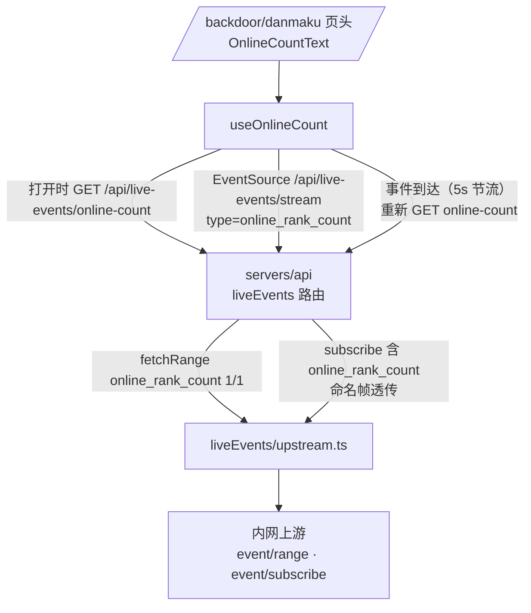
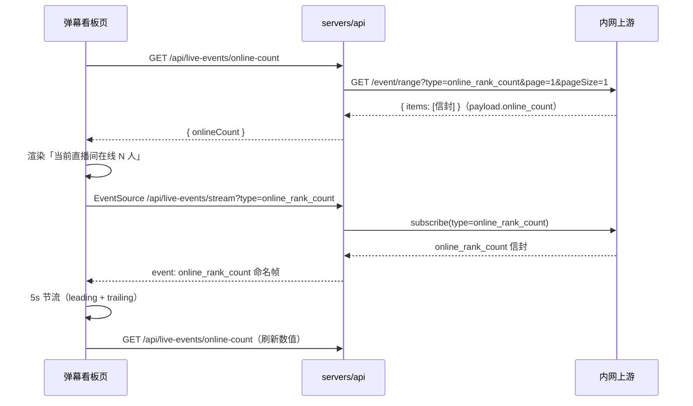

# 直播间在线人数展示 - 技术提案

**功能名称**: 直播间在线人数展示（Live Online Count）
**关联 PRD**: `docs/product/requirements/draft/2026-08-21-online-count-prd.md`
**技术提案版本**: v1.0
**创建日期**: 2026-08-21
**作者**: sumire workflow
**prd-branch**: `prd/online-count`（需求总分支）
**feat-branch**: `feat/online-count`（开发分支，实现时自需求总分支合入 main 后切出）

## 1. 概述

### 1.1 背景

弹幕看板（`/backdoor/danmaku`）无在线人数信息。上游内网直播事件服务持续产生 `online_rank_count` 类型事件，两个既有通道均可获取：

```
GET http://vtuber.internal.fffdan.com/api/b/live/1727076670/event/range?page=1&pageSize=1&type=online_rank_count
GET http://vtuber.internal.fffdan.com/api/b/live/1727076670/event/subscribe?type=online_rank_count   (SSE)
```

- `event/range` 取最新一条，其 `payload.online_count` 即当前在线人数；
- `event/subscribe` 实时推送 `online_rank_count` 事件，作为「人数可能已变化」的刷新触发。

服务端现状：`src/liveEvents/upstream.ts` 的 `fetchRange(types, page, pageSize)` / `subscribe(types, onEvent, signal)` 均为通用类型参数实现，`type=online_rank_count` 可直接复用、零改动；路由 `src/routes/liveEvents.ts` 的 `parseTypesParam` 将 type 白名单限定为四类 `LiveEventType`（`LIVE_EVENT_TYPES`），且 SSE `send()` 对所有信封做 `toLiveEvent` 归一化——`online_rank_count` 不是 `LiveEvent`，需特殊处理。前端看板页头在 `app/backdoor/(dashboard)/danmaku/page.tsx`，普通模式与全屏模式各有一处「弹幕看板」标题。

### 1.2 目标

- 契约新增 `GET /api/live-events/online-count`（member 及以上），服务端代理上游取最新 `online_count`；
- `/api/live-events/stream` 的 `type` 参数扩展支持 `online_rank_count`，该类型事件以**命名 SSE 帧**透传（不归一化为 LiveEvent）；
- 前端看板标题旁小字号展示「当前直播间在线 {online_count} 人」：打开时取一次，事件驱动节流刷新。

### 1.3 范围

- **做**：契约端点与流扩展；路由新增 `/online-count`、stream 透传 `online_rank_count`；前端 `useOnlineCount` hook 与展示组件；API 集成测试、前端单测、e2e 覆盖。
- **不做**：在线人数历史/曲线/持久化；高能榜榜单；信息流（LiveEvent）模型变更。

## 2. 技术架构

### 2.1 系统架构图



### 2.2 技术栈

| 层级 | 技术选型 | 说明 |
|------|---------|------|
| 前端 | Next.js（App Router）+ React + TS strict | 看板页头内嵌展示，纯客户端拉取 |
| 样式 | Tailwind v4（@theme token） | 小字号弱化文案；token 色禁硬编码 |
| 后端 | Express 5 + TS strict | live-events 域新增端点、stream 扩展 |
| 契约 | OpenAPI 3.1（`contract/live-events.openapi.yaml`） | 单一事实源，先改契约 |
| 测试 | Vitest（API + 前端单测）、Playwright（e2e） | 既有组织方式 |

### 2.3 模块划分

| 模块 | 职责 | 关键技术点 |
|------|------|-----------|
| `contract/live-events.openapi.yaml` | 新增 `/api/live-events/online-count`；`/stream` 的 type 枚举扩展 | 命名 SSE 帧口径写入契约描述 |
| `servers/api/src/routes/liveEvents.ts` | `GET /online-count`；stream 透传扩展 | 复用 `fetchRange`/`subscribe`；`online_rank_count` 信封走命名帧、跳过 `toLiveEvent` |
| `apps/bookstore/features/danmaku/useOnlineCount.ts`（新增） | 在线人数状态 | 首取 + SSE 事件触发 5s 节流刷新；卸载清理 |
| `apps/bookstore/features/danmaku/components/OnlineCountText.tsx`（新增） | 文案渲染 | `null` 不渲染；小字号 token 样式 |
| `apps/bookstore/app/backdoor/(dashboard)/danmaku/page.tsx` | 页头组装 | hook 在页面层调用一次，数值下传普通/全屏两处页头 |

## 3. API 设计

契约 `contract/live-events.openapi.yaml` 新增与修改（单一事实源，以下为要点）：

```yaml
/api/live-events/online-count:
  get:
    summary: 获取直播间当前在线人数（member 及以上）
    description: 服务端代理上游 event/range?type=online_rank_count&page=1&pageSize=1 取最新一条，从 payload 提取 online_count。
    responses:
      "200":
        description: 当前在线人数
        content:
          application/json:
            schema:
              type: object
              required: [onlineCount]
              properties:
                onlineCount: { type: integer, minimum: 0, description: 当前直播间在线人数（上游 online_count 原样透传） }
      "401": 未登录
      "502": 上游事件服务不可用（不可达 / 超时 / 返回非法）   # { error: "上游事件服务不可用" }
      "503": 暂无在线人数数据（上游无 online_rank_count 事件或缺 online_count 字段）   # { error: "在线人数数据暂不可用" }

/api/live-events/stream:   # 修改
  get:
    parameters:
      - name: type
        description: 事件类型过滤，可重复；除四类 LiveEventType 外额外接受 online_rank_count（该类型以命名帧透传）
        schema:
          type: array
          items:
            type: string
            enum: [danmaku, super_chat, gift, guard_buy, online_rank_count]
    # description 增补：online_rank_count 事件不归一化，帧格式为
    #   event: online_rank_count\n
    #   data: <上游原始信封 JSON>\n\n
    # 其余类型仍为 data: <LiveEvent JSON> 无名帧，两种帧可在同一流中混发。
```

要点：

- `online-count` 端点只提取数值透传，不引入 LiveEvent 归一化、罗马音、已读管道；`payload.online_count` 缺失或非有限数字视为无数据（503）；
- 503 与 502 分离：上游不可用（502）与「上游正常但暂无数据」（503，非直播时段常态）语义不同，前端两者都隐藏文案但口径清晰；
- stream 的 `type` 扩展仅作用于 stream 端点：`GET /api/live-events` 与 `/search` 的 type 白名单不变（`online_rank_count` 不是 LiveEvent，历史检索不承接）；
- `online_rank_count` 命名帧透传上游原始信封（`data` 为 `{ roomId, type, occurredAt, liveSessionId, payload }`），前端本期只把事件当触发信号、不解析 payload（数值仍经 online-count 端点获取，与需求口径一致）。

## 4. 数据模型

无数据库变更，在线人数不持久化。契约无新增 schema（`online-count` 响应为内联对象；`online_rank_count` 帧为上游信封透传，不建模为 LiveEvent）。

## 5. 技术实现方案

### 5.1 核心流程



### 5.2 关键实现点

#### 实现点 1: 服务端 online-count 端点（routes/liveEvents.ts）

- `router.get("/online-count", requireRole("member"), …)`：
  - `deps.upstream.fetchRange(["online_rank_count"], 1, 1)`——`upstream.ts` 零改动；
  - 取 `items[0]`，`payload` 防御式解析（沿用 `asRecord/asNumber` 风格的局部判断）：`online_count` 为有限数字 → 200 `{ onlineCount }`；
  - `items` 为空或字段缺失/非法 → 503 `{ error: "在线人数数据暂不可用" }`；
  - 上游异常/非 2xx/信封非法 → 复用既有 `upstreamUnavailable`（502）。
- **风险点**: 上游 `page` 钳制行为不影响本端点（恒 page=1）；`online_count` 可能是浮点或数字字符串——按契约只接受 number，其余按无数据处理（防御优先，不为上游脏数据扩展契约）。

#### 实现点 2: stream 透传 online_rank_count（routes/liveEvents.ts）

- `parseTypesParam` 增加参数区分端点：stream 允许附加白名单 `STREAM_EXTRA_TYPES = ["online_rank_count"]`；`/` 与 `/search` 维持原口径；
- `toUpstreamTypes` 对 `online_rank_count` 原样透传（不参与 gift→gift_v2 展开逻辑）；
- `send()` 前置分支：`envelope.type === "online_rank_count"` 时直接 `res.write("event: online_rank_count\ndata: " + JSON.stringify(envelope) + "\n\n")`，跳过 `toLiveEvent`/已读/罗马音管道；
- 重连/心跳/退避逻辑不变。
- **风险点**: ① 前端 EventSource 默认 `onmessage` 只收无名帧，命名帧必须 `addEventListener("online_rank_count", …)`——契约与 hook 注释写明，避免误用。② 若订阅仅含 `online_rank_count`，现有 `send` 的归一化路径完全不触及，无回归面。

#### 实现点 3: useOnlineCount hook（features/danmaku/useOnlineCount.ts）

- **状态**：`onlineCount: number | null`（`null` = 无数据/未获取，不渲染）。
- **首取**：挂载时 `request("/api/live-events/online-count")`（复用 `features/backdoor/api.ts` 的 `request()`）；200 提取 `onlineCount`；非 200（401/502/503/网络错）保持 `null`（已有值时保留最后成功值）。
- **事件驱动刷新**：`EventSource(API_BASE_URL + "/api/live-events/stream?type=online_rank_count", { withCredentials: true })`，`addEventListener("online_rank_count", …)` 仅作触发；节流：最短间隔 5s，leading 立即刷新 + 间隔内事件合并为一次 trailing 刷新（`setTimeout` 尾随），避免高频事件打满请求。
- **清理**：卸载时 `es.close()` + abort 进行中的 fetch + 清 trailing 定时器，离开看板后零请求。
- **API 未配置**（`API_CONFIGURED === false`）时整体不启用，恒 `null`。
- **风险点**: ① 事件高频——节流是本 hook 的核心职责，单测覆盖 leading/trailing 边界；② 断线由 EventSource 内建重连兜底，不额外加状态机（保持简单）；③ 与看板信息流 SSE 相互独立（两条连接），信息流断线不影响人数刷新，反之亦然。

#### 实现点 4: 页头展示（page.tsx + OnlineCountText.tsx）

- `OnlineCountText({ onlineCount }: { onlineCount: number | null })`：`null` 返回 `null`；否则渲染 `<span className="text-sm font-normal text-ink-dim">当前直播间在线 {onlineCount} 人</span>`（小字号弱化，与标题同行尾随，类名以实现时 frontend-rules 与既有 `text-ink-dim` 口径为准）；
- `DanmakuPage` 页面层调用一次 `useOnlineCount()`，数值下传：普通模式页头 `<h1>弹幕看板</h1>` 后尾随 `<OnlineCountText>`（h1 所在容器改 `flex items-baseline gap-2` 对齐基线）；全屏模式页头同样尾随在 `<h1>弹幕看板</h1>` 后——两处共用同一份 hook 状态，不重复订阅；
- 纯展示：无交互、无已读、不入栏位配置。

## 6. 技术决策

### 6.1 决策列表

| 决策 | 选项 A | 选项 B | 最终选择 | 原因 |
|------|--------|--------|---------|------|
| 取数通道 | 服务端代理上游 event/range | 前端直连内网上游 | A | 上游仅服务端可达是既有架构红线（契约 info 已声明）；沿用代理口径 |
| 事件触发通道 | 复用 /stream 扩展 type | 新增独立 SSE 端点 | A | 复用既有重连/心跳/退避机制，契约面最小；命名帧隔离不污染 LiveEvent 流 |
| online_rank_count 帧格式 | 命名帧透传原始信封 | 归一化为 LiveEvent 新类型 | A | 不是信息流事件，入 LiveEvent 模型会污染 types.ts、栏位配置与已读管道；前端只需触发信号 |
| 刷新数值来源 | 事件触发后重新 GET online-count | 直接解析事件 payload.online_count | A | 需求原文口径（监听到事件后调用接口取数）；事件 payload 结构未入契约，不依赖更稳 |
| 高频事件处理 | 前端 5s 节流（leading+trailing） | 服务端合并/采样 | A | 透传保持简单；刷新频率是展示层关注点 |
| 无数据语义 | 503 独立错误 | 200 + onlineCount: null | A | 与既有 `{error}` 中文错误口径一致；200 契约保持 `onlineCount` 恒为 integer |
| hook 订阅方式 | 独立 EventSource | 复用看板信息流 EventSource | A | 信息流类型由栏位配置驱动，耦合会让 `online_rank_count` 泄漏进栏位类型系统；独立连接职责清晰 |

### 6.2 依赖与约束

| 类型 | 内容 | 说明 |
|------|------|------|
| 依赖 | 上游 `event/range` 支持 `type=online_rank_count`、`event/subscribe` 推送该类型 | 均已交付，`upstream.ts` 零改动 |
| 依赖 | 既有 `request()` / EventSource 鉴权（cookie withCredentials） | 前端无新增基础设施 |
| 约束 | 契约先行 | 先改 `contract/live-events.openapi.yaml`，测试与实现以契约为准 |
| 约束 | 后端规范 | `docs/engineering/backend-rules.md`：错误 `{error}` 中文、401、TDD |
| 约束 | 前端规范 | `docs/engineering/frontend-rules.md`：features 分层、token 色、`pnpm lint && pnpm test && pnpm build` 全绿 |
| 约束 | 分支 `<type>/<slug>`；禁 rebase/squash | `prd/online-count` 需求总分支 |

## 7. 项目结构

```
contract/
└── live-events.openapi.yaml                 # 新增 /api/live-events/online-count；/stream type 枚举扩展
servers/api/src/
└── routes/liveEvents.ts                     # 新增 GET /online-count；stream 透传 online_rank_count
apps/bookstore/
├── app/backdoor/(dashboard)/danmaku/
│   └── page.tsx                             # 两处页头标题后尾随 OnlineCountText
├── features/danmaku/
│   ├── useOnlineCount.ts                    # 新增：首取 + 事件驱动节流刷新
│   └── components/
│       └── OnlineCountText.tsx              # 新增：小字号文案（null 不渲染）
└── tests/unit/
    ├── danmaku-online-count-hook.test.ts    # 新增
    └── danmaku-online-count-text.test.tsx   # 新增
tests/api/src/
└── live-events.test.ts                      # 新增 /online-count 与 stream 透传 describe 分组
tests/e2e/                                   # 新增看板在线人数用例
```

## 8. 测试策略

### 8.1 测试覆盖要求

- 契约：OpenAPI 校验通过（既有契约 lint 口径）。
- API 集成测试（`tests/api/src/live-events.test.ts` 新增分组，stub 上游）：
  - `GET /online-count`：未登录 401；member 200 且 `onlineCount` 提取正确；上游 items 为空 / `online_count` 缺失 / 非数字 → 503；上游 5xx/超时 → 502；
  - `GET /stream?type=online_rank_count`：收到该类型信封时写出 `event: online_rank_count` 命名帧且不做归一化；与四类 LiveEvent 混订时两种帧各自正确；非法 type 仍 400。
- 前端单测：
  - `useOnlineCount`：挂载首取成功/失败；`online_rank_count` 事件触发刷新；5s 节流（间隔内多事件只尾随一次）；卸载后不再请求；
  - `OnlineCountText`：`null` 不渲染；有值渲染「当前直播间在线 N 人」。
- e2e（Playwright）：登录后进入看板，stub online-count 接口，断言标题旁文案出现；接口失败时文案不出现且看板可用。

### 8.2 测试类型

| 类型 | 工具 | 覆盖范围 |
|------|------|---------|
| API 集成 | Vitest + fetch + CookieJar + stub 上游 | /online-count 鉴权/取数/错误；stream 命名帧透传 |
| 单元测试 | Vitest + Testing Library | hook 节流与清理、文案组件 |
| e2e | Playwright | 看板页头在线人数主流程与失败隐藏 |

## 9. 部署方案

### 9.1 环境规划

| 环境 | 用途 | 部署方式 |
|------|------|---------|
| 本地联调 | Aspire 编排（既有四资源） | `aspire start`，`LIVE_EVENTS_UPSTREAM_URL` 既有注入，无配置变更 |
| 生产 | GitHub Pages（前端）+ 既有 API 部署 | 无新增配置项 |

### 9.2 配置管理

无新增配置项；上游地址沿用 `LIVE_EVENTS_UPSTREAM_URL`。

## 10. 验收标准

- [ ] 技术方案评审通过
- [ ] 契约含 `/api/live-events/online-count` 且 `/stream` type 扩展通过校验；服务端实现与契约一致
- [ ] 看板打开时获取并展示「当前直播间在线 {online_count} 人」，失败/无数据不渲染
- [ ] `online_rank_count` 事件驱动刷新，5s 节流不抖动；离开看板后零请求
- [ ] 普通模式与全屏模式页头均展示，同一份数据不重复订阅
- [ ] API 测试、前端单测、e2e 全绿；`pnpm lint && pnpm test && pnpm build` 全绿
- [ ] Spec 同步：上线 PR 内更新 `docs/product/spec/danmaku.md` 与 `docs/engineering/spec/` 对应文件

## 11. 相关文档

- 关联 PRD：`docs/product/requirements/draft/2026-08-21-online-count-prd.md`
- 产品 Spec（现态）：`docs/product/spec/danmaku.md`
- 契约：`contract/live-events.openapi.yaml`
- 开发规范：`docs/engineering/frontend-rules.md`、`docs/engineering/backend-rules.md`
