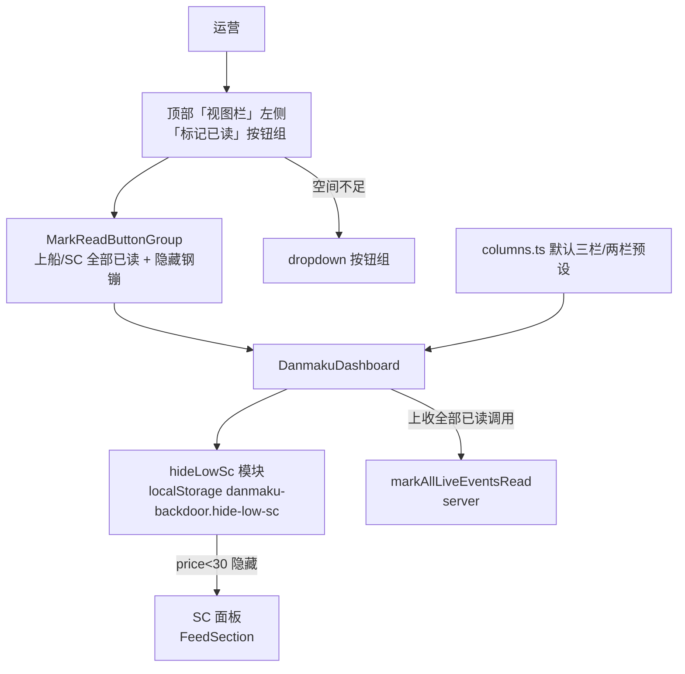
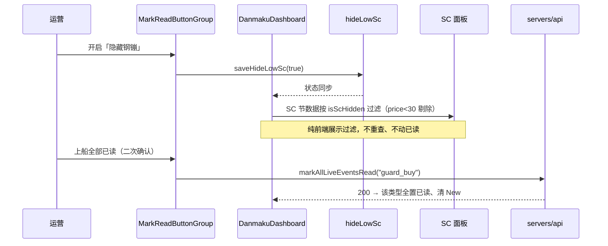

# 弹幕看板三期 - 技术提案

**功能名称**: 弹幕看板三期（Danmaku Board v3）
**关联 PRD**: `docs/product/requirements/draft/2026-08-22-danmaku-board-v3-prd.md`
**技术提案版本**: v1.0
**创建日期**: 2026-08-22
**作者**: sumire workflow
**prd-branch**: `prd/danmaku-board-v3`（需求总分支）
**feat-branch**: `feat/danmaku-board-v3`（开发分支，实现时自需求总分支合入 main 后切出）

## 1. 概述

### 1.1 背景

弹幕看板现态（`docs/product/spec/danmaku.md` + `features/danmaku/`）：

- **栏位**：`columns.ts` 的 `DEFAULT_COLUMNS`（3 栏）= `[礼物 | 上船+SC 分节 | 弹幕]`；`COLUMN_PRESETS[2]` = `[上船+SC 分节 | 礼物+弹幕 混排]`；`COLUMN_PRESETS[1]` = 全部混排。视口自适应 `resolveColumns` 按窄/中/宽档位夹取，配置存 localStorage `danmaku-backdoor.columns`。
- **已读**：上船/SC「全部已读」按钮分散在各 `FeedColumn` 栏头（`READ_ALL_LABELS`），带 3s 二次确认；`DanmakuDashboard.READ_ALL_TYPES = ["super_chat","guard_buy"]`，`ReadAllType = "super_chat" | "guard_buy"`。
- **SC 金额**：`LiveEvent.price`（元，可选）既是 SC 直接金额，可直接用于金额判定。
- **工具区**：栏头有「弹幕合并」开关、「礼物筛选」(`gift-min-price`，纯前端 SSE 过滤 + 检索带 `minPrice`)、「配置栏位」。

本期三项改造：默认分栏布局再调整；SC「隐藏钢镚」全局开关；「视图栏」左侧「标记已读」按钮组整合（上船/SC 全部已读上收 + 隐藏钢镚，空间不足折叠 dropdown）。

### 1.2 目标

- `columns.ts` 调整默认三栏与两栏预设：三栏「礼物+上船（混排） | SC | 弹幕」、两栏「上船+SC（混排） | 弹幕+礼物（混排）」、单栏不变；存量配置不迁移；
- 新增「隐藏钢镚」全局开关：所有 SC 面板 `price < 30` 的 SC 不展示，`>= 30` 正常展示；纯前端展示过滤、即时生效不重查；localStorage 持久化、损坏回退关闭；
- 顶部「视图栏」左侧新增「标记已读」按钮组：上收上船/SC 全部已读（admin+，保留二次确认）+ 隐藏钢镚；空间不足折叠为 dropdown 按钮组（普通页头与全屏页头均提供）；
- 既有能力（虚拟化、SSE、已读、gift-min-price、跨标签同步）零回归。

### 1.3 范围

- **做**：`columns.ts` 默认三栏/两栏预设修改；新增 `hideLowSc.ts`（或并入既有持久化模块）存储模块与 `isScHidden(price)` 纯函数；新增「标记已读」按钮组组件（含 dropdown 折叠）与「隐藏钢镚」开关控件；`DanmakuDashboard` 接入 SC 展示过滤、上收全部已读调用；移除 `FeedColumn` 栏头的上船/SC 全部已读按钮；页头（普通/全屏）挂载按钮组；单元测试。

  > 说明：本节点仅产出需求文档与提案。代码与 spec 同步在后续 `feat/danmaku-board-v3` 开发分支按 TDD 落地，本提案给出实现方案与验收口径。

- **不做**：契约/服务端/接口变更；SSE 上游过滤 SC；SC 阈值可调（默认固定 30）；每栏独立隐藏开关；隐藏钢镚作用于 SC 检索页；编排与基础设施变更。

## 2. 技术架构

### 2.1 系统架构图



### 2.2 技术栈

| 层级 | 技术选型 | 说明 |
|------|---------|------|
| 前端 | Next.js（App Router）+ React + TS strict | 改造集中在 `features/danmaku/` 与页头 |
| 样式 | Tailwind v4（@theme token） | token 色禁硬编码 |
| 存储 | localStorage（既有口径） | 新增 key `danmaku-backdoor.hide-low-sc` |
| 虚拟化 | `@tanstack/react-virtual`（既有） | SC 为展示过滤，不影响虚拟列表结构 |
| 测试 | Vitest + Testing Library | 无 API/e2e 契约变更 |

### 2.3 模块划分

| 模块 | 职责 | 关键技术点 |
|------|------|-----------|
| `features/danmaku/columns.ts` | 默认分栏调整 | 改 `DEFAULT_COLUMNS` 与 `COLUMN_PRESETS[2]`；单栏/解析/兜底逻辑不变 |
| `features/danmaku/hideLowSc.ts`（新增） | 隐藏钢镚存取 + 纯函数 | `loadHideLowSc()`/`saveHideLowSc()`；`isScHidden(price)` 判定 |
| `features/danmaku/components/MarkReadButtonGroup.tsx`（新增） | 顶部按钮组 | 平铺 / dropdown 折叠；上船/SC 全部已读二次确认上收；隐藏钢镚开关 |
| `features/danmaku/components/DanmakuDashboard.tsx` | 隐藏钢镚展示过滤；上收全部已读 | SC 节数据按开关过滤；`handleReadAll` 全局调用 |
| `features/danmaku/components/FeedColumn.tsx` | 移除栏头全部已读 | 去掉 `readAllTypes`/`onReadAll` 渲染，保留其余栏头功能 |
| `app/backdoor/(dashboard)/danmaku/page.tsx` | 挂载按钮组 | 普通页头与全屏页头各一处，与 `ColumnCountSelector` 同排 |

## 3. API 设计

无契约/接口变更。上船/SC 全部已读继续复用既有 `markAllLiveEventsRead(type)`（`ReadAllType = "super_chat" | "guard_buy"`）；SC 金额 `LiveEvent.price` 为既有契约字段。隐藏钢镚为纯客户端偏好，无服务端暴露。

## 4. 数据模型

无数据库变更。新增一个 localStorage key：

| Key | 值 | 缺省/损坏回退 |
|-----|----|----|
| `danmaku-backdoor.hide-low-sc` | JSON boolean | `false`（关闭＝全部显示） |

存取口径对齐 `giftMinPrice.ts` / `mergeEnabled.ts`（`JSON.parse` try/catch、`typeof === "boolean"` 校验、损坏回退默认）。既有栏位配置 key `danmaku-backdoor.columns` 不变、不迁移（旧库中已存的 3 栏配置保持用户自定义，仅「无配置/损坏」用户看到新默认）。
## 5. 技术实现方案

### 5.1 核心流程



### 5.2 关键实现点

#### 实现点 1: 默认分栏布局调整（columns.ts）

- **描述**: 修改默认三栏与两栏预设，单栏与视口解析、兜底逻辑不变。

  ```ts
  export const DEFAULT_COLUMNS: ColumnConfig[] = [
    { id: "gift_guard", types: ["gift", "guard_buy"], mode: "mixed" },
    { id: "sc",          types: ["super_chat"],        mode: "mixed" },
    { id: "danmaku",     types: ["danmaku"],           mode: "mixed" },
  ];
  export const COLUMN_PRESETS: Readonly<Record<1 | 2 | 3, ColumnConfig[]>> = {
    1: [{ id: "all", types: ["super_chat", "guard_buy", "gift", "danmaku"], mode: "mixed" }],
    2: [
      { id: "gift_danmaku", types: ["gift", "danmaku"],       mode: "mixed" },
      { id: "guard_sc",     types: ["guard_buy", "super_chat"], mode: "mixed" },
    ],
    3: DEFAULT_COLUMNS,
  };
  ```

- **技术细节**: 单类型栏 `mode` 取 `"mixed"` 或 `"split"` 效果等同（仅多类型栏区分），统一写 `"mixed"` 更贴近混排语义。`resolveColumns`、`parseColumns`、SSR 兜底、storage 读写零改动。
- **风险点**: 旧库存配置含旧 id（`gift`、`guard_sc`）——仅影响 id 展示与未来迁移，不影响功能；存量配置不迁移（PRD 口径），新默认只对无配置/损坏用户生效。

#### 实现点 2: 隐藏钢镚展示过滤（hideLowSc.ts + DanmakuDashboard）

- **描述**: 新增 `hideLowSc.ts`（仿 `mergeEnabled.ts`）：`loadHideLowSc(): boolean`（`danmaku-backdoor.hide-low-sc`，JSON boolean，损坏回退 `false`）、`saveHideLowSc(v: boolean)`，以及纯函数：

  ```ts
  /** SC 是否应因「隐藏钢镚」隐藏：缺金额按未知处理（不隐藏），price < 30 隐藏，>= 30 显示。 */
  export function isScHidden(price: number | undefined): boolean {
    return price !== undefined && price < 30;
  }
  ```

  `DanmakuDashboard` 持有 `hideLowSc` state（挂载时 `loadHideLowSc()` 初始化，随按钮组同步）。展示过滤：所有 SC 类型的节 / mixed 混排数据在传给 `FeedSection` 前按 `isScHidden(event.price)` 剔除；SSE 实时到达的 SC 在 `handleStreamEvent` 中若 `hideLowSc && isScHidden(event.price)` 直接丢弃（不插入、不清 New、不标入场）。
- **技术细节**: 过滤点统一收敛——可复用礼物筛选既有模式（实时在 `handleStreamEvent` 丢弃、历史为展示层过滤）。历史 SC 全量已加载，展示过滤在 `mixedEventsByColumn` / 单类型节数据派生时进行，**不触发重新检索**，代际机制无需改动；切换即时生效（filter 重算）。
- **风险点**: ① SC 过滤同时落在「单类型 SC 节」与「混排节（上船+SC、弹幕+SC…）」——统一在节数据或 mixed 合并结果处过滤，避免遗漏；建议实时与历史都走同一 `isScHidden` 谓词。② 隐藏不追溯改动已读/New：只影响展示与实时插入，不影响已读水位与 New 语义（PRD 口径）。

#### 实现点 3: 「标记已读」按钮组 + dropdown 折叠（MarkReadButtonGroup.tsx + FeedColumn）

- **描述**: 新增 `MarkReadButtonGroup` 组件，置于页头「视图栏」`ColumnCountSelector` 左（普通页头与全屏页头各一处）。组内：
  - 上船全部已读、SC 全部已读：仅 `canManage`（admin+）渲染；复用既有二次确认（首次点击进入「确认全部已读？」态，3s 超时复位；确认即 `onReadAll(type)`）。
  - 隐藏钢镚：`role="switch"` + `aria-checked`，label「隐藏钢镚」，点击切换 `saveHideLowSc` 并同步 dashboard。
  - **空间不足折叠**：用既有 `useMediaQuery`（`<640px` narrow）等判定宽度；可用宽度不足时渲染单个「标记已读」触发钮，点击展开下拉菜单（菜单内为上述各项，点击后收起）。dropdown 开合过渡省略或仅 opacity（≤200ms，尊重 `prefers-reduced-motion`）。
- **技术细节**: 组件入参 `canManage`、`hideLowSc`、`onToggleHideLowSc`、`onReadAll(type)`（透传 dashboard 的 `handleReadAll`）、`confirming`/`onRequestConfirm`（二次确认 3s 复位逻辑自 `FeedColumn` 迁入）。空间判定与「视图栏」折叠断点尽量对齐。
- **风险点**: ① 二次确认状态上收后，`FeedColumn` 须移除 `readAllTypes`/`onReadAll` 及其确认态（仅保留「配置栏位」等栏头功能），避免新旧入口并存；② dropdown 折叠断点与按钮数量（admin 3 项 / member 1 项「隐藏钢镚」）相关，按实际渲染项数 + 可用宽度决定折叠，保证 member 不会无故塌成 dropdown。

## 6. 技术决策

### 6.1 决策列表

| 决策 | 选项 A | 选项 B | 最终选择 | 原因 |
|------|--------|--------|---------|------|
| 默认三栏组合 | 礼物+上船混排 \| SC \| 弹幕 | 保持现况（礼物 \| 上船+SC 分节 \| 弹幕） | A | 需求口径；需答谢类（上船）与氛围类（礼物）混排更自然，SC 独占中栏辨识度最高 |
| 两栏组合 | 上船+SC 混排 \| 弹幕+礼物混排 | 保持现况（上船+SC 分节 \| 礼物+弹幕混排） | A | 需求口径；两栏下需答谢类单组、氛围类单组 |
| 隐藏钢镚过滤位置 | 纯前端展示过滤 | 服务端检索过滤（同 gift-min-price 加 minPrice） | A | SC 历史已全量加载，前端过滤即时、无网络、不改分页 total；服务端过滤需契约变更且 SC 元金额为展示细节 |
| 隐藏钢镚作用域 | 全局统一开关（作用于所有 SC 面板） | 每栏独立开关 | A | 需求口径「开启的面板中的 SC」，语义为全局；每栏开关徒增配置面 |
| 隐藏阈值 | 固定 30 | 可调 | A | 需求固定口径（<30 隐藏，>=30 显示）；可调留作后续 |
| 全部已读入口位置 | 顶部「视图栏」button group | 保留各栏栏头 | A | 需求口径；入口集中、多栏不分散；行为与二次确认语义不变（仅迁移） |
| 空间不足折叠 | dropdown button group | 换行/收缩 | A | 需求口径；dropdown 不挤压栏区布局 |
| 空 SC 金额（price 缺） | 不隐藏（保守展示） | 按 <30 隐藏 | A | 金额未知不该误藏；与产品「未知金额正常显示」一致 |

### 6.2 依赖与约束

| 类型 | 内容 | 说明 |
|------|------|------|
| 依赖 | 弹幕看板一二期 + 礼物筛选 + 视觉优化既有实现 | 改造基底 |
| 依赖 | `LiveEvent.price` 既有契约字段 | SC 金额判定，无新增字段 |
| 约束 | Tailwind token 色、禁硬编码色值 | `frontend-rules.md` |
| 约束 | 静态导出（GitHub Pages） | 全部客户端行为；隐藏钢镚默认值与 localStorage 首帧闪烁按既有 `mergeEnabled`/`giftMinPrice` 口径处理 |
| 约束 | 动效克制 ≤200ms + `prefers-reduced-motion` 降级 | `frontend-rules.md`、`03-backdoor-design.md` |
| 约束 | 分支 `<type>/<slug>`；禁 rebase/squash | `prd/danmaku-board-v3` 需求总分支 |

## 7. 项目结构

```
apps/bookstore/
└── features/danmaku/
    ├── columns.ts                          # 修改：DEFAULT_COLUMNS / COLUMN_PRESETS[2]
    ├── hideLowSc.ts                        # 新增：隐藏钢镚存取 + isScHidden 纯函数
    └── components/
        ├── MarkReadButtonGroup.tsx         # 新增：顶部按钮组（平铺/dropdown + 二次确认 + 隐藏钢镚开关）
        ├── DanmakuDashboard.tsx            # 修改：SC 展示过滤、上收 handleReadAll、透传 hideLowSc
        ├── FeedColumn.tsx                  # 修改：移除栏头 readAllTypes/onReadAll
        └── FeedSection.tsx                 # 修改（如需）：SC 数据入参过滤
apps/bookstore/app/backdoor/(dashboard)/danmaku/page.tsx   # 修改：普通/全屏页头挂载 MarkReadButtonGroup
apps/bookstore/tests/unit/
    ├── danmaku-hide-low-sc.test.ts         # 新增：isScHidden / 存储存取
    ├── danmaku-columns.test.ts             # 更新：新默认三栏/两栏预设断言
    └── danmaku-dashboard.test.tsx          # 更新：SC 过滤、全部已读上收
```

契约（`contract/`）、服务端（`servers/api`）、编排（`infra/aspire`）零变更。

## 8. 测试策略

### 8.1 测试覆盖要求

- 单元测试（前端）：
  - `hideLowSc.ts`：默认 false、存取往返、损坏回退 false；`isScHidden`（undefined→false、29→true、30→false、31→false）；
  - `columns.ts`：新默认三栏「礼物+上船混排 | SC | 弹幕」、两栏预设「上船+SC 混排 | 弹幕+礼物混排」、单栏不变；既有损坏回退断言按新默认更新；
  - `MarkReadButtonGroup`：平铺渲染三项 / 折叠为 dropdown、隐藏钢镚 switch 切换回调、上船/SC 全部已读二次确认与超时复位、member 仅显示隐藏钢镚；
  - `DanmakuDashboard`：隐藏钢镚开启时 SC 节/mixed 数据过滤（历史）与 `handleStreamEvent` 实时低价 SC 丢弃、达标 SC 正常插入；上收全部已读仍正确调用 `markAllLiveEventsRead`。
- API 测试：无变更，既有 `live-events` 测试保持绿。
- e2e：无契约变更；既有弹幕看板 e2e 若断言栏头「全部已读」需适配迁移到顶部组。

### 8.2 测试类型

| 类型 | 工具 | 覆盖范围 |
|------|------|---------|
| 单元测试 | Vitest + Testing Library | 分栏预设、SC 过滤、按钮组折叠/确认、存储 |

## 9. 部署方案

### 9.1 环境规划

| 环境 | 用途 | 部署方式 |
|------|------|---------|
| 本地联调 | Aspire 编排（既有四资源） | `aspire start`，无配置变更 |
| GitHub Pages 生产 | 纯静态 | 无新增配置项 |

### 9.2 配置管理

无新增配置项。

## 10. 验收标准

- [ ] 技术方案评审通过
- [ ] 清除本地配置后桌面三栏为「礼物+上船（混排） | SC | 弹幕」、两栏预设「上船+SC（混排） | 弹幕+礼物（混排）」、单栏不变；存量配置保持
- [ ] 「隐藏钢镚」开启后所有 SC 面板不显示 <30 元 SC、≥30 元正常；实时低价 SC 不插入；切换即时、持久化、损坏回退关闭；已读/New 不受影响
- [ ] 「视图栏」左侧「标记已读」按钮组平铺渲染上船/SC 全部已读 + 隐藏钢镚（admin+），二次确认语义保留；空间不足折叠为 dropdown；member 仅显示隐藏钢镚
- [ ] 栏头不再出现上船/SC 全部已读按钮；普通/全屏页头均提供按钮组；全屏/虚拟化滚动/礼物筛选等既有能力零回归
- [ ] 单元测试全绿，`pnpm lint && pnpm test && pnpm build` 全绿

## 11. 相关文档

- 关联 PRD：`docs/product/requirements/draft/2026-08-22-danmaku-board-v3-prd.md`
- 产品 Spec（现态）：`docs/product/spec/danmaku.md`
- 二期提案：`docs/engineering/proposals/2026-08-16-danmaku-board-v2-proposal.md`
- 礼物筛选提案：`docs/engineering/proposals/2026-08-17-danmaku-gift-min-price-proposal.md`
- 视觉优化提案：`docs/engineering/proposals/2026-08-19-danmaku-board-visual-polish-proposal.md`
- 开发规范：`docs/engineering/frontend-rules.md`、`docs/engineering/backend-rules.md`
