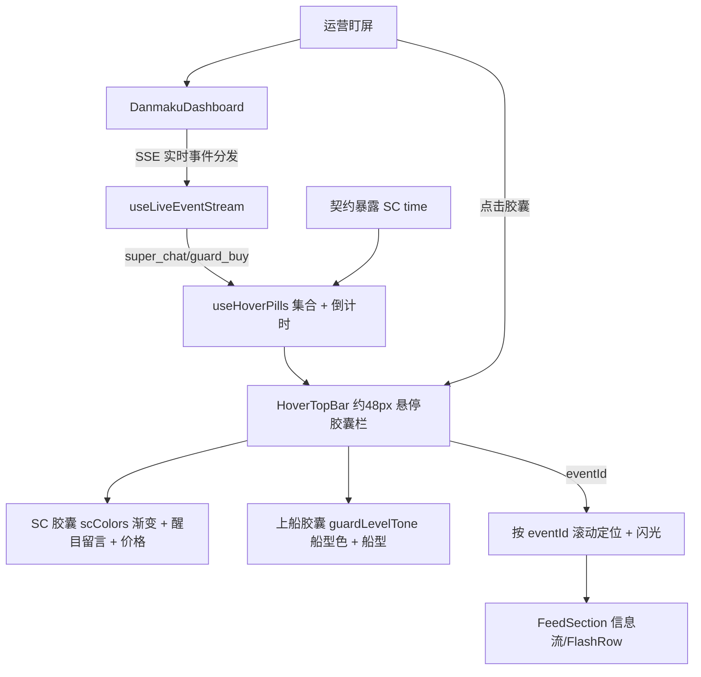
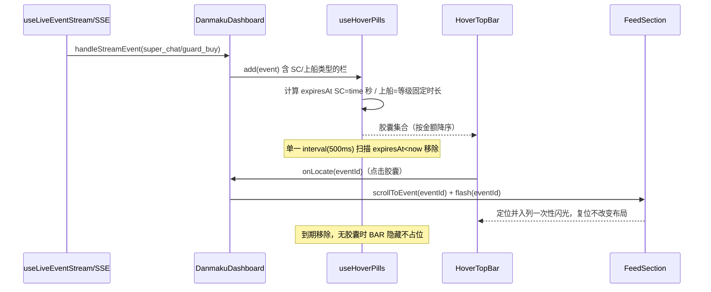

# 弹幕看板「SC/上船 悬停胶囊栏」 - 技术提案

**功能名称**: 弹幕看板 SC/上船 悬停胶囊栏（Danmaku Hover Top Bar）
**关联 PRD**: `docs/product/requirements/draft/2026-08-23-danmaku-hover-bar-prd.md`
**技术提案版本**: v1.0
**创建日期**: 2026-08-23
**作者**: sumire workflow
**prd-branch**: `prd/danmaku-hover-bar`（需求总分支）
**feat-branch**: `feat/danmaku-hover-bar`（开发分支，实现时自需求总分支合入 main 后切出）

## 1. 概述

### 1.1 背景

弹幕看板现态（`docs/product/spec/danmaku.md` + `apps/bookstore/features/danmaku/`）：

- **信息流**：`FeedColumn`（栏容器，栏头 + 多 `FeedSection` 小节）。`DanmakuDashboard` 统一持数据并分发 SSE 实时事件（`handleStreamEvent`、`freshIds` 入场动画）。
- **SC 数据**：`LiveEvent.scColors = { backgroundStart, backgroundEnd, fontColor }`（上游 `payload.data.background_color_start/end`、`message_font_color`）、`price`（元）、`sender.face`（头像）。服务端 `normalize.ts` 的 `normalizeSuperChat` 透传三者，但**未透传悬停时长 `time`**。
- **上船数据**：`LiveEvent.guard = { level, name, count }`（level 3=舰长/2=提督/1=总督），`guard_buy` 上游无头像（`face: null`）。前端 `format.ts` 有 `guardLevelName`（level→船型名）与 `guardLevelTone(level)`（3→eye 蓝 / 2→flower 紫 / 1→crimson 红）。
- **SC/上船差异化配色**：SC 走 `SuperChatItem` 渐变（`scColors`）；上船走 `GuardItem` + `guardLevelTone` 船型色。

本期新增「SC/上船 悬停胶囊栏」：在包含 SC 或上船类型的栏内容区顶部提供一个约 48px 悬停带，把 SSE 实时到达的 SC/上船以宽胶囊按金额降序置顶展示，各胶囊按其悬停时长倒计时后移除。**点击胶囊可将信息流滚动定位到该 SC/上船对应记录，并让该记录播放一次闪光视觉提示**。纯前端展示增强 + 契约侧透传一个 SC 字段（`time`）。

### 1.2 目标

- 新增悬停胶囊栏组件，作用于含 SC/上船类型的栏内容区顶部；无有效胶囊时不占位；
- SSE 实时 SC/上船到达即生成胶囊，多胶囊按金额降序排列（金额相同新者优先）；
- SC 胶囊悬停时长 = 该事件 `time`（秒）；上船胶囊固定时长 舰长 60s / 提督 5min / 总督 1h；
- SC 胶囊用 `scColors` 渐变底色 + `fontColor` 文字色；上船胶囊用 `guardLevelTone` 船型强调色；
- 点击胶囊定位对应记录（按 `eventId` 滚动到可视区）+ 一次性闪光提示，闪光后复位不改变布局；
- 倒计时到期胶囊移除；既有能力（虚拟化、SSE、已读、栏位配置、gift-min-price、hide-low-sc）零回归。

### 1.3 范围

- **做**：服务端 `normalizeSuperChat` 透传上游 `data.time` 为 `LiveEvent` 新可选字段 `time`（秒），契约 `contract/live-events.openapi.yaml` 与前端 `types.ts` 同步；新增悬停胶囊栏组件 `HoverTopBar.tsx` + `useHoverPills` 数据钩子；胶囊点击定位（`FeedSection` 暴露按 `eventId` 定位 scrollTo）+ 一次性闪光状态；`FeedColumn`/`DanmakuDashboard` 接线；单元测试。
- **不做**：改变信息流内容/已读/栏位配置；历史 SC 纳入悬停栏（仅 SSE 实时事件驱动）；悬停栏可开关/持久化配置；服务端改 SSE 推送逻辑；列定位到虚拟化未装载的行（虚拟化天然只渲染可视区，目标记录在已加载列表才可精确定位）；编排与基础设施变更。

> 说明：本节点仅产出需求文档与提案。代码与 spec 同步在后续 `feat/danmaku-hover-bar` 开发分支按 TDD 落地，本提案给出实现方案与验收口径。

## 2. 技术架构

### 2.1 系统架构图



### 2.2 技术栈

| 层级 | 技术选型 | 说明 |
|------|---------|------|
| 前端 | Next.js（App Router）+ React + TS strict | 改造集中在 `features/danmaku/` |
| 样式 | Tailwind v4（@theme token） | SC 渐变/船型色为事件数据色（内容色例外），容器用 token |
| 时钟 | 客户端 `setInterval` 单统一扫描 | 见实现点 3 |
| 测试 | Vitest + Testing Library | 悬停胶囊计时/排序/取色纯函数与组件 |

### 2.3 模块划分

| 模块 | 职责 | 关键技术点 |
|------|------|-----------|
| `servers/api/src/liveEvents/normalize.ts` | SC 透传 `time` | `normalizeSuperChat` 提取 `payload.data.time`（秒） |
| `contract/live-events.openapi.yaml` | 暴露 SC `time` | `LiveEvent.time?: integer`（仅 super_chat，秒） |
| `apps/bookstore/features/danmaku/types.ts` | 前端字段同步 | `LiveEvent` 增加可选 `time` |
| `apps/bookstore/features/danmaku/hoverTopBar.ts`（新增） | 纯函数 | `isHoverable`/`pillPrice`/`hoverDuration`/`pillKind`/`pillSort` |
| `apps/bookstore/features/danmaku/useHoverPills.ts`（新增） | 胶囊集合 + 计时 | 单一 interval 扫描过期，金额降序排列 |
| `apps/bookstore/features/danmaku/components/HoverTopBar.tsx`（新增） | 悬停胶囊栏 | 约 48px 容器；SC/上船胶囊渲染；无胶囊不占位；胶囊点击回调上抛 `eventId` |
| `apps/bookstore/features/danmaku/components/FeedSection.tsx` | 按 `eventId` 定位 + 闪光 | 暴露 `locate(eventId)`（虚拟化 scrollToIndex）+ 一次性闪光行状态 `flashIds` |
| `apps/bookstore/features/danmaku/components/FeedColumn.tsx` | 挂载悬停栏 + 定位接线 | 栏头之下、小节之上；胶囊点击转调对应小节定位 |

## 3. API 设计

### 3.1 契约变更（仅新增可选字段）

`contract/live-events.openapi.yaml` 的 `LiveEvent` 新增可选字段透传 SC 悬停时长：

| 字段 | 位置 | 类型 | 说明 |
|------|------|------|------|
| `time` | `LiveEvent`（仅 super_chat 携带） | integer（秒） | SC 悬停时长：上游 `SUPER_CHAT_MESSAGE` payload 的 `data.time`（B 站标准字段，单位秒，如 60/120/180/300/3600 档） |

**实现路径**：服务端 `normalizeSuperChat` 在 `scColors`/`price` 之外，读取 `payload.data.time`（`asNumber`，须为正整数），存在则平铺透传；缺失不下发可选字段，前端回退默认。后端路由层无需改动（归一化后即随检索/SSE 出口）。其余 `/api/live-events/*` 端点语义、权限、分页、SSE 一律不变。

### 3.2 展示层垂直无接口

悬停胶囊栏不新增端点，数据全部来自既有 SSE 实时事件分发（`handleStreamEvent`）。

## 4. 数据模型

- **数据库**：无变更。
- **契约/前端类型**：`LiveEvent` 增加可选 `time`（仅 super_chat 携带）。
- **客户端内存**（非持久化）：`HoverPill = { eventId, kind: "sc"|"guard", price, arrivedAt, expiresAt, event }`；悬停胶囊**不落 localStorage**（时点展示，刷新即清，无需持久化）。

## 5. 技术实现方案

### 5.1 核心流程



### 5.2 关键实现点

#### 实现点 1: 服务端透传 SC `time`（normalize.ts + 契约 + types.ts）

- **描述**: `normalizeSuperChat` 读取 `payload.data.time`（秒）透传为 `LiveEvent.time`；契约与前端同步，缺失可选。

  ```ts
  const time = asNumber(data.time);
  // 返回对象带 ...(time !== undefined && time > 0 ? { time } : {})
  ```

  ```yaml
  # contract/live-events.openapi.yaml
  time:
    type: integer
    description: SC 悬停时长（秒，仅 super_chat；上游 data.time 标准字段，如 60/120/180/300/3600）；缺失由前端回退默认
  ```

- **技术细节**: SC `time` 是只读展示字段，无越权风险；仅 super_chat 携带。gift/guard 不新增字段（上船悬停时长由前端按 `guard.level` 固定映射，见实现点 3）。
- **风险点**: 上游若提供 `time` 为字符串需 `asNumber` 兼容；缺失下游前端回退默认。

#### 实现点 2: 悬停胶囊纯函数（hoverTopBar.ts）

- **描述**: 新增展示换算纯函数：

  ```ts
  export type PillKind = "sc" | "guard";
  export const SC_DEFAULT_SECONDS = 60;
  export function isHoverable(event: LiveEvent): boolean {
    return event.type === "super_chat" || event.type === "guard_buy";
  }
  export function pillPrice(event: LiveEvent): number {
    return typeof event.price === "number" ? event.price : 0;
  }
  /** SC=time（缺失/非法回退 60s）；上船=舰长60/提督300/总督3600，未知回退舰长档。 */
  export function hoverDuration(event: LiveEvent): number {
    if (event.type === "super_chat") {
      const t = typeof event.time === "number" && event.time > 0 ? event.time : SC_DEFAULT_SECONDS;
      return t;
    }
    const level = event.guard?.level;
    if (level === 1) return 3600; // 总督 1h
    if (level === 2) return 300;  // 提督 5min
    return 60;                    // 舰长 / 未知默认 60s
  }
  export function pillKind(event: LiveEvent): PillKind {
    return event.type === "super_chat" ? "sc" : "guard";
  }
  export function pillSort(a: HoverPill, b: HoverPill): number {
    if (a.price !== b.price) return b.price - a.price; // 金额降序
    return a.arrivedAt - b.arrivedAt;                  // 相同金额新者优先
  }
  ```

- **技术细节**: `time` 落位到前端类型 `LiveEvent.time?`（仅 super_chat）。排序谓词 `pillSort` 强调金额降序、金额相同新者优先，与 F1 口径一致。
- **风险点**: 计时基于 `expiresAt` 时间戳而非剩余秒数，避免 interval 漂移累积误差。

#### 实现点 3: 胶囊集合 + 倒计时（useHoverPills.ts）

- **描述**: `useHoverPills(types)` 维护当前有效胶囊集合（数组 + 单一 `setInterval(500ms)`）：

  - `add(event)`：`isHoverable` 且事件类型属于本栏 `types` 时，以 `eventId` 为 key 生成 `HoverPill`（`arrivedAt = Date.now()`、`expiresAt = arrivedAt + hoverDuration(event)*1000`）加入；同一 `eventId` 重复到达覆盖（刷新计时）；
  - 单一 interval 每次 tick 过滤 `expiresAt > Date.now()` 的胶囊并重排 `pillSort`；
  - 返回 `pills`（排序后数组）供 `HoverTopBar` 渲染；`types` 变化或卸载时清理 interval。

- **技术细节**: 单一 interval 统一扫描而非逐胶囊 timer（PRD §4.1）；胶囊量级小，`pillSort` 每 tick 重排 O(n log n) 可忽略。只认 SSE 实时到达，历史分页不注入悬停栏。
- **风险点**: 后台 tab 节流——用 `expiresAt` 时间戳判定，节流下到期即清，无需逐秒校正；刷新页面清空悬停胶囊属预期（不持久化）。

#### 实现点 4: 悬停胶囊栏组件（HoverTopBar.tsx）+ 接入（FeedColumn）

- **描述**: 新增 `HoverTopBar({ pills })` 组件：

  - 容器高约 48px，位于 `FeedColumn` 栏头之下、`FeedSection` 之上；
  - `pills.length === 0` 时渲染空（不占位）；
  - SC 胶囊：`background: linear-gradient(90deg, {scColors.backgroundStart}, {scColors.backgroundEnd})` + `color: scColors.fontColor`，内容 `Sender(compact)` + 「醒目留言」+ `formatPrice(price)`；
  - 上船胶囊：`guardLevelTone(level)` 的 `chip`/`text`/`item` token + 头像 + `guardLevelName ?? guard.name`；
  - 每个胶囊可点击（`cursor-pointer` + `role=button`/`aria-label`），点击调用 `onLocate(eventId)`；胶囊被点击（或当前处于定位命中）时给出一致的按压态；
  - `FeedColumn` 新增可选 `hoverPills?: HoverPill[]` + `onLocate(eventId)` 入参，在 `sections` 含 SC/上船类型时于内容区顶部渲染。

- **技术细节**: SC 语义「醒目留言」为固定四字文案，不随 `content` 变化；头像兜底复用 `Sender` 组件 compact 形态。胶囊用事件数据色（内容色例外，PRD §5.2）。点击回调只上抛 `eventId`，由 `DanmakuDashboard` 转发到对应含该类型的 `FeedSection` 执行定位。
- **风险点**: ① SC 渐变按 `scColors` 缺失回退中性底色（沿用 `SuperChatItem` 缺省）；② 悬停栏为栏头定高区，不与 `FeedSection` 虚拟化滚动争用，需以 flex 布局保证信息流仍 `min-h-0 flex-1` 可滚动。

#### 实现点 5: 点击胶囊定位 + 一次性闪光（FeedSection locate + FlashRow）

- **描述**: `FeedSection` 暴露按 `eventId` 定位与闪光的能力：

  - **定位**：`FeedSection` 用 `@tanstack/react-virtual` 管理列表。`locate(eventId)` 先尝试 `events.findIndex(e => e.eventId === id)`：
    - 命中（目标在已加载数组，含被虚拟化回收但仍在数据中的行）→ `scrollToIndex(index, { align })` 滚动到可视区居中；数据中索引对应即滚回，虚拟化天然复用该索引；
    - 未命中（目标在分页历史中尚未加载）→ 依 `scrollToIndex` 逼近目标所在列表深度并依据既有分页触底加载（`onLoadMore`）将目标引入已加载范围，加载后可再次定位；无法精确定位时落下滚动到对应深度，**不做虚假定位但必须让列表滚动以尝试到达目标**，绝不因目标不在列表就直接放弃（PRD F4/边界）。
  - **闪光**：`FeedSection` 维护一次性 `flashIds` 集合（`Set<string>`，初始空）；`locate(eventId)` 滚动到位后把 `eventId` 加入 `flashIds`，对应虚拟行渲染时挂一次性闪光样式；用单计时器在约定时长（≤200ms 结束后柔和淡出，总量约 1s：`animate-danmaku-flash` 类）后将该 `eventId` 从 `flashIds` 移除，自动复位。同一行再次点击可再次加入（重新闪光）。
  - **接线**：`DanmakuDashboard` 的 `handleLocate(eventId)` 把胶囊点击转发到含对应类型的 `FeedSection` 的 `locate` 派生（经 ref/`useImperativeHandle` 或状态 `locateId` + 命中消费）。多类型混排栏需精确路由到包含目标类型的那个 `FeedSection`。

- **技术细节**: 闪光只作用于虚拟行内层（不改变行测高/布局），避免虚拟化重测量的跳动；闪光状态不入 `eventId` 去重 key、不影响 `getItemKey`。定位优先用虚拟化 `scrollToIndex`（按已加载索引），避免手算 offset 与虚拟回收冲突；未命中分支复用既有分页 `onLoadMore` 触底加载机制逐步逼近，保证「滚动列表定位到目标」。`flashIds` 为瞬态 UI 状态，刷新即清，不持久化。
- **风险点**: ① 多类型混排栏内目标 `eventId` 可能经弹幕合并折叠（`merge.ts`）后不存在独立行——SC/上船不在折叠范围（仅弹幕折叠），故命中安全；② 目标在分页历史未加载时，需要依赖 `scrollToIndex` 逼近 + 触底加载循环，可能多次分页才到目标——须防止无限循环（每次 `onLoadMore` 后再按新数据重定位，加载到底无更多时停止并落到目标深度）；③ 闪光动画须尊重 `prefers-reduced-motion`（降级为仅轻微高亮、无位移动画）。

## 6. 技术决策

### 6.1 决策列表

| 决策 | 选项 A | 选项 B | 最终选择 | 原因 |
|------|--------|--------|---------|------|
| 悬停栏作用范围 | 含 SC/上船类型的栏 | 仅弹幕栏 | A | 需求「弹幕或弹幕混排栏」+ 聚焦答谢类；SC 独占栏/上船混排栏都应有锚点；`types` 判定最贴合 |
| SC 悬停时长来源 | 契约透传 `data.time` | 前端本地固定档位 | A | 需求明确 SC 用 `time` 属性（秒）；透传与上游一致，各档时长无需前端维护 |
| SC `time` 缺失处理 | 前端回退默认 60s | 不展示胶囊 | A | 保守展示，错失即时答谢代价高于误显 |
| 数据来源 | 仅 SSE 实时事件 | 实时 + 历史首屏 | A | 悬停栏是「当下生效」提醒，历史 SC 无时效意义；避免分页注入复杂度 |
| 计时实现 | 单一 interval 扫描 | 逐胶囊 setTimeout | A | 胶囊多时有定时器堆积风险；统一扫描更稳（PRD §4.1） |
| 排列顺序 | 金额降序 | 到达时间倒序 | A | 需求「按礼物金额排序」；金额相同新者优先 |
| 持久化 | 不落 localStorage | 持久化 | A | 悬停胶囊为时点展示，刷新即清符合「当下有效」语义，无持久化价值 |
| 点击定位机制 | 虚拟化 `scrollToIndex`（未命中走触底分页逼近）+ 一次性 `flashIds` | 原生 scrollIntoView + 持久高亮 | A | 虚拟列表须用 `scrollToIndex` 规避虚拟回收冲突、并对分页未加载目标滚动列表逼近；`flashIds` 一次性复位比持久高亮更不干扰；原生 scrollIntoView 对虚拟未装载行无效 |
| 目标不在已加载列表 | 滚动列表逼近定位（scrollToIndex + 复用 onLoadMore 触底加载） | 静默放弃 | A | 需求要求「目标不在已加载列表时滚动列表定位到目标」；静默放弃无法达成定位意图，明确不做 |
| 定位与闪光作用层级 | 虚拟行内层（不改行高） | 外层容器 | A | 内层闪光不触及虚拟化测高，避免定位时布局跳动 |
| 多类型混排栏定位路由 | 按 `eventId` 的类型路由到含该类型的 `FeedSection` | 仅当前小节/仅首个小节 | A | 目标在任一含该类型的节内都应可定位；F3/F4 覆盖 SC 与上船所在节 |

### 6.2 依赖与约束

| 类型 | 内容 | 说明 |
|------|------|------|
| 依赖 | 弹幕看板既有实现（`FeedColumn`/`FeedSection`/`useLiveEventStream`/`DanmakuDashboard`） | 改造基底 |
| 依赖 | SC `scColors`、`price`；guard `level` | 胶囊渲染取色，上船时长由 `level` 映射 |
| 依赖 | 上游 `SUPER_CHAT_MESSAGE # payload.data.time` | 契约新增字段的唯一来源 |
| 约束 | Tailwind token 色、禁硬编码色值（事件数据色例外） | `frontend-rules.md` |
| 约束 | 静态导出（GitHub Pages） | 全部客户端行为；悬停胶囊不持久化，无首帧闪烁问题 |
| 约束 | 动效克制 ≤200ms + `prefers-reduced-motion` 降级 | `frontend-rules.md`、`03-backdoor-design.md` |
| 约束 | 分支 `<type>/<slug>`；禁 rebase/squash | `prd/danmaku-hover-bar` 需求总分支 |

## 7. 项目结构

```
servers/api/src/liveEvents/normalize.ts       # 修改：normalizeSuperChat 透传 data.time
contract/live-events.openapi.yaml             # 修改：LiveEvent 增可选 time
apps/bookstore/features/danmaku/types.ts      # 修改：LiveEvent 增可选 time
apps/bookstore/features/danmaku/hoverTopBar.ts            # 新增：纯函数
apps/bookstore/features/danmaku/useHoverPills.ts          # 新增：胶囊集合 + 倒计时
apps/bookstore/features/danmaku/components/HoverTopBar.tsx # 新增：悬停胶囊栏
apps/bookstore/features/danmaku/components/FeedColumn.tsx  # 修改：挂载悬停栏 + onLocate 接线
apps/bookstore/features/danmaku/components/FeedSection.tsx  # 修改：按 eventId 定位 + 一次性闪光 flashIds
apps/bookstore/features/danmaku/components/DanmakuDashboard.tsx # 修改：handleLocate 路由到对应小节
apps/bookstore/tests/unit/
    ├── danmaku-hover-top-bar.test.ts         # 新增：纯函数
    ├── danmaku-use-hover-pills.test.tsx      # 新增：胶囊 add/到期/排序/interval
    ├── danmaku-hover-top-bar.test.tsx        # 新增（或并入）：组件渲染/空状态/配色/点击回调
    └── danmaku-feed-flash.test.tsx           # 新增：locate scrollToIndex + flashIds 闪光复位
servers/api/tests/liveEventsNormalize.test.ts # 更新：SC 透传 time 断言
```

编排（`infra/aspire`）、服务端路由层、数据库零变更。

## 8. 测试策略

### 8.1 测试覆盖要求

- 单元测试（后端）：
  - `liveEventsNormalize.test.ts`：super_chat 携带 `data.time` → 透传 `time`；缺 `data.time` → 不携带可选字段。
- 单元测试（前端）：
  - `hoverTopBar.ts`：`isHoverable`（仅 super_chat/guard_buy）；`pillPrice`（缺失→0）；`hoverDuration`（SC=time / 缺省 60s / 舰长60/提督300/总督3600/未知60）；`pillKind`；`pillSort`（金额降序、同额新者优先）；
  - `useHoverPills`：add 生成 `expiresAt` 正确；interval 到期移除非到期保留；重复 `eventId` 覆盖刷新计时；排序输出；
  - `HoverTopBar`：无 pill 不占位；SC 胶囊含「醒目留言」+ 价格 + 渐变样式；上船胶囊含船型 + 配色；`scColors` 缺失回退；点击胶囊触发 `onLocate(eventId)`；
  - `FeedSection` 定位 + 闪光：`locate(eventId)` 命中行 `scrollToIndex`（对齐居中）并加入 `flashIds`，行渲染闪光类，计时后复位移除；**未命中（分页未加载）时滚动列表、触底 `onLoadMore` 逼近并再次定位到目标，到底无更多时停止并落下目标深度（不无限循环）**；重复定位可重新闪光；多类型混排栏路由到包含目标类型的节。
- API/e2e 无契约破坏：契约仅增加可选字段，`live-events` 既有测试保持绿；e2e 既有断言通常不涉及悬停栏（空时不占位）。

### 8.2 测试类型

| 类型 | 工具 | 覆盖范围 |
|------|------|---------|
| 单元测试（后端） | Vitest | normalize SC `time` 透传 |
| 单元测试（前端） | Vitest + Testing Library | 纯函数、胶囊计时/排序、组件渲染 |

## 9. 部署方案

### 9.1 环境规划

| 环境 | 用途 | 部署方式 |
|------|------|---------|
| 本地联调 | Aspire 编排（既有四资源） | `aspire start`，无配置变更 |
| GitHub Pages 生产 | 纯静态 | 无新增配置项 |

### 9.2 配置管理

无新增配置项。

## 10. 验收标准

- [ ] 技术方案评审通过
- [ ] 契约 `live-events` 增 SC `time` 可选字段，normalize 透传、前端类型同步，缺失兼容
- [ ] 含 SC/上船类型的栏内容区顶部出现约 48px 悬停栏；无胶囊不占位
- [ ] SSE 实时 SC/上船到达即生成胶囊，多胶囊按金额降序排列（同额新者优先）
- [ ] SC 胶囊渐变底色 + 醒目留言 + 价格，悬停时长 = `time` 秒；上船胶囊船型强调色 + 船型，悬停时长 舰长60/提督300/总督3600 秒
- [ ] 胶囊到期自动移除、全部清零悬停栏不占位；虚拟化/已读/SSE/栏位配置等既有能力零回归
- [ ] 点击任一 SC/上船胶囊，信息流滚动定位到对应 `eventId` 记录并播放一次性闪光，闪光后复位不改变布局；目标不在当前可视/已加载列表时，列表滚动定位到目标（含未加载走分页逼近），不盲目放弃
- [ ] 单元测试全绿，`pnpm lint && pnpm test && pnpm build` 全绿

## 11. 相关文档

- 关联 PRD：`docs/product/requirements/draft/2026-08-23-danmaku-hover-bar-prd.md`
- 产品 Spec（现态）：`docs/product/spec/danmaku.md`
- 弹幕看板 v3 提案：`docs/engineering/proposals/2026-08-22-danmaku-board-v3-proposal.md`
- 开发规范：`docs/engineering/frontend-rules.md`、`docs/engineering/backend-rules.md`
