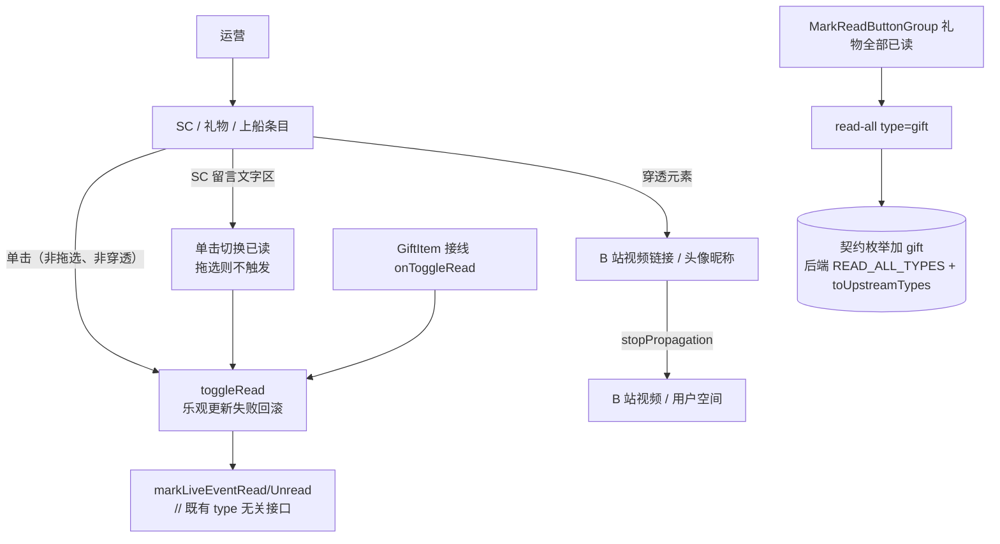
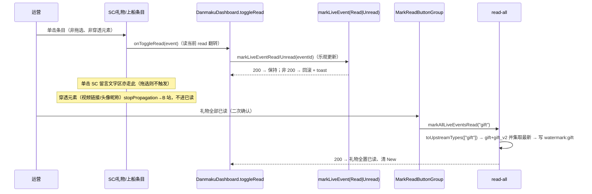

# 弹幕看板「已读功能优化」 - 技术提案

**功能名称**: 弹幕看板已读功能优化（Danmaku Read Interaction Optimization）
**关联 PRD**: `docs/product/requirements/draft/2026-08-23-danmaku-read-optimization-prd.md`
**技术提案版本**: v1.0
**创建日期**: 2026-08-23
**作者**: sumire workflow
**prd-branch**: `prd/danmaku-read-optimization`（需求总分支）
**feat-branch**: `feat/danmaku-read-optimization`（开发分支，实现时自需求总分支合入 main 后切出）

## 1. 概述

### 1.1 背景

弹幕看板现态（`docs/product/spec/danmaku.md` + `apps/bookstore/features/danmaku/`）：

- **已读切换**：`SuperChatItem` / `GuardItem` 根节点 `onDoubleClick` 触发 `onToggleRead(event)`，`title="双击切换已读"`；`GiftItem` **从未接收 `onToggleRead`**——礼物已读为缺失（`FeedSection.renderItem` 只对 `super_chat`/`guard_buy` 传入 `toggleRead`）。
- **SC 留言文字区隔离**：`SuperChatItem` 内留言 `content` 段落 `select-text cursor-text` + `onDoubleClick stopPropagation`，用于拖选复制并把文字区自身排除在已读切换之外。
- **穿透元素**：`Sender` 锚点（头像 + 昵称）`onClick/onDoubleClick stopPropagation`、`BiliVideoLink` 内 `BiliLinkSegment` `<a>` `onClick/onDoubleClick stopPropagation` + `onMouseEnter/Leave` 驱动 hover 预览——SC 内的 B 站链接与用户信息本就 `stopPropagation`，穿透基础已具备。

本期三项交互优化：礼物已读纳入；SC/礼物/上船已读双击改单击；SC 留言文字区纳入单击已读（区分拖选），且 B 站视频链接点击/hover 与头像昵称跳转作为穿透元素不被已读吞掉。

### 1.2 目标

- `GiftItem` 支持单条已读切换（乐观更新、失败回滚口径复用 `DanmakuDashboard.toggleRead`）；
- 新增「礼物全部已读」：契约 `read-all` type 枚举加 `gift`、后端 `READ_ALL_TYPES` 同步、`read-all` 对礼物走 `toUpstreamTypes` 展开（`gift`+`gift_v2`）取并集最新写入水位线、前端按钮组新增入口；
- SC / 礼物 / 上船已读触发由 `onDoubleClick` 改为 `onClick`，`title` 改「单击切换已读」；
- SC 留言文字区（含罗马音）响应单击已读，拖选复制不触发；
- SC 内 B 站视频链接点击/hover、用户头像昵称点击穿透 B 站，不被已读吞掉；
- 既有能力（New、隐藏钢镚、虚拟化、栏位、SSE）零回归。

### 1.3 范围

- **做**：`GiftItem` 增 `onToggleRead` 并在 `FeedSection.renderItem` 接线；`SuperChatItem`/`GuardItem` 双击改单击；SC 留言文字区单击已读 + 拖选区分；`title` 文案更新；`DanmakuDashboard.toggleRead` 不做逻辑改动（已支持任意 type 的单条已读）；**礼物全部已读**——契约 `read-all` 的 `type` 枚举加 `gift`、后端 `READ_ALL_TYPES` 同步且 `read-all` 对 gift 走 `toUpstreamTypes`（`["gift","gift_v2"]`）取并集最新、前端 `ReadAllType` 与 `MarkReadButtonGroup` 新增「礼物 全部已读」入口；单元测试（前端 + 后端）。
- **不做**：数据库结构变更（`live_event_reads` 水文线按任意 `type` 已然支持 gift，无需迁移）；SC 内读接口新增；SC 留言可复制能力移除；SC 悬停胶囊栏的已读交互（本就纯展示）；编排与基础设施变更。

> 说明：本节点仅产出需求文档与提案。代码与 spec 同步在后续 `feat/danmaku-read-optimization` 开发分支按 TDD 落地，本提案给出实现方案与验收口径。

## 2. 技术架构

### 2.1 系统架构图



### 2.2 技术栈

| 层级 | 技术选型 | 说明 |
|------|---------|------|
| 前端 | Next.js（App Router）+ React + TS strict | 改造集中在 `features/danmaku/` 条目组件 |
| 样式 | Tailwind v4（@theme token） | 已读置灰沿用既有 `opacity-60` |
| 测试 | Vitest + Testing Library | 条目组件单击/拖选/穿透断言 |
| API | 既有 `markLiveEventRead/Unread` | type 无关，按 `eventId` |

### 2.3 模块划分

| 模块 | 职责 | 关键技术点 |
|------|------|-----------|
| `features/danmaku/components/SuperChatItem.tsx` | 已读双击改单击；留言文字区单击已读 + 拖选区分 | 根/留言区 `onClick`；拖选判定；穿透元素保留 stopPropagation |
| `features/danmaku/components/GiftItem.tsx` | 礼物已读 | 新增 `onToggleRead` + `onClick` + 置灰 |
| `features/danmaku/components/GuardItem.tsx` | 已读双击改单击 | `onDoubleClick`→`onClick`，`title` 更新 |
| `features/danmaku/components/FeedSection.tsx` | 礼物已读接线 | `renderItem` 的 gift 分支传入 `toggleRead` |
| `features/danmaku/components/BiliVideoLink.tsx` / `Sender.tsx` | 穿透元素保持 | 维持/必要时增强 `stopPropagation`，不被单击已读吞掉 |
| `features/danmaku/components/DanmakuDashboard.tsx` | 已读逻辑（不变/微调注释） | `toggleRead` 现按 `eventId`，天然支持 gift |
| `servers/api/src/routes/liveEvents.ts` | 礼物全部已读支持 | `READ_ALL_TYPES` 加 `gift`；`read-all` 对 gift 走 `toUpstreamTypes` 展开 |
| `contract/live-events.openapi.yaml` | read-all type 枚举 | 加 `gift` |
| `features/danmaku/api.ts` | `ReadAllType` | 加 `"gift"` |
| `features/danmaku/components/MarkReadButtonGroup.tsx` | 礼物全部已读入口 | `READ_ALL_LABELS`/`readAllTypes` 加 `gift`，折叠判定计数同步 |

## 3. API 设计

### 3.1 契约变更（read-all type 枚举加 gift）

`contract/live-events.openapi.yaml` 的 `/api/live-events/read-all` 请求体 `type` 枚举由 `[super_chat, guard_buy]` 扩展为 `[super_chat, guard_buy, gift]`：

```yaml
type:
  type: string
  enum: [super_chat, guard_buy, gift]
  description: 支持需要已读管理的类型（含礼物）
```

后端 `servers/api/src/routes/liveEvents.ts` 的 `READ_ALL_TYPES` 同步为 `["super_chat", "guard_buy", "gift"]`，并对 `read-all` 的 `fetchRange` 使用前以 `toUpstreamTypes([type])` 展开（礼物 → `["gift","gift_v2"]`），保证按上游两来源并集取最新事件写入水位线（检索/SSE 已统一展开，read-all 补齐前者遗漏）。

### 3.2 其余接口

- 单条已读复用既有 `markLiveEventRead(eventId)` / `markLiveEventUnread(eventId)`（type 无关，admin+）；
- 礼物全部已读复用既有 `markAllLiveEventsRead(type)`（`ReadAllType` 前端加 `"gift"`）；
- 无新增端点；检索/SSE/搜索端点语义不变。

## 4. 数据模型

无数据库结构变更。已读状态字段 `LiveEvent.read` 为既有字段，礼物事件照常携带；礼物水位线复用 `db/liveEventReads.ts` 的 `watermark:{type}`（按任意 `type`、`$max` 只前进），`typeFromEventId` 已含 `gift`，无需迁移。前端 `ReadAllType` 加 `"gift"`；`GiftItem` 增可选 `onToggleRead?: (event) => void`。

## 5. 技术实现方案

### 5.1 核心流程



### 5.2 关键实现点

#### 实现点 1: 已读双击改单击（SuperChatItem / GuardItem）

- **描述**: 三处条目根节点的已读触发统一由 `onDoubleClick` 改为 `onClick`。

  ```tsx
  // SuperChatItem / GuardItem 根节点
  onClick={onToggleRead ? () => onToggleRead(event) : undefined}
  title={onToggleRead ? "单击切换已读" : undefined}
  ```

- **技术细节**: `GuardItem` 根节点已有 `select-none cursor-pointer`；单击会受文字选中影响——上船条目无文字复制诉求，保留 `select-none`。SC 根节点维持 `cursor-pointer`（见实现点 2 的 SC 特殊处理）。
- **风险点**: 双击语义变为「两次单击交替切换」——第一次单击已读、第二次单击未读，最终回到原状态；本视为等价可接受（PRD §六），实现不需特判双击。

#### 实现点 2: SC 留言文字区单击已读 + 拖选区分（SuperChatItem）

- **描述**: SC 留言 `content` 段落由「`onDoubleClick stopPropagation` 隔离」改为「单击响应已读，拖选不触发」。

  ```tsx
  const onMessageClick = (e: React.MouseEvent) => {
    // 拖选产生的点击不触发已读：选中非空或位移超阈值视为复制意图
    const sel = window.getSelection();
    if (sel && sel.type === "Range" && !sel.isCollapsed) return;
    onToggleRead?.(event);
  };
  // <p> 上：
  onClick={onMessageClick}
  className="... select-text"
  ```

- **技术细节**:
  - 拖动选中（`selectstart` 产生 Range 选区、`!sel.isCollapsed`）时点击不触发已读，保留复制能力（对应 PRD F3 / §六 澄清 A 口径）；
  - 干净单击（无选区 / 选区折叠）触发 `onToggleRead`；
  - 移除留言段的 `onDoubleClick stopPropagation`（原为隔离已读，现文字区本就要已读），但对文字段内的穿透 `BiliVideoLink`/`Sender` 依赖其自身 `onClick stopPropagation`（见实现点 3）不冒泡到段落/根节点；
  - 需 `upward` 确认根节点的 `onClick` 与留言段的 `onClick` 不会重复触发：留言段点击会 `onToggleRead` 一次，因 React 事件冒泡，根节点 `onClick` 也会触发——**必须让留言段 `stopPropagation` 防止根节点重复 toggle**（否则一次单击 = toggle 两次 = 无效果）。采用「留言段处理 + e.stopPropagation()」或「根节点统一处理 + 留言段穿透元素隔离」两种方案取舍，见下表决策。
- **风险点**: ① 拖选判定依赖 `getSelection()`，测试需 mock；② 双击留言会依次触发两次单击 toggle（等同实现点 1，可接受）；③ `select-text` 与单击已读的光标提示需协调（`cursor-text` vs `cursor-pointer`），文案语义以「可单击已读」为主。

#### 实现点 3: 穿透元素保持（BiliVideoLink / Sender）

- **描述**: SC 内 B 站视频链接与用户头像/昵称作为穿透元素，单击直达 B 站、不触发已读。

- **`BiliVideoLink`（`BiliLinkSegment`）**：`<a>` 已具 `onClick stopPropagation`（新开视频）+ `onMouseEnter/Leave`（hover 预览）+ `onDoubleClick stopPropagation`。光标提示 `cursor-pointer` 天然；保持即可。若根节点改单击后出现穿透丢失（冒泡），补 `onClick`/`onMouseEnter` 的 `stopPropagation`。
- **`Sender`**：锚点已具 `onClick/onDoubleClick stopPropagation`（新开空间）。保持即可。
- **技术细节**: 穿透的本质是「已读事件不触发」→ 穿透元素 `onClick` 必须 `stopPropagation`，使冒泡不达条目根节点的已读 `onClick`。实现点 2 决定 SC 根节点 vs 留言段谁来承担已读，须与穿透元素一致路由，避免「穿透元素已 stop、其父容器未 stop」导致穿透元素点击仍冒泡触发已读 或 正常点击重复 toggle。
- **风险点**: 若走「根节点统一已读」，须确认穿透元素 stopPropagation 后根节点收不到 click；若走「各段独立已读」，留言段须对穿透元素依赖其自身 stop、对外部区域自担已读。两种路径测试都须覆盖「点穿透元素不 toggle」。

#### 实现点 4: 礼物已读接线（GiftItem + FeedSection）

- **描述**: `GiftItem` 增可选 `onToggleRead`，渲染单击已读与置灰；`FeedSection.renderItem` 的 gift 分支传入 `toggleRead`。

  ```tsx
  // GiftItem
  interface GiftItemProps { event: LiveEvent; onToggleRead?: (event: LiveEvent) => void; }
  // 根节点
  onClick={onToggleRead ? () => onToggleRead(event) : undefined}
  title={onToggleRead ? "单击切换已读" : undefined}
  className={`... ${event.read ? "opacity-60" : ""} ${onToggleRead ? "cursor-pointer" : ""}`}
  ```

  ```tsx
  // FeedSection.renderItem
  case "gift":
    return <GiftItem event={event} onToggleRead={toggleRead} />;
  ```

- **技术细节**: `toggleRead` 已在 `renderItem` 定义 `const toggleRead = canManage ? onToggleRead : undefined;`（member 下 undefined，天然满足「member 无已读交互」）。`DanmakuDashboard.toggleRead` 按 `eventId` 定位 `updateEvent`，对 gift 类型无需改动。
- **风险点**: 礼物条目内 `Sender`（头像昵称）为穿透元素，须确认其 `stopPropagation` 使单击不触发礼物已读（复用实现点 3 的 `Sender` 处理）。

#### 实现点 5: 礼物全部已读（契约 + 后端 read-all + 前端按钮组）

- **描述**: 顶层「标记已读」按钮组新增「礼物 全部已读」，后端与契约同步支持 `gift`：

  - **契约**：`read-all` 的 `type` 枚举加 `gift`。
  - **后端**：`READ_ALL_TYPES = ["super_chat","guard_buy","gift"]`；`read-all` 处理中把 `fetchRange([type], 1, READ_ALL_PAGE_SIZE)` 改为 `fetchRange(toUpstreamTypes([type]), 1, READ_ALL_PAGE_SIZE)`（礼物展开为 `["gift","gift_v2"]`，与检索/SSE 口径一致）；水位线写入沿用 `markAllRead(type, ...)`（`watermark:gift`），`typeFromEventId`/数据模型无需改动。
  - **前端**：`ReadAllType` 加 `"gift"`；`MarkReadButtonGroup` 的 `READ_ALL_LABELS` 加 `gift: "礼物 全部已读"`、`readAllTypes` 在 `canManage` 时含 `"gift"`，折叠判定 `itemCount` 由 `2` 增为 `3`（readAll 按钮数）；`DanmakuDashboard.handleReadAll` 已按 `e.type === type` 置已读，天然支持 gift。
- **技术细节**: `toUpstreamTypes` 若不展开，仅查 `gift` 会漏掉 `gift_v2` 来源的更高水位（gift_v2 是主来源），故 read-all 必须展开；`READ_ALL_PAGE_SIZE` 上限 100，与 SC/上船一致（水位线口径「首页最新」）。
- **风险点**: ① 上游若 `gift`/`gift_v2` 分页去重未合并，并集取最新以 `fetchRange` 返回各来源首页共同取 max `occurredAt`，与既有 read-all 相同口径；② member 不可见入口（沿用 `canManage` 门控）；③ 折叠判定随按钮数增大需在窄屏及时折叠，`itemCount` 更新别遗漏。

## 6. 技术决策

### 6.1 决策列表

| 决策 | 选项 A | 选项 B | 最终选择 | 原因 |
|------|--------|--------|---------|------|
| 已读触发事件 | `onClick`（单击） | 保留 `onDoubleClick` | A | PRD 口径要求单击已读，减轻手势负担 |
| SC 留言段已读路由 | 留言段自担单击已读 + `stopPropagation` 防根节点重复 toggle | 根节点统一已读，留言段仅依赖穿透元素 stopPropagation | A | 减弱「文字区点中即 toggle」的被吞风险、根节点与留言段职责清晰；留言段 `e.stopPropagation()` 保证一次单击仅 toggle 一次 |
| 拖选 vs 单击已读区分 | 检测 `getSelection()` Range 非折叠 → 不触发 | 移除 SC 文字可复制 | A | 尽量保留可复制能力（PRD 澄清 A 口径）；若评审同意移除可简化 |
| 礼物全部已读 | 本期纳入（契约 + 后端 + 前端） | 本期不做 | A（评审决定） | 评审明确「礼物全部已读也需要加上」；礼物与 SC/上船同为需答谢类，处理动线一致 |
| 礼物 read-all 上游展开 | `toUpstreamTypes` 展开 `gift`+`gift_v2` | 仅查 `gift` | A | gift_v2 为礼物主来源，不展开会漏高水位 |
| 双击语义 | 视为两次单击（交替往返） | 特判为一次 | A | 单击已读后双击无独立语义，等价往返可接受，实现简单 |

### 6.2 依赖与约束

| 类型 | 内容 | 说明 |
|------|------|------|
| 依赖 | `GiftItem`/`SuperChatItem`/`GuardItem`/`Sender`/`BiliVideoLink` 条目组件 | 改造基底 |
| 依赖 | `DanmakuDashboard.toggleRead` + `markLiveEventRead/Unread` | 已读逻辑复用，type 无关已支持 gift |
| 依赖 | `markAllLiveEventsRead` + `db/liveEventReads.markAllRead`（任意 type 水位线） | 礼物全部已读，数据模型已支持 |
| 依赖 | `toUpstreamTypes`（gift → gift+gift_v2） | read-all 展开复用 |
| 约束 | Tailwind token 色、禁硬编码色值 | `frontend-rules.md` |
| 约束 | 静态导出（GitHub Pages） | 全部客户端行为；已读状态来自服务端，无障碍 |
| 约束 | 动效克制 ≤200ms + `prefers-reduced-motion` 降级 | `frontend-rules.md`、`03-backdoor-design.md` |
| 约束 | B 站视频链接点击 / hover、头像昵称跳转穿透不可回归 | 既有能力，PRD F4 |
| 约束 | 分支 `<type>/<slug>`；禁 rebase/squash | `prd/danmaku-read-optimization` 需求总分支 |

## 7. 项目结构

```
contract/live-events.openapi.yaml            # 修改：read-all type 枚举加 gift
servers/api/src/routes/liveEvents.ts         # 修改：READ_ALL_TYPES 加 gift；read-all 对 gift 走 toUpstreamTypes 展开
apps/bookstore/features/danmaku/api.ts       # 修改：ReadAllType 加 "gift"
apps/bookstore/features/danmaku/components/
    ├── SuperChatItem.tsx      # 修改：双击→单击；留言文字区单击已读 + 拖选区分；stopPropagation 防重复 toggle
    ├── GiftItem.tsx           # 修改：新增 onToggleRead + 单击 + 置灰 + title「单击切换已读」
    ├── GuardItem.tsx          # 修改：双击→单击 + title 更新
    ├── Sender.tsx             # 保持不变/微调：保持 stopPropagation 穿透（如无回归无需改）
    ├── BiliVideoLink.tsx      # 保持不变/微调：保持 hover/click stopPropagation 穿透
    ├── MarkReadButtonGroup.tsx# 修改：READ_ALL_LABELS/readAllTypes 加 gift、itemCount 2→3
    └── FeedSection.tsx        # 修改：renderItem gift 分支传入 toggleRead
apps/bookstore/tests/unit/
    ├── danmaku-items.test.tsx               # 更新/新增：SC 单击已读、拖选不触发、穿透元素不 toggle；Gift 单击已读 + 置灰；Guard 单击已读
    ├── danmaku-dashboard.test.tsx           # 更新（如需）：toggleRead 对 gift 类型转发断言；readAll 对 gift
    ├── danmaku-mark-read-button-group.test.tsx # 更新：礼物「全部已读」入口渲染/二次确认/折叠计数/角色可见性
    └── danmaku-sender.test.tsx              # 更新（如需）：穿透 stopPropagation 断言
servers/api/tests/
    └── liveEventsReadAll.test.ts            # 新增/更新：read-all type=gift 合法 + 非法 type 400 + gift 展开 upstream 断言
```

服务端、编排（`infra/aspire`）无新增资源；仅契约枚举 + 后端白名单/上游展开 + 前端类型/按钮组改动。

## 8. 测试策略

### 8.1 测试覆盖要求

- 单元测试（前端）：
  - `SuperChatItem`：单击根节点切换已读（event 透传）；单击留言文字区切换已读且不重复触发（仅一次 toggle）；拖选文字（mock `getSelection` 为 Range 非折叠）不触发；穿透元素（`BiliVideoLink`、`Sender`）点击不触发已读；member（无 `onToggleRead`）无已读交互、`title` 无「单击切换已读」；
  - `GiftItem`：admin+ 单击切换已读、已读置灰 `opacity-60`、`title` 提示；member 无已读交互；`Sender` 穿透点击不 toggle；
  - `GuardItem`：单击切换已读、置灰、`title`「单击切换已读」；双击等价（两次单击往返可接受）；
  - `MarkReadButtonGroup`：admin 下平铺含「礼物 全部已读」、二次确认、折叠为 dropdown 可操作、`itemCount` 3；member 仅隐藏钢镚；
  - `FeedSection.renderItem`：gift 分支在 `canManage` 时传入 `onToggleRead`。
- 单元测试（后端）：
  - `liveEventsReadAll`：`type=gift` 200 且 `upstream.fetchRange` 收到展开类型 `["gift","gift_v2"]` 并写 `watermark:gift`；`type=danmaku` 等 400；无事件时 `marked=0` 且不写水位线。
- API 测试（黑盒，后续开发分支）：既有 `live-events` read-all 用例补充 gift。
- e2e：无契约破坏（枚举扩容兼容）；既有弹幕看板 e2e 若断言「双击已读」需适配为「单击已读」。

### 8.2 测试类型

| 类型 | 工具 | 覆盖范围 |
|------|------|---------|
| 单元测试（前端） | Vitest + Testing Library | 单击已读、拖选区分、穿透元素、礼物单条/全部已读接线、按钮组 |
| 单元测试（后端） | Vitest | read-all gift 白名单 + upstream 展开 + 水位线写入 |

## 9. 部署方案

### 9.1 环境规划

| 环境 | 用途 | 部署方式 |
|------|------|---------|
| 本地联调 | Aspire 编排（既有四资源） | `aspire start`，无配置变更 |
| GitHub Pages 生产 | 纯静态 | 无新增配置项 |

### 9.2 配置管理

无新增配置项。

## 10. 验收标准

- [ ] 技术方案评审通过
- [ ] `GiftItem` 在 admin+ 下单击切换已读、已读置灰、`title`「单击切换已读」；member 无已读交互（复用 `FeedSection` 的 `canManage? onToggleRead : undefined` 口径）
- [ ] SC / 上船条目已读由双击改为单击；`title` 更新为「单击切换已读」；双击不再作为独立手势
- [ ] SC 留言文字区（含罗马音）单击切换已读、且与根节点不重复触发（一次单击 = 一次已读切换）；拖选文字复制不触发已读
- [ ] SC 内 B 站视频链接单击新开视频、hover 出预览，均不触发已读；SC 内用户头像/昵称单击新开空间、不触发已读（穿透生效，任意含 SC 的栏位一致）
- [ ] 「标记已读」按钮组新增「礼物 全部已读」（admin+，二次确认与折叠一致），触发后礼物类型事件全置已读、New 清零；契约 `read-all` 枚举含 `gift`，后端 `READ_ALL_TYPES` 支持且对 gift 展开 `gift`+`gift_v2` 取并集最新写 `watermark:gift`；member 不可见入口
- [ ] 既有 New 标记、隐藏钢镚、虚拟化、栏位配置、SSE 零回归
- [ ] 单元测试（前端/后端）全绿，`pnpm lint && pnpm test && pnpm build`（前后端）全绿

## 11. 相关文档

- 关联 PRD：`docs/product/requirements/draft/2026-08-23-danmaku-read-optimization-prd.md`
- 产品 Spec（现态）：`docs/product/spec/danmaku.md`
- 契约：`contract/live-events.openapi.yaml`
- 弹幕看板 v3 提案：`docs/engineering/proposals/2026-08-22-danmaku-board-v3-proposal.md`
- 悬停胶囊栏提案：`docs/engineering/proposals/2026-08-23-danmaku-hover-bar-proposal.md`
- 开发规范：`docs/engineering/frontend-rules.md`、`docs/engineering/backend-rules.md`