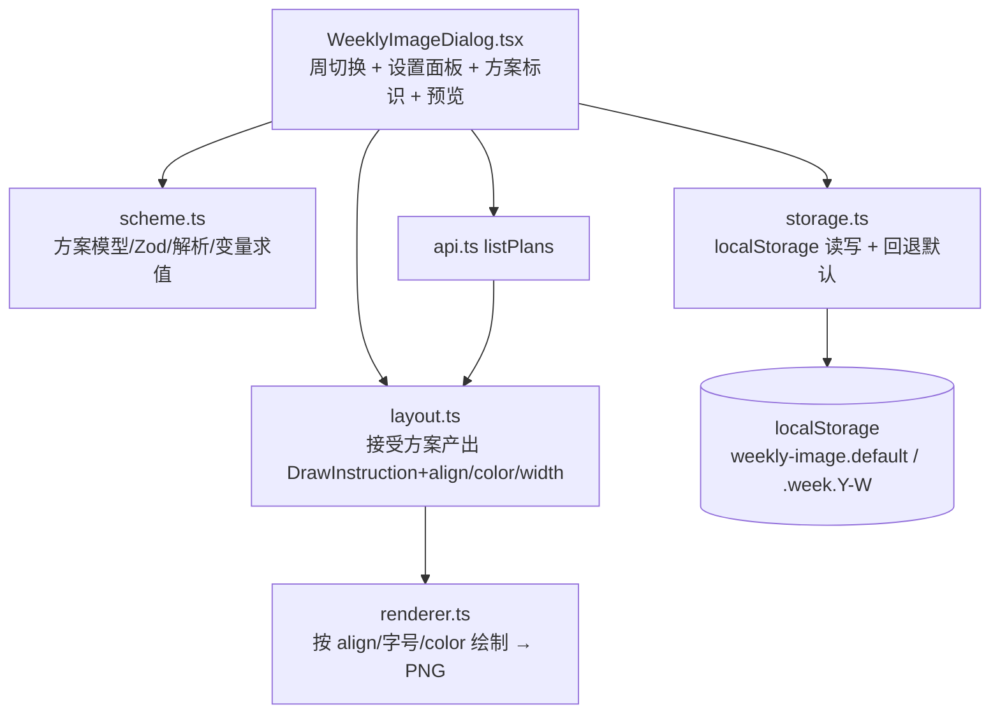
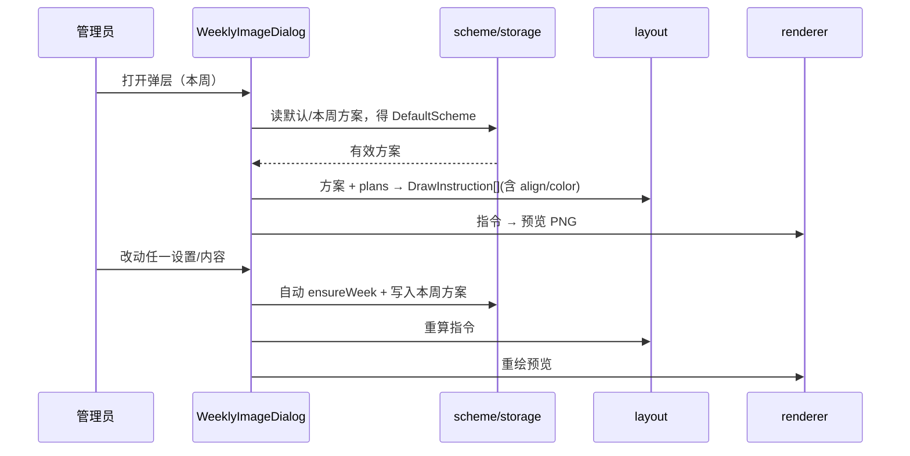

# 周表图片自定义 - 技术提案

**功能名称**: 周表图片自定义（Weekly Image Customization）
**关联 PRD**: `docs/product/requirements/draft/2026-08-24-weekly-image-customization-prd.md`
**技术提案版本**: v1.0
**创建日期**: 2026-08-24
**作者**: sumire workflow
**feat-branch**: `feat/weekly-image-customization`

## 1. 概述

### 1.1 背景

`features/schedule/weeklyImage/` 的周表图生成目前样式固化：

- `layout.ts:15-20` 常量 `ROW_X=365`、`ROW_WIDTH=715`、`BASE_FONT_SIZE=40`、`MIN_FONT_SIZE=22`，`fitToWidth` 自 40px 起 shrink-to-fit、超宽截断；
- `layoutWeek` 输出 `DrawInstruction`（`x` 固定 `ROW_X`，即恒左对齐）；
- `renderer.ts:7` `TEXT_COLOR="#342a40"`、`:9` `FONT_SPEC` 固定 40px，`fillText(ins.text, ins.x, centerY)` 恒左对齐、恒深色、恒字号；
- `WeeklyImageDialog.tsx` 仅周切换 + 预览，无任何设置项，无持久化。

本次迭代在这些既有机制上叠加「样式/内容配置」与「方案」留存，不改变底图坐标与导出尺寸。

### 1.2 目标

- 弹层提供对齐（左/中/右）、字号、颜色的全局设置与按天设置；
- 支持按天编辑文案、插入 `{schedules}` 变量（默认 `{schedules}`），`{schedules}` 替换为现态 `layoutWeek` 生成的拼接文案；
- 引入「默认方案 + 按周方案」：无周方案时用默认方案，任一编辑自动新建/更新本周方案；方案持久化到 `localStorage`。

### 1.3 范围

- **做**：新增 `weeklyImage/scheme.ts`（方案模型 + Zod + 解析 + localStorage）、`storage.ts`（读写）等纯函数与模块；扩展 `layout.ts`（接受方案与单日文案、产出含对齐/颜色/实测宽度的指令，替代文案用 `resolveDayText` 求值）；扩展 `renderer.ts`（按对齐/字号/颜色绘制）；改造 `WeeklyImageDialog.tsx`（设置面板 + 方案标识 + 按天编辑 + 自动新建周方案）；补/更新单元测试。
- **不做**：后端接口/契约/数据模型变更；底图与各日区域坐标变更；导出尺寸变更；`listPlans` 与计划 CRUD 变更；公开页样式依赖。

## 2. 技术架构

### 2.1 系统架构图



### 2.2 技术栈

| 层级 | 技术选型 | 说明 |
|------|---------|------|
| 前端 | Next.js（App Router）+ React + TS strict | 改造集中在 `features/schedule/weeklyImage/` |
| 校验 | Zod | 方案 schema 与 `localStorage` 读取白名单校验 |
| 样式 | Tailwind v4（token） | 弹层设置面板样式沿用既有 token |
| Canvas | Canvas 2D API | 沿用 2× 超采样渲染管线，仅扩展绘制参数 |
| 测试 | Vitest + Testing Library | 纯函数单测 + 弹层组件测试 |

### 2.3 模块划分

| 模块 | 职责 | 关键技术点 |
|------|------|-----------|
| `weeklyImage/scheme.ts` | 方案类型/默认值/Zod schema/生效解析/变量求值 | `resolveEffectiveScheme`；`resolveDayText(template, schedules)` |
| `weeklyImage/storage.ts` | localStorage 读写与回退 | key `weekly-image.default`、`weekly-image.week.{year}-{week}`；非法回退内置默认 |
| `weeklyImage/layout.ts` | 依据方案产出绘制指令 | 增加 `align`/`color`/`textWidth` 字段；按方案字号 shrink-to-fit；内容来自 `resolveDayText` |
| `weeklyImage/renderer.ts` | 按指令绘制导出 | 按 `align`/`fontSize`/`color` 设置 `textAlign`/`fillStyle` |
| `weeklyImage/WeeklyImageDialog.tsx` | 弹层 UI + 状态编排 | 设置面板、按天编辑、方案标识、自动新建周方案、切周重绘 |

## 3. API 设计

无 API 变更。仍复用 `features/schedule/api.ts` 的 `listPlans`；契约 `contract/stream-plans.openapi.yaml` 不动。

## 4. 数据模型

不落库到服务端。引入客户端 `localStorage` 内的两份数据：

### 4.1 DefaultScheme（默认方案）

```ts
type TextAlign = "left" | "center" | "right";
interface DaySettings {
  content: string;                       // 默认 "{schedules}"
  align?: TextAlign;                     // 空=沿用全局
  fontSize?: number;                     // 空=沿用全局
  color?: string;                        // 空=沿用全局
}
interface DefaultScheme {
  version: 1;
  global: {
    align: TextAlign;                    // 默认 "left"
    fontSize: number;                    // 默认 40
    color: string;                       // 默认 "#b4a6bf"
  };
  days: DaySettings[];                   // 长度 7，索引 0=周一…6=周日
}
```

内置默认（`createDefaultScheme()`）：`global = { align:"left", fontSize:40, color:"#b4a6bf" }`，`days[i] = { content:"{schedules}" }`。

### 4.2 WeekScheme（按周方案）

```ts
interface WeekScheme extends DefaultScheme {
  week: { year: number; week: number };  // 归属 ISO 周
}
```

有效方案解析：`resolveEffectiveScheme(week, store) = store.getWeek(week) ?? store.getDefault()`。任一编辑经 `ensureWeek(week)` 先以当前有效方案为基底 `cloneDeep` 复制为本周 `WeekScheme`，再写入变更。

### 4.3 localStorage keys

- `weekly-image.default` → 默认方案 JSON；
- `weekly-image.week.{year}-{week}`（如 `weekly-image.week.2026-33`）→ 各周方案；
- 读取用 Zod `safeParse`，失败回退内置默认；`localStorage` 不可用时降级为内存态（仅会话有效）。

## 5. 技术实现方案

### 5.1 核心流程



### 5.2 关键实现点

#### 实现点 1: 方案模型与变量求值（`scheme.ts`）

- **描述**: 定义 `DefaultScheme`/`WeekScheme`/`TextAlign` 等类型与 Zod schema；`createDefaultScheme()`；`resolveEffectiveScheme(week, store)`；`resolveDayText(template, schedules)` 将 `{schedules}` 替换为计划拼接文案，模板无变量则原样返回（替换用 `split`/`join` 而非正则以防特殊字符）。
- **技术细节**: `schedules`（即某日文案）的生成沿用现态 `layoutWeek` 的逻辑：同日多场按 `startTime` 升序以 ` / ` 连接成 `HH:mm 标题`。将该拼接逻辑抽为纯函数 `buildDaySchedulesText(plans)` 供 `resolveDayText` 与既有测试复用，避免重复。
- **风险点**: 无（纯函数，Zod 白名单杜绝非法枚举/色值注入）。

#### 实现点 2: localStorage 读写（`storage.ts`）

- **描述**: `loadDefault()` / `saveDefault(scheme)` / `loadWeek(week)` / `saveWeek(scheme)` / `deleteWeek(week)`；读取一律 `DefaultSchemeSchema.safeParse`，失败回退 `createDefaultScheme()`。
- **技术细节**: key 稳定可推导（`weekKey(year, week)` 导出供复用）；`localStorage` 不存在/抛错（隐私模式）时用模块级内存 Map 兜底，保证可生成但不跨会话持久。
- **风险点**: 与既有 `danmaku-backdoor.*` key 无冲突；数据量 < 数 KB 无配额压力。

#### 实现点 3: layout 依据方案产出指令（`layout.ts`）

- **描述**: `layoutWeek(plans, monday, measure, scheme)` 增加 `scheme` 入参（缺省用 `createDefaultScheme()` 保持向后兼容）。对每天：
  1. 取 `DaySettings`，计算 `有效内容 = resolveDayText(content, buildDaySchedulesText(dayPlans))`；内容为空串则该日不产出指令；
  2. 求 `有效字号 = day.fontSize ?? global.fontSize`（默认 40），`fitToWidth` 自该字号 shrink-to-fit 到 `MIN_FONT_SIZE`（22）防溢出，超宽截断；
  3. 计算实测文字宽度 `textWidth = measure(fitted, fontSize)`；
  4. 有效对齐 `align = day.align ?? global.align`、有效颜色 `color = day.color ?? global.color`；
  5. 产出 `DrawInstruction`（新增 `align`/`color`/`textWidth` 字段）。
- **技术细节**: 保持 `ROW_X`/`ROW_WIDTH`/`ROW_Y` 常量；`DrawInstruction` 扩展不再仅靠 `x` 左对齐，`x` 仍记录区域左边界，实际绘点由 renderer 按 `align`/`textWidth` 计算。
- **风险点**: 对齐右/中时若文字大于区域宽度（极端，shrink 已防），renderer 侧对计算的 `x` 做 `clamp` 到 `[ROW_X, ROW_X+ROW_WIDTH-textWidth]` 兜底。

#### 实现点 4: renderer 按对齐/字号/颜色绘制（`renderer.ts`）

- **描述**: `renderWeekImage(baseUrl, instructions)` 内循环时读取每条指令：
  - `offCtx.font = 600 {fontSize}px FONT_STACK`（改用 `ins.fontSize`）；
  - `offCtx.fillStyle = ins.color`；
  - 计算 `x`：`left → ins.x`；`center → ins.x + (ins.width - ins.textWidth)/2`；`right → ins.x + ins.width - ins.textWidth`，并 `clamp` 防越界；
  - `fillText(ins.text, x, centerY)`。
- **技术细节**: 仍走既有 2× 超采样 + `imageSmoothingQuality:"high"` 缩回 1665×1080；导出尺寸与对齐计算在逻辑坐标，与超采样倍率无关。
- **风险点**: 无（纯绘制参数扩展）。

#### 实现点 5: 弹层 UI 与状态编排（`WeeklyImageDialog.tsx`）

- **描述**: 弹层扩展：
  - **状态**：`scheme`（当前生效方案，`useState<DefaultScheme>`）、`week`（既有）+ `editingDefault`（是否编辑默认方案）；`plans` 沿用；
  - **方案标识**：`effectiveScheme = resolveEffectiveScheme(week)`；显式 `hasWeekScheme` 徽标（「默认方案」/「2026 年第 N 周方案」）与「编辑默认方案」切换；
  - **全局设置**：对齐三选、字号增减/输入、颜色色板；**按天设置**：七日折叠面板，内容编辑框 + 「插入 {schedules}」 + 三项覆盖（留空=沿用全局）；
  - **自动新建**：任一变更 handler 先 `ensureWeek(week)`（首次以当前有效方案为基底复制为周方案），写入 `storage`，更新 state；
  - **重绘**：`useEffect` 依赖加入 `scheme`（或 `schemeVersion`），按 `layoutWeek(plans, monday, measure, scheme)` + `renderWeekImage` 重绘预览（依赖项：`open, week, plans, scheme, renderImage, baseImageUrl`）。
- **技术细节**: 编辑对象为 `scheme` 的不可变更新（struct-sharing 更新 `global`/`days[i]`）；`editingDefault` 为 true 时变更写入默认方案而非周方案，且不触发 `ensureWeek`。
- **风险点**: 重绘频率——每次击键都重绘可接受（单次 Canvas + 已有底图缓存考虑：`renderWeekImage` 每次 `loadImage` 有浏览器缓存，可忽略）；如抖动明显可在字号/文案输入上做轻量防抖（300ms）。

### 5.3 扩展既有函数签名（兼容性）

- `layoutWeek(plans, monday, measure)` → `layoutWeek(plans, monday, measure, scheme?)`，`scheme` 可选，缺省回退默认，避免破坏现有调用与既有单测。
- `DrawInstruction` 增 `align: TextAlign`、`color: string`、`textWidth: number`。

## 6. 技术决策

### 6.1 决策列表

| 决策 | 选项 A | 选项 B | 最终选择 | 原因 |
|------|--------|--------|---------|------|
| 方案持久化 | 客户端 `localStorage` | 服务端 API + MongoDB 落库 | A | 周表图生成与存储本就在客户端（无服务端渲染），加后端接口/契约/数据模型改动大且本期非必需；与后台既有本地偏好（`danmaku-backdoor.columns`、`merge-danmaku`）一致；单维护者场景足够 |
| 内容变量 | 单变量 `{schedules}` | 多变量模板引擎 | A | 需求明确本期仅 `{schedules}`；`split`/`join` 替换即可，不引入模板引擎依赖 |
| 字号口径 | 用户设定字号 + shrink-to-fit 兜底 | 完全固定字号（溢出裁剪不缩放） | A | 保留现态防溢出能力，用户字号作为基准更可控；完全不缩放会导致超长文案被裁掉 |
| 周方案基底 | 以「当前有效方案」快照复制 | 以「内置默认」复制 | A | 用户在新周里期望继承上周/既有编排基础上微调；以有效方案为基底体验更平滑 |
| 对齐处理层级 | renderer 计算 x + clamp | layout 直接算好 x | A | renderer 已持有 `textWidth`/`align`，集中一处计算并 clamp 兜底，layout 保持区域几何职责 |

### 6.2 依赖与约束

| 类型 | 内容 | 说明 |
|------|------|------|
| 依赖 | 既有 `features/schedule/weeklyImage/` 全部实现 | 改造基底 |
| 约束 | 底图坐标、每日常规区域（715×70）、导出 1665×1080 不变 | `public/assets/original/AGENTS.md` |
| 约束 | 仅用 `@theme` token 色，后台控件过渡 ≤200ms | `docs/design/03-backdoor-design.md` |
| 约束 | 静态导出（GitHub Pages），全客户端行为 | `renderWeekImage` 等须保持 `"use client"` |
| 约束 | 分支 `feat/weekly-image-customization` 自 main 切出，禁止 rebase/squash 只 merge | `AGENTS.md` |

## 7. 项目结构

```
apps/bookstore/
├── features/schedule/weeklyImage/
│   ├── scheme.ts                         # 新增：方案模型/默认值/Zod/解析/变量求值
│   ├── storage.ts                        # 新增：localStorage 读写 + 内存兜底
│   ├── layout.ts                         # 扩展：接受 scheme，产出 align/color/textWidth
│   ├── renderer.ts                       # 扩展：按 align/fontSize/color 绘制
│   └── WeeklyImageDialog.tsx             # 扩展：设置面板 + 方案标识 + 按天编辑 + 自动新建
└── tests/unit/
    ├── weekly-image-scheme.test.ts       # 新增：默认值/解析/变量求值/回退
    ├── weekly-image-layout.test.ts       # 更新：scheme 化 layout + align/color/textWidth 断言
    └── schedule-weekly-image-dialog.test.tsx  # 更新：设置驱动重绘/自动新建周方案补测
```

契约、服务端、编排（`infra/aspire`）零变更。

## 8. 测试策略

### 8.1 测试覆盖要求

- `weekly-image-scheme.test.ts`：
  - `createDefaultScheme`（左对齐、40px、`#b4a6bf`、每日 `{schedules}`）；
  - `resolveEffectiveScheme`：有周方案优先、无则默认、Zod 非法回退内置默认；
  - `resolveDayText`：`{schedules}` 替换、无变量原样、空计划空串、多变量/边界；
  - `buildDaySchedulesText`：同日多场升序 ` / ` 拼接；
- `weekly-image-layout.test.ts`：
  - 全局对齐左/中/右侧输出正确；单日覆盖优先、部分覆盖（仅颜色）沿用全局；
  - 内容为空串不产出指令；文案含 `{schedules}` 求值正确；自定义文案时 shrink/截断仍生效；
  - `scheme` 缺省回退默认，`align`/`color`/`textWidth` 字段存在；
- `schedule-weekly-image-dialog.test.tsx`：
  - 设置面板存在；改动任一设置触发 `ensureWeek` 写入周方案、默认方案不变；
  - 「编辑默认方案」模式写入默认方案且不建周方案；切周按各周方案渲染；
  - 既有渲染管线打桩适配新签名，生成/导出断言保持绿；
- e2e：既有计划/周表 e2e 保持绿；无新增 e2e（后台配置面板以单测覆盖为主）。

### 8.2 测试类型

| 类型 | 工具 | 覆盖范围 |
|------|------|---------|
| 单元测试 | Vitest + Testing Library | 方案模型、layout、弹层组件 |
| E2E | Playwright | 既有回归（回归守卫） |

## 9. 部署方案

### 9.1 环境规划

| 环境 | 用途 | 部署方式 |
|------|------|---------|
| 本地联调 | Aspire 编排（既有四资源） | `aspire start`，无配置变更 |
| GitHub Pages 生产 | 纯静态 | 无新增配置项 |

### 9.2 配置管理

无新增配置项；`NEXT_PUBLIC_API_BASE_URL` 口径不变（`API_CONFIGURED` 守卫沿用）。

## 10. 验收标准

- [ ] 技术方案评审通过
- [ ] 对齐（左/中/右）可切换且预览即时更新，右/中不越界
- [ ] 字号可调（16–60）、颜色可调，默认颜色 `#b4a6bf`，字号/颜色对预览立即生效
- [ ] 全局与按天设置区分生效，单天可部分覆盖（仅颜色等）
- [ ] 按天可编辑文案并插入 `{schedules}`，默认 `{schedules}`，替换求值正确
- [ ] 方案按周保存：无周方案回退默认，任一编辑自动新建本周方案，不影响默认与其他周；删除回退默认
- [ ] 关闭/刷新后在按周回显正确方案，数据非法回退内置默认
- [ ] 单测全绿：`pnpm lint && pnpm test && pnpm build` 全绿

## 11. 相关文档

- 关联 PRD：`docs/product/requirements/draft/2026-08-24-weekly-image-customization-prd.md`
- 产品 Spec（现态）：`docs/product/spec/schedule-admin.md`
- 开发规范：`docs/engineering/frontend-rules.md`、`apps/bookstore/AGENTS.md`
- 周表图既有提案：`docs/engineering/proposals/archived/2026-08-13-weekly-schedule-proposal.md`、`docs/engineering/proposals/archived/2026-08-15-weekly-schedule-v2-proposal.md`
- 素材坐标：`public/assets/original/AGENTS.md`
