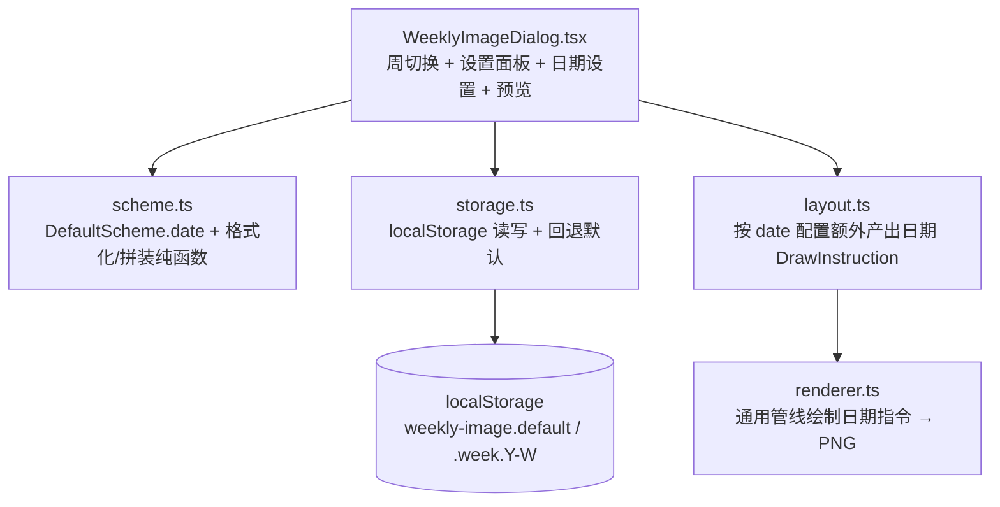
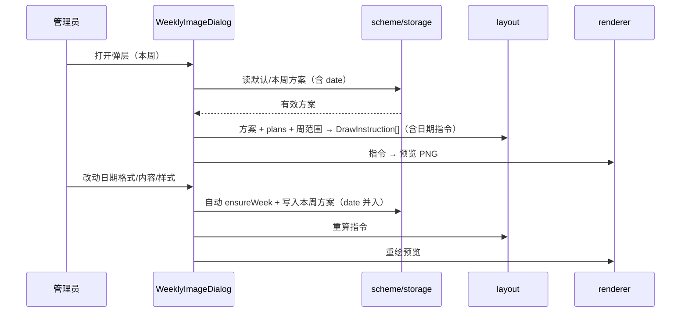

# 周表图片日期渲染 - 技术提案

**功能名称**: 周表图片日期渲染（Weekly Image Date Render）
**关联 PRD**: `docs/product/requirements/draft/2026-08-24-weekly-image-date-render-prd.md`
**技术提案版本**: v1.0
**创建日期**: 2026-08-24
**作者**: sumire workflow
**feat-branch**: `feat/weekly-image-date-render`

## 1. 概述

### 1.1 背景

在上一迭代（`weekly-image-customization`，已上线 merge 进 main）建立的方案体系之上，本次在官方底图顶部**日期绘制区域**渲染该周的日期范围。

- 官方底图日期区域坐标已在 `feat/weekly-image-date-area` 分支确定：左上角 `(640,80)`，可用 `451×40`（见 `public/assets/original/AGENTS.md`）；
- 现态 `.weeklyImage/scheme.ts` 定义 `DefaultScheme`/`WeekScheme`（含全局与按天设置），`layout.ts` 产出 `DrawInstruction[]`，`renderer.ts` 已按 `align`/`fontSize`/`color`/`textWidth` **通用地**绘制任意指令（`computeTextX` + `fillText`）；
- 本次把日期区域作为一条**额外的 `DrawInstruction`** 并入既有指令管线，配合顶层（周头）区域，尽量少的改动。

### 1.2 目标

- 生成周表图片时在日期区域渲染该周日期范围（周一~周日）；
- 支持日期**格式**模板（`{yyyy}`/`{yy}`/`{mm}`/`{m}`/`{dd}`/`{d}`）与日期**内容**模板（`{开始日期}`/`{结束日期}`）；
- 日期区域独立支持字号（更小默认值）、对齐、颜色；
- 日期配置并入既有方案体系（默认 + 按周）持久化，向后兼容旧版本 scheme。

### 1.3 范围

- **做**：扩展 `scheme.ts`（新增 `DateSchemeConfig` 类型/Zod/默认与解析、日期格式化与内容拼装纯函数）；扩展 `layout.ts`（产出日期 `DrawInstruction`；新增日期区域常量与日期字号默认）；适度扩展 `layout.ts` 入参以取到周一与周日；`WeeklyImageDialog.tsx` 增加「日期设置」区块并纳入方案编辑/持久化；补/更新单元测试。
- **不做**：后端接口/契约/数据模型变更；底图与各区域坐标变更（坐标采用既有已确定值）；导出尺寸变更；日期区域开关（本期不提供显式隐藏）；`listPlans` 与计划 CRUD 变更。

## 2. 技术架构

### 2.1 系统架构图



### 2.2 技术栈

| 层级 | 技术选型 | 说明 |
|------|---------|------|
| 前端 | Next.js（App Router）+ React + TS strict | 改造集中在 `features/schedule/weeklyImage/` |
| 校验 | Zod | 日期配置 schema 白名单校验；复用既有方案 schema |
| 样式 | Tailwind v4（token） | 弹层新增「日期设置」区块沿用既有 token |
| Canvas | Canvas 2D API | 复用既有通用绘制管线，仅新增一条日期指令 |
| 测试 | Vitest + Testing Library | 纯函数单测 + 弹层组件测试 |

### 2.3 模块划分

| 模块 | 职责 | 关键技术点 |
|------|------|-----------|
| `scheme.ts` | 新增 `DateSchemeConfig` 类型/默认/Zod；日期格式化与内容拼装纯函数；`date` 字段解析回退 | `formatDate(dateStr, format)`；`buildDateContent(template, startStr, endStr)`；`resolveDateConfig(scheme)` |
| `layout.ts` | 依据 date 配置额外产出日期绘制指令 | 新增 `DATE_*` 常量；`layoutWeek` 产出日期指令（`align`/`color`/`textWidth` 一并计算） |
| `renderer.ts` | 按指令绘制导出 | **无改动**（既有通用指令管线已支持日期指令） |
| `WeeklyImageDialog.tsx` | 弹层 UI + 状态编排 | 新增「日期设置」区块；日期编辑纳入方案编辑/自动新建/持久化 |

## 3. API 设计

无 API 变更。仍复用 `features/schedule/api.ts` 的 `listPlans`；契约 `contract/stream-plans.openapi.yaml` 不动。

## 4. 数据模型

### 4.1 DateSchemeConfig（日期配置）

在 `DefaultScheme` 中新增**可选** `date` 字段（缺省回退内置默认，保证旧版本 scheme 向后兼容）：

```ts
interface DateSchemeConfig {
  format: string;          // 日期格式模板，默认 "{yyyy}年{mm}月{dd}日"
  content: string;         // 日期内容模板，默认 "{开始日期} ~ {结束日期}"
  align?: TextAlign;       // 空=沿用全局；默认随全局
  fontSize?: number;       // 空=沿用内置更小默认；默认 20
  color?: string;          // 空=沿用全局默认色
}
```

- `DefaultScheme.date?: DateSchemeConfig`（可选，解析时缺失回退内置默认）；
- `WeekScheme` 继承 `DefaultScheme`，`date` 同样可选。

内置日期默认（`createDefaultDateConfig()`）：`{ format:"{yyyy}年{mm}月{dd}日", content:"{开始日期} ~ {结束日期}", align: undefined, fontSize: undefined, color: undefined }`；解析回退时字号用更小默认 `DATECONFIG_DEFAULT_FONT_SIZE = 20`，对齐/颜色沿用全局值。

### 4.2 localStorage

沿用既有 key（`weekly-image.default`、`weekly-image.week.{year}-{week}`）；`date` 字段随方案一并序列化。因 `date` 为可选，旧数据（无 `date`）仍通过 `safeParse`，由解析层补默认，无需迁移、无需版本号变更。

## 5. 技术实现方案

### 5.1 核心流程



### 5.2 关键实现点

#### 实现点 1: 日期格式化与内容拼装（`scheme.ts`）

- **描述**: 新增两个纯函数：
  - `formatDate(dateStr: string, format: string): string`：入参 `YYYY-MM-DD` 与格式模板，按模板逐变量替换。变量含义：`{yyyy}` 四位年、`{yy}` 两位年（`String(year).padStart(2,"0").slice(-2)`，如 2026→26）、`{mm}`/`{dd}` 补零两位（如 08）、`{m}`/`{d}` 一位或多位（如 8/9/12）。替换用 `split`/`join` 依次进行（单趟，因变量互不同名不相互干扰），其余文字原样保留。
  - `buildDateContent(template: string, startStr: string, endStr: string): string`：将 `{开始日期}`/`{结束日期}` 分别替换为格式化后的开始/结束字符串；模板为空串返回空串。
- **技术细节**: 日期解析复用 `layout.ts` 的 `daysBetween` 思路（`split("-").map(Number)`），不引入日期库；跨年/跨月由 `Date` 构造处理。
- **风险点**: 无（纯函数）。注意 `formatDate` 的变量替换用逐变量 `split`/`join`，避免正则转义与特殊字符问题。

#### 实现点 2: 日期配置解析回退（`scheme.ts`）

- **描述**: 提供 `resolveDateConfig(scheme: DefaultScheme): Required<Pick<DateSchemeConfig,"format"|"content">> & { align: TextAlign; fontSize: number; color: string }`：从 `scheme.date`（存在且合法）取模板；字号取 `date.fontSize ?? DATECONFIG_DEFAULT_FONT_SIZE`；对齐取 `date.align ?? scheme.global.align`；颜色取 `date.color ?? scheme.global.color`。
- **技术细节**: `DefaultSchemeSchema` 增加可选 `date` 字段（`DateSchemeConfigSchema.optional()`）；旧数据无 `date` 时 `safeParse` 仍成功，`resolveDateConfig` 走默认回退。
- **风险点**: 无。

#### 实现点 3: layout 产出日期指令（`layout.ts`）

- **描述**: 新增日期区域常量并让 `layoutWeek` 额外产出**一条**日期 `DrawInstruction`：
  - `DATE_X = 640`、`DATE_Y = 80`、`DATE_WIDTH = 451`、`DATE_HEIGHT = 40`、`DATECONFIG_DEFAULT_FONT_SIZE = 20`、`DATECONFIG_MAX_FONT_SIZE = 30`（更小字号上限，防字过大）；
  - 计算周范围：入参 `monday` 已知，周日 = `monday + 6 天`（复用既有日期算术，或由 `getWeekRange` 传入）；
  - 生成：`startStr = formatDate(monday, dateConfig.format)`；`endStr = formatDate(sunday, dateConfig.format)`；`text = buildDateContent(dateConfig.content, startStr, endStr)`；`text === ""` 则不产出该指令；
  - 对齐/字号/颜色取 `resolveDateConfig` 结果；`fitToWidth` 以日期字号为基准 shrink-to-fit 到 `MIN_FONT_SIZE` 防溢出（复用既有函数）；
  - 日期指令 `dayIndex` 置 `-1`（标记非按天指令，供测试/渲染辨识）。
- **技术细节**: `layoutWeek(plans, monday, measure, scheme)` 签名不变；scheme 已含 `date`，从入参 monday 推导周日，无需新入参。日期指令与按天指令一起返回；renderer 逐条绘制即渲染日期。
- **风险点**: 无（纯函数，沿用既有 shrink 机制）。

#### 实现点 4: renderer 无改动

- **描述**: 既有 `renderer.ts` 的通用循环按 `ins.font`/`fillStyle`/`computeTextX`/`fillText` 绘制任意指令，日期指令自带 `x/y/width/height/fontSize/align/color/textWidth`，无需任何改动即可绘制。
- **风险点**: 无。

#### 实现点 5: 弹层「日期设置」区块与状态编排（`WeeklyImageDialog.tsx`）

- **描述**: 在既有方案设置面板新增「日期设置」区块：
  - **状态**：`scheme.date` 复用 `scheme` state，不新增独立 state；
  - **控件**：日期格式模板文本输入框（默认 `{yyyy}年{mm}月{dd}日`）、日期内容模板文本输入框（默认 `{开始日期} ~ {结束日期}`）、字号（默认 20，更小默认）、对齐三选、颜色色板；均为可编辑项；
  - **编辑/持久化**：日期各变更复用 `handleGlobalChange`/新增 `handleDateChange`，按既有 `editingDefault` 分支写入默认方案或自动 `ensureWeek` 写入本周方案（与全局/按天设置同一套规则）；
  - **重绘**：既有 `useEffect` 依赖项已含 `scheme`，日期变更触发重算指令并重绘预览，无需新增依赖。
- **技术细节**: 日期编辑更新 `scheme.date` 采用不可变更新；`date` 缺失时初始化用 `createDefaultDateConfig()` 填充以便表单可编辑。
- **风险点**: 重绘频率复用既有策略（可接受；如需可日期输入框加轻量防抖）。

### 5.3 兼容性

- `DefaultScheme` 增加可选 `date` 字段；`WeekSchemeSchema` 继承它，均为可选，旧数据可解析并回退默认；
- `layoutWeek` 签名不变；`DrawInstruction` 不变（日期指令复用既有字段，仅 `dayIndex=-1` 语义标记）。

## 6. 技术决策

### 6.1 决策列表

| 决策 | 选项 A | 选项 B | 最终选择 | 原因 |
|------|--------|--------|---------|------|
| date 字段形态 | `DefaultScheme.date?`（可选，缺省回退默认） | 必填 + 版本号升级迁移 | A | 旧版本 storage 无 `date`，可选字段经 `safeParse` 仍成功、解析层补默认即可向后兼容，无需版本迁移；改动最小 |
| 日期渲染实现 | 作为额外 `DrawInstruction` 并入既有指令管线 | 独立 drawDate 函数/单独绘制步骤 | A | renderer 既有通用指令绘制已覆盖对齐/字号/颜色，零改动即可复用；避免重复绘制逻辑 |
| 日期格式化 | 引入日期库（dayjs 等） | 自实现纯函数（split + 算术） | B | 仅需单日期格式化与变量替换，自实现避免新增依赖；与既有 `weekUtils`/`dateUtils` 自实现风格一致 |
| 日期默认字号 | 独立更小默认 20px | 沿用全局 40px | A | 日期区域（451×40）远小于每日区域（715×70），需求明确要求更小默认字号 |
| 对齐/颜色默认 | `date.align/color ?? global` | 日期完全独立常量 | A | 对齐/颜色沿用全局更符合直觉且减少重复配置；字号因区域更小而独立默认 |

### 6.2 依赖与约束

| 类型 | 内容 | 说明 |
|------|------|------|
| 依赖 | 既有 `features/schedule/weeklyImage/` 全部实现（含上一迭代方案体系） | 改造基底 |
| 约束 | 日期区域坐标 `(640,80)`、可用 `451×40`（`public/assets/original/AGENTS.md`）；导出 1665×1080 不变 | 坐标已确定 |
| 约束 | 仅用 `@theme` token 色，后台控件过渡 ≤200ms | `docs/design/03-backdoor-design.md` |
| 约束 | 静态导出（GitHub Pages），全客户端行为 | `renderWeekImage` 等保持 `"use client"` |
| 约束 | 分支 `<type>/<slug>` 自 main 切出，禁止 rebase/squash 只 merge | `AGENTS.md` |

## 7. 项目结构

```
apps/bookstore/
├── features/schedule/weeklyImage/
│   ├── scheme.ts                         # 扩展：DateSchemeConfig + 格式化/拼装/解析回退
│   ├── layout.ts                         # 扩展：DATE_* 常量 + 额外产出日期指令
│   ├── renderer.ts                       # 无改动（通用管线复用）
│   └── WeeklyImageDialog.tsx             # 扩展：「日期设置」区块 + 纳入方案编辑/持久化
└── tests/unit/
    ├── weekly-image-scheme.test.ts       # 更新：新增 date 格式/内容/解析回退断言
    ├── weekly-image-layout.test.ts       # 更新：日期指令产出断言（含空内容不产出）
    └── schedule-weekly-image-dialog.test.tsx  # 更新：日期设置驱动重绘/持久化补测
```

契约、服务端、编排（`infra/aspire`）零变更。

## 8. 测试策略

### 8.1 测试覆盖要求

- `weekly-image-scheme.test.ts`：
  - `formatDate`：`{yyyy}`/`{yy}`/`{mm}`/`{m}`/`{dd}`/`{d}` 各变量替换；非变量文字原样；补零（`08`）与非补零（`8`）边界；2026-08-31 全变量默认模板 `2026年08月31日`；
  - `buildDateContent`：`{开始日期}`/`{结束日期}` 替换；模板空串返回空串；自定义分隔符；
  - `createDefaultDateConfig` 默认值；`resolveDateConfig`：scheme 无 date 回退默认、部分覆盖（仅 font/color）沿用全局；
- `weekly-image-layout.test.ts`：
  - 日期指令存在，`dayIndex=-1`、坐标 `DATE_*`、对齐/字号/颜色正确；
  - 日期内容为空串不产出日期指令；文字过长 shrink/截断不越界；
  - 跨年/跨月周的日期格式化正确；无计划周仍产出日期指令；
- `schedule-weekly-image-dialog.test.tsx`：
  - 「日期设置」区块存在；改动日期触发 `ensureWeek` 写入周方案、默认方案不变（editingDefault 分支正确）；
  - 日期配置随方案回显；既有渲染管线打桩适配后断言生成保绿；
- e2e：既有计划/周表 e2e 保持绿；无新增 e2e（后台配置面板以单测覆盖为主）。

### 8.2 测试类型

| 类型 | 工具 | 覆盖范围 |
|------|------|---------|
| 单元测试 | Vitest + Testing Library | 日期纯函数、layout 日期指令、弹层组件 |
| E2E | Playwright | 既有回归（回归守卫） |

## 9. 部署方案

### 9.1 环境规划

| 环境 | 用途 | 部署方式 |
|------|------|---------|
| 本地联调 | Aspire 编排（既有资源） | `aspire start`，无配置变更 |
| GitHub Pages 生产 | 纯静态 | 无新增配置项 |

### 9.2 配置管理

无新增配置项；`NEXT_PUBLIC_API_BASE_URL` 口径不变（`API_CONFIGURED` 守卫沿用）。

## 10. 验收标准

- [ ] 技术方案评审通过
- [ ] 生成的周表图顶部日期区域渲染出该周日期范围（周一~周日，默认 `2026年08月31日 ~ 2026年09月06日` 形式）
- [ ] 日期格式/内容模板可编辑，各变量替换正确，预览即时更新
- [ ] 日期区域字号（默认 20px）、对齐、颜色可独立设置，导出生效，不越界
- [ ] 日期配置按周保存：无周方案回退默认，任一编辑自动新建本周方案，不影响默认与其他周；刷新/切周回显正确
- [ ] 旧版本 scheme（无 `date` 字段）数据安全回退内置日期默认，不崩溃
- [ ] 单测全绿：`pnpm lint && pnpm test && pnpm build` 全绿

## 11. 相关文档

- 关联 PRD：`docs/product/requirements/draft/2026-08-24-weekly-image-date-render-prd.md`
- 先决需求：`docs/product/requirements/draft/2026-08-24-weekly-image-customization-prd.md`
- 产品 Spec（现态）：`docs/product/spec/schedule-admin.md`
- 开发规范：`docs/engineering/frontend-rules.md`、`apps/bookstore/AGENTS.md`
- 日期区域坐标：`public/assets/original/AGENTS.md`
- 上一迭代提案：`docs/engineering/proposals/2026-08-24-weekly-image-customization-proposal.md`
