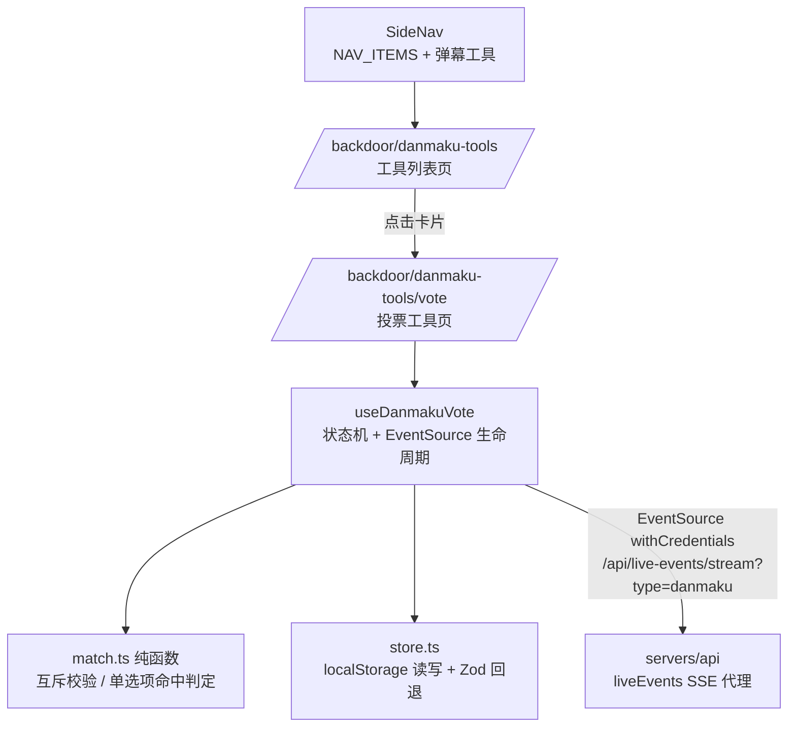
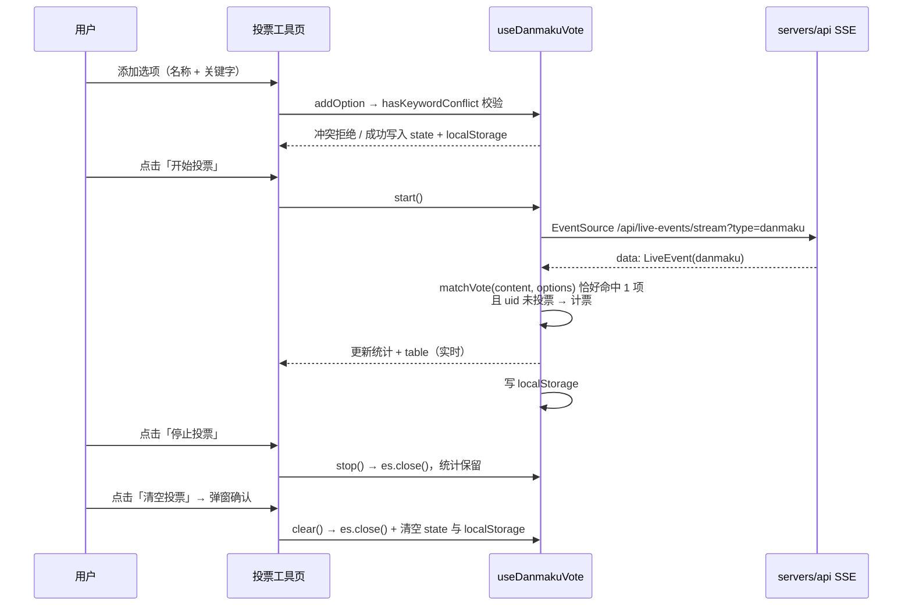

# 弹幕投票（弹幕工具一期）- 技术提案

**功能名称**: 弹幕投票（Danmaku Vote）
**关联 PRD**: `docs/product/requirements/draft/2026-08-28-danmaku-vote-prd.md`
**技术提案版本**: v1.0
**创建日期**: 2026-08-28
**作者**: sumire workflow
**prd-branch**: `prd/danmaku-vote`（需求总分支）
**feat-branch**: `feat/danmaku-vote`（开发分支，实现时自需求总分支合入 main 后切出）

## 1. 概述

### 1.1 背景

后台需在左侧导航新增「弹幕工具」聚合入口（卡片式工具列表），首个工具为「弹幕投票」。弹幕投票为**纯前端工具**：弹幕来源复用既有 `GET /api/live-events/stream?type=danmaku` SSE 端点（member 及以上，契约已交付，零变更），匹配、计票、持久化全部在浏览器内完成。

现况要点：

- SideNav `NAV_ITEMS` 位于 `apps/bookstore/features/backdoor/components/SideNav.tsx`，选中态按 `pathname === href || pathname.startsWith(href + "/")` 最长前缀匹配——新入口 href `/backdoor/danmaku-tools` 不会与 `/backdoor/danmaku` 互相误中；
- 弹幕看板「全页面唯一 SSE 连接」约定仅约束看板页（`/backdoor/danmaku`）；投票工具为独立页面，自行持有一条 EventSource 不违反该约定；
- `features/backdoor/api.ts` 提供 `API_BASE_URL` / `API_CONFIGURED` 口径；`features/danmaku/useLiveEventStream.ts` 已有 EventSource `withCredentials` 订阅先例可参照（不复用——它耦合看板信息流去重与分发）；
- localStorage + Zod 校验回退已有先例：`features/danmaku/columns.ts`、`mergeEnabled.ts`。

### 1.2 目标

- SideNav 新增「弹幕工具」入口 + `/backdoor/danmaku-tools` 卡片式工具列表页；
- `/backdoor/danmaku-tools/vote` 投票工具页：选项管理（互斥校验）、开始/停止投票（SSE 生命周期）、实时统计展示、localStorage 持久化、二次确认清空；
- 匹配与互斥判定为纯函数，状态机集中于 hook，组件薄渲染。

### 1.3 范围

- **做**：导航与两个新路由页面；`features/danmaku-tools/` 模块（工具卡片 + vote 子模块全部逻辑）；前端单测与 e2e。
- **不做**：后端/契约/数据库任何变更；投票结果导出；服务端持久化；更多工具卡片。

## 2. 技术架构

### 2.1 系统架构图



### 2.2 技术栈

| 层级 | 技术选型 | 说明 |
|------|---------|------|
| 前端 | Next.js（App Router）+ React + TS strict | 纯客户端交互，`"use client"` 页面 |
| 样式 | Tailwind v4（@theme token） | 后台设计口径，禁硬编码色值 |
| 校验 | Zod | localStorage 持久化结构校验回退（沿用 columns.ts 先例） |
| 数据通道 | EventSource（浏览器原生） | 复用既有 SSE 代理端点，零契约变更 |
| 测试 | Vitest（单测）+ Playwright（e2e） | 既有组织方式 |

### 2.3 模块划分

| 模块 | 职责 | 关键技术点 |
|------|------|-----------|
| `features/backdoor/components/SideNav.tsx` | 新增「弹幕工具」导航项 | 既有 NAV_ITEMS 追加一项，零结构改动 |
| `app/backdoor/(dashboard)/danmaku-tools/page.tsx` | 工具列表页 | 卡片栅格，整卡 Link 跳转 |
| `app/backdoor/(dashboard)/danmaku-tools/vote/page.tsx` | 投票工具页组装 | 左配置右统计布局；窄屏纵向堆叠 |
| `features/danmaku-tools/ToolCard.tsx` | 工具卡片组件 | 名称 + 简介，整卡可点 |
| `features/danmaku-tools/vote/types.ts` | 投票数据 Zod schema 与类型 | `VoteOption` / `VoteState`，voterUids 数组持久化、内存转 Set |
| `features/danmaku-tools/vote/match.ts` | 纯函数：互斥校验与弹幕匹配 | `hasKeywordConflict` / `matchVote` |
| `features/danmaku-tools/vote/store.ts` | localStorage 读写 | key `danmaku-tools.vote`，Zod 非法回退空态 |
| `features/danmaku-tools/vote/useDanmakuVote.ts` | 投票状态机 hook | EventSource 生命周期、计票、持久化、清空 |
| `features/danmaku-tools/vote/components/` | 薄渲染组件 | `VoteOptionsEditor` / `VoteControlBar` / `VoteStatsTable` / `ClearVoteDialog` |

## 3. API 设计

无契约变更。仅消费既有端点：

```
GET /api/live-events/stream?type=danmaku        (SSE，member 及以上，withCredentials)
```

每帧 `data: <LiveEvent JSON>`；仅使用 `type === "danmaku"` 条目的 `content`（可选）与 `sender.uid`。表情弹幕无 `content`，不参与匹配。

## 4. 数据模型

无数据库变更。localStorage 持久化（key：`danmaku-tools.vote`，Zod schema 校验，非法回退初始空态）：

```ts
interface VoteOption {
  id: string;        // crypto.randomUUID()
  name: string;      // 展示名称（trim 后非空）
  keyword: string;   // 匹配关键字（trim 后非空）
  count: number;     // 票数
}

interface VoteState {
  options: VoteOption[];
  processed: number;   // 已处理弹幕总数
  matched: number;     // 实际计票弹幕总数
  voterUids: number[]; // 已投票发送者 uid（内存中转 Set 判定）
}
```

初始空态：`{ options: [], processed: 0, matched: 0, voterUids: [] }`。投票进行中状态（`voting: boolean`）**不持久化**——刷新后一律视为已停止，需手动重新开始（SSE 连接本就无法跨刷新存活，此为最简一致口径）。

## 5. 技术实现方案

### 5.1 核心流程



### 5.2 关键实现点

#### 实现点 1: 匹配与互斥纯函数（match.ts）

- `matchVote(content: string, options: VoteOption[]): string | null`——返回恰好命中 1 个选项时的 `option.id`，否则 `null`：遍历计数 `options.filter(o => content.includes(o.keyword))`，长度恰好 1 才返回；0 或 ≥2 返回 `null`（≥2 为互斥校验的防御兜底）；
- `hasKeywordConflict(keyword: string, existing: VoteOption[]): boolean`——双向子串判定：`existing.some(o => o.keyword.includes(keyword) || keyword.includes(o.keyword))`，完全相同亦命中（子串定义天然覆盖）；
- 两函数均为无依赖纯函数，单测直推表驱动用例。
- **风险点**: 关键字大小写——弹幕匹配按原样 `includes`（不做大小写折叠，B 站弹幕以中文为主，引入折叠徒增复杂度；如需后续再议）；PRD 已按「包含匹配」写明。

#### 实现点 2: useDanmakuVote 状态机（vote/useDanmakuVote.ts）

- **状态**：`state: VoteState`（useState，挂载时 `store.load()` 初始化）+ `voting: boolean` + `voterSet: Set<number>`（由 `voterUids` 派生，ref 持有避免闭包旧值）；
- **start()**：`options.length === 0` 时拒绝并透出提示态；否则 `new EventSource(API_BASE_URL + "/api/live-events/stream?type=danmaku", { withCredentials: true })`，`onmessage` 处理无名帧（danmaku 为无名帧，无需命名帧监听）：JSON.parse 失败忽略；`type !== "danmaku"` 忽略；之后 `processed += 1`；`content` 存在时 `matchVote` 命中且 `!voterSet.has(uid)` → 该选项 `count += 1`、`matched += 1`、`voterSet.add(uid)`；每次事件后批量 setState 并 `store.save()`；
- **stop()**：`es.close()`，`voting = false`，统计保留；
- **clear()**：`es.close()` + 重置初始空态 + `store.clear()`（由确认弹窗确认后调用）；
- **清理**：组件卸载 `es.close()`；`API_CONFIGURED === false` 时 start 拒绝（页面本身已被构建时守卫拦截，双保险）；
- **风险点**: ① 高频弹幕下每条都 `store.save()` 有写入压力——localStorage 为同步 API，投票量级（条/s）下可接受；如出现卡顿再引入防抖（保持简单，不预优化）；② 事件回调闭包必须经 ref 读最新 `voterSet`/options，避免 start 后添加选项读到旧值（投票中选项只读，主要防 uid 判定旧值）。

#### 实现点 3: store.ts（localStorage 持久化）

- `load(): VoteState`——读 key `danmaku-tools.vote`，JSON.parse + Zod `voteStateSchema.safeParse`，任一步失败返回初始空态（沿用 `columns.ts` 损坏回退先例）；
- `save(state: VoteState): void`——`JSON.stringify` 写入（`voterUids` 由 Set 转数组）；
- `clear(): void`——`removeItem`；
- 参照 `columns.ts` 的单测组织（内存 localStorage mock）。

#### 实现点 4: 页面与组件

- `SideNav.tsx`：`NAV_ITEMS` 追加 `{ href: "/backdoor/danmaku-tools", label: "弹幕工具", roles: ["superadmin", "admin", "member"] }`，置于「弹幕检索」之后；
- `danmaku-tools/page.tsx`：`"use client"` 薄页面，标题「弹幕工具」+ 卡片栅格（本期一张 `ToolCard`：名称「弹幕投票」+ 简介「观众弹幕实时投票统计」），整卡 `Link` 跳 `/backdoor/danmaku-tools/vote`；
- `danmaku-tools/vote/page.tsx`：`"use client"`，调用一次 `useDanmakuVote()`，下传分区渲染：左侧 `VoteOptionsEditor`（选项列表行 + 删除按钮 + 新增表单两输入一按钮，投票中禁用全部编辑控件），操作区 `VoteControlBar`（「开始投票/停止投票」双态按钮——投票中换文案并换用区分色 token；旁置「清空投票」次按钮），右侧 `VoteStatsTable`（统计文案「已处理 {processed} 条弹幕，其中 {matched} 条匹配」+ 语义化 `<table>`：名称/票数/占比，占比保留 1 位小数、总票数为 0 显示 0%）；
- `ClearVoteDialog`：确认弹窗，文案明确「将清空当前所有投票数据（选项、统计与已投票记录）」，确认/取消两按钮；复用后台既有弹层口径（Esc/遮罩取消）；投票进行中确认时先 stop 再 clear（由 hook 的 clear 内部保证）；
- 布局：`lg:` 左右两栏，窄屏纵向堆叠；视觉严格按 `docs/design/03-backdoor-design.md`，token 色。
- **风险点**: 「停止投票」颜色变化——使用既有 token 中的强调/警示色（如 crimson 系），以设计文档口径为准，不新增 token。

## 6. 技术决策

### 6.1 决策列表

| 决策 | 选项 A | 选项 B | 最终选择 | 原因 |
|------|--------|--------|---------|------|
| 弹幕数据通道 | 复用既有 /stream SSE | 新增专用端点 | A | 纯前端工具定位；契约零变更；代理/鉴权/重连全复用 |
| SSE 连接管理 | 页面级独立 EventSource | 抽取全局共享连接 | A | 工具页独立生命周期；看板「全页面唯一连接」约定不适用本页；共享徒增耦合 |
| 匹配方式 | 子串包含匹配 | 正则/分词 | A | 需求原文口径；互斥校验（双向子串）保证恰好单命中为常态 |
| 互斥校验时机 | 添加时双向子串校验 | 匹配时消解冲突 | A | 需求原文要求；前置校验让匹配规则（恰好 1 项计票）保持简单 |
| 发送者唯一判定 | sender.uid | sender.name | A | uid 为稳定唯一标识，昵称可重名 |
| 持久化介质 | localStorage | 服务端存储 | A | 需求原文口径；纯前端工具，无后端变更 |
| 投票状态持久化 | 不持久化（刷新视为停止） | 持久化并自动重连 | A | SSE 无法跨刷新存活，自动重连会在用户无感知时继续计票，手动重启语义更清晰 |
| 清空范围 | 全部投票数据（含选项） | 仅统计保留选项 | A | 需求原文「清空现在的所有投票数据」按全量清空实现，弹窗文案明示 |

### 6.2 依赖与约束

| 类型 | 内容 | 说明 |
|------|------|------|
| 依赖 | `/api/live-events/stream`（type=danmaku） | 已交付，零变更 |
| 依赖 | `features/backdoor/api.ts`（`API_BASE_URL`/`API_CONFIGURED`）、会话守卫 | 既有基础设施 |
| 约束 | 前端规范 | `docs/engineering/frontend-rules.md`：features 分层、token 色、`pnpm lint && pnpm test && pnpm build` 全绿 |
| 约束 | 视觉 | `docs/design/03-backdoor-design.md`，后台不使用氛围动效 |
| 约束 | 分支 `<type>/<slug>`；禁 rebase/squash | `prd/danmaku-vote` 需求总分支 |

## 7. 项目结构

```
apps/bookstore/
├── app/backdoor/(dashboard)/danmaku-tools/
│   ├── page.tsx                             # 新增：工具列表页（卡片栅格）
│   └── vote/page.tsx                        # 新增：投票工具页
├── features/
│   ├── backdoor/components/SideNav.tsx      # 修改：NAV_ITEMS + 弹幕工具
│   └── danmaku-tools/
│       ├── ToolCard.tsx                     # 新增：工具卡片
│       └── vote/
│           ├── types.ts                     # 新增：VoteOption/VoteState Zod schema
│           ├── match.ts                     # 新增：matchVote / hasKeywordConflict 纯函数
│           ├── store.ts                     # 新增：localStorage 读写（损坏回退空态）
│           ├── useDanmakuVote.ts            # 新增：状态机 + EventSource 生命周期
│           └── components/
│               ├── VoteOptionsEditor.tsx    # 新增：选项列表 + 新增表单
│               ├── VoteControlBar.tsx       # 新增：开始/停止 + 清空按钮
│               ├── VoteStatsTable.tsx       # 新增：统计文案 + 比例 table
│               └── ClearVoteDialog.tsx      # 新增：清空确认弹窗
└── tests/unit/
    ├── danmaku-vote-match.test.ts           # 新增
    ├── danmaku-vote-store.test.ts           # 新增
    ├── danmaku-vote-hook.test.ts            # 新增
    └── danmaku-vote-components.test.tsx     # 新增
tests/e2e/
└── danmaku-vote.spec.ts                     # 新增
```

servers/api、contract、数据库：零变更。

## 8. 测试策略

### 8.1 测试覆盖要求

- 前端单测：
  - `match.ts`：恰好单命中返回选项；0 命中/多命中返回 null；互斥校验双向子串（A vs AA、AA vs A、完全相同、无冲突）；
  - `store.ts`：save/load 往返；非法 JSON / 结构不符回退空态；clear 后 load 为空态；
  - `useDanmakuVote`：mock EventSource——无选项 start 拒绝；danmaku 帧计票（单命中 +1、重复 uid 不计、0/多命中不计但 processed +1）；stop 断开且统计保留；clear 清空；卸载清理；
  - 组件：选项编辑器空值/冲突禁用提示、投票中只读；控制条双态文案与颜色类；table 占比计算（含总票数 0）；清空弹窗确认/取消分支。
- e2e（Playwright）：登录后导航出现「弹幕工具」→ 列表页卡片跳转 → 添加选项（含冲突拒绝）→ 清空确认弹窗主流程；SSE 计票主流程经 route 拦截伪造 SSE 帧覆盖（若既有 e2e 无 SSE 伪造先例，则降级为 UI 流程覆盖 + 单测兜底，实现时以 z-test 口径为准）。

### 8.2 测试类型

| 类型 | 工具 | 覆盖范围 |
|------|------|---------|
| 单元测试 | Vitest + Testing Library | 纯函数、store、hook 状态机、组件交互 |
| e2e | Playwright | 导航入口、卡片跳转、选项管理、清空确认主流程 |

## 9. 部署方案

### 9.1 环境规划

| 环境 | 用途 | 部署方式 |
|------|------|---------|
| 本地联调 | Aspire 编排（既有四资源） | `aspire start`，无配置变更 |
| 生产 | GitHub Pages（前端 SSG） | 无新增配置项；`NEXT_PUBLIC_API_BASE_URL` 既有注入 |

### 9.2 配置管理

无新增配置项。

## 10. 验收标准

- [ ] 技术方案评审通过
- [ ] SideNav 新增「弹幕工具」（全角色可见），`/backdoor/danmaku-tools` 卡片列表与选中态正确
- [ ] 选项管理含必填与双向子串互斥校验；投票中只读
- [ ] 开始/停止投票 SSE 生命周期正确，按钮双态文案与颜色切换
- [ ] 计票规则（恰好单命中 + uid 唯一）与统计口径（已处理/已匹配）符合 PRD F4
- [ ] 比例 table 实时更新，占比口径正确
- [ ] localStorage 持久化刷新保留；清空走确认弹窗并全量清空；损坏回退空态
- [ ] 前端单测与 e2e 全绿；`pnpm lint && pnpm test && pnpm build` 全绿
- [ ] Spec 同步：上线 PR 内更新 `docs/product/spec/backdoor.md`（弹幕工具区）与 `docs/engineering/spec/frontend-bookstore.md`

## 11. 相关文档

- 关联 PRD：`docs/product/requirements/draft/2026-08-28-danmaku-vote-prd.md`
- 产品 Spec（现态）：`docs/product/spec/backdoor.md`、`docs/product/spec/danmaku.md`
- 契约：`contract/live-events.openapi.yaml`（本期零变更）
- 开发规范：`docs/engineering/frontend-rules.md`
- 设计文档：`docs/design/03-backdoor-design.md`
