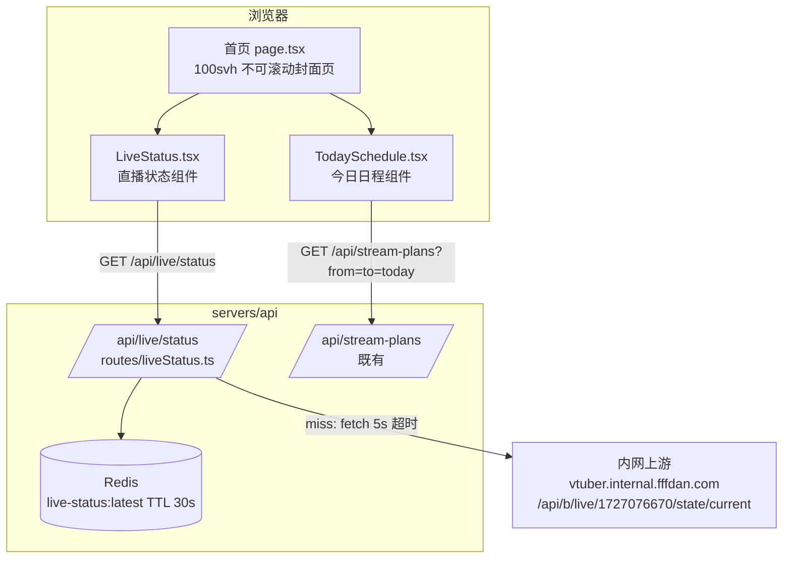
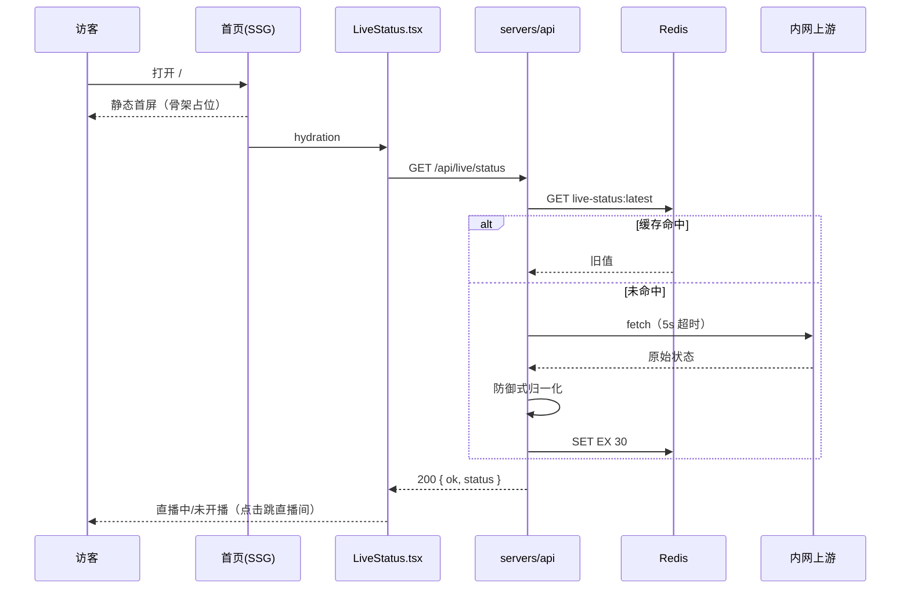

# 首页视觉效果优化 - 技术提案

**功能名称**: 首页视觉效果优化（Home Visual Overhaul）
**关联 PRD**: `docs/product/requirements/draft/2026-08-31-home-visual-overhaul-prd.md`
**技术提案版本**: v1.0
**创建日期**: 2026-08-31
**作者**: sumire workflow
**feat-branch**: `feat/home-visual-overhaul`（需求总分支 `prd/home-visual-overhaul`）

## 1. 概述

### 1.1 背景

现态首页为可滚动多区块页面（hero + 三张入口卡 + 本周日程大卡 + 信息速览条，多行 Footer），本次按 PRD 重构为**一屏封面页**，并新增「直播状态」全链路能力：API 代理内网上游 `http://vtuber.internal.fffdan.com/api/b/live/1727076670/state/current` 对外提供公开读接口 `GET /api/live/status`，前端首屏展示直播状态组件与「今日日程」组件。同时按应援色 `#b4a6bf` 重设调色盘、整体放大字号，并按萌娘百科词条校准静态文案。

现态关键事实（实现时以代码为准）：

- 首页 `apps/bookstore/app/(site)/page.tsx`：纯 Server Component，构建期读 YAML；hero `grid min-h-svh max-w-6xl` 左文案右立绘（`standing-01`，底部渐变 mask），其下依次 `EntryCard`×3、`WeeklySchedule`（仅 `API_CONFIGURED` 挂载）、速览条 `PaperCard`；
- 文案块含 `ColorChip`（应援色复制按钮，`features/home/ColorChip.tsx`）；
- NavBar（`components/NavBar.tsx`）`fixed top-0 h-16` 毛玻璃，内容限宽；Footer（`components/Footer.tsx`）多行（免责声明 / 三外链 / 应援色行）；
- token 全部在 `app/globals.css @theme`（`primary #b4a6bf`、night/raised/soft、paper 系、ink 系、flower/vine 等）；
- API 已有三个内网上游代理先例：`/api/live-history`（公开读 + Redis 缓存 300s + stale-if-error 200 降级，永不 5xx）是最贴近模板；`/api/live-events`、`/api/bilibili/cover` 为 502 口径（面向后台）；
- `API_CONFIGURED = NEXT_PUBLIC_API_BASE_URL !== ""` 是前端唯一配置口径。

### 1.2 目标

- 首页 `100svh` 占满一屏且不可滚动（桌面 + 移动端），首屏元素重排：立绘右半宽×上半高裁剪（移动端全宽）、文案块左下、NavBar 全屏宽、Footer 单行右下；
- 新增 `GET /api/live/status`（公开读、契约先行、短 TTL 缓存、静默降级）与首屏直播状态组件（点击跳直播间）；
- 移除入口卡×3 / 速览条 / 本周日程大卡，新增「今日日程」组件（复用 stream-plans）；
- `@theme` 调色盘按 `#b4a6bf` 重设 + 字阶整体上调，全站生效且后台不破坏；
- `content/profile.yaml` 按萌娘百科补充书籍动漫类型 / 音乐类型 / 游戏偏好类型 / 新逸闻。

### 1.3 范围

- **做**：`app/(site)/page.tsx` 重构；`components/NavBar.tsx`、`components/Footer.tsx` 改造；新增 `features/home/LiveStatus.tsx`、`features/home/TodaySchedule.tsx`；移除 `features/home/EntryCard.tsx`、`features/home/ColorChip.tsx` 及首页 `WeeklySchedule`/速览条引用；`globals.css` token 与字阶调整；`servers/api` 新增 live-status 路由 + 缓存 + 配置 + 契约 `contract/live-status.openapi.yaml`；`infra/aspire/apphost.cs` 注入新环境变量；`content/profile.yaml`（及必要的内容 schema/`/about` 展示）更新；unit/api/e2e 测试覆盖；spec 与设计文档同 PR 同步。
- **不做**：`/calendar`、`/backdoor` 功能逻辑变更；直播状态 SSE 实时推送；直播间内嵌播放；立绘素材本身变更（复用 `standing-01` 现有缩略图）；部署方式变更。

## 2. 技术架构

### 2.1 系统架构图



### 2.2 技术栈

| 层级 | 技术选型 | 说明 |
|------|---------|------|
| 前端 | Next.js（App Router）+ React + TS strict | 纯 SSG（`output: "export"`），改动集中在 `app/(site)/` 与 `features/home/` |
| 样式 | Tailwind v4（`@theme` token） | 调色盘/字阶调整只动 `globals.css @theme`，禁硬编码色值 |
| 后端 | Express 5 + TS strict | 新增 `routes/liveStatus.ts`，沿用依赖注入路由工厂范式 |
| 缓存 | Redis（ioredis） | 复用既有单实例；新键 `live-status:latest` |
| 契约 | OpenAPI 3.1 | 新增 `contract/live-status.openapi.yaml` 单一事实源 |
| 测试 | Vitest + Testing Library / Playwright / tests/api（fetch 黑盒） | 单测 + 契约黑盒 + e2e 回归 |

### 2.3 模块划分

```mermaid
graph LR
    PAGE[app/(site)/page.tsx] --> NAV[components/NavBar.tsx]
    PAGE --> FOOT[components/Footer.tsx]
    PAGE --> LS[features/home/LiveStatus.tsx]
    PAGE --> TS[features/home/TodaySchedule.tsx]
    PAGE --> CSS[app/globals.css @theme]
    LS --> API1[features/home/api.ts<br/>getLiveStatus]
    TS --> API2[features/schedule/api.ts<br/>listPlans 复用]
```

| 模块 | 职责 | 关键技术点 |
|------|------|-----------|
| `app/(site)/page.tsx` | 一屏封面页组装 | `h-svh overflow-hidden`；绝对定位分区（立绘右上/文案左下/footer 右下） |
| `components/NavBar.tsx` | 全屏宽导航 | 内容区去限宽，保留毛玻璃与移动端菜单 |
| `components/Footer.tsx` | 单行 footer | 免责声明（`hidden sm:inline` 类移动端隐藏）+ 三外链；首页右下贴边呈现 |
| `features/home/LiveStatus.tsx` | 直播状态组件（Client） | `API_CONFIGURED` 守卫；固定尺寸骨架；点击新窗口跳直播间 |
| `features/home/TodaySchedule.tsx` | 今日日程组件（Client） | `listPlans(today, today)`；空态文案；固定尺寸骨架 |
| `app/globals.css` | 调色盘 + 字阶 | `@theme` 色 token 按 `#b4a6bf` 衍生调整；`--text-*` 字阶 token 化并整体上调 |
| `servers/api/src/routes/liveStatus.ts` | 直播状态代理 | 公开读、5s 超时、防御式归一化、stale-if-error 200 降级 |
| `servers/api/src/infra/liveStatusCache.ts` | 缓存抽象 | 接口 + Redis 实现 + 内存缺省（照搬 liveHistoryCache 范式） |

## 3. API 设计

### 3.1 API 契约

新增 `contract/live-status.openapi.yaml`（结构照搬 `live-history.openapi.yaml` 的 45 行模板）：公开端点写 `security: []`，降级口径写进 description/responses，**契约先行**，实现与 tests/api 以契约为准。

#### 接口 1: 查询当前直播状态（公开）

- **请求**
  - Method: GET
  - Path: `/api/live/status`
  - 无需登录、无参数（房间号服务端内置固定 `1727076670`）

- **响应**
  - Status: 200（含降级；**永不 5xx**）
  - Body（正常）：
    ```json
    {
      "ok": true,
      "status": {
        "live": true,
        "title": "【歌回】晚好",
        "startedAt": "2026-08-31T12:00:00.000Z"
      }
    }
    ```
  - Body（降级）：
    ```json
    { "ok": false, "status": null }
    ```
  - 字段口径：`live` 是否直播中（归一化唯一强保证字段）；`title`/`startedAt` 防御式可选（上游缺字段时为 `null`）。上游真实响应结构实现阶段实测（参照 online-count PRD v1.1 教训：内网上游行为可能与预期有出入），契约描述中注明归一化与降级语义。

### 3.2 内部接口

- 上游：`GET {LIVE_STATUS_UPSTREAM_URL}`，缺省 `http://vtuber.internal.fffdan.com/api/b/live/1727076670/state/current`（config 内置缺省、缺环境变量不抛错，与既有上游一致）；`AbortSignal.timeout(5000)`；`fetchFn` 可注入便于单测。

## 4. 数据模型

### 4.1 数据库设计

无 Mongo 变更。

### 4.2 缓存设计

- 键：`live-status:latest`（冒号分层，同 `live-history:latest` 风格）；
- TTL：**30s**（直播状态时效性高，远短于 live-history 的 300s；平衡上游压力与状态新鲜度）；
- 策略：读穿缓存 + **stale-if-error**（上游失败时回退旧缓存，仍无则 200 降级体）；
- 抽象：`src/infra/liveStatusCache.ts` = `LiveStatusCache { get(key); set(key, value, ttlSeconds) }` 接口 + `RedisLiveStatusCache`（复用 index.ts 传入的 ioredis）+ `createMemoryLiveStatusCache()`（`createApp` 缺省兜底），照搬 liveHistoryCache 范式。

### 4.3 前端内容模型（profile.yaml 扩展）

`content/profile.yaml` 按萌娘百科补充（Zod schema 同步扩展，均为可选/列表字段）：

- `bookAnimeTypes`: [通俗文学, 悬疑, 恐怖, 奇幻, 冒险, 中式]
- `musicTypes`: [东方系列, 术力口, 电子纯音, r&b]
- `gameGenre`: 模拟经营
- `anecdotes` 追加：「小姨驾到」（2026-08-12 直播中妹妹意外进入直播间，弹幕疯狂喊「小姨」）

`/about` 档案页在喜好区块展示新增字段（沿用既有 Tag/纸页排版）。

## 5. 技术实现方案

### 5.1 核心流程



### 5.2 关键实现点

#### 实现点 1: 一屏不可滚动布局（`page.tsx` + `(site)/layout.tsx`）

- **描述**: 首页改为 `h-svh overflow-hidden` 的相对定位容器，首屏元素绝对定位分区：
  - 立绘：桌面 `absolute right-0 top-0 h-1/2 w-1/2`，移动端 `inset-x-0 w-full`；`<Image>` `object-cover object-top`（顶部锚定裁剪、不变形），保留 `priority`；
  - 文案块：`absolute bottom-* left-*`（padding 桌面 > 移动端），保留四段错峰入场动画（复用 `animate-rise`）；
  - 直播状态/今日日程组件：左侧区域纵向排布（文案块上方），固定尺寸骨架防 CLS；
  - footer 行：首页内 `absolute bottom-* right-*` 右下贴边。
- **技术细节**: 页面不再依赖 `min-h-svh` 流式 hero；移除 `VineDivider grow`、EntryCard 区、`WeeklySchedule`、速览条；`max-w-6xl` 容器去除。移动端为「立绘（顶部 50%）→ 组件 → 文案 → 链接行」纵向紧凑排布，用 flex/grid + `min-h-0` 保证不溢出。
- **风险点**: 移动端竖屏空间紧张——组件尺寸需收紧（字号/间距下调但大于现状基准）；以 375×667 为下限验收视口。

#### 实现点 2: NavBar 全屏宽 / Footer 单行（`components/`）

- **描述**: NavBar 内容容器去 `max-w-*` 限宽，改 `w-full px-*`，行为不变；Footer 重构为单行（`flex` 一行）：免责声明（`hidden sm:inline`，移动端不展示）+ 三外链（数据源 `content/site.yaml` 不变），移除应援色行；首页以绝对定位右下呈现，非首页保持流式底部单行。
- **技术细节**: Footer 保持 Server Component；新增可选呈现参数（如 `floating?: boolean`）区分首页贴边与常规流式，避免复制组件。
- **风险点**: `tests/unit/footer-link.test.tsx`（不出现 `/backdoor` 链接）需保持绿；非首页页面回归。

#### 实现点 3: 直播状态组件（`features/home/LiveStatus.tsx` + `features/home/api.ts`）

- **描述**: Client Component，`API_CONFIGURED` 守卫（未配置返回 `null`）；初始渲染固定尺寸骨架；`useEffect` 请求 `getLiveStatus()`（新请求层函数，复用 `API_BASE_URL`/`credentials` 口径），按契约渲染「直播中」（可点睛色/呼吸点）/「未开播」；`ok:false` 或请求失败渲染中性态（视同未开播但文案中性，以契约为准）；整体为 `<a href={site.links.live} target="_blank" rel="noopener">` 可点击跳直播间。样式基于被移除的 ColorChip 按钮语言改造（药丸形 + 状态点）。
- **风险点**: hydration 布局跳动——骨架与实际内容同尺寸；SSG 下 `site.links.live` 由服务端 props 传入。

#### 实现点 4: 今日日程组件（`features/home/TodaySchedule.tsx`）

- **描述**: Client Component，`API_CONFIGURED` 守卫；复用 `features/schedule/api.ts` `listPlans(today, today)`（当天 ISO 日期）；渲染「今日日程」标题 + 当天计划（`HH:mm 主题`），无计划显示「今日暂无安排」；失败静默为空态；固定尺寸骨架。
- **技术细节**: 日期计算用本地时区当天（与日历页口径一致）；仅取当天，不混入历史直播（同 `apps/bookstore/AGENTS.md` 对 WeeklySchedule 的口径）。
- **风险点**: 无（复用既有请求层与数据形态）。

#### 实现点 5: live-status 服务端（`routes/liveStatus.ts` 等）

- **描述**: 照搬 live-history 处理链：`router.get("/")` → 读缓存命中直回 → 未命中 fetch（5s 超时）→ `!upstream.ok` 抛错 → 防御式归一化（解析失败视为上游失败）→ 写缓存（30s）→ `{ ok: true, status }`；catch 中重读缓存（stale-if-error），仍无 → `200 { ok: false, status: null }`，**永不 5xx**。归一化：从上游响应防御式提取直播状态布尔与可选 `title`/`startedAt`（字段名/信封结构实现阶段实测后定型并回写契约）。
- **装配**: `AppDeps` 加可选 `liveStatusUpstreamUrl`/`liveStatusCache`/`fetchFn` 注入；`app.ts` 挂 `/api/live/status`（注意与既有 kebab-case 域根 `/api/live-history` 的层次差异：本路径为 PRD 指定的两段式 `live/status`，按 PRD 实现）；`index.ts` 注入 Redis 实现；`config.ts` 加 `liveStatusUpstreamUrl: getEnv("LIVE_STATUS_UPSTREAM_URL", "http://vtuber.internal.fffdan.com/api/b/live/1727076670/state/current")`；`apphost.cs` 加同名 `.WithEnvironment`（编排进程环境变量可覆盖，否则回退内网地址）。
- **风险点**: 上游真实响应结构未知——归一化必须防御式（zod 不可用，servers/api 无 zod 依赖，手写类型守卫）；实现阶段实测后回写契约与 spec。

#### 实现点 6: 调色盘与字阶（`globals.css`）

- **描述**: `@theme` 内围绕 `#b4a6bf` 重设色 token（保持 `primary` 值不变，调整 night/raised/soft/paper/ink 等衍生色的明度/饱和度使其更简约协调，具体色值设计阶段定稿并同步 `docs/design/01`）；将设计文档中的字阶（display/h1/h2/body/small/caption）落成 `--text-*` token 并**整体上调**（如 body 0.875→1.0rem、caption 0.75→0.875rem，以设计定稿为准）；页面散用的 Tailwind 内置 `text-6xl/7xl` 等替换为字阶 token。
- **风险点**: 共享 token 全站生效——必须回归 `/about`、`/assets`、`/calendar`、`/backdoor`；对比度按 WCAG AA 校验。

#### 实现点 7: 文案更新（`profile.yaml` + schema + `/about`）

- **描述**: 按 §4.3 补充字段；内容 Zod schema 增加对应可选字段；`/about` 喜好区块展示；既有字段与词条核对（当前 bio/喜好/设定/历程/逸闻已一致，无需改动）。
- **风险点**: 内容规范红线——仅官方公开信息，禁止二次设定。

### 5.3 兼容性

- 前端：无新依赖；`API_CONFIGURED` 守卫语义不变；非首页路由逻辑不变。
- 后端：`AppDeps` 新增均为可选注入，缺省内存缓存 + 内置上游缺省，不破坏既有装配与测试。
- 契约：新增独立文件，既有四份契约不动。

## 6. 技术决策

### 6.1 决策列表

| 决策 | 选项 A | 选项 B | 最终选择 | 原因 |
|------|--------|--------|---------|------|
| 直播状态错误口径 | 200 降级体（stale-if-error，永不 5xx） | 502 `{error}` | A | 面向公开首页，页面不能挂；与 `/api/live-history` 公开读先例一致 |
| 房间号来源 | 服务端内置固定 1727076670 | 契约暴露 roomId 参数 | A | 防 SSRF；与既有直播域口径一致；需求仅为枝堇直播间 |
| 缓存 TTL | 30s | 不缓存 / 300s | A（30s） | 公开页流量直连内网上游不可接受；300s 对「直播中」状态过旧 |
| 契约文件 | 新建 `live-status.openapi.yaml` | 并入 `live-events.openapi.yaml` | A | live-events 是 member+ 鉴权域；live-status 为公开读 + 不同降级口径，参照 live-history 独立成文先例 |
| 上游配置 | 新增 `LIVE_STATUS_UPSTREAM_URL` | 复用 `LIVE_EVENTS_UPSTREAM_URL` 拼路径 | A | 与 live-history「完整 URL 内置缺省」先例一致，语义独立，测试 stub 注入隔离 |
| 今日日程数据 | 复用 `GET /api/stream-plans?from=to=today` | 新增「今日计划」端点 | A | 数据形态完全一致，零后端改动 |
| 立绘裁剪 | CSS `object-cover object-top` + 容器裁剪 | 构建期生成新裁剪缩略图 | A | 纯展示裁剪，CSS 即可；不动素材管道 |
| Footer 形态 | 全站共享组件统一精简为单行（首页加贴边呈现参数） | 仅首页新建独立组件 | A | 单一事实源，避免两个 footer 实现漂移 |
| 字阶落地 | `--text-*` 字阶 token 化并上调 | 逐页面调 Tailwind 字号类 | A | 字阶集中在 @theme，全站一致且便于设计同步 |

### 6.2 依赖与约束

| 类型 | 内容 | 说明 |
|------|------|------|
| 依赖 | 内网上游 `state/current`（结构需实测） | 防御式解析；实测后回写契约/spec |
| 依赖 | 既有 stream-plans 公开读接口 | 今日日程数据源 |
| 约束 | 纯静态导出 `output: "export"` | 直播状态/今日日程仅客户端 hydration 后请求 |
| 约束 | 样式仅用 `@theme` token 色 | `docs/engineering/frontend-rules.md` |
| 约束 | `API_CONFIGURED` 唯一配置口径，未配置不留占位 | `apps/bookstore/AGENTS.md` |
| 约束 | 错误统一 `{ error: string }` 中文；纯 API 仅 `/api/*` | `docs/engineering/backend-rules.md` |
| 约束 | 分支 `<type>/<slug>` 自需求总分支切出，只 merge | `AGENTS.md` |
| 约束 | spec/设计文档同 PR 同步 | `docs/product/spec/README.md` 等 |

## 7. 项目结构

```
apps/bookstore/
├── app/(site)/page.tsx                  # 重构：100svh 不可滚动封面页
├── app/globals.css                      # @theme 调色盘 + 字阶 token
├── components/
│   ├── NavBar.tsx                       # 内容区全屏宽
│   └── Footer.tsx                       # 单行（免责声明移动端隐藏 + 三外链；首页贴边参数）
├── features/home/
│   ├── api.ts                           # 新增 getLiveStatus()
│   ├── LiveStatus.tsx                   # 新增：直播状态组件（Client）
│   ├── TodaySchedule.tsx                # 新增：今日日程组件（Client）
│   ├── ColorChip.tsx                    # 删除（应援色复制按钮移除）
│   └── EntryCard.tsx                    # 删除（入口卡移除）
├── content/profile.yaml                 # 萌娘百科校准补充
└── lib/content/                         # schema 扩展（新字段）

servers/api/src/
├── routes/liveStatus.ts                 # 新增：公开读代理 + stale-if-error
├── infra/liveStatusCache.ts             # 新增：缓存抽象（接口 + Redis + 内存）
├── config.ts                            # 新增 liveStatusUpstreamUrl
├── app.ts / index.ts                    # 挂载 /api/live/status + 注入

contract/live-status.openapi.yaml        # 新增：单一事实源
infra/aspire/apphost.cs                  # 新增 LIVE_STATUS_UPSTREAM_URL 注入

tests/api/src/live-status.test.ts        # 新增：stub（端口 9878）+ 缓存/降级/超时断言
tests/unit/                              # LiveStatus/TodaySchedule/Footer 守卫与渲染测试
tests/e2e/site.spec.ts                   # 首页断言更新（一屏布局/组件存在性/无移除卡片）
```

## 8. 测试策略

### 8.1 测试覆盖要求

- `servers/api/tests/`：liveStatus 路由单测（`fetchFn` 打桩）——正常归一化、缓存命中不打上游、上游 500/超时/结构非法 → 200 降级体、stale-if-error 回旧缓存；
- `tests/api/src/live-status.test.ts`（契约黑盒）：进程内 `node:http` stub 于独立端口 **9878**（环境变量 `LIVE_STATUS_UPSTREAM_URL` 经 Aspire 注入指向 stub）；断言 200 正常体、未登录可访问、缓存命中（stub 调用计数不变）、降级体、超时降级；`REDIS_URL` 直连清 `live-status:latest`（TLS `rejectUnauthorized: false`）；
- `tests/unit/`：
  - `LiveStatus`：`API_CONFIGURED=false` 不渲染；直播中/未开播/降级三态渲染；链接 href/target/rel；
  - `TodaySchedule`：守卫、空态、有计划渲染、失败静默；
  - `Footer`：单行内容、移动端免责声明隐藏（类断言）、无 `/backdoor` 链接（既有用例保持）；
  - 首页：不再渲染 EntryCard/速览条/WeeklySchedule；文案块/bio 存在；
  - 内容 schema：新字段解析与缺省回退；
- `tests/e2e/site.spec.ts`：首页断言更新——一屏无滚动、文案块、footer 三链接、（API 配置时）直播状态与今日日程存在、无入口卡/速览条；`/calendar`、`/about` 回归。

### 8.2 测试类型

| 类型 | 工具 | 覆盖范围 |
|------|------|---------|
| 单元测试 | Vitest + Testing Library | 前端组件三态/守卫、后端路由归一化与降级、内容 schema |
| API 黑盒 | Vitest + fetch（tests/api） | `/api/live/status` 契约行为（含缓存/降级/超时） |
| E2E | Playwright | 首页一屏布局与组件存在性、全站回归 |

## 9. 部署方案

### 9.1 环境规划

| 环境 | 用途 | 部署方式 |
|------|------|---------|
| 本地联调 | Aspire 编排（四资源既有） | `aspire start`；apphost.cs 新增 `LIVE_STATUS_UPSTREAM_URL` 回退注入 |
| GitHub Pages 生产 | 纯静态前端 | 无新增配置项；`NEXT_PUBLIC_API_BASE_URL` 口径不变 |
| api 生产 | 既有部署 | 新增环境变量可选（缺省回退内网地址） |

### 9.2 配置管理

- 新增 `LIVE_STATUS_UPSTREAM_URL`（servers/api config 内置缺省、apphost.cs 回退注入、tests/api stub 覆盖）；
- 其余配置项不变。

## 10. 验收标准

- [ ] 技术方案评审通过
- [ ] Contract `live-status.openapi.yaml` 评审通过
- [ ] 首页桌面/移动端 `100svh` 不可滚动，元素不溢出；立绘右半宽×上半高（移动端全宽）顶部锚定裁剪
- [ ] 文案块左下 + padding；全站无应援色复制按钮；NavBar 全屏宽
- [ ] `GET /api/live/status` 契约行为达标（公开读、缓存、静默降级、永不 5xx）
- [ ] 直播状态组件三态正确、点击跳直播间、守卫与骨架达标
- [ ] 今日日程组件展示当天计划/空态，守卫达标；入口卡/速览条/本周日程大卡已移除且 `/calendar` 不受影响
- [ ] Footer 单行右下（首页），免责声明移动端不展示，三外链正确
- [ ] 新调色盘与字阶全站生效、无硬编码色值、对比度 AA、后台回归通过
- [ ] profile.yaml 与萌娘百科一致（新增字段 + 无二次设定）
- [ ] 单测 / API 测试 / e2e 全绿：`pnpm lint && pnpm test && pnpm build` 全绿
- [ ] spec（`site-pages.md`、`calendar.md`、`backend-live.md`、`frontend-bookstore.md`、`infra.md`、`testing.md`）、设计文档（`01`、`02`）、`servers/api/AGENTS.md`、`tests/api/AGENTS.md` 同 PR 同步

## 11. 相关文档

- 关联 PRD：`docs/product/requirements/draft/2026-08-31-home-visual-overhaul-prd.md`
- 产品 Spec（现态）：`docs/product/spec/site-pages.md`、`docs/product/spec/calendar.md`
- 工程 Spec：`docs/engineering/spec/backend-live.md`、`frontend-bookstore.md`、`infra.md`、`testing.md`
- 设计文档：`docs/design/01-visual-identity.md`、`docs/design/02-page-design.md`
- 开发规范：`docs/engineering/frontend-rules.md`、`docs/engineering/backend-rules.md`、`apps/bookstore/AGENTS.md`、`servers/api/AGENTS.md`、`tests/api/AGENTS.md`
- 参考先例：`docs/engineering/proposals/2026-08-21-online-count-proposal.md`（内网上游实测教训）、`contract/live-history.openapi.yaml`（公开读代理契约模板）
- 外部资料：萌娘百科「枝堇」词条（https://zh.moegirl.org.cn/枝堇）
