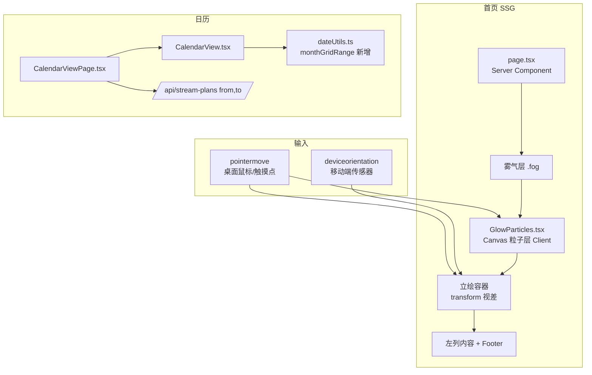
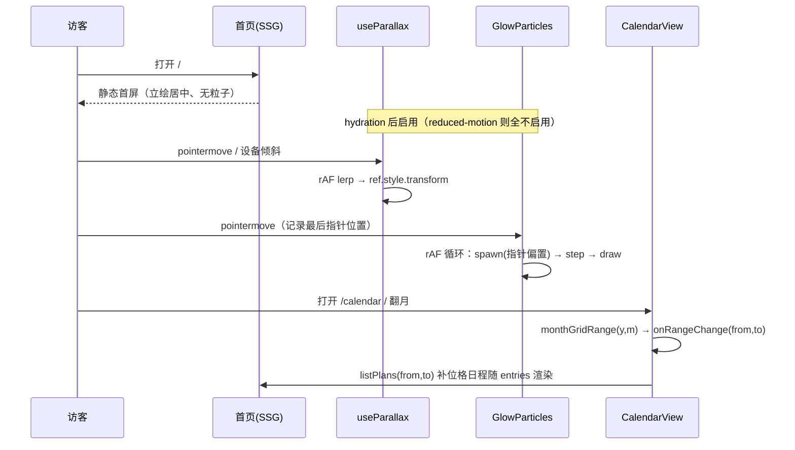

# 首页视觉效果优化 3 期 - 技术提案

**功能名称**: 首页视觉效果优化 3 期（Home Visual FX v3：立绘视差 + 光晕粒子 + 日历跨月日程补全）
**关联 PRD**: `docs/product/requirements/draft/2026-08-31-home-visual-v3-prd.md`
**技术提案版本**: v1.0
**创建日期**: 2026-08-31
**作者**: sumire workflow
**feat-branch**: `feat/home-visual-v3`（需求总分支 `prd/home-visual-v3`）

## 1. 概述

### 1.1 背景

首页封面页（`app/(site)/page.tsx`，100svh 不可滚动）已上线，含雾气层、立绘衬底、左列文案/组件、`Footer floating`。本期按 PRD 增加立绘视差（鼠标 + 移动端传感器）与背景光晕粒子两层互动氛围，并修正 `/calendar` 月视图取数口径：现态 `CalendarView.goMonth` 上抛 `monthRange(y, m)`（当月 1 日~月末）、`CalendarViewPage` 首屏同口径，而月视图实际渲染 `monthGrid` 的 42 格（跨月补位），补位格日程因未取数恒为空。

现态关键事实（实现时以代码为准）：

- 首页 `apps/bookstore/app/(site)/page.tsx`：Server Component；立绘容器 `pointer-events-none absolute inset-x-0 top-[10%] h-[90%] lg:left-auto lg:right-[10%] lg:w-1/2`，内 `<Image priority object-cover object-top>`；雾气为两个 `.fog` div（`globals.css` keyframes 漂移）；
- 粒子/视差目标层序：雾气（底）→ **粒子画布（新增）** → 立绘 → 左列内容/Footer（顶）；
- `lib/useMediaQuery.ts` 现成（`useSyncExternalStore` 封装 matchMedia，SSR 快照固定 false），可用于 `prefers-reduced-motion`；
- 日历：`features/schedule/dateUtils.ts` 有 `monthGrid`（42 格，首末格即展示范围）与 `monthRange`；`CalendarView.goMonth` 调 `onRangeChange(monthRange)`；`CalendarViewPage.currentMonthRange` 首屏用 `monthRange`；`listPlans(from, to)` 区间查询现成；
- 后台 `/backdoor/schedule` 复用同一 `CalendarView`（管理态），口径随组件一并修正；
- 样式规范：仅 `@theme` token 色；氛围动效必须尊重 `prefers-reduced-motion`（`docs/engineering/frontend-rules.md`）。

### 1.2 目标

- 立绘层随鼠标/设备方向产生平滑视差（仅 `transform`，rAF 插值，回中缓动）；
- 背景新增 Canvas 光晕粒子层：随机产生、漂移明灭、生成位置偏向最后指针位置；
- 月视图按展示网格范围取数，跨月补位格日程可展示（弱化/不可点击口径不变）；
- 零新依赖、零 CLS、reduced-motion 全禁用、页面隐藏暂停。

### 1.3 范围

- **做**：`app/(site)/page.tsx` 接线；新增 `features/home/GlowParticles.tsx`、`features/home/glowParticles.ts`（纯函数）、`features/home/useParallax.ts`、`features/home/parallax.ts`（纯函数）；`features/schedule/dateUtils.ts` 新增 `monthGridRange`；`CalendarView.tsx`/`CalendarViewPage.tsx` 取数口径；`globals.css` 仅按需补充（粒子层不需要新增 class，用 inline + Tailwind）；unit/e2e 测试；spec/设计文档/AGENTS.md 同 PR 同步。
- **不做**：后端与契约任何变更；后台视觉变更；粒子与指针的实时交互（吸附/躲避）；多层景深视差；跨月补位格可点击；`WeeklySchedule.tsx`（首页未挂载的遗留组件）处置。

## 2. 技术架构

### 2.1 系统架构图



### 2.2 技术栈

| 层级 | 技术选型 | 说明 |
|------|---------|------|
| 前端 | Next.js（App Router）+ React + TS strict | 纯 SSG（`output: "export"`），动效仅 hydration 后生效 |
| 样式 | Tailwind v4（`@theme` token） | 粒子色运行时 `getComputedStyle` 读 CSS 变量，无硬编码 |
| 绘制 | Canvas 2D（原生，无依赖） | 粒子层；DPR 自适应 |
| 测试 | Vitest + Testing Library / Playwright | 纯函数单测 + 组件守卫测试 + e2e 存在性回归 |

### 2.3 模块划分

```mermaid
graph LR
    PAGE[app/(site)/page.tsx] --> GP[GlowParticles.tsx]
    PAGE --> UP[useParallax.ts]
    GP --> GPF[glowParticles.ts 纯函数]
    UP --> PF[parallax.ts 纯函数]
    CV[CalendarView.tsx] --> DU[dateUtils.ts monthGridRange]
    CVP[CalendarViewPage.tsx] --> DU
```

| 模块 | 职责 | 关键技术点 |
|------|------|-----------|
| `features/home/parallax.ts` | 视差偏移纯函数：指针/倾角 → 目标偏移（归一化、钳制、幅度上限） | 可单测；无 DOM |
| `features/home/useParallax.ts` | 视差 hook：pointermove/deviceorientation 监听、rAF 插值（lerp）、回中、iOS 权限、reduced-motion 禁用 | 直接写 `ref.style.transform`，不触发 React 重渲染 |
| `features/home/glowParticles.ts` | 粒子纯函数：生成位置分布（指针偏置概率）、粒子生命周期推进 | 可单测；注入 `random` 便于确定性测试 |
| `features/home/GlowParticles.tsx` | 粒子画布 Client 组件：rAF 主循环、DPR/resize、hidden 暂停、token 取色 | `pointer-events-none absolute inset-0`，reduced-motion 返回 `null` |
| `features/schedule/dateUtils.ts` | 新增 `monthGridRange(y, m)`：网格首格~末格 | 复用 `monthGrid`，纯函数 |
| `CalendarView.tsx` / `CalendarViewPage.tsx` | 月视图取数改网格范围 | `goMonth` 与首屏两处的口径替换 |

## 3. API 设计

### 3.1 API 契约

无契约变更。仅前端调整 `GET /api/stream-plans?from=…&to=…` 的调用参数（区间本身就在契约支持范围内，见 `contract/stream-plans.openapi.yaml`）。

### 3.2 内部接口

- `parallax.ts`：
  - `pointerOffset(x, y, w, h, max): { dx, dy }`——指针坐标归一化到 `[-1, 1]`，取反（视差反向）× 幅度上限；
  - `tiltOffset(beta, gamma, max): { dx, dy }`——倾角钳制（如 ±25°）后归一化 × 幅度上限；
  - `lerp(current, target, t): number`——帧插值。
- `glowParticles.ts`：
  - `spawnPosition(viewport, pointer | null, bias, radius, random): { x, y }`——`pointer` 存在时以概率 `bias`（约 0.6，定稿以设计为准）在 `radius` 半径内取点（越界钳制到视口），否则全屏均匀；
  - `createParticle(pos, random): Particle`（初速向上微漂、生命周期、尺寸、色相槽位）；
  - `stepParticles(particles, dt): Particle[]`（推进位移/透明度明灭，淘汰寿终粒子）；
  - `maxParticles(area): number`（按视口面积收敛上限）。
- `dateUtils.ts`：`monthGridRange(y, m): { from, to }` = `monthGrid` 首格与末格 `dateStr`。

## 4. 数据模型

### 4.1 数据库设计

无。

### 4.2 缓存设计

无。粒子与视差状态全部内存态，不持久化。

## 5. 技术实现方案

### 5.1 核心流程



### 5.2 关键实现点

#### 实现点 1: 立绘视差（`useParallax.ts` + `page.tsx`）

- **描述**: `page.tsx` 保持 Server Component；立绘容器外包一层 Client 组件（如 `ParallaxLayer.tsx`，`"use client"`，透传 `children`），内部 `useParallax(ref)` 接管 `transform`。输入：桌面 `pointermove`（window 级，被动监听）；移动端 `deviceorientation`——特性检测 `(window as any).DeviceOrientationEvent?.requestPermission` 存在（iOS 13+）时在**首次 `touchend`** 回调中静默 `requestPermission()`，成功则挂监听，拒绝/异常静默放弃；无需权限的平台直接挂监听。
- **技术细节**: 目标偏移由 `parallax.ts` 纯函数计算（幅度上限约 12px，定稿以设计为准）；每帧 `lerp`（t≈0.08）逼近平滑跟随；`pointerleave`/`blur` 目标归零回中；rAF 循环在无输入变化且已收敛时停帧省电。**reduced-motion 处理（一等口径）**：经 `useMediaQuery("(prefers-reduced-motion: reduce)")` **响应式订阅**媒体查询（`useSyncExternalStore`，系统设置变更即触发重渲染）——为真时 hook 不挂任何指针/传感器监听、不请求 iOS 权限、不写 transform；**运行时切换为 reduce** 时 effect 清理函数立即移除全部监听、停 rAF 并将 `ref.style.transform` 复位为空（立绘回中），切回 no-preference 时按正常流程重新启用，全程无需刷新页面。
- **风险点**: hydration 一致性——初始不设置任何 transform（SSG 与首渲染一致），首帧输入后才写入；iOS 权限必须在用户手势回调内调用，不得页面加载即弹；reduced-motion 下的清理必须覆盖「已挂监听后切换」的路径（effect 依赖媒体查询值，切换即重跑清理）。

#### 实现点 2: 光晕粒子（`GlowParticles.tsx` + `glowParticles.ts`）

- **描述**: Client 组件渲染 `<canvas aria-hidden className="pointer-events-none absolute inset-0">`，z 序置于雾气之后/立绘之前（page.tsx 中 DOM 序先于立绘容器即可）。主循环 rAF：按生成速率（与上限挂钩）调用 `spawnPosition`——最后指针位置存在时以概率 bias 在其 radius（约 160px，定稿以设计为准）内生成，否则全屏均匀；`stepParticles` 推进（缓慢上漂 + alpha 正弦明灭）；绘制用径向渐变圆点（`createRadialGradient` 或 `shadowBlur` 二选一，以性能实测为准）。
- **技术细节**: 取色——挂载时 `getComputedStyle(document.documentElement).getPropertyValue("--color-flower"/"--color-primary"/"--color-eye")` 读 token，粒子随机取其一；粒子数上限 `maxParticles(width*height)`（桌面约 ≤70）；`resize` 重建画布尺寸并按 DPR 缩放；`visibilitychange`（`document.hidden`）暂停/恢复 rAF；卸载清理全部监听与 rAF；`pointermove`/`pointerdown` 仅记录坐标（ passive，不 preventDefault ）。**reduced-motion 处理（一等口径）**：同样经 `useMediaQuery("(prefers-reduced-motion: reduce)")` 响应式订阅——为真时组件返回 `null`，**不创建 canvas、不启动 rAF**；**运行时切换为 reduce** 时 React 卸载组件（effect 清理移除全部监听、取消 rAF），切回时重新挂载初始化，无需刷新页面。
- **风险点**: 低端机 GPU/CPU——上限 + 暂停 + 无 blur 滤镜（用低 alpha 渐变模拟柔光，避免 `filter: blur` 逐帧开销）；SSG 输出不含 canvas 初始内容，无 hydration 差异。

#### 实现点 3: 日历取数口径（`dateUtils.monthGridRange` + 两处接线）

- **描述**: `dateUtils.ts` 新增 `monthGridRange(y, m)`（`const cells = monthGrid(y, m); return { from: cells[0].dateStr, to: cells[41].dateStr }`）。`CalendarView.goMonth` 由 `monthRange` 改为 `monthGridRange` 上抛；`CalendarViewPage.currentMonthRange()` 同样改为当前月网格范围（函数更名 `currentGridRange`）。渲染侧零改动：`DayCell` 已对补位格渲染 `DaySummaries`（`showEmpty=false`），取数到位后摘要自然出现；补位格 `opacity-35` 弱化与 `clickable = inMonth && …` 不可点击口径保持不变。
- **技术细节**: 周视图（< 640px）`goWeek`/`goToday` 口径不动；后台 `/backdoor/schedule` 复用同组件，其翻月重拉随之变为网格范围（与编辑后「重拉当前月区间」逻辑兼容——该处按当前选中日期所在月取数，一并改用 `monthGridRange`，保证编辑落在补位格时回显不丢）。
- **风险点**: 拉取区间变宽（最多 42 天）——数据量可控（`stream-plans` 为轻量集合）；区间跨三个月边界（如 1 月网格含上年 12 月日期）由 `monthGrid` 既有逻辑保证正确。

#### 实现点 4: 接线与层序（`page.tsx`）

- **描述**: 在雾气层之后、立绘容器之前插入 `<GlowParticles />`；立绘容器移入 `ParallaxLayer`（或给容器挂 ref）。全部新增元素 `aria-hidden`、`pointer-events-none`，不参与布局（`absolute`），`100svh overflow-hidden` 与 CLS 不变。
- **风险点**: 移动端层叠顺序——粒子在立绘之下避免糊在人物上；Footer 毛玻璃条不受影响。

### 5.3 兼容性

- 无新依赖；`API_CONFIGURED` 口径无关（日历守卫不变）；非首页路由零改动；
- 传感器/指针 API 全部特性检测，缺失静默降级；`prefers-reduced-motion` 下粒子不渲染、视差不挂监听；
- 纯静态导出不受影响（动效全在客户端 hydration 后）。

## 6. 技术决策

### 6.1 决策列表

| 决策 | 选项 A | 选项 B | 最终选择 | 原因 |
|------|--------|--------|---------|------|
| 粒子实现 | Canvas 2D 单画布 | DOM 节点 + CSS 动画 | A | 数十粒子 DOM 节点 + 模糊滤镜逐帧开销高；Canvas 一处绘制、易控上限 |
| 粒子取色 | 运行时读 `@theme` CSS 变量 | TS 常量硬编码色值 | A | 符合「仅 token 色」规范，调色盘变更自动跟随 |
| 视差输入 | 自实现 pointermove + deviceorientation | 引入动画库（framer-motion 等） | A | 需求简单、零依赖约束；库体积不值得 |
| 视差写样式 | rAF 直写 `ref.style.transform` | `useState` 驱动重渲染 | A | 高频输入下避免 React 重渲染 |
| iOS 传感器权限 | 首次触摸静默请求，失败降级 | UI 提供「开启动态」按钮 | A | PRD 要求无占位入口/提示 UI；拒绝后无残留状态 |
| reduced-motion | 粒子不渲染 + 视差禁用，**响应式订阅媒体查询**（运行时切换即时停用/清理/复位，无需刷新） | 仅挂载时读取一次 / 仅减速减幅 | A | JS 驱动动效无法靠 CSS 媒体查询兜底，必须以 `useMediaQuery`（useSyncExternalStore）订阅变更；与站点既有氛围动效口径一致（`.fog` 直接停动画） |
| 月视图取数 | 网格范围（首格~末格 42 格） | 月区间 + 固定前后缓冲 | A | 精确匹配展示范围，无冗余无遗漏；`monthGrid` 现成 |
| 补位格点击 | 维持不可点击 | 同步放开点击 | A | PRD 本期口径：仅补齐展示；放开点击涉及翻月联动，列入后续 |

### 6.2 依赖与约束

| 类型 | 内容 | 说明 |
|------|------|------|
| 依赖 | 既有 `monthGrid`/`listPlans`/`useMediaQuery` | 全部复用，无新增包 |
| 约束 | 纯静态导出 `output: "export"` | 动效仅 hydration 后启用，SSG 首渲染无差异 |
| 约束 | 样式仅用 `@theme` token 色 | `docs/engineering/frontend-rules.md`；Canvas 运行时读 CSS 变量 |
| 约束 | 氛围动效尊重 `prefers-reduced-motion` | 粒子不渲染、视差禁用 |
| 约束 | 不出现未上线功能占位入口 | 传感器权限失败静默，不做提示 UI |
| 约束 | 分支 `<type>/<slug>` 自需求总分支切出，只 merge | `AGENTS.md` |
| 约束 | spec/设计文档同 PR 同步 | `site-pages.md`、`calendar.md`、`docs/design/02`、`apps/bookstore/AGENTS.md` |

## 7. 项目结构

```
apps/bookstore/
├── app/(site)/page.tsx                 # 接线：GlowParticles 层 + 立绘容器挂视差
├── features/home/
│   ├── ParallaxLayer.tsx               # 新增：视差容器（Client，透传 children）
│   ├── useParallax.ts                  # 新增：指针/传感器监听 + rAF 插值
│   ├── parallax.ts                     # 新增：偏移/倾角/lerp 纯函数
│   ├── GlowParticles.tsx               # 新增：粒子画布（Client）
│   └── glowParticles.ts                # 新增：生成/推进/上限纯函数
├── features/schedule/
│   ├── dateUtils.ts                    # 新增 monthGridRange
│   ├── CalendarView.tsx                # goMonth 上抛网格范围
│   └── CalendarViewPage.tsx            # 首屏按当前月网格范围拉取
└── app/backdoor/(dashboard)/schedule/  # 同组件口径同步（编辑后重拉改 monthGridRange）

tests/unit/                             # parallax/glowParticles/monthGridRange 纯函数 + 组件守卫
tests/e2e/site.spec.ts                  # 首页粒子 canvas 存在性、日历补位格日程回归
```

## 8. 测试策略

### 8.1 测试覆盖要求

- 纯函数（TDD 先行）：
  - `parallax.ts`：边界（指针在四角/中心取反）、幅度钳制、倾角钳制（±25°）、lerp 收敛；
  - `glowParticles.ts`：注入确定性 `random`——无指针时全屏均匀；有指针时 bias 命中落在 radius 内且越界钳制；`stepParticles` 明灭与寿终淘汰；`maxParticles` 面积缩放上限；
  - `dateUtils.monthGridRange`：2026-08 → `{ from: "2026-07-27", to: "2026-09-06" }`；跨年（2027-01）首格落在 2026-12；
- 组件（Testing Library，媒体查询以 matchMedia mock 控制并可触发变更回调）：
  - `ParallaxLayer`：reduced-motion 时不挂监听/不写 transform；普通环境 pointermove 后 transform 更新（rAF 打桩）；**运行时切换为 reduce 后监听移除、transform 复位为空**，切回后恢复；
  - `GlowParticles`：reduced-motion 返回 `null`（不创建 canvas）；普通环境渲染 `canvas[aria-hidden]` 且卸载清理（不抛错）；**运行时切换为 reduce 后 canvas 卸载、rAF 取消**；
  - `CalendarView`：`goMonth` 上抛网格范围（mock `onRangeChange` 断言 from/to）；补位格有 entries 时渲染摘要、无 entries 不渲染「—」；
- `tests/e2e/site.spec.ts`：首页存在粒子 canvas 且 `pointer-events-none`；立绘层存在；**`page.emulateMedia({ reducedMotion: "reduce" })` 下粒子 canvas 不存在、立绘无 transform**；（API 配置时）`/calendar` 月视图补位格日程展示回归、翻月回归；移动端周视图回归。

### 8.2 测试类型

| 类型 | 工具 | 覆盖范围 |
|------|------|---------|
| 单元测试 | Vitest + Testing Library | 纯函数边界、组件守卫/监听挂载、CalendarView 上抛口径 |
| E2E | Playwright | 首页粒子/立绘存在性、日历跨月补位格日程、周视图回归 |
| API 黑盒 | —（无后端变更） | 不涉及 |

## 9. 部署方案

### 9.1 环境规划

| 环境 | 用途 | 部署方式 |
|------|------|---------|
| 本地联调 | Aspire 编排（既有四资源） | `aspire start`，无新增配置 |
| GitHub Pages 生产 | 纯静态前端 | 无新增配置项 |

### 9.2 配置管理

无新增配置项/环境变量。

## 10. 验收标准

- [ ] 技术方案评审通过
- [ ] 桌面端立绘随鼠标平滑视差、移出回中；移动端传感器视差生效（iOS 权限静默请求，失败降级）
- [ ] 粒子随机产生、漂移明灭，指针附近密度明显更高；`document.hidden` 暂停；粒子数上限达标
- [ ] `prefers-reduced-motion` 下粒子不渲染、视差禁用
- [ ] 首页保持 100svh 不可滚动、无 CLS、无新增依赖
- [ ] `/calendar` 月视图按展示网格范围取数（2026-08 → 2026-07-27 ~ 2026-09-06），补位格日程可见、弱化/不可点击口径不变；翻月口径一致；后台同组件同步
- [ ] 移动端周视图口径不变
- [ ] 单测 / e2e 全绿：`pnpm lint && pnpm test && pnpm build` 全绿
- [ ] spec（`site-pages.md`、`calendar.md`）、设计文档（`02-page-design.md`）、`apps/bookstore/AGENTS.md` 同 PR 同步

## 11. 相关文档

- 关联 PRD：`docs/product/requirements/draft/2026-08-31-home-visual-v3-prd.md`
- 产品 Spec（现态）：`docs/product/spec/site-pages.md`、`docs/product/spec/calendar.md`
- 前序提案（已上线）：`docs/engineering/proposals/2026-08-31-home-visual-overhaul-proposal.md`
- 设计文档：`docs/design/01-visual-identity.md`、`docs/design/02-page-design.md`
- 开发规范：`docs/engineering/frontend-rules.md`、`apps/bookstore/AGENTS.md`
- 契约（不变）：`contract/stream-plans.openapi.yaml`
