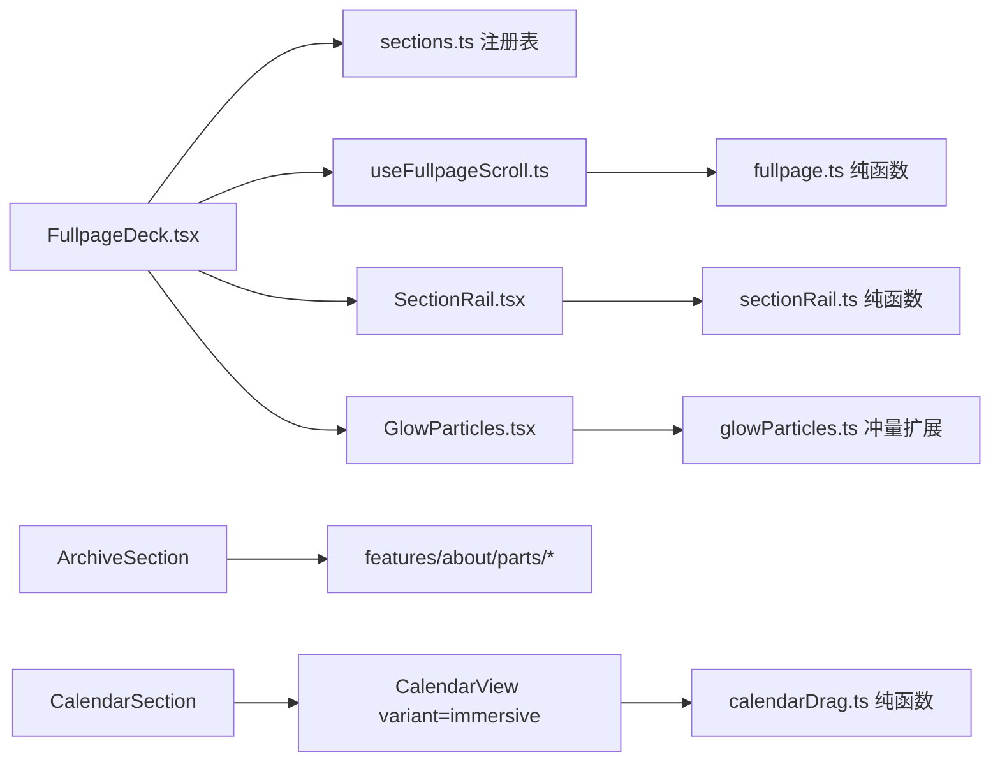
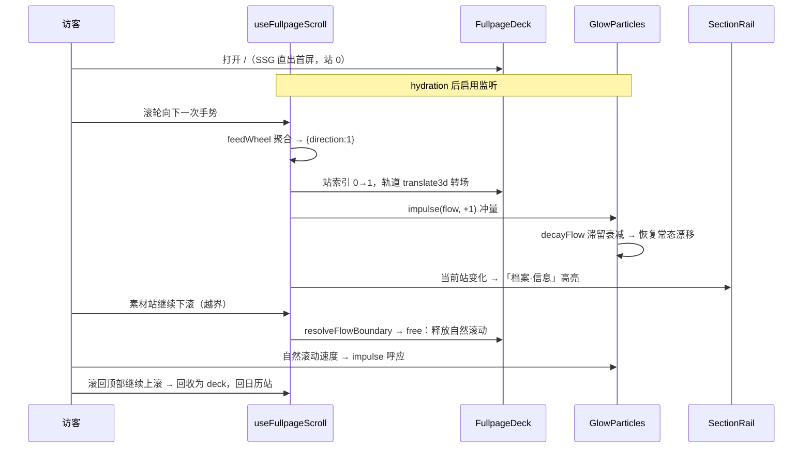

# 首页视觉效果优化 4 期 - 技术提案

**功能名称**: 首页视觉效果优化 4 期（Home Visual FX v4：整页滚动叙事 · 档案五页 · 全幅日历 · 全幅素材）
**关联 PRD**: `docs/product/requirements/draft/2026-09-01-home-visual-v4-prd.md`
**技术提案版本**: v1.0
**创建日期**: 2026-09-01
**作者**: sumire workflow
**feat-branch**: `feat/home-visual-v4`（需求总分支 `prd/home-visual-v4`）

## 1. 概述

### 1.1 背景

按 PRD，首页 `/` 由「100svh 不可滚动封面页」升级为**整页滚动叙事容器**：「首页 → 档案 P1~P5 → 日历 → 素材」逐屏翻页，素材区为最后一站并释放为自然滚动直至结尾 + Footer；导航锚点化；新增竖向树状指示器；粒子常驻并获得滚动冲量。

现态关键事实（实现时以代码为准）：

- 首页 `app/(site)/page.tsx`（Server Component，80 行）：层序 雾气（`.fog`）→ `<GlowParticles/>` → `<ParallaxLayer>`（立绘）→ 左列内容（LiveStatus/TodaySchedule/文案块）→ `Footer floating`；`100svh overflow-hidden`；
- `features/home/`：`glowParticles.ts`（`spawnPosition`/`createParticle`/`stepParticles`/`maxParticles`，注入 random）、`GlowParticles.tsx`（Canvas rAF 主循环、DPR/resize、hidden 暂停、token 取色）、`parallax.ts`/`useParallax.ts`/`ParallaxLayer.tsx`（视差）、`LiveStatus.tsx`/`TodaySchedule.tsx`；
- 档案 `/about`：`app/(site)/(content)/about/page.tsx` 单文件 208 行 Server Component，内含 7 个 `<section>`（信息卡/设定故事/喜好×若干/历程/逸闻/外链），`features/about/` 仅 `VineTimeline.tsx`；
- 素材：`features/assets/AssetGallery.tsx`（分类筛选 + 网格 + Lightbox），`/assets` 经 `(content)/layout.tsx` 限宽 72rem；
- 日历：`features/schedule/CalendarView.tsx`（月/周响应式，`onRangeChange` 上抛网格范围、`onSelectDay`）、`CalendarViewPage.tsx`（公开页主体）、后台 `/backdoor/schedule` 复用同一 `CalendarView`；
- 全局：`components/NavBar.tsx`（固定雾面玻璃，`Link` 路由跳转）、`components/Footer.tsx`（floating/流式两形态）、`lib/useMediaQuery.ts`（响应式媒体查询订阅）；
- 样式规范：仅 `@theme` token 色；公开站氛围层对 reduced-motion 不降级（展示向口径，视差/粒子/转场/冲量与常规一致），后台仍严格遵循 frontend-rules 的 reduced-motion 规范。

### 1.2 目标

- 数据驱动的站序列注册表作为单一事实源，导航、指示器、翻页容器三方同源；
- 自实现翻页引擎：一次手势一屏、translate3d 轨道转场、键盘可达、素材尾部自然滚动无缝衔接、hash 可定位可分享；
- 粒子常驻 + 滚动冲量（翻页方向加速、停止后滞留衰减）；
- 档案五屏立绘左右交替；日历 immersive 全幅变体（含拖拽翻月）；素材全幅化；
- 零新依赖、零 CLS、公开站氛围层不降级 reduced-motion、SSG 首屏直出无 hydration 差异。

### 1.3 范围

- **做**：`features/home/` 新增 `sections.ts`（站注册表）、`fullpage.ts`（纯函数）、`useFullpageScroll.ts`、`FullpageDeck.tsx`、`SectionRail.tsx`/`sectionRail.ts`、`sections/`（Hero/Archive/Calendar/Assets 各屏）；`glowParticles.ts`/`GlowParticles.tsx` 冲量扩展与常驻化；`features/about/` 抽五组内容组件；`CalendarView.tsx` 新增 `variant="immersive"` + `calendarDrag.ts`；`AssetGallery` 全幅化；`NavBar` 锚点化与选中态；`app/(site)/page.tsx` 重构接线；独立路由页复用同源组件；unit/e2e 测试；spec/设计文档/AGENTS.md 同 PR 同步。
- **不做**：后端与契约任何变更；后台 `/backdoor` 任何视觉/交互变更（日历保持 panel 默认）；周视图拖拽；粒子与指针实时交互；删除独立路由。

## 2. 技术架构

### 2.1 系统架构图

```mermaid
graph TD
    subgraph 首页 /（SSG）
      PAGE[page.tsx<br/>Server Component] --> DECK[FullpageDeck.tsx<br/>Client 容器]
      DECK --> GP[GlowParticles<br/>常驻粒子层 fixed]
      DECK --> TRACK[翻页轨道 translate3d]
      TRACK --> HERO[HeroSection 首页]
      TRACK --> ARCH[ArchiveSection ×5<br/>立绘左右交替]
      TRACK --> CAL[CalendarSection<br/>CalendarView immersive]
      TRACK --> ASSETS[AssetsSection<br/>AssetGallery 全幅]
      DECK --> RAIL[SectionRail 指示器]
      DECK --> FLOW[素材自然滚动区 + Footer]
    end
    subgraph 输入
      WHEEL[wheel / touch / keyboard] --> UFS[useFullpageScroll]
      UFS --> TRACK
      UFS -->|翻页冲量事件| GP
      SCROLL[素材区自然滚动速度] -->|冲量| GP
    end
    NAV[NavBar 锚点] --> DECK
    subgraph 复用
      ARCH --> PARTS[features/about 五组内容组件]
      ABOUTPAGE[/about 路由/] --> PARTS
      CALPAGE[/calendar 路由/] --> CAL
      ASSETSPAGE[/assets 路由/] --> ASSETS
    end
```

### 2.2 技术栈

| 层级 | 技术选型 | 说明 |
|------|---------|------|
| 前端 | Next.js（App Router）+ React + TS strict | 纯 SSG（`output: "export"`），翻页行为仅 hydration 后启用 |
| 样式 | Tailwind v4（`@theme` token） | 转场/指示器仅用 token 色；Canvas 运行时读 CSS 变量（沿用） |
| 绘制 | Canvas 2D（原生，无依赖） | 粒子层扩展冲量流场 |
| 测试 | Vitest + Testing Library / Playwright | 纯函数单测 + 组件守卫 + e2e 回归 |

### 2.3 模块划分



| 模块 | 职责 | 关键技术点 |
|------|------|-----------|
| `features/home/sections.ts` | 站序列注册表（id/hash/标题/树层级/是否需 API），单一事实源 | 纯数据 + 类型；`API_CONFIGURED` 过滤日历站 |
| `features/home/fullpage.ts` | 翻页纯函数：手势聚合、阈值方向判定、目标站索引、素材区释放/回收边界、easing | 无 DOM 可单测；注入 `now` 便于确定性测试 |
| `features/home/useFullpageScroll.ts` | 输入监听（wheel/touch/keyboard 被动）、状态机、轨道 transform 驱动、hash 同步、冲量事件派发 | rAF px 插值编排；直写 style 不触发重渲染；公开站氛围层不降级 reduced-motion |
| `features/home/FullpageDeck.tsx` | Client 容器：渲染站序列、常驻粒子层、SectionRail、素材自然滚动区 + Footer | SSG 首屏直出（初始站 0，无 transform） |
| `features/home/SectionRail.tsx` + `sectionRail.ts` | 竖向树状指示器：树模型、当前节点计算、点击跳转 | 树数据来自注册表；键盘可达 |
| `features/home/sections/HeroSection.tsx` 等 | 各屏组件（首页/档案/日历/素材） | 内容组件复用；每屏 `h2` 标题层级 |
| `features/about/parts/*` | 五组内容组件（Profile/Story/Taste/Journey/Trivia） | 从 `/about/page.tsx` 抽取，文案不变；`/about` 与首页共用 |
| `features/home/glowParticles.ts` | 新增全局流场：`createFlow`/`applyFlow(particles, flow, dt)`/`decayFlow(flow, dt)` | 冲量注入 + 指数衰减；reduce 下不注入 |
| `features/home/GlowParticles.tsx` | 常驻 fixed 视口层；接收冲量源（翻页事件 + 自然滚动速度） | 既有口径（上限/hidden 暂停/token 取色）不变 |
| `features/schedule/CalendarView.tsx` | 新增 `variant?: "panel" \| "immersive"`（默认 panel 现样式） | immersive：直角中字全幅、侧翻月竖条按钮、拖拽 |
| `features/schedule/calendarDrag.ts` | 拖拽纯函数：位移累积、阈值判定、方向 → 翻月意图 | 注入阈值可单测 |
| `features/assets/AssetGallery.tsx` | 全幅化：容器去 72rem 限宽、网格列数随屏宽扩展 | 其余口径不变 |
| `components/NavBar.tsx` | 导航项 href 锚点化（`/#archive` 等）、当前模块选中态 | 选中态来自 hash/自定义事件；外链不变 |

## 3. API 设计

### 3.1 API 契约

无契约变更。日历取数仍走 `GET /api/stream-plans?from=…&to=…`（网格范围口径不变，见 `contract/stream-plans.openapi.yaml`）。

### 3.2 内部接口

- `sections.ts`：
  - `type SectionId = "hero" | "archive-1" | … | "archive-5" | "calendar" | "assets"`；
  - `SECTIONS: SectionDef[]`（`{ id, hash, navKey: "home"|"archive"|"calendar"|"assets", title, parent?: SectionId }`，档案 5 站 `parent` 为逻辑分组 `archive`）；
  - `visibleSections(apiConfigured: boolean): SectionDef[]`（过滤日历站）。
- `fullpage.ts`：
  - `createGestureState()` / `feedWheel(state, deltaY, now): GestureIntent | null`——聚合一次滚轮手势的 delta，超过阈值且手势冷却结束后返回 `{ direction: 1 | -1 }`；一次手势只产出一个意图；
  - `feedTouch(start, current, now): GestureIntent | null`——触屏滑动同理（位移阈值 + 速度下限）；
  - `nextIndex(current, direction, count): number`——钳制在 `[0, count-1]`；
  - `resolveFlowBoundary(mode, scrollTop, direction): "deck" | "free"`——素材站向下滚动越界时释放为自然滚动（`free`），自然滚动区 `scrollTop <= 0` 且继续上滚时回收为翻页（`deck`）；
  - `easeInOutCubic(t): number`。
- `sectionRail.ts`：`buildTree(sections): RailNode[]`（模块 → 子内容两层）；`activeNode(sections, index): SectionId`。
- `glowParticles.ts`（扩展）：
  - `createFlow(): { vx, vy }`；
  - `impulse(flow, direction, strength): Flow`——翻页/滚动注入瞬时速度（方向 ±，强度与滚动速度挂钩、有上限）；
  - `decayFlow(flow, dt, halfLife): Flow`——指数衰减（滞留感），低于阈值归零；
  - `stepParticles(particles, dt, flow)`——在既有漂移之上叠加流场速度（既有签名以可选参数扩展，不破坏现调用）。
- `calendarDrag.ts`：`createDrag()` / `feedPointer(drag, dx): void` / `release(drag, threshold): -1 | 0 | 1`（左拖超阈值 → 下月 `1`，右拖 → 上月 `-1`，未超阈值 `0`）。

## 4. 数据模型

### 4.1 数据库设计

无。

### 4.2 缓存设计

无。翻页/冲量/拖拽状态全部内存态；URL hash 仅作定位与分享，不持久化。

## 5. 技术实现方案

### 5.1 核心流程



### 5.2 关键实现点

#### 实现点 1: 翻页引擎（`fullpage.ts` + `useFullpageScroll.ts` + `FullpageDeck.tsx`）

- **描述**: `FullpageDeck` 渲染外层 `100svh overflow-hidden` 容器与纵向轨道（`height: N*100svh`，`translate3d(0, -index*100svh, 0)`）。`useFullpageScroll` 挂 window 级被动监听：`wheel` 经 `feedWheel` 聚合（同一次滚动事件的连续 delta 累加，超过阈值且距上次翻页超过冷却期才产出方向意图——保证一次手势一屏、不连跳）；`touchstart/touchmove/touchend` 同理（位移阈值 + 方向）；键盘 `↓/↑/PageDown/PageUp/Home/End` 直接映射意图。翻页时更新站索引：转场用 rAF px 插值（`transform` + 粒子流场耦合，时长约 800ms），公开站氛围层对 reduced-motion 不降级。转场开始即向粒子层派发冲量事件（自定义事件或回调注册）。站索引变化同步 `location.hash`（`#archive-1` 等，`history.replaceState` 不污染历史栈）；挂载时解析初始 hash 定位到对应站（无转场直落）。
- **技术细节**: 素材区衔接——站索引到达素材站且继续下滚越界时，`resolveFlowBoundary` 切到 `free` 模式：容器取消 `overflow-hidden`、轨道位移固定在素材站，浏览器接管自然滚动（素材内容 + Footer 在文档流中）；`free` 模式下 `scroll` 监听计算滚动速度喂粒子冲量；`scrollTop <= 0` 且继续上滚（wheel 向上 / 触屏下滑）时切回 `deck` 并翻到上一站。两模式切换不得产生跳动（切换瞬间轨道位移与文档滚动位置对齐）。
- **风险点**: hydration 一致性——SSG 首渲染即站 0、无 transform、无 hash，初始 hash 定位在 hydration 后 effect 中执行；`wheel` 必须 passive 且**不** `preventDefault`（`overflow-hidden` 已天然阻断滚动）；触控板惯性滚动的高频小 delta 由聚合阈值吸收；`free` 模式边界抖动（scrollTop 在 0 附近振荡）用死区（如 > 2px 才判定离开顶部）消除；弹层（Lightbox/当日详情）打开时屏蔽翻页输入（既有滚动锁定口径扩展）。

#### 实现点 2: 常驻粒子与滚动冲量（`GlowParticles.tsx` + `glowParticles.ts` 扩展）

- **描述**: `GlowParticles` 由首屏 `absolute inset-0` 改为 `fixed inset-0` 常驻视口层（z 序保持在雾气之上/内容之下，全程 `pointer-events-none`、`aria-hidden`），覆盖所有模块与素材自然滚动区。新增全局流场：粒子每帧位移 = 既有缓慢漂移 + `flow` 速度；翻页开始/自然滚动时 `impulse(flow, direction, strength)` 注入瞬时速度（strength 与滚动速度挂钩、设上限），随后 `decayFlow` 按半衰期（约 0.4~0.6s，定稿以设计为准）指数衰减——视觉上即「翻页瞬间粒子整体下坠/上浮加速，随后缓缓平复」，滞留时长达 PRD 的 0.5~1.5s 量级。
- **技术细节**: 冲量源两处——`useFullpageScroll` 翻页事件（强度固定档位）、`free` 模式滚动速度（连续喂入，帧间仍衰减）；公开站氛围层对 reduced-motion 不降级（冲量照常注入）；`document.hidden` 暂停口径不变。
- **风险点**: 连续冲量叠加——`impulse` 对 flow 取钳制后的合成（非无限累加）；低端机——流场只是每帧一次向量加法，无额外绘制开销。

#### 实现点 3: 竖向树状指示器（`SectionRail.tsx` + `sectionRail.ts`）

- **描述**: 桌面端固定于视口右侧边缘的竖向指示器：竖轴为细藤蔓线（CSS 渐变，token 色），模块节点为主节点（微光紫花圆点 + 文字），档案 5 个子内容为主节点下的缩进子节点（树状连线）。数据由 `buildTree(visibleSections(...))` 生成，与翻页容器同源。当前站经 `activeNode` 映射高亮（子节点精确到站，父节点在档案任一站时呈次级高亮）；点击节点调 deck 跳转（同翻页转场）。移动端（< 640px）收纳为仅主节点的极简形态（以实现定稿为准）。
- **技术细节**: 组件为 `<nav aria-label="页面位置">`，节点为 `<a href="#...">`（键盘可达、可读屏），点击拦截走平滑翻页；公开站氛围层对 reduced-motion 不降级（节点脉冲/生长动效照常）。
- **风险点**: 窄屏遮挡内容——指示器整体 `pointer-events` 仅作用于节点，轴体穿透；素材自然滚动区高亮保持「素材」。

#### 实现点 4: 档案五屏与内容复用（`features/about/parts/*` + `ArchiveSection`）

- **描述**: 将 `/about/page.tsx` 的 7 个 section 抽取为 `features/about/parts/` 五组组件：`ProfilePart`（信息卡）、`StoryPart`（设定故事纸页）、`TastePart`（喜好标签组）、`JourneyPart`（历程 `VineTimeline`）、`TriviaPart`（逸闻卡片 + 官方外链按钮组）。文案零改动。`/about` 路由页改为顺序渲染五组组件（保留页头引文与 `(content)/layout.tsx` 框架）。首页档案屏 `ArchiveSection` 参数化（`part: 1..5`）：桌面端 `grid` 左右分栏——立绘侧 + 内容侧，单数屏 `立绘→内容`、双数屏 `内容→立绘`（DOM 序固定内容在后/前由 `order` 或条件类切换）；移动端纵向（立绘上、内容下，立绘高度收敛）。立绘素材从 `public/assets/` 现有立绘/插画选取（P1 `character-full-02`，其余定稿以设计为准），`pointer-events-none`、按屏懒加载。每屏内容区居中收缩（`max-h` 内自适应），桌面一屏放下、不产生屏内滚动条；内容超长的屏（如 P2 设定、P4 历程）通过字号/间距收敛与内容区 `overflow` 裁剪策略定稿，以不溢出视口为验收线。
- **风险点**: 内容量差异导致各屏密度不一——以实现期逐屏调校为准，必要时 P2/P4 内容区允许内部压缩（小一号字号/紧凑行距），验收以「桌面不溢出、移动不截断关键信息」为准；历程时间轴在窄半栏内的交错布局需降级为单侧（复用既有移动端单侧口径）。

#### 实现点 5: 日历 immersive 变体与拖拽翻月（`CalendarView.tsx` + `calendarDrag.ts`）

- **描述**: `CalendarView` 新增可选 prop `variant?: "panel" | "immersive"`，默认 `"panel"` 完全保持现样式与 DOM（后台零影响）。`immersive` 变体：容器 `w-full` 占满屏宽、日期格直角（去圆角类）、日期数字与摘要字号上调（`text-sm`→`text-base` 量级，定稿以设计为准）；翻月按钮渲染为日历左右两侧的竖条按钮（`absolute inset-y-0 left-0/right-0`，高度占满日历区域，图标 + hover 态，token 色），替代头部小按钮（头部保留月份标题与「今天」）。拖拽翻月：日历网格区挂 `pointerdown/pointermove/pointerup`（被动、不 preventDefault，触屏走 `touch-action: pan-y` 保留纵向滚动手势），横向位移累积进 `calendarDrag` 状态，`release` 超阈值（如约 60px）返回方向并触发与按钮一致的 `goMonth`；未超阈值归零，不影响 `onSelectDay` 点击。
- **技术细节**: `CalendarViewPage` 传 `variant="immersive"`，`/calendar` 路由同步新样式；月视图独有——周视图（< 640px）渲染分支不传拖拽、布局不变；拖拽中设置 `isDragging` 抑制日期点击（click 在 drag release 后按位移判定吞掉）。
- **风险点**: 与整页翻页手势冲突——日历屏横向拖拽为翻月、纵向滚轮/滑动为整页翻页，两者正交不冲突；触屏 `touch-action` 必须显式声明避免浏览器手势争抢；immersive 的 42 格全幅布局在超宽屏行高收敛（定稿以设计为准）。

#### 实现点 6: 素材全幅化与 Footer（`AssetGallery.tsx` + deck 流式区）

- **描述**: `AssetGallery` 容器由限宽 72rem 改为 `w-full`（保留左右 padding），网格断点列数扩展（如 `xl:grid-cols-4`，定稿以设计为准）；筛选、占位、Lightbox 口径零改动。首页素材屏 + 素材自然滚动区 = 同一 `AssetsSection` 渲染 `AssetGallery`（其高度自然伸展，即 `free` 模式的文档流内容），其后流式渲染 `Footer`（通栏贴底毛玻璃条形态）。首屏不再渲染 `Footer floating`，改为文案块下方一行小号免责声明（token 色 `ink-dim`，定稿以设计为准），保证免责信息全端可见且全站单 Footer。
- **风险点**: 素材图片加载导致自然滚动区高度变化——沿用 4:5 占位防跳动口径；`free` 模式下粒子层 fixed 常驻不受影响。

#### 实现点 7: 导航锚点化（`NavBar.tsx`）

- **描述**: 导航项「主页/档案/素材/日历」href 改为 `/#hero`、`/#archive-1`、`/#assets`、`/#calendar`（hash 取自注册表）。`FullpageDeck` 监听 hashchange/导航点击：首页内拦截并平滑翻页到对应站；其他路由为正常跳转（浏览器定位 + deck 挂载时 hash 直落）。当前模块选中态：deck 站索引变化时经自定义事件（或同步 hash 后由 NavBar 读 `location.hash` + `hashchange` 监听）同步，NavBar 按 `navKey` 匹配高亮；非首页路由按既有 pathname 口径。移动端菜单项同一数据源。
- **风险点**: 未配置 API 时「日历」项缺席（既有 `API_CONFIGURED` 口径不变，导航数据源与注册表过滤同源）。

### 5.3 兼容性

- 无新依赖；`API_CONFIGURED` 降级口径扩展为「日历站从序列/导航/指示器移除」；
- 输入全部特性检测 + 被动监听；弹层打开时屏蔽翻页；公开站氛围层不降级 `prefers-reduced-motion`，后台仍遵循 frontend-rules；
- 纯静态导出：首屏 SSG 直出站 0，翻页/冲量/指示器交互仅 hydration 后启用，无 hydration 差异。

## 6. 技术决策

### 6.1 决策列表

| 决策 | 选项 A | 选项 B | 最终选择 | 原因 |
|------|--------|--------|---------|------|
| 翻页实现 | 自实现翻页引擎（状态机 + translate3d 轨道） | CSS scroll-snap / 引入 fullpage.js | A | 零依赖约束；scroll-snap 无法精确保证「一次手势一屏」、无法提供翻页事件喂粒子冲量、素材尾部自然滚动衔接需模式切换；fullpage.js 体积与许可不值得 |
| 轨道驱动 | 整轨 `translate3d` + CSS transition | 逐屏 `scrollTo({behavior:"smooth"})` | A | 合成层友好、转场可编排（内容错峰）、无滚动事件噪音；scrollTo 与 free 模式滚动监听互相干扰 |
| 站序列建模 | 数据驱动注册表（导航/指示器/容器同源） | 三处各自硬编码 | A | 单一事实源；`API_CONFIGURED` 过滤一处生效 |
| 粒子冲量 | 全局流场（flow 向量 + 指数衰减）叠加既有漂移 | 逐粒子注入加速度 | A | 实现简单、视觉整体一致（整片下坠/上浮）、每帧 O(1) 额外开销；衰减天然产生滞留感 |
| 粒子常驻 | `fixed` 视口层常驻 | 每屏各挂一份粒子 | A | 避免翻页时粒子重建闪烁；一份 rAF |
| 日历新样式 | `variant` prop（panel 默认 / immersive） | 全局改 CalendarView 样式 | A | 后台 `/backdoor/schedule` 必须保持现样式；变体隔离零回归 |
| 拖拽翻月 | 自实现 pointer 拖拽纯函数 | 引入手势库 | A | 需求单一（横向阈值），零依赖 |
| 独立路由 | 保留 + 内容组件复用 | 删除路由全量并入首页 | A | PRD 口径：直接访问/分享/降级路径；单一事实源不重复维护 |
| URL 状态 | hash 同步（`replaceState`） | 无 URL 状态 | A | 可分享可定位；导航从其他路由跳入依赖 hash |
| Footer | 素材末尾流式单 Footer，首屏留小号免责行 | 各屏常驻 floating Footer | A | 全站单 Footer 口径延续；floating 条常驻会遮挡翻页内容 |

### 6.2 依赖与约束

| 类型 | 内容 | 说明 |
|------|------|------|
| 依赖 | 既有 `GlowParticles`/`useParallax`/`useMediaQuery`/`CalendarView`/`AssetGallery`/`VineTimeline` | 全部复用/扩展，无新增包 |
| 约束 | 纯静态导出 `output: "export"` | 首屏 SSG 直出站 0，交互仅 hydration 后启用 |
| 约束 | 样式仅用 `@theme` token 色 | `docs/engineering/frontend-rules.md`；Canvas 运行时读 CSS 变量（沿用） |
| 约束 | 公开站氛围层不降级 reduced-motion（展示向口径） | 视差/粒子/转场/冲量与常规一致；后台仍严格遵循 `docs/engineering/frontend-rules.md` |
| 约束 | 不出现未上线功能占位入口 | — |
| 约束 | 文案仅搬移不改编 | 档案内容以官方公开信息为准，禁止二次设定 |
| 约束 | 分支 `<type>/<slug>` 自需求总分支切出，只 merge | `AGENTS.md` |
| 约束 | spec/设计文档同 PR 同步 | `site-pages.md`、`calendar.md`、`docs/design/02-page-design.md`、`apps/bookstore/AGENTS.md` |

## 7. 项目结构

```
apps/bookstore/
├── app/(site)/page.tsx                  # 重构：渲染 FullpageDeck（SSG 直出站 0）
├── app/(site)/(content)/
│   ├── about/page.tsx                   # 改为顺序渲染 features/about/parts 五组组件
│   ├── assets/page.tsx                  # 复用 AssetGallery（全幅化随之生效）
│   └── calendar/page.tsx                # CalendarViewPage 传 immersive（路由同新样式）
├── components/
│   ├── NavBar.tsx                       # 锚点 href + 当前模块选中态
│   └── Footer.tsx                       # 不变（deck 末尾流式复用）
├── features/home/
│   ├── sections.ts                      # 新增：站序列注册表（单一事实源）
│   ├── fullpage.ts                      # 新增：手势聚合/目标索引/边界/easing 纯函数
│   ├── useFullpageScroll.ts             # 新增：输入监听 + 状态机 + 轨道驱动 + hash 同步
│   ├── FullpageDeck.tsx                 # 新增：整页容器（Client）
│   ├── SectionRail.tsx                  # 新增：竖向树状指示器
│   ├── sectionRail.ts                   # 新增：树模型/激活节点纯函数
│   ├── sections/
│   │   ├── HeroSection.tsx              # 新增：首屏（现 page.tsx 内容搬移）
│   │   ├── ArchiveSection.tsx           # 新增：档案屏（part 参数化，立绘左右交替）
│   │   ├── CalendarSection.tsx          # 新增：日历屏（CalendarView immersive）
│   │   └── AssetsSection.tsx            # 新增：素材屏 + 自然滚动区 + Footer
│   ├── glowParticles.ts                 # 扩展：createFlow/impulse/decayFlow/stepParticles+flow
│   └── GlowParticles.tsx                # 扩展：fixed 常驻 + 冲量源接线
├── features/about/parts/
│   ├── ProfilePart.tsx                  # 新增：信息卡（P1）
│   ├── StoryPart.tsx                    # 新增：设定故事（P2）
│   ├── TastePart.tsx                    # 新增：喜好标签组（P3）
│   ├── JourneyPart.tsx                  # 新增：历程时间轴（P4）
│   └── TriviaPart.tsx                   # 新增：逸闻卡片 + 官方外链（P5）
├── features/schedule/
│   ├── CalendarView.tsx                 # 新增 variant prop + immersive 布局/侧按钮/拖拽接线
│   └── calendarDrag.ts                  # 新增：拖拽累积/阈值/方向纯函数
└── features/assets/AssetGallery.tsx     # 全幅化（去限宽、列数扩展）

apps/bookstore/tests/                    # fullpage/sectionRail/calendarDrag/glowParticles 冲量纯函数 + 组件守卫
tests/e2e/site.spec.ts                   # 翻页序列/指示器/日历新样式/素材全幅/reduced-motion 不降级回归
```

## 8. 测试策略

### 8.1 测试覆盖要求

- 纯函数（TDD 先行）：
  - `fullpage.ts`：`feedWheel` 聚合（同手势连续 delta 只产出一个方向意图、冷却期内不重复产出、阈值下不产出）；`feedTouch` 位移阈值与方向；`nextIndex` 边界钳制（首站上滚/素材站下滚越界）；`resolveFlowBoundary`（素材站下滚越界 → free、free 模式 scrollTop ≤ 0 上滚 → deck）；`easeInOutCubic` 端点；
  - `sectionRail.ts`：`buildTree` 层级正确（档案 5 子节点挂在档案模块下）；`activeNode` 档案各站映射到对应子节点；日历缺席时树收敛；
  - `glowParticles.ts` 冲量：`impulse` 方向/强度钳制；`decayFlow` 指数衰减最终归零；`stepParticles` 叠加 flow 后位移方向正确、flow 为零时行为与现态一致（回归）；
  - `calendarDrag.ts`：左拖超阈值 → 下月、右拖 → 上月、阈值内 → 0、累积后 release 归零；
  - `sections.ts`：`visibleSections(false)` 无日历站且导航 key 完整；
- 组件（Testing Library，matchMedia mock 可触发变更回调）：
  - `FullpageDeck`：首屏直出站 0（无 transform）；模拟 wheel 序列后站索引前进一屏且不连跳；hash 初始定位（`#archive-3` 直落对应站）；reduced-motion 下转场/冲量与常规一致（不降级）；
  - `SectionRail`：渲染完整树；当前站变化高亮正确；点击节点触发跳转；
  - `CalendarView`：`variant` 缺省渲染现 DOM（后台回归）；immersive 渲染侧翻月按钮（点击上抛新网格范围）；模拟 pointer 拖拽超阈值触发 `goMonth`、阈值内不触发且不影响日期点击；
  - `NavBar`：hash 变化同步选中态；未配置 API 无「日历」项；
- `tests/e2e/site.spec.ts`：首页存在常驻粒子 canvas 与 SectionRail；wheel 模拟翻页后档案屏可见、指示器高亮移动；素材区自然滚动可见 Footer；`page.emulateMedia({ reducedMotion: "reduce" })` 下翻页可用、粒子 canvas 存在；（API 配置时）日历屏侧按钮翻月与补位格日程回归；移动端周视图回归。

### 8.2 测试类型

| 类型 | 工具 | 覆盖范围 |
|------|------|---------|
| 单元测试 | Vitest + Testing Library | 纯函数边界、组件守卫（站序列/指示器/日历变体/导航） |
| E2E | Playwright | 翻页序列、指示器高亮、素材尾部滚动、日历新样式、reduced-motion 不降级 |
| API 黑盒 | —（无后端变更） | 不涉及 |

## 9. 部署方案

### 9.1 环境规划

| 环境 | 用途 | 部署方式 |
|------|------|---------|
| 本地联调 | Aspire 编排（既有四资源） | `aspire start`，无新增配置 |
| GitHub Pages 生产 | 纯静态前端 | 无新增配置项 |

### 9.2 配置管理

无新增配置项/环境变量。

## 10. 验收标准

- [ ] 技术方案评审通过
- [ ] 一次滚轮/滑动手势恰好翻一屏，序列「首页 → 档案×5 → 日历 → 素材」正确；键盘可翻页；素材尾部自然滚动到 Footer、回顶后上滚回日历屏
- [ ] 导航锚点跳转与选中态正确；SectionRail 树状指示、高亮与点击跳转正确
- [ ] 粒子全体验常驻；翻页冲量方向正确、停止后滞留衰减；reduce 下冲量不启用
- [ ] 档案 P1~P5 内容与 `/about` 同源、单左双右交替、桌面一屏不溢出
- [ ] 日历 immersive：全幅直角中字、侧全高翻月按钮、拖拽翻月（阈值/方向正确）；后台 panel 样式零变化
- [ ] 素材全幅、筛选/Lightbox 口径不变；全站单 Footer
- [ ] 公开站氛围层 `prefers-reduced-motion` 不降级（转场/冲量/粒子/视差与常规一致），后台 `/backdoor` 仍遵循 frontend-rules
- [ ] 未配置 API 时日历站/导航/指示器同步缺席
- [ ] 独立路由 `/about` `/assets` `/calendar` 直接访问正常且内容同源
- [ ] 无 CLS、无新增依赖；`pnpm lint && pnpm test && pnpm build` 全绿
- [ ] spec（`site-pages.md`、`calendar.md`）、设计文档（`02-page-design.md`）、`apps/bookstore/AGENTS.md` 同 PR 同步

## 11. 相关文档

- 关联 PRD：`docs/product/requirements/draft/2026-09-01-home-visual-v4-prd.md`
- 产品 Spec（现态）：`docs/product/spec/site-pages.md`、`docs/product/spec/calendar.md`
- 前序提案（已上线）：`docs/engineering/proposals/2026-08-31-home-visual-overhaul-proposal.md`、`2026-08-31-home-visual-v3-proposal.md`
- 设计文档：`docs/design/01-visual-identity.md`、`docs/design/02-page-design.md`
- 开发规范：`docs/engineering/frontend-rules.md`、`apps/bookstore/AGENTS.md`
- 契约（不变）：`contract/stream-plans.openapi.yaml`
