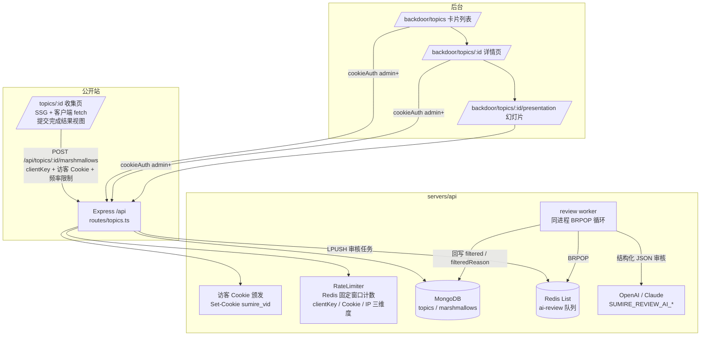
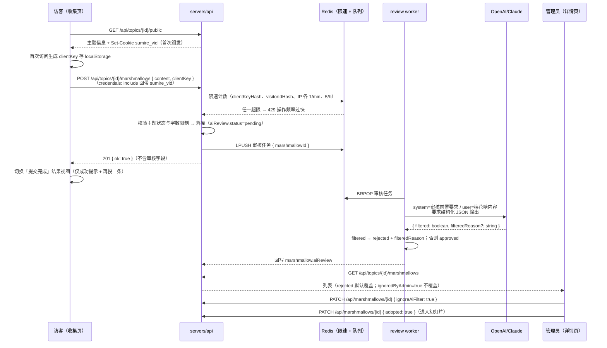

# 棉花糖（提问箱）- 技术提案

**功能名称**: 棉花糖（Marshmallow Topics）
**关联 PRD**: `docs/product/requirements/draft/2026-09-06-marshmallow-topics-prd.md`
**技术提案版本**: v1.1
**创建日期**: 2026-09-06
**作者**: sumire workflow
**prd-branch**: `prd/marshmallow-topics`（需求总分支）
**feat-branch**: `feat/marshmallow-topics`（开发分支，实现时自需求总分支合入 main 后切出）

## 1. 概述

### 1.1 背景

从零新增「棉花糖」提问箱：后台主题管理与审阅（含 AI 审核覆盖层）、公开收集页投递（访客 Cookie + 三重限速 + 提交完成结果视图）、AI 前置异步审核、幻灯片放映页。全仓无任何 topics / marshmallow 存量代码（已确认零命中），全链路新建。

现况要点（调研结论）：

- 服务端模式清晰：`app.ts` `createApp(deps)` 装配，`routes/` 只做校验与编排，`db/` 每文件一个 mongoose model + 数据访问函数，外部依赖经 `AppDeps` 注入，单测注入内存 stub；
- Redis（ioredis 单实例）现仅 K-V 用法（session、登录限速、两个 TTL 缓存），**无队列先例**——本期首次引入，选择自建轻量 List 队列而非 BullMQ（见 6.1）；
- 契约手写、无 codegen，每模块一文件（`contract/<模块>.openapi.yaml`），路径含 `/api` 前缀，受限端点显式 `cookieAuth`；
- bookstore 为 `output: "export"` 纯静态导出站，无 SSR；动态公开路由需特殊处理（见 5.2 实现点 4）；
- 无 Markdown 渲染/编辑先例，无 openai/anthropic SDK——均为首次引入依赖；
- 后端无 zod，路由内手写校验为正例（沿用）；错误统一 `{ error: string }` 中文；
- CORS 已为精确白名单 + `credentials: true`，公开页跨域携带访客 Cookie 无需新增配置。

### 1.2 目标

- 服务端：`/api/topics` 系列管理端点（admin 及以上）+ 公开读/投递端点（颁发访客 Cookie）+ 三维度频率限制（localStorage 标识 + 访客 Cookie + IP）+ AI 异步审核 worker；
- 契约：新增 `contract/topics.openapi.yaml` 单一事实源；投递响应仅 `{ ok: true }`，不返回审核字段；
- 前端：后台「棉花糖」三页（列表/详情/幻灯片）+ 公开收集页（含提交完成结果视图）+ 可复用 Markdown 编辑器组件；
- 测试：tests/api 黑盒集成（含限速与 AI stub）、前端单测、Playwright e2e。

### 1.3 范围

- **做**：上述全链路；Aspire 注入 `SUMIRE_REVIEW_AI_*` 环境变量；spec 同步。
- **不做**：棉花糖回复、公开展示墙、归档列表视图、审核提示词后台可配（见 PRD 六）。

## 2. 技术架构

### 2.1 系统架构图



### 2.2 技术栈

| 层级 | 技术选型 | 说明 |
|------|---------|------|
| 服务端 | Express 5 + TS strict + Mongoose 8 + ioredis | 全部沿用既有模式 |
| AI 审核 | `openai` / `@anthropic-ai/sdk`（新增依赖） | 按 `SUMIRE_REVIEW_AI_TYPE` 二选一初始化 |
| 审核队列 | Redis List（LPUSH/BRPOP）自建轻量 worker | 首次引入队列，见决策 6.1 |
| 契约 | 手写 OpenAPI 3.1 YAML | `contract/topics.openapi.yaml` |
| 前端 | Next.js 16（静态导出）+ React 19 + Tailwind v4 | 沿用既有口径 |
| Markdown 渲染 | `react-markdown` + `remark-gfm`（新增依赖） | 不渲染原始 HTML（默认行为），防 XSS |
| Markdown 编辑器 | `@uiw/react-md-editor`（新增依赖） | 工具栏按钮接近富文本体验，见决策 6.1 |
| 校验 | 服务端手写校验（沿用）；前端 Zod | 既有口径 |
| 测试 | Vitest（api 黑盒 + 前端单测）+ Playwright | 既有组织方式 |

### 2.3 模块划分

| 模块 | 职责 | 关键技术点 |
|------|------|-----------|
| `contract/topics.openapi.yaml` | 契约单一事实源 | 手写，沿用 Error/cookieAuth 约定 |
| `servers/api/src/db/topics.ts` | Topic model + CRUD | 派生状态计算函数为纯函数 |
| `servers/api/src/db/marshmallows.ts` | Marshmallow model + CRUD | 审核字段、采用、ignore_ai_filter |
| `servers/api/src/routes/topics.ts` | 管理端点 + 公开端点 | requireRole、访客 Cookie、限速挂载、入队 |
| `servers/api/src/topics/visitorCookie.ts` | 访客标识 Cookie 颁发与解析 | Set-Cookie 拼装沿用 session/cookie.ts 先例 |
| `servers/api/src/topics/rateLimit.ts` | 三维度固定窗口限速 | Redis INCR + EXPIRE（沿用登录限速先例） |
| `servers/api/src/topics/reviewQueue.ts` | 队列接口 + Redis 实现 + 内存实现 | 沿用「接口 + 双实现」先例 |
| `servers/api/src/topics/reviewWorker.ts` | BRPOP 消费循环 + AI 调用 | 结构化输出、失败回写拒绝原因 |
| `servers/api/src/topics/reviewPrompt.ts` | system 提示词（纯数据） | 内容审核常规要求 + 结尾声明 user 内容即待审内容 |
| `apps/bookstore/features/topics/` | 前端模块（后台三页逻辑 + 公共组件） | api.ts / 纯函数 / hooks / 组件 |
| `apps/bookstore/features/markdown/` | MarkdownEditor + MarkdownView | 编辑器与渲染两处复用 |
| `app/backdoor/(dashboard)/topics/**` | 后台三页路由组装 | 薄页面 |
| `app/(site)/(content)/topics/[id]/` | 公开收集页 | 静态导出动态路由处理，见 5.2 |

## 3. API 设计

新增 `contract/topics.openapi.yaml`（OpenAPI 3.1，手写，路径含 `/api` 前缀，错误一律 `$ref Error`，受限端点显式 `cookieAuth`）。端点一览：

```
# 管理端点（cookieAuth，superadmin/admin）
POST   /api/topics                          新建主题（5 字段 + aiReviewEnabled）
GET    /api/topics                          主题列表（默认不含已归档，?archived=true 预留）
GET    /api/topics/{id}                     主题详情（含派生 status）
PUT    /api/topics/{id}                     修改主题
POST   /api/topics/{id}/collecting          停止/继续收集 { collecting: boolean }
POST   /api/topics/{id}/archive             归档
GET    /api/topics/{id}/marshmallows        棉花糖列表（含审核字段，分页）
PATCH  /api/marshmallows/{id}               { adopted?: boolean, ignoreAiFilter?: boolean }

# 公开端点（无鉴权；首次接触颁发访客 Cookie）
GET    /api/topics/{id}/public              收集页公开信息（标题/描述/状态/起止/字数限制/aiReviewEnabled）
POST   /api/topics/{id}/marshmallows        投递棉花糖 { content, clientKey } → 201 { ok: true }
```

关键口径：

- **派生 status**：`now < startAt` → `upcoming`（未开始）；手动停止或 `now > endAt` 或已归档 → `ended`（已结束）；否则 `collecting`（进行中）。status 不入库，读取时计算；
- **访客 Cookie**：两个公开端点均检查请求 Cookie `sumire_vid`，缺失或非法时颁发新值——`Set-Cookie: sumire_vid=<uuid>; HttpOnly; Path=/; SameSite=Lax; Max-Age=31536000`，生产 `Secure`、不设 Domain（与 `sumire_sid` 拼装口径一致）；限速以其 sha256 为维度 key；
- **投递校验**：主题不存在/未开始/已结束/已归档 → 409 或 410 拒绝（中文 error 文案）；`content` trim 后为空或超过主题 `charLimit` → 400；限速命中 → 429「操作频率过快」；**成功 201 仅返回 `{ ok: true }`——不返回棉花糖 id、审核状态等任何内部字段**（访客侧只需知道是否提交成功）；
- **AI 审核字段**（marshmallow，仅管理端点可见）：`aiReview: { status: "pending" | "approved" | "rejected", filteredReason?: string, ignoredByAdmin: boolean }`；未启用 AI 审核的主题该字段为 `null`，前端据此不渲染覆盖层；
- PATCH `ignoreAiFilter: true` 即 PRD 的持久化「显示这条棉花糖」。

## 4. 数据模型

MongoDB 新增两个集合（mongoose，沿用 `{ versionKey: false }` 与 `toOutput` 口径，`id` 对外为 `_id.toString()`）：

```ts
// topics 集合
interface TopicDoc {
  title: string;            // trim 后 1..100
  description: string;      // Markdown 原文
  startAt: Date;
  endAt: Date;              // 校验 startAt < endAt
  charLimit: number;        // 100..10000
  aiReviewEnabled: boolean; // 默认 true
  collectingStopped: boolean; // 手动停止标记，默认 false
  archived: boolean;        // 默认 false
  createdBy: string;        // userId
  createdAt: Date;
  updatedAt: Date;
}

// marshmallows 集合
interface MarshmallowDoc {
  topicId: ObjectId;        // 索引
  content: string;          // Markdown 原文，≤ 主题 charLimit
  clientKeyHash: string;    // localStorage 标识的 sha256（不存原文）
  visitorIdHash: string;    // 访客 Cookie 标识的 sha256（不存原文）
  authorIp: string;         // 仅限速与审计用
  adopted: boolean;         // 默认 false
  aiReview: {
    status: "pending" | "approved" | "rejected";
    filteredReason?: string;  // rejected 时必填
    ignoredByAdmin: boolean;  // 默认 false，即 ignore_ai_filter
  } | null;                 // 主题未启用 AI 审核时为 null
  createdAt: Date;
}
```

索引：`marshmallows.topicId + createdAt`（列表按时间倒序）；`topics.archived + createdAt`。

## 5. 技术实现方案

### 5.1 核心流程



### 5.2 关键实现点

#### 实现点 1：访客 Cookie 与三维度频率限制（topics/visitorCookie.ts + rateLimit.ts）

- **访客 Cookie**：`visitorCookie.ts` 提供中间件，挂于两个公开端点——解析 `sumire_vid`（复用既有 cookie 解析口径），缺失/非法时生成 `crypto.randomUUID()` 并拼装 Set-Cookie（HttpOnly / Path=/ / SameSite=Lax / Max-Age=31536000 / 生产 Secure / 不设 Domain，与 `session/cookie.ts` 同口径）；解析结果挂 `req.visitorId` 供限速与落库使用；
- **限速**：沿用 `auth/rateLimit.ts` 的 Redis 固定窗口计数先例（INCR + EXPIRE），封装为通用 `FixedWindowLimiter`：`allow(key, limit, windowSeconds)`；
- 六个窗口：`marsh:ck:{sha256(clientKey)}`、`marsh:vid:{sha256(visitorId)}`、`marsh:ip:{ip}`，各 60s/1 条与 3600s/5 条；任一 `allow` 返回 false 即 429「操作频率过快」；
- IP 取 `req.ip`（`trust proxy` 已开启，与登录限速同口径）；
- `clientKey` 由前端生成 `crypto.randomUUID()` 存 localStorage（key：`topics.clientKey`），随 body 上送；服务端只存 sha256（`visitorId` 同）；
- 前端公开页 fetch 一律 `credentials: "include"`（跨域回带 `sumire_vid`；CORS 已为白名单 + credentials，无需新增配置）；
- **风险点**：固定窗口在窗口边界可瞬时 2 倍放行——与登录限速同口径，量级可接受，不引入滑动窗口复杂度；访客清除 Cookie 后该维度重置，但 localStorage 标识与 IP 维度仍兜底。

#### 实现点 2：AI 审核队列与 worker（topics/reviewQueue.ts + reviewWorker.ts）

- 队列接口沿用「接口 + Redis 实现 + 内存实现（测试缺省）」先例：`enqueue(job)` / `start(handler)`；Redis 实现为 `LPUSH marsh:ai-review {job}` + 消费者 `BRPOP` 循环；不引入 BullMQ（见 6.1）；
- worker 在 api 进程内启动（`index.ts` 注入后 `start`）：BRPOP 取任务 → 读 marshmallow 与主题 → 调 AI → 回写 `aiReview`；AI 调用异常（网络/超时/非 JSON）重试至多 2 次（退避 1s/5s），仍失败回写 `rejected` + `filteredReason: "审核服务暂时不可用，请管理员人工确认"`——与 PRD「审核失败展示拒绝原因」一致；
- 幂等：消费前检查 `aiReview.status === "pending"`，非 pending 跳过（重复入队安全）；
- **风险点**：进程崩溃丢失 in-flight 任务——BRPOP 无确认机制。量级低（人工投递场景），接受该风险；如后续需要可靠投递再升级 BRPOPLPUSH 或 BullMQ。

#### 实现点 3：AI 客户端与提示词（topics/reviewPrompt.ts + AI 初始化）

- 环境变量（`config.ts` 集中读取，新增）：
  - `SUMIRE_REVIEW_AI_TYPE`：`openai` | `claude`；
  - `SUMIRE_REVIEW_AI_ENDPOINT`：API base URL；
  - `SUMIRE_REVIEW_AI_API_KEY`：凭据；
- **启动前校验**：`index.ts` 启动时三者缺失或 type 非法即抛错退出（PRD「要求启动前配置」）；tests/api 与 Aspire 注入指向本地 stub 的值（沿用上游 stub 先例），生产经部署环境注入；
- system 提示词（`reviewPrompt.ts` 纯数据常量）：常规内容审核要求（以骂人为目的的脏话、只为追求快感的性描写、儿童色情内容、人身攻击与威胁、违法信息等），结尾明确表述「user 发送的内容都是要进行审核的内容」；
- user 消息为棉花糖原文；
- 结构化输出 JSON：`{ "filtered": boolean, "filteredReason"?: string }`（filtered=true 时 filteredReason 必填）——openai 用 `response_format: json_object`（提示词内声明 schema），claude 用对应 JSON 输出指令；解析失败按审核失败口径处理；
- SDK：`openai`（兼容自定义 baseURL）与 `@anthropic-ai/sdk`，按 type 二选一初始化。

#### 实现点 4：静态导出下的公开动态路由（/topics/[id]）

- bookstore 为 `output: "export"`，动态段必须 `generateStaticParams`。方案：`app/(site)/(content)/topics/[id]/page.tsx` 导出 `generateStaticParams() { return [{ id: "_" }] }` + `export const dynamicParams = false`，生成占位静态页；页面为 `"use client"` 组件，运行时经 `useParams()` 读取真实 id（静态导出生成的 `/_/` 页壳在任何 `/topics/{真实id}` 路径下由 GitHub Pages 404 兜底问题——**风险点**：GitHub Pages 对未生成的路径返回 404，静态导出动态路由无法直接直达）；
- 缓解：收集页链接以后台复制/分享的完整 URL 分发。若 GitHub Pages 404 问题在实现时确认无法绕过，备选方案为查询串形态 `/topics?id={id}`（静态页无动态段，最稳）——实现时先在 e2e 环境验证 `/_/index.html` 重写不可行则落查询串方案。契约与 API 不受此影响；
- 页面守卫：`API_CONFIGURED === false` 时按既有口径不渲染入口/页面（同 calendar 先例）。

#### 实现点 5：前端页面与组件（features/topics/）

- `SideNav.tsx` `NAV_ITEMS` 追加 `{ href: "/backdoor/topics", label: "棉花糖", roles: ["superadmin", "admin"] }`；
- **列表页** `/backdoor/topics`：卡片栅格；卡片首行标题 + 状态徽标（未开始/进行中/已结束，token 色区分），次行「停止收集/继续收集」「归档」「修改」按钮（按钮点击 `stopPropagation`，卡面其余区域 Link 跳详情）；「新建主题」按钮开表单弹窗；
- **主题表单弹窗**（新建/修改复用）：标题（文本）、描述（MarkdownEditor）、开始/结束日期（datetime-local）、字数限制（number，100–10000 校验）、启用AI前置审核（checkbox 默认勾选）；复用后台既有 dialog 口径（`createPortal` 挂 body、Esc/遮罩关闭、`role="alert"` 错误区）；
- **详情页** `/backdoor/topics/[id]`：大标题 + CollapsibleMarkdown（描述渲染，line-clamp-3，默认折叠，展开/收起按钮）；工具栏「幻灯片」（`window.open` 独立页）「开始/结束收集」「修改主题」；列表容器 `flex-1 overflow-y-auto` 内部滚动；条目组件 MarshmallowCard：全宽、内容 MarkdownView 渲染、采用切换（已采用变灰 + 「已采用」标记）；AI 覆盖层按 `aiReview.status` 三态渲染（rejected：原因 + 「显示这条棉花糖」→ PATCH ignoreAiFilter；pending：提示 + 「提前查看」→ 本地 state 临时展示；null：无覆盖层）；
- **幻灯片页** `/backdoor/topics/[id]/presentation`：仅 adopted 条目；条目满高（`h-full`）内部 Y 滚动、`max-w-[50%] mx-auto`；左右全高按钮（lucide `ChevronLeft`/`ChevronRight`，首末条禁用）；页头标题 + CollapsibleMarkdown；字号工具栏（A-/A+，存 localStorage `topics.presentation.fontSize`）；首次引导遮盖层（localStorage `topics.presentation.guideSeen`，关闭后写入）；
- **收集页** `/topics/[id]`：主题信息区 + MarkdownEditor + 提交按钮，页面级三态视图——`form`（编辑投递）/ `submitting` / `done`（**提交完成结果视图**：仅展示「提交成功，感谢你的棉花糖」+「再投一条」按钮，不展示任何审核字段；「再投一条」回到 `form` 并清空编辑器，仍受频率限制约束）；提交前 ConfirmDialog 展示 AI 审核告知文案；失败（429/400/409）回到表单态并给出明确提示；未开始/已结束/已归档展示状态提示并禁用编辑器；
- **MarkdownEditor**（`features/markdown/MarkdownEditor.tsx`）：`@uiw/react-md-editor`，`"use client"` + `next/dynamic` `ssr: false`（静态导出无 SSR，但避免构建期 window 依赖）；工具栏保留加粗/斜体/标题/列表/引用/链接/代码等常用按钮；
- **MarkdownView**（`features/markdown/MarkdownView.tsx`）：`react-markdown + remark-gfm`，不启用 `rehype-raw`（禁原始 HTML，防 XSS）；
- 视觉：后台三页严格按 `docs/design/03-backdoor-design.md`（无氛围动效、token 色、紧凑控件）；收集页按公开站口径。

## 6. 技术决策

### 6.1 决策列表

| 决策 | 选项 A | 选项 B | 最终选择 | 原因 |
|------|--------|--------|---------|------|
| 审核队列 | Redis List 自建（LPUSH/BRPOP） | 引入 BullMQ | A | 单任务类型、低量级、无定时/重试编排需求；BullMQ 引入完整依赖与运维概念过重；沿用既有「接口 + 双实现」模式便于测试 |
| AI 接入 | openai + @anthropic-ai/sdk 官方 SDK | 裸 fetch 自拟请求 | A | PRD 明确「接入一个 ai 的 sdk」；官方 SDK 处理鉴权/重试/流式细节，type 二选一封装 |
| AI 配置校验时机 | 启动时 fail-fast | 首次使用时校验 | A | PRD 明确「要求启动前配置」；测试/本地经 stub 注入 |
| 主题状态 | 读取时派生（now vs startAt/endAt + collectingStopped + archived） | 入库存 status 字段 | A | 时间驱动状态入库必然过期；派生为纯函数，单测直推 |
| 访客标识 | localStorage 标识 + HttpOnly 访客 Cookie + IP 三维度 | 仅 localStorage + IP | A | 需求要求颁发 Cookie 并纳入限速；Cookie 由服务端颁发且 HttpOnly，与可清除的 localStorage 标识互补 |
| 投递响应 | 仅 `{ ok: true }` | 返回 id + 审核状态 | A | 访客只需知道是否提交成功；不暴露审核机制细节，避免访客试探审核规则；前端以提交完成结果视图反馈 |
| 公开收集页路由 | 路径参数 `/topics/[id]`（占位参数静态导出） | 查询串 `/topics?id=` | A（备选 B） | PRD 明确路由 `/topics/{topic-id}`；GitHub Pages 无重写能力，若直达 404 无法绕正则降级 B（实现时验证，见 5.2 实现点 4） |
| Markdown 编辑器 | @uiw/react-md-editor | 自建 textarea + 工具栏 | A | PRD 允许开源库且要求富文本体验；自建工具栏 + 预览成本高于引入成熟库；库体量为可接受的一次性成本 |
| Markdown 渲染 | react-markdown + remark-gfm | marked + 自行 sanitize | A | React 组件化渲染、默认不渲染原始 HTML（XSS 安全默认）、生态主流 |
| 限速维度存储 | Redis 固定窗口计数 | MongoDB 计数 | A | 沿用登录限速先例；O(1)、自动过期 |
| 访客标识存储 | 服务端存 sha256 | 存原文 | A | 标识等价于弱凭据，哈希存储降低泄露面（clientKey 与 visitorId 同口径） |
| 后台可见角色 | superadmin / admin | 含 member | A | 涉及 UGC 内容审阅与管理操作，从严；与「用户管理」以外的既有全角色入口不同属内容管理域 |

### 6.2 依赖与约束

| 类型 | 内容 | 说明 |
|------|------|------|
| 依赖 | Redis（限速 + 队列）、MongoDB（新集合） | Aspire 既有资源，无新增资源类型 |
| 依赖 | AI 服务（OpenAI 兼容 / Claude） | 新增外部依赖；`SUMIRE_REVIEW_AI_*` 环境变量 |
| 依赖 | 新增 npm 依赖：openai、@anthropic-ai/sdk（api）；react-markdown、remark-gfm、@uiw/react-md-editor（bookstore） | 均为首次引入 |
| 约束 | 契约先行 | `contract/topics.openapi.yaml` 为单一事实源，实现与 tests/api 以其为准 |
| 约束 | 后端规范 | `docs/engineering/backend-rules.md`：仅 `/api/*`、`{ error }` 中文、requireRole、TDD |
| 约束 | 前端规范 | `docs/engineering/frontend-rules.md`：features 分层、token 色、SSG、TDD |
| 约束 | 视觉 | `docs/design/03-backdoor-design.md`（后台）；公开站既有口径（收集页） |
| 约束 | 分支 `<type>/<slug>`；禁 rebase/squash | `prd/marshmallow-topics` 需求总分支 |

## 7. 项目结构

```
contract/
└── topics.openapi.yaml                      # 新增：契约单一事实源

servers/api/
├── src/
│   ├── config.ts                            # 修改：SUMIRE_REVIEW_AI_* 读取与启动校验
│   ├── app.ts                               # 修改：挂载 topics 路由
│   ├── index.ts                             # 修改：启动 review worker
│   ├── db/
│   │   ├── topics.ts                        # 新增：Topic model + CRUD + 派生状态纯函数
│   │   └── marshmallows.ts                  # 新增：Marshmallow model + CRUD
│   ├── topics/
│   │   ├── visitorCookie.ts                 # 新增：访客 Cookie 颁发与解析中间件
│   │   ├── rateLimit.ts                     # 新增：FixedWindowLimiter（Redis/内存）
│   │   ├── reviewQueue.ts                   # 新增：队列接口 + Redis/内存实现
│   │   ├── reviewPrompt.ts                  # 新增：system 审核提示词常量
│   │   └── reviewWorker.ts                  # 新增：BRPOP 消费 + AI 调用 + 回写
│   └── routes/topics.ts                     # 新增：管理 + 公开端点
└── tests/                                   # 新增对应单测（内存 stub）

apps/bookstore/
├── app/
│   ├── backdoor/(dashboard)/topics/
│   │   ├── page.tsx                         # 新增：卡片列表
│   │   ├── [id]/page.tsx                    # 新增：主题详情
│   │   └── [id]/presentation/page.tsx       # 新增：幻灯片
│   └── (site)/(content)/topics/[id]/page.tsx# 新增：公开收集页（占位参数静态导出）
├── features/
│   ├── backdoor/components/SideNav.tsx      # 修改：NAV_ITEMS + 棉花糖
│   ├── markdown/
│   │   ├── MarkdownEditor.tsx               # 新增：@uiw/react-md-editor 封装
│   │   └── MarkdownView.tsx                 # 新增：react-markdown 渲染
│   └── topics/
│       ├── api.ts                           # 新增：端点封装（沿用 backdoor/api 口径，公开页 credentials: include）
│       ├── types.ts                         # 新增：Zod schema 对齐契约
│       ├── status.ts                        # 新增：状态派生/文案纯函数
│       ├── components/                      # 新增：TopicCard / TopicFormDialog /
│       │                                    #   CollapsibleMarkdown / MarshmallowCard /
│       │                                    #   AiReviewOverlay / ConfirmDialog /
│       │                                    #   SubmitDoneView / 幻灯片组件
│       └── ...
└── tests/unit/                              # 新增对应单测

tests/api/src/
└── topics.test.ts                           # 新增：黑盒集成（契约为准）

tests/e2e/src/
├── backdoor/topics.spec.ts                  # 新增：后台三页主流程
└── bookstore/topics.spec.ts                 # 新增：公开收集页投递流程

infra/aspire/apphost.cs                      # 修改：api 注入 SUMIRE_REVIEW_AI_*（指向 stub/占位）
```

## 8. 测试策略

### 8.1 测试覆盖要求

- 服务端单测（Vitest，内存 stub）：派生状态纯函数（未开始/进行中/已结束/手动停止/归档边界）；visitorCookie 中间件（无 Cookie 颁发新值并 Set-Cookie、合法 Cookie 透传、非法值重颁）；FixedWindowLimiter（窗口内放行/超限拒绝/过期重置）；reviewQueue 内存实现入队消费；reviewWorker（mock AI：approved/rejected/异常重试/幂等跳过）；
- tests/api 黑盒（以契约为准，CookieJar + 角色助手）：主题 CRUD 与权限矩阵（member 403、未登录 401）；字段校验（字数限制边界 100/10000、日期先后、缺字段 400）；停止/继续/归档对投递的影响；公开 GET/POST 无鉴权可用；**首次公开请求响应带 `sumire_vid` Set-Cookie（HttpOnly），后续回带不重复颁发**；**投递成功响应体严格为 `{ ok: true }`，不含 id/aiReview 等字段**；投递限速（clientKey、访客 Cookie、IP 三个维度各自 1/min、5/h，429 文案；清除 Cookie 后其余维度仍生效）；启用/未启用 AI 审核的 aiReview 字段形态（仅管理端点可见）；PATCH adopted / ignoreAiFilter；AI 经本地 HTTP stub 断言异步回写（轮询等待 status 迁移）；
- 前端单测：status 纯函数、CollapsibleMarkdown 折叠交互、MarshmallowCard 三态覆盖层（rejected 持久化/pending 临时/null 无）、表单校验（字数边界、默认勾选）、收集页三态视图切换（提交成功进 done 视图且不含审核字段、再投一条回 form 并清空）、localStorage 读写（clientKey 颁发、字号、引导记录损坏回退）；
- e2e（Playwright）：后台——导航入口 → 新建主题 → 详情采用/覆盖层操作 → 幻灯片翻页与字号持久化；公开——收集页展示 → AI 告知弹窗 → 投递成功出现提交完成视图 → 再投一条连续投递触发 429 提示。

### 8.2 测试类型

| 类型 | 工具 | 覆盖范围 |
|------|------|---------|
| 单元测试 | Vitest（api + bookstore） | 纯函数、访客 Cookie、限速、队列、worker、组件交互 |
| 集成测试 | tests/api（Vitest + fetch + CookieJar） | 全部契约端点、权限、Cookie 颁发、限速、响应体形态、AI stub 异步审核 |
| e2e | Playwright | 后台三页主流程、公开投递与提交完成视图主流程 |

## 9. 部署方案

### 9.1 环境规划

| 环境 | 用途 | 部署方式 |
|------|------|---------|
| 本地联调 | Aspire 编排（既有四资源） | `aspire start`；apphost.cs 为 api 注入 `SUMIRE_REVIEW_AI_*`（本地指向 AI stub 或占位值） |
| 测试 | tests/api 经 `aspire describe` 注入 | AI 走进程内 HTTP stub（沿用上游 stub 先例） |
| 生产 | api 部署 + GitHub Pages（前端 SSG） | 部署环境注入 `SUMIRE_REVIEW_AI_*` 三个变量；前端 `NEXT_PUBLIC_API_BASE_URL` 既有注入 |

### 9.2 配置管理

新增环境变量（api）：

| 变量 | 说明 | 缺省行为 |
|------|------|---------|
| `SUMIRE_REVIEW_AI_TYPE` | `openai` \| `claude` | 缺失/非法 → 启动失败 |
| `SUMIRE_REVIEW_AI_ENDPOINT` | AI API base URL | 缺失 → 启动失败 |
| `SUMIRE_REVIEW_AI_API_KEY` | AI API 凭据 | 缺失 → 启动失败 |

启动时 fail-fast 校验（PRD「要求启动前配置」）；本地与测试环境由 Aspire / 测试注入指向 stub。

## 10. 验收标准

- [ ] 技术方案评审通过
- [ ] `contract/topics.openapi.yaml` 与实现、tests/api 三者一致
- [ ] 后台导航「棉花糖」（superadmin/admin），列表/新建/修改/停止继续/归档行为符合 PRD F1–F3
- [ ] 详情页折叠描述、棉花糖列表、采用切换、AI 覆盖层三态符合 PRD F4–F5
- [ ] 公开收集页展示与投递、AI 告知弹窗、访客 Cookie 颁发、三维度限速 429、提交完成结果视图（响应与视图均不含审核字段）符合 PRD F6
- [ ] 幻灯片页采用条目、翻页、字号持久化、首次引导符合 PRD F8
- [ ] AI 审核异步执行：pending → approved/rejected 回写正确；失败重试后按 rejected 兜底；`SUMIRE_REVIEW_AI_*` 缺失启动失败
- [ ] 全部测试全绿：`pnpm lint && pnpm test && pnpm build`（api + bookstore）、tests/api、tests/e2e
- [ ] Spec 同步：上线 PR 内更新 `docs/product/spec/backdoor.md`（+ 公开收集页入 `site-pages.md`）与 `docs/engineering/spec/`（新增 backend-topics 或并入既有文件、frontend-bookstore.md、infra.md）

## 11. 相关文档

- 关联 PRD：`docs/product/requirements/draft/2026-09-06-marshmallow-topics-prd.md`
- 产品 Spec（现态）：`docs/product/spec/backdoor.md`、`docs/product/spec/site-pages.md`
- 技术 Spec（现态）：`docs/engineering/spec/backend-auth.md`、`frontend-bookstore.md`、`infra.md`、`testing.md`
- 契约（本期新增）：`contract/topics.openapi.yaml`
- 开发规范：`docs/engineering/backend-rules.md`、`docs/engineering/frontend-rules.md`
- 设计文档：`docs/design/03-backdoor-design.md`
