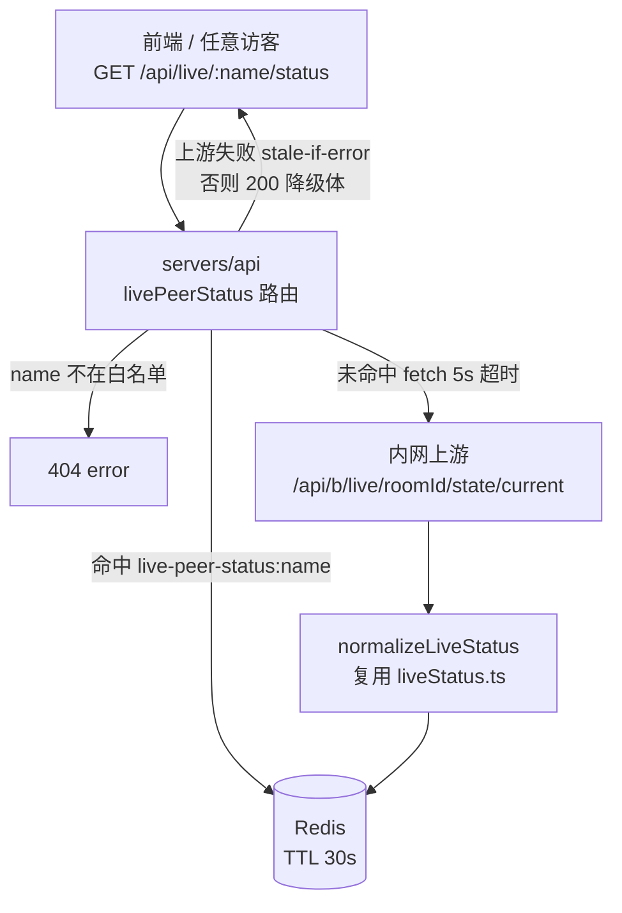
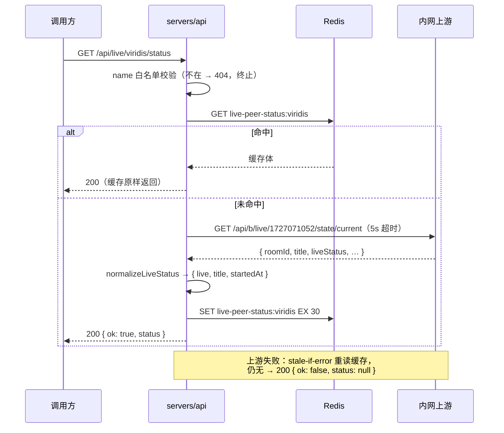

# 同期直播状态 API - 技术提案

**功能名称**: 同期直播状态 API（Peer Live Status）
**关联 PRD**: `docs/product/requirements/draft/2026-09-07-peer-live-status-prd.md`
**技术提案版本**: v1.0
**创建日期**: 2026-09-07
**作者**: sumire workflow
**prd-branch**: `prd/peer-live-status`（需求总分支）
**feat-branch**: `feat/peer-live-status`（开发分支，实现时自需求总分支合入 main 后切出）

## 1. 概述

### 1.1 背景

既有 `GET /api/live/status`（公开）代理内网上游 `state/current` 查询枝堇本人（房间 1727076670，服务端内置固定）的直播状态，链路为：Redis 缓存（`live-status:latest`，TTL 30s）→ 未命中拉上游（5s 超时）→ `normalizeLiveStatus` 防御式归一化 → 写缓存返回；上游失败 stale-if-error + 200 降级 `{ ok: false, status: null }`，永不 5xx（`servers/api/src/routes/liveStatus.ts`）。

本期需求：对三位同期主播提供同口径的直播状态查询，上游按房间号寻址：

```
GET http://vtuber.internal.fffdan.com/api/b/live/{roomId}/state/current
```

name→roomId 映射（服务端内置白名单）：`viridis`→1727071052、`komichi`→1700301235、`chu2u`→1727074031。

服务端现状可直接复用的资产：`routes/liveStatus.ts` 已导出 `normalizeLiveStatus` 与 `LiveStatus` 类型；`infra/liveStatusCache.ts` 的 `LiveStatusCache` 抽象（get/set 两方法，Redis 实现复用 index.ts 既有 ioredis 实例）与房间号无关，可直接承载按 name 隔离的新缓存键。

### 1.2 目标

- 契约 `contract/live-status.openapi.yaml` 新增 `GET /api/live/{name}/status`（公开，`name` 枚举白名单）；
- 服务端新增路由：白名单校验 → 按 name 隔离的 30s 缓存 → 代理上游对应房间 `state/current` → 复用 `normalizeLiveStatus` 归一化 → 同口径降级；
- API 集成测试覆盖鉴权豁免、白名单 404、归一化、缓存与降级。

### 1.3 范围

- **做**：契约新增 path；`servers/api` 新路由模块与装配；`tests/api` 集成测试（stub 上游）。
- **不做**：前端展示；批量查询端点；name 列表配置化/持久化；数据库变更。

## 2. 技术架构

### 2.1 系统架构图



### 2.2 技术栈

| 层级 | 技术选型 | 说明 |
|------|---------|------|
| 后端 | Express 5 + TS strict | live-status 域新增路由，公开读 |
| 缓存 | Redis（ioredis，复用既有实例） | 按 name 隔离键，TTL 30s；缺省内存实现 |
| 契约 | OpenAPI 3.1（`contract/live-status.openapi.yaml`） | 单一事实源，先改契约 |
| 测试 | Vitest（`tests/api` 黑盒集成 + `servers/api` 单测） | 既有组织方式 |

### 2.3 模块划分

| 模块 | 职责 | 关键技术点 |
|------|------|-----------|
| `contract/live-status.openapi.yaml` | 新增 `/api/live/{name}/status` path | name 枚举白名单写入契约；复用 `LiveStatus` schema |
| `servers/api/src/routes/livePeerStatus.ts`（新增） | 新端点路由 | 白名单映射、按 name 缓存键、复用 `normalizeLiveStatus` |
| `servers/api/src/config.ts` | 新增上游 base 配置项 | env `LIVE_PEER_STATUS_UPSTREAM_URL`，内置缺省值 |
| `servers/api/src/app.ts` / `index.ts` | 装配与挂载 | 复用 `LiveStatusCache` 注入路径 |
| `tests/api/src/live-status.test.ts` | 新增 describe 分组 | stub 上游 fetch，覆盖白名单/缓存/降级 |

## 3. API 设计

契约 `contract/live-status.openapi.yaml` 新增（单一事实源，以下为要点）：

```yaml
/api/live/{name}/status:
  get:
    summary: 查询同期主播直播状态（公开）
    description: 无需登录。name 为同期主播标识白名单，服务端按内置 name→roomId 映射代理上游 state/current 并归一化（房间号服务端内置不暴露）。每个 name 独立短 TTL 缓存（30s）。上游不可达/超时/返回结构非法时降级为 200 + { ok: false, status: null }，不产生 5xx。
    security: []
    parameters:
      - name: name
        in: path
        required: true
        description: 同期主播标识（服务端内置映射对应房间号）
        schema:
          type: string
          enum: [viridis, komichi, chu2u]
    responses:
      "200":
        description: 当前直播状态；ok=false 表示上游不可用（静默降级体，status 为 null）
        content:
          application/json:
            schema:   # 与既有 /api/live/status 响应同构
              type: object
              required: [ok, status]
              properties:
                ok: { type: boolean }
                status:
                  anyOf:
                    - $ref: "#/components/schemas/LiveStatus"
                    - type: "null"
      "404":
        description: 未知的同期主播标识（不在白名单，不请求上游）
        content:
          application/json:
            schema:
              type: object
              required: [error]
              properties:
                error: { type: string, description: 中文错误文案 }
```

要点：

- 响应体与既有 `/api/live/status` 完全同构，复用契约既有 `LiveStatus` schema，不新增组件；
- 404 仅用于「name 不在白名单」这一参数错误；上游失败一律走 200 降级体，与既有端点口径一致；
- 契约 `info.description` 顺带补充多房间口径说明（实现 PR 内完成）。

## 4. 数据模型

无数据库变更，直播状态不持久化。契约无新增 schema（复用 `LiveStatus`）。Redis 新增缓存键族 `live-peer-status:{name}`（每 name 一键，TTL 30s）。

## 5. 技术实现方案

### 5.1 核心流程



### 5.2 关键实现点

#### 实现点 1: 白名单与上游 URL 构造（routes/livePeerStatus.ts）

- 模块内置常量映射：`const PEER_ROOMS: Record<string, string> = { viridis: "1727071052", komichi: "1700301235", chu2u: "1727074031" }`；
- `router.get("/:name/status", …)`：取出 `req.params.name`，`PEER_ROOMS[name]` 不存在 → 404 `{ error: "未知的同期主播" }`，**直接返回，不请求上游**（精确匹配，大小写敏感，与契约枚举一致）；
- 上游 URL 服务端拼接：`${deps.upstreamBaseUrl}/api/b/live/${roomId}/state/current`——roomId 只可能来自内置映射，客户端无法注入，杜绝 SSRF；
- **风险点**: Express 5 路径参数语义——`/:name/status` 与既有 `/api/live/status` 段数不同（4 段 vs 3 段），互不冲突；挂载在 `/api/live` 前缀下时确认既有 `app.use("/api/live/status", …)` 先匹配或两者无交集（段数差异保证无交集）。

#### 实现点 2: 缓存与降级（routes/livePeerStatus.ts）

- 缓存键 `live-peer-status:${name}`，TTL 复用 `LIVE_STATUS_CACHE_TTL_SECONDS`（30s，自 liveStatus.ts 导入或提为共享常量）；
- 处理链照搬 liveStatus.ts：读缓存 → 命中原样返回（含 JSON.parse 失败按无缓存处理）→ 未命中 fetch（`AbortSignal.timeout(5000)`，`fetchFn` 可注入）→ `normalizeLiveStatus`（自 `./liveStatus` 导入，零改动复用）→ 写缓存返回 `{ ok: true, status }`；
- 失败路径：catch 后 stale-if-error 重读缓存，仍无 → 200 `{ ok: false, status: null }`；任何异常不冒泡为 5xx；
- 缓存抽象直接复用 `AppDeps.liveStatusCache` 同一实例（接口与房间无关，键隔离即可），不新增依赖注入面；
- **风险点**: 三个 name 的上游健康度可能不同——按 name 隔离键天然满足，无需额外处理；并发未命中时的缓存击穿与既有端点同水平（可接受，30s TTL 低基数）。

#### 实现点 3: 配置与装配（config.ts / app.ts）

- `config.ts` 新增 `livePeerStatusUpstreamUrl: getEnv("LIVE_PEER_STATUS_UPSTREAM_URL", "http://vtuber.internal.fffdan.com")`——env 存 **base**（不含路径，与 liveEvents 域 `LIVE_EVENTS_UPSTREAM_URL` 同模式），内置缺省值、缺变量不抛错；
- `app.ts`：`createLivePeerStatusRouter({ upstreamBaseUrl: config.livePeerStatusUpstreamUrl, cache: deps.liveStatusCache ?? createMemoryLiveStatusCache(), fetchFn: deps.fetchFn? })`，挂载 `app.use("/api/live", router)`（router 内 `/:name/status`）；
- Aspire 编排无需变更（env 有缺省值；如需经 `aspire describe` 注入另议，本期沿用缺省）。

#### 实现点 4: 契约与文档同步

- 先改契约（本提案评审通过后，实现 PR 首提交即契约变更），实现与 `tests/api` 以契约为准；
- 上线 PR 内同步：`docs/engineering/spec/backend-live.md`（新增端点小节）、根 `AGENTS.md` 与 `servers/api/AGENTS.md` 的端点/缓存键约定（`live-peer-status:{name}`）。

## 6. 技术决策

### 6.1 决策列表

| 决策 | 选项 A | 选项 B | 最终选择 | 原因 |
|------|--------|--------|---------|------|
| 契约归属 | 扩展既有 `live-status.openapi.yaml` | 新建独立契约文件 | A | 同域（直播状态）、同上游端点族、复用同一 LiveStatus schema；新文件只会割裂事实源 |
| 房间号来源 | 服务端内置 name→roomId 白名单 | 客户端直接传 roomId 参数 | A | PRD 明确 name 寻址；开放 roomId 即开放任意内网房间探测（SSRF 面），白名单与既有「房间号服务端内置」红线一致 |
| 路径形态 | `/api/live/{name}/status` | `/api/live-status/{name}` | A | PRD 指定路径；与既有 `/api/live/status` 段数不同无路由冲突 |
| 未知 name | 404 `{ error }` | 200 降级体 `{ ok: false, status: null }` | A | 参数错误 ≠ 上游失败；404 让调用方尽早发现拼写错误；降级体保留给上游异常语义 |
| 归一化逻辑 | 复用 `normalizeLiveStatus` | 为同期单独写一份 | A | 同一上游服务同一端点族，结构口径一致；复用避免两份守卫逻辑漂移 |
| 缓存键 | 按 name 隔离 `live-peer-status:{name}` | 单键聚合三房间状态 | A | 各房间上游独立成败；聚合键会把单房间失败放大为整体降级，且需要批量拉取放大延迟 |
| env 配置 | 新增 `LIVE_PEER_STATUS_UPSTREAM_URL` 存 base | 复用 `LIVE_STATUS_UPSTREAM_URL` 改写路径 | A | 后者是含房间号的完整 URL，字符串改写脆弱；base 模式与 liveEvents 域一致 |

### 6.2 依赖与约束

| 类型 | 内容 | 说明 |
|------|------|------|
| 依赖 | 上游 `GET /api/b/live/{roomId}/state/current` 对三个房间可用 | 与既有 live-status 同一上游服务 |
| 依赖 | `normalizeLiveStatus` / `LiveStatusCache` 既有实现 | 零改动复用 |
| 约束 | 契约先行 | 先改 `contract/live-status.openapi.yaml`，测试与实现以契约为准 |
| 约束 | 后端规范 | `docs/engineering/backend-rules.md`：错误 `{error}` 中文、TDD、`pnpm lint && pnpm test` 全绿 |
| 约束 | 分支 `<type>/<slug>`；禁 rebase/squash | `prd/peer-live-status` 需求总分支 |

## 7. 项目结构

```
contract/
└── live-status.openapi.yaml                 # 新增 /api/live/{name}/status（复用 LiveStatus schema）
servers/api/src/
├── config.ts                                # 新增 livePeerStatusUpstreamUrl（LIVE_PEER_STATUS_UPSTREAM_URL）
├── app.ts                                   # 装配 createLivePeerStatusRouter，挂载 /api/live
└── routes/
    ├── liveStatus.ts                        # 零改动（导出被复用）
    └── livePeerStatus.ts                    # 新增：白名单 + 按 name 缓存 + 代理归一化降级
tests/api/src/
└── live-status.test.ts                      # 新增同期端点 describe 分组
```

## 8. 测试策略

### 8.1 测试覆盖要求

- 契约：OpenAPI 校验通过（既有契约 lint 口径）。
- API 集成测试（`tests/api/src/live-status.test.ts` 新增分组，stub 上游 fetch）：
  - 三个白名单 name：无 Cookie 直接 200，归一化结构正确（`live` 布尔、`title`/`startedAt` 缺字段为 null）；
  - 上游 URL 断言：各 name 请求的上游路径含正确 roomId（白名单映射不落错房间）；
  - 未知 name（含大小写变体）→ 404 `{ error }`，stub fetch 零调用；
  - 缓存：30s 内同 name 二次请求不再调上游；不同 name 各自独立；
  - 降级：上游 5xx/超时/非法 JSON/缺 `live` 语义 → 有缓存返回缓存，无缓存 200 `{ ok: false, status: null }`；全程无 5xx；
  - 回归：既有 `GET /api/live/status` 用例不动仍绿。
- `servers/api` 单测：如需对路由内部（白名单、键构造）补细粒度用例，随实现 TDD 补齐。

### 8.2 测试类型

| 类型 | 工具 | 覆盖范围 |
|------|------|---------|
| API 集成 | Vitest + fetch + stub 上游 | 白名单 404、鉴权豁免、归一化、缓存隔离、降级 |
| 单元测试 | Vitest（servers/api） | 路由内部边界（按需） |

## 9. 部署方案

### 9.1 环境规划

| 环境 | 用途 | 部署方式 |
|------|------|---------|
| 本地联调 | Aspire 编排（既有四资源） | `aspire start`，无新增资源配置 |
| 生产 | 既有 API 部署 | 新增可选 env `LIVE_PEER_STATUS_UPSTREAM_URL`（缺省内网地址，不配置即可运行） |

### 9.2 配置管理

新增 1 个配置项 `LIVE_PEER_STATUS_UPSTREAM_URL`（base URL，内置缺省 `http://vtuber.internal.fffdan.com`，缺变量不抛错）；无其他配置变更。

## 10. 验收标准

- [ ] 技术方案评审通过
- [ ] 契约含 `/api/live/{name}/status`（name 枚举白名单）且通过校验；服务端实现与契约一致
- [ ] 三个白名单 name 无需登录返回归一化状态；未知 name 404 且上游零调用
- [ ] 按 name 隔离的 30s 缓存与 stale-if-error 降级生效，全程无 5xx
- [ ] 响应体不泄露 roomId 与上游地址
- [ ] API 测试与 `servers/api` 单测全绿；`pnpm lint && pnpm test` 全绿
- [ ] 既有 `/api/live/status` 零回归
- [ ] Spec 同步：上线 PR 内更新 `docs/engineering/spec/backend-live.md` 与相关 AGENTS.md

## 11. 相关文档

- 关联 PRD：`docs/product/requirements/draft/2026-09-07-peer-live-status-prd.md`
- 契约：`contract/live-status.openapi.yaml`
- 后端直播域 Spec（现态）：`docs/engineering/spec/backend-live.md`
- 开发规范：`docs/engineering/backend-rules.md`
