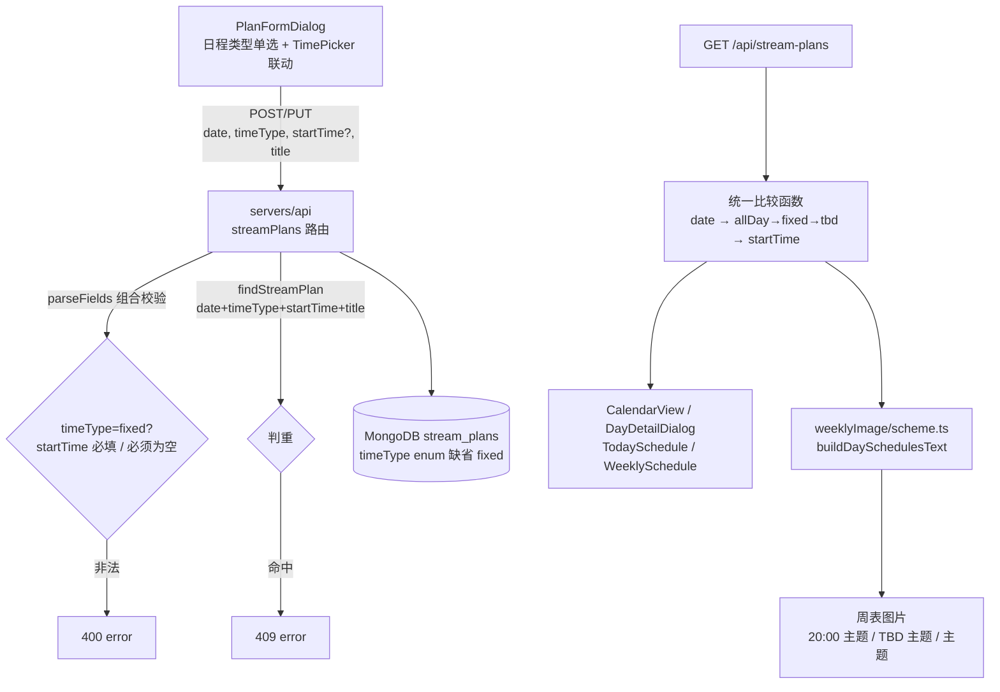
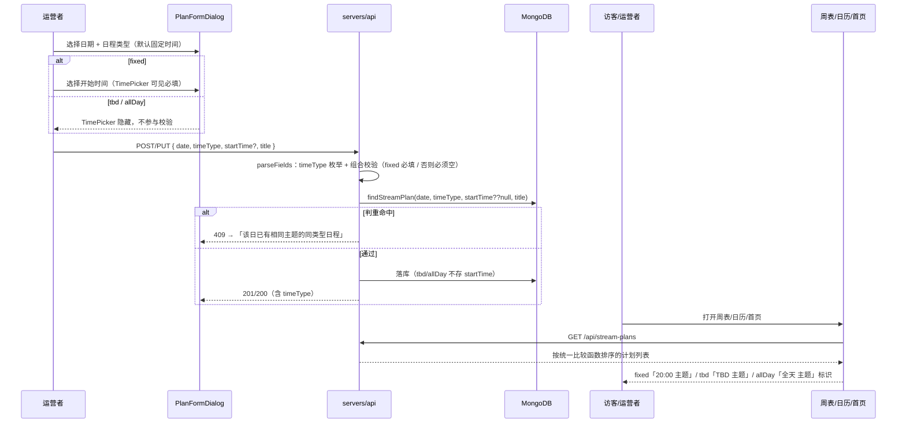

# 周表灵活时间日程 - 技术提案

**功能名称**: 周表灵活时间日程（Weekly Schedule Flexible Time）
**关联 PRD**: `docs/product/requirements/draft/2026-09-08-weekly-schedule-flexible-time-prd.md`
**技术提案版本**: v1.0
**创建日期**: 2026-09-08
**作者**: sumire workflow
**prd-branch**: `prd/weekly-schedule-flexible-time`（需求总分支）
**feat-branch**: `feat/weekly-schedule-flexible-time`（开发分支，实现时自需求总分支合入 main 后切出）

## 1. 概述

### 1.1 背景

直播计划全链路现状：契约 `contract/stream-plans.openapi.yaml` 中 `StreamPlan = { id, date, startTime, title, createdAt, updatedAt? }`，`startTime` 必填（`HH:mm`）；服务端 `servers/api/src/db/streamPlans.ts` Mongoose schema `startTime required`、排序 `{ date: 1, startTime: 1 }`、`findStreamPlan` 按（date, startTime, title）判重；`servers/api/src/routes/streamPlans.ts` 的 `parseFields` 校验三字段、`startTime` 缺失 400。前端后台表单 `apps/bookstore/features/schedule/PlanFormDialog.tsx` 为「日期 + 开始时间 + 主题」三段式（`emptyField` 强制三字段）；`{schedules}` 渲染在 `apps/bookstore/features/schedule/weeklyImage/scheme.ts` 的 `buildDaySchedulesText`（按 `startTime` 升序、`` `${startTime} ${title}` `` 以「 / 」拼接）；其余消费 `startTime` 的展示点：`features/schedule/mergeEntries.ts`（计划+历史混排，`date || startTime` 排序）、`CalendarView.tsx`、`DayDetailDialog.tsx`、`features/home/TodaySchedule.tsx`、`features/home/WeeklySchedule.tsx`、前端 API 层 `features/schedule/api.ts`。

关联 PRD 要求添加日程支持「固定时间 / 时间待定 / 全天」三种类型，渲染与排序全站统一，判重键扩展。

### 1.2 目标

- 契约与数据模型：`StreamPlan` 增加 `timeType` 枚举（`fixed | tbd | allDay`，缺省 `fixed`）；`startTime` 仅在 `fixed` 必填且合法，`tbd`/`allDay` 时必须为空（不存值）；
- 判重键扩展为（date, timeType, startTime, title）；
- 前端表单新增「日程类型」单选并与 TimePicker 联动；`{schedules}` 渲染按类型输出 `20:00 主题` / `TBD 主题` / `主题`；
- 定义全站统一的日程排序比较函数（allDay → fixed 按 startTime 升序 → tbd），贯穿服务端列表、`{schedules}`、日历混排与首页区块。

### 1.3 范围

- **做**：`contract/stream-plans.openapi.yaml` 变更；`servers/api` 模型/路由校验/判重/排序；bookstore 表单、`scheme.ts` 渲染、排序比较函数与日历/详情/首页展示适配；单元测试、API 集成测试与 e2e 覆盖；上线 PR 内同步三个 spec 文件。
- **不做**：存量数据迁移（缺省即兼容）；TBD 转定档快捷操作；周表图片差异化视觉样式；历史直播记录模型的任何变更。

## 2. 技术架构

### 2.1 系统架构图



### 2.2 技术栈

| 层级 | 技术选型 | 说明 |
|------|---------|------|
| 后端 | Express 5 + TS strict | 既有 streamPlans 路由与模型扩展，无新端点 |
| 数据库 | MongoDB（Mongoose） | schema 增加 `timeType` 枚举字段，`startTime` 改非必填 |
| 契约 | OpenAPI 3.1（`contract/stream-plans.openapi.yaml`） | 单一事实源，先改契约 |
| 前端 | Next.js（`output: "export"`）+ React + TS | 表单联动、渲染与排序纯函数 |
| 测试 | Vitest（单元 / API 集成）、Playwright（e2e） | 复用现有设施 |

### 2.3 模块划分

| 模块 | 职责 | 关键技术点 |
|------|------|-----------|
| `contract/stream-plans.openapi.yaml` | `timeType` 枚举与组合约束、判重口径 | required 调整、`startTime` nullable、409 描述更新 |
| `servers/api/src/db/streamPlans.ts` | 模型与查询 | `timeType` 字段（缺省 `fixed`）、`startTime` 非必填、判重键扩展、应用层排序 |
| `servers/api/src/routes/streamPlans.ts` | 请求校验 | `parseFields` 增加 timeType 与 startTime 组合校验 |
| `apps/bookstore/features/schedule/timeType.ts`（新增） | 类型与排序共享模块 | `TimeType` 类型、类型秩、统一比较函数、展示文案 |
| `apps/bookstore/features/schedule/api.ts` | 前端 API 层 | `StreamPlan` 类型与 create/update 入参扩展 |
| `apps/bookstore/features/schedule/PlanFormDialog.tsx` | 表单 | 日程类型单选、TimePicker 联动隐藏、校验随类型切换 |
| `apps/bookstore/features/schedule/weeklyImage/scheme.ts` | `{schedules}` 渲染 | `buildDaySchedulesText` 按类型格式化 + 统一排序 |
| `mergeEntries.ts` / `CalendarView.tsx` / `DayDetailDialog.tsx` / `features/home/*` | 展示与混排 | 类型标识（全天/TBD）、统一排序 |

## 3. API 设计

契约 `contract/stream-plans.openapi.yaml` 变更（单一事实源，以下为要点，实现 PR 首提交即契约变更）：

```yaml
components:
  schemas:
    TimeType:
      type: string
      description: 日程类型：fixed 固定时间 / tbd 时间待定 / allDay 全天；缺省 fixed
      enum: [fixed, tbd, allDay]
      default: fixed
    StreamPlan:
      type: object
      required: [id, date, timeType, title, createdAt]   # startTime 移出 required
      properties:
        id: { type: string }
        date: { $ref: "#/components/schemas/Date" }
        timeType: { $ref: "#/components/schemas/TimeType" }
        startTime:
          anyOf:
            - $ref: "#/components/schemas/StartTime"
            - type: "null"
          description: 仅 timeType=fixed 时有值；tbd/allDay 为 null
        title: { $ref: "#/components/schemas/Title" }
        createdAt: { type: string, format: date-time }
        updatedAt: { type: string, format: date-time }
```

POST / PUT 请求体要点：

```yaml
requestBody:
  content:
    application/json:
      schema:
        type: object
        required: [date, title]            # startTime 改为条件必填；timeType 可缺省（=fixed）
        properties:
          date: { $ref: "#/components/schemas/Date" }
          timeType: { $ref: "#/components/schemas/TimeType" }
          startTime:
            anyOf:
              - $ref: "#/components/schemas/StartTime"
              - type: "null"
          title: { $ref: "#/components/schemas/Title" }
```

要点：

- 组合约束写入各端点 `description`：「`timeType` 缺省 `fixed`；`fixed` 时 `startTime` 必填且合法；`tbd`/`allDay` 时 `startTime` 必须为空（null 或缺省），携带非空 `startTime` 返回 400」；OpenAPI 无法直接表达条件必填，约束以描述 + 服务端校验为准（与既有「真实日期/真实时间」由服务端校验的口径一致）；
- 400/409 描述更新：400 增加「timeType 非法、timeType 与 startTime 组合非法」；409 描述改为「同日同类型同时间同主题已存在」（编辑排除自身口径不变）；
- GET 响应描述更新排序口径：「按 date 升序，同日按 全天 → 固定时间（startTime 升序）→ 时间待定」；
- 201/200 响应体同样返回 `timeType` 与可空 `startTime`；
- 向后兼容：旧客户端不携带 `timeType` 视为 `fixed`，`startTime` 必填行为不变；响应新增 `timeType` 字段不破坏既有消费方。

## 4. 数据模型

Mongoose schema（`servers/api/src/db/streamPlans.ts`）：

```ts
export type TimeType = "fixed" | "tbd" | "allDay";

const streamPlanSchema = new Schema<StreamPlanDoc>(
  {
    date: { type: String, required: true, index: true },
    timeType: { type: String, enum: ["fixed", "tbd", "allDay"], required: true, default: "fixed" },
    startTime: { type: String },   // 不再 required；tbd/allDay 不存值
    title: { type: String, required: true, trim: true },
    // createdBy / createdAt / updatedAt 不变
  },
  { versionKey: false },
);
```

- 存量文档无 `timeType` 字段：读取时 `toOutput` 归一化为 `doc.timeType ?? "fixed"`，**不做数据迁移**；`startTime` 保留原值，行为不变；
- `findStreamPlan` 判重条件扩展为 `{ date, timeType, startTime: startTime ?? null, title }`（tbd/allDay 时 `startTime` 为 null，等同「同日同类型同主题」判重）；
- `listStreamPlans`：Mongo 层排序退化为 `{ date: 1 }`，同日类型序在应用层用统一比较函数完成（见实现点 2）——集合低基数（周表数据量级），无性能问题，不引入派生排序字段；
- 无新集合、无索引变更、无缓存变更。

## 5. 技术实现方案

### 5.1 核心流程



### 5.2 关键实现点

#### 实现点 1: 契约与类型共享（前端 `features/schedule/timeType.ts` 新增）

- 前端新增小模块集中类型相关常量与纯函数：`TimeType = "fixed" | "tbd" | "allDay"`；类型秩 `timeTypeRank(t) = { allDay: 0, fixed: 1, tbd: 2 }`；统一比较函数 `comparePlans(a, b)`：先 `date`，再类型秩，再 `startTime`（fixed 间 `localeCompare`，空串兜底）；展示文案 `formatPlanLabel(plan)`：fixed → `` `${startTime} ${title}` ``、tbd → `TBD ${title}`、allDay → `${title}`；
- 该模块是 `{schedules}` 渲染、日历、首页共用的单一事实源，避免三处排序/格式化逻辑漂移；服务端不 import 前端代码，`routes/streamPlans.ts` 侧按同口径各写一份小型比较函数（两端以契约描述对齐，测试互锁）。

#### 实现点 2: 服务端校验与判重（`routes/streamPlans.ts` + `db/streamPlans.ts`）

- `parseFields` 扩展：`timeType` 缺省 `"fixed"`；非法枚举值 → 400「日程类型非法」；`fixed` 时 `startTime` 缺失/非法 → 400（现状文案沿用）；`tbd`/`allDay` 时 `startTime` 非空 → 400「时间待定/全天日程无需填写开始时间」；
- 写库时 `tbd`/`allDay` 的 `startTime` 一律置 null（不信任客户端置空），`toOutput` 输出 `timeType`（缺省归一 `fixed`）与 `startTime ?? null`；
- `listStreamPlans` 改为 `.sort({ date: 1 })` 后在应用层用比较函数稳定排序（同日类型秩 → startTime）；
- **风险点**: `startTime` 由 required 改为可选是 schema 放宽，存量写入路径只有本路由一处，组合校验在路由层兜住，模型层不加复杂条件校验（保持与既有「校验在路由、模型从简」的分层一致）。

#### 实现点 3: 后台表单联动（`PlanFormDialog.tsx`）

- 新增 `timeType` state（编辑态由 `initial.timeType ?? "fixed"` 初始化），日期下方渲染单选组「日程类型：固定时间 / 时间待定 / 全天」，样式对齐后台既有表单控件（`TextField`/`PrimaryButton` 同套类名语言）；
- `timeType === "fixed"` 时渲染 `TimePicker`；切换类型时：切到 tbd/allDay 清空 `startTime`，切回 fixed 不恢复（需重选）；
- `emptyField` 改为 `!date || !title.trim() || (timeType === "fixed" && !startTime)`；`validate()` 同步调整（fixed 才校验时间）；
- 提交入参：`fixed` → `{ date, timeType, startTime: parseTimeStr(startTime)!, title }`；tbd/allDay → `{ date, timeType, title }`（不带 startTime）；
- 409 文案随类型微调：「该日该时间已有相同主题的直播计划」（fixed）/「该日已有相同主题的同类型日程」（tbd/allDay）。

#### 实现点 4: `{schedules}` 渲染与全站展示适配

- `weeklyImage/scheme.ts` 的 `buildDaySchedulesText`：排序改用 `comparePlans`，格式化改用 `formatPlanLabel`（自 `../timeType` 导入）——fixed 输出逐字不变，存量单测零改动应仍绿，新增 tbd/allDay 用例；
- `mergeEntries.ts`：`CalendarEntry` 的 plan 分支携带 `timeType`；混排比较函数扩展为：同日先按「allDay 计划最前」，历史记录与 fixed 计划按 `startTime` 混排（现逻辑），tbd 计划最后；历史记录语义不变（恒有折算时间，视同 fixed 秩参与混排）；
- `CalendarView.tsx` / `DayDetailDialog.tsx`：条目时间位置改为按类型展示——allDay 显示「全天」、tbd 显示「TBD」、fixed 显示 `HH:mm`（复用 `formatPlanLabel` 或拆出时间槽位文案，实现时以最少改动为准）；
- `features/home/TodaySchedule.tsx` / `WeeklySchedule.tsx`：同一比较函数排序 + 类型标识；
- **风险点**: 展示点分散（5 处），以 `timeType.ts` 共享模块收敛；e2e 覆盖公开日历与后台日历两条路径防漏改。

#### 实现点 5: 前端 API 层（`features/schedule/api.ts`）

- `StreamPlan` 类型扩展：`timeType: TimeType`、`startTime: string | null`；
- `createPlan` / `updatePlan` 入参改为对象形 `{ date, timeType, startTime?, title }`（现状已是对象入参，`updatePlan` 为对象、`createPlan` 为位置参数——实现时统一为对象入参并更新调用点 `PlanFormDialog`）；
- 读取侧对老响应防御：`timeType ?? "fixed"`（契约保证必有，防御仅兜底）。

### 5.3 文档同步

上线 PR 内同步：`docs/product/spec/schedule-admin.md`（表单类型与判重）、`docs/product/spec/calendar.md`（类型标识与排序）、`docs/engineering/spec/backend-schedule.md`（模型字段、校验、排序口径）。

## 6. 技术决策

### 6.1 决策列表

| 决策 | 选项 A | 选项 B | 最终选择 | 原因 |
|------|--------|--------|---------|------|
| 类型建模 | 新增 `timeType` 枚举字段 | `startTime` 用哨兵值（如 `""` / `"TBD"`） | A | 哨兵值污染时间字段语义，校验与排序到处特判；枚举字段显式、可索引、契约可枚举约束 |
| 存量兼容 | `timeType` 缺省 `fixed`，读取归一，零迁移 | 全量数据迁移补字段 | A | 集合低基数但零迁移更稳：读取归一一处代码即覆盖；迁移脚本引入发布顺序耦合 |
| tbd/allDay 的 startTime | 不存值（null） | 存 `""` 或 `00:00` | A | 假数据会泄漏到排序与展示；null 语义明确，契约 `anyOf null` 表达 |
| 条件必填表达 | 契约描述 + 服务端校验 | JSON Schema `if/then` 强约束 | A | OpenAPI 3.1 虽支持 `if/then`，但与既有契约「格式 pattern + 服务端校验真实合法性」的口径一致更可读；服务端是唯一强制点 |
| 同日排序实现 | 应用层统一比较函数 | Mongo 派生排序字段（如 `sortKey`） | A | 低基数集合，派生字段引入写入一致性问题；比较函数一处定义多端复用 |
| 排序规则 | allDay → fixed 升序 → tbd | 按创建时间 / tbd 在最前 | A | PRD 指定；语义上全天是「当日基调」、TBD 是「当日补充」，固定时间为主体 |
| 判重键 | （date, timeType, startTime, title） | 维持（date, startTime, title） | A | 不含 timeType 会让同日 TBD 与全天同主题互撞（startTime 均 null）；含类型后语义清晰 |
| 排序/格式化逻辑复用 | 前端 `timeType.ts` 共享模块 | 各展示点各自实现 | A | 5 处消费点，各自实现必然漂移；单一模块单测锁定 |
| 「TBD」文案归属 | 前端渲染时拼前缀 | 服务端存进 title | A | title 保持运营者原始录入；文案是展示层决策，可演进（如周表差异化样式） |

### 6.2 依赖与约束

| 类型 | 内容 | 说明 |
|------|------|------|
| 依赖 | 既有 stream-plans 全链路（契约 / 路由 / 模型 / 前端组件） | 全部已上线，无新外部依赖 |
| 约束 | 契约先行 | 先改 `contract/stream-plans.openapi.yaml`，实现与测试以契约为准 |
| 约束 | 后端规范 | `docs/engineering/backend-rules.md`：错误 `{error}` 中文、TDD、`pnpm lint && pnpm test` 全绿 |
| 约束 | 前端规范 | `docs/engineering/frontend-rules.md` |
| 约束 | 分支 `<type>/<slug>`；禁 rebase/squash | `prd/weekly-schedule-flexible-time` 需求总分支 |
| 约束 | Spec 同步 | 上线 PR 内同步 `schedule-admin.md` / `calendar.md` / `backend-schedule.md` |

## 7. 项目结构

```
contract/
└── stream-plans.openapi.yaml              # TimeType schema、StreamPlan/请求体 required 调整、400/409/排序描述更新
servers/api/src/
├── db/streamPlans.ts                      # timeType 字段（缺省 fixed）、startTime 非必填、判重键扩展、应用层排序
└── routes/streamPlans.ts                  # parseFields 组合校验（枚举 + fixed 必填 / 否则必空）
apps/bookstore/features/schedule/
├── timeType.ts                            # 新增：TimeType、类型秩、comparePlans、formatPlanLabel
├── api.ts                                 # StreamPlan 类型扩展、create/update 入参扩展、读取防御
├── PlanFormDialog.tsx                     # 日程类型单选 + TimePicker 联动 + 校验随类型切换
├── mergeEntries.ts                        # 混排比较扩展（allDay 最前 / tbd 最后，历史记录视同 fixed 秩）
├── CalendarView.tsx / DayDetailDialog.tsx # 类型标识（全天 / TBD）与统一排序
└── weeklyImage/scheme.ts                  # buildDaySchedulesText 按类型格式化 + 统一排序
apps/bookstore/features/home/
├── TodaySchedule.tsx / WeeklySchedule.tsx # 类型标识与统一排序
apps/bookstore/tests/unit/                 # timeType 比较/格式化、表单联动、scheme 渲染用例
tests/api/src/stream-plans.test.ts         # 三类型 CRUD、组合校验 400、判重 409、排序断言、旧请求兼容
tests/e2e/src/backdoor/schedule.spec.ts    # 表单类型联动、保存与回显
tests/e2e/src/bookstore/calendar.spec.ts   # 公开日历类型标识与排序
```

## 8. 测试策略

### 8.1 测试覆盖要求

- 契约：OpenAPI 校验通过（既有契约 lint 口径）；
- API 集成测试（`tests/api/src/stream-plans.test.ts` 扩展）：
  - 三类型创建/编辑成功路径（tbd/allDay 不带 startTime → 201/200，响应 `startTime: null`、`timeType` 正确）；
  - 组合校验 400：fixed 缺 startTime（现状回归）、tbd/allDay 携带 startTime、非法 timeType；
  - 判重 409：同日同 TBD 同主题、同日同全天同主题；同日 TBD 与全天同主题不 409；编辑排除自身；
  - 兼容：不携带 `timeType` 的请求体行为与现状逐一致；
  - GET 排序断言：构造混合类型数据验证「allDay → fixed 升序 → tbd」；
- 单元测试（`apps/bookstore/tests/unit/`）：`timeType.ts` 比较函数（类型秩、同日 fixed 升序、date 优先、null 兜底）与 `formatPlanLabel` 三类型输出；`buildDaySchedulesText` 三类型渲染与排序拼接（fixed 旧用例零改动仍绿）；`mergeEntries` 混排（allDay 最前、历史与 fixed 按时间混排、tbd 最后）；表单组件（类型切换隐藏/显示 TimePicker、校验随类型变化、切换清空时间）；
- e2e：后台表单选「时间待定/全天」→ 时间控件隐藏 → 保存成功 → 日历/当日详情显示「TBD」/「全天」标识；公开日历排序与标识；周表图片 `{schedules}` 含 TBD/全天条目渲染正确。

### 8.2 测试类型

| 类型 | 工具 | 覆盖范围 |
|------|------|---------|
| 单元测试 | Vitest + Testing Library | 比较函数、格式化、scheme 渲染、mergeEntries、表单联动 |
| API 集成测试 | Vitest + fetch（tests/api） | 三类型 CRUD、组合校验、判重、排序、旧请求兼容 |
| E2E 测试 | Playwright（tests/e2e） | 后台表单闭环、公开/后台日历标识与排序、周表渲染 |

## 9. 部署方案

### 9.1 环境规划

| 环境 | 用途 | 部署方式 |
|------|------|---------|
| 本地联调 | Aspire 编排（既有四资源） | `aspire start`，无新增资源配置 |
| 生产 | 既有 API + 静态站部署 | 无新配置项；存量数据零迁移，随版本发布即生效 |

### 9.2 配置管理

无新增配置项；无环境变量、无 Aspire 变更。

## 10. 验收标准

- [ ] 技术方案评审通过
- [ ] 契约含 `TimeType` 与组合约束描述且通过校验；服务端实现与契约一致
- [ ] 三种类型日程可录入/编辑/删除；`fixed` 缺 `startTime`、`tbd`/`allDay` 带 `startTime`、非法 `timeType` 均 400
- [ ] 判重键（date, timeType, startTime, title）生效：同日 TBD/全天同主题 409，跨类型同主题不冲突
- [ ] 全站排序统一：allDay → fixed 按 startTime 升序 → tbd；`{schedules}` 渲染 `20:00 主题` / `TBD 主题` / `主题`
- [ ] 日历、当日详情、首页今日/每周日程显示「全天」「TBD」标识，无伪时间
- [ ] 不携带 `timeType` 的旧请求与存量数据行为零回归；历史直播混排零回归
- [ ] 单元、API、E2E 测试全绿；`pnpm lint && pnpm test` 全绿
- [ ] Spec 同步：上线 PR 内更新 `docs/product/spec/schedule-admin.md`、`docs/product/spec/calendar.md`、`docs/engineering/spec/backend-schedule.md`

## 11. 相关文档

- 关联 PRD：`docs/product/requirements/draft/2026-09-08-weekly-schedule-flexible-time-prd.md`
- 契约：`contract/stream-plans.openapi.yaml`
- 产品 Spec（现态）：`docs/product/spec/schedule-admin.md`、`docs/product/spec/calendar.md`
- 工程 Spec（现态）：`docs/engineering/spec/backend-schedule.md`
- 周表二期提案（已归档）：[[2026-08-15-weekly-schedule-v2-proposal]]
- 开发规范：`docs/engineering/frontend-rules.md`、`docs/engineering/backend-rules.md`
