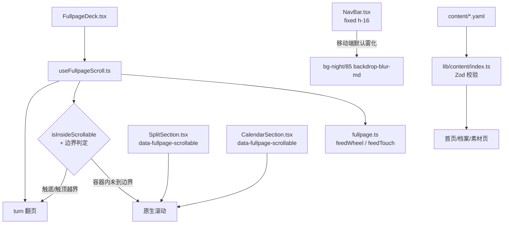
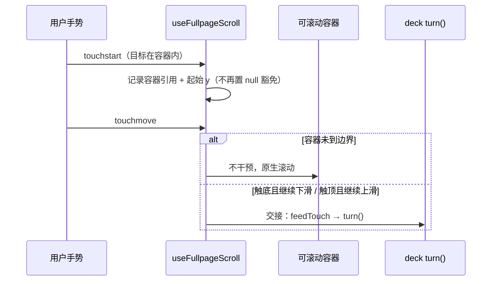

# 首页展示优化 - 技术提案

**功能名称**: 首页展示优化（Home Display Polish）
**关联 PRD**: `docs/product/requirements/draft/2026-09-14-home-display-polish-prd.md`
**技术提案版本**: v1.0
**创建日期**: 2026-09-14
**作者**: sumire workflow
**prd-branch**: `prd/home-display-polish`（需求总分支）
**feat-branch**: `feat/home-display-polish`（开发分支，实现时自需求总分支合入 main 后切出）

## 1. 概述

### 1.1 背景

首页 deck 由 `apps/bookstore/features/home/FullpageDeck.tsx`（容器 `h-svh overflow-hidden`）与 `useFullpageScroll.ts`（471 行，全部输入逻辑）驱动，手势纯函数在 `fullpage.ts`（`feedWheel`/`feedTouch`，阈值 `WHEEL_THRESHOLD=48`、`TOUCH_THRESHOLD=50`、`COOLDOWN=400ms`）。触摸/滚轮监听为 window 级**被动**监听（`{ passive: true }`，从不 `preventDefault`）。

可滚动站豁免逻辑 `isInsideScrollable`（`useFullpageScroll.ts:332-345`）：触摸/滚轮目标命中 `[data-fullpage-scrollable]` 且容器溢出（`scrollHeight > clientHeight + 1`）时，`touchstart` 直接把 `touchStartRef` 置 null（361-364 行），整段手势豁免给原生滚动。**该判定只看手势起点、不看滚动边界，且手势中途不重新评估**——内容滑到底后继续滑动，`onTouchMove` 因 `touchStartRef.current` 为 null 直接 return（369 行），既无法继续滚动也无法翻页。wheel 链路（`onWheel` 349-357 行）同理。这是 PRD F1「滑到底无法翻页」的根因。

现有豁免容器两处：`SplitSection.tsx:50-55`（档案各站内容列，移动端 `overflow-y-auto`、桌面 lg 起 `overflow-visible`）与 `CalendarSection.tsx:9`（日历站整 section，`overflow-y-auto`）。素材站的 deck/free 边界已有边界处理先例（`reclaimToDeck` 209-220 行、`turn` 227-229 行检测 `BOUNDARY_DEADZONE`），可滚动站缺的正是同款「触底/触顶交接」。

F2/F3 为样式问题：日历站顶部仅 `py-3`、独立 `/calendar` 页 `py-14`（56px），均小于 fixed NavBar 高度 64px（`NavBar.tsx:144`，`fixed inset-x-0 top-0 z-40 h-16`）；NavBar 默认透明，仅滚动 >24px 或菜单展开时才有 `bg-night/85 backdrop-blur-md`（`NavBar.tsx:143-148`）。

F4 为内容维护：素材 `content/assets.yaml`（5 条）与档案 `content/profile.yaml`，构建期经 `lib/content/index.ts`（Zod 校验）读取。

### 1.2 目标

- `useFullpageScroll` 增加滚动边界感知：可滚动容器到顶/到底后，同向越界手势交接给 deck 翻页；未到边界时维持原生滚动；
- 日历站与独立 `/calendar` 页为 fixed NavBar 留足顶部空间；
- 移动端 NavBar 默认态即带背景模糊；
- `assets.yaml` / `profile.yaml` 按官方信息源（萌娘百科、B 站空间/动态）更新，新素材图片入库并生成缩略图。

### 1.3 范围

- **做**：`useFullpageScroll.ts`/`fullpage.ts` 边界交接；`CalendarSection.tsx`、`CalendarViewPage.tsx` 顶部间距；`NavBar.tsx` 移动端默认雾化；`content/` 与 `public/assets/` 内容更新；相关单测；上线 PR 内同步 spec。
- **不做**：手势体系重构（不引入全局 `preventDefault` 接管）；deck 结构变更；API/契约/编排变更；内容自动抓取管线（本期人工核对更新）。

## 2. 技术架构

### 2.1 系统架构图



### 2.2 技术栈

| 层级 | 技术选型 | 说明 |
|------|---------|------|
| 前端 | Next.js + React + Tailwind（既有） | 手势 hook 与样式类调整 |
| 内容 | YAML + Zod（既有内容管道） | `assets.yaml` / `profile.yaml` 更新，`pnpm thumbnails` 生成缩略图 |
| 测试 | Vitest + Testing Library（既有） | 手势交接、NavBar、日历用例 |

### 2.3 模块划分

| 模块 | 职责 | 关键技术点 |
|------|------|-----------|
| `features/home/useFullpageScroll.ts` | 边界感知与交接 | touchstart 记录容器引用；touchmove/wheel 边界检测后交还 `turn()` |
| `features/home/fullpage.ts` | 纯函数 | 视情况扩展可测的边界判定纯函数 |
| `features/home/sections/CalendarSection.tsx` | 日历站顶部间距 | 顶部 padding 留位 NavBar |
| `features/schedule/CalendarViewPage.tsx` | 独立日历页顶部间距 | 与 `/about` 口径对齐 |
| `components/NavBar.tsx` | 移动端默认雾化 | 断点条件类 |
| `content/assets.yaml` / `content/profile.yaml` | 内容更新 | 官方信息源核对，Zod schema 不变 |

## 3. API 设计

无 API 变更，无契约变更。

## 4. 数据模型

无数据模型变更。`assets.yaml` / `profile.yaml` 沿用既有 Zod schema，仅改数据不改动 schema；若官方信息出现 schema 无法表达的字段，本期不扩展 schema，仅记录于 PR 说明。

## 5. 技术实现方案

### 5.1 核心流程

触摸交接流程（wheel 同理）：



### 5.2 关键实现点

#### 实现点 1: 触摸链路边界交接（useFullpageScroll.ts）

- `onTouchStart` 命中可滚动容器时：不再 `touchStartRef.current = null` 整段豁免，而是记录起始位置并同时记录容器引用（如 `touchScrollableRef`）；命中非容器时维持现状；
- `onTouchMove` 增加分支：若 `touchScrollableRef` 存在，先计算容器边界——
  - 向下越界：`scrollTop + clientHeight >= scrollHeight - ε` 且手势方向向下（位移超阈值）→ 交还 `feedTouch`/`turn()` 翻下一页，并清除容器引用防止同手势连翻；
  - 向上越界：`scrollTop <= ε` 且手势方向向上 → 翻上一页；
  - 否则 return（原生滚动，现状）；
  - ε 取 1-2px 容差（与现有 `+ 1` 溢出判断口径一致）；
- `onTouchEnd`/`onTouchCancel` 清理 `touchScrollableRef`；
- 保持 `{ passive: true }`，全程不 `preventDefault`：交接通过「原生滚动已触底无位移 + 翻页 transform」实现，不与浏览器抢手势；
- **风险点**: 触底瞬间原生惯性滚动与翻页 transform 叠加造成视觉跳动——交接后以容器引用清除 + `COOLDOWN` 双重约束单次手势只翻一页；必要时给容器加 `overscroll-behavior: contain`（CSS，非 JS 拦截）抑制回弹链；
- **风险点**: 日历站内拖拽交互（`schedule-calendar-drag`）起点也在容器内——边界分支只在容器到界且位移超阈值时触发，日历拖拽的短位移不受影响；实现后以既有拖拽用例验证零回归。

#### 实现点 2: 滚轮链路边界交接（useFullpageScroll.ts）

- `onWheel`（349-357 行）目标在滚动列内时，同样增加边界判定：列已到边界且滚轮同向 → 不 return，走既有 `feedWheel` 翻页；未到边界 → return（列内原生滚动）；
- wheel 无「手势会话」，边界判定逐事件进行，依赖既有 `WHEEL_THRESHOLD` 与 `COOLDOWN` 防抖，无需容器引用；
- **风险点**: 触控板惯性滚动在触底后持续派发 wheel 事件导致连翻——既有 `COOLDOWN=400ms` 已覆盖，与不可滚站行为一致。

#### 实现点 3: 日历顶部间距（CalendarSection.tsx / CalendarViewPage.tsx）

- `CalendarSection.tsx:9`：`py-3` 调整为 `pb-3 pt-20`（80px = NavBar 64px + 16px 余量），移动端与桌面端统一（桌面端同样 fixed NavBar 覆盖，现状 py-3 同样不足）；
- `CalendarViewPage.tsx:59` 非 compact 形态：`py-14`（56px）调整为 `pb-14 pt-28`（112px），与 `/about` 独立页 `pt-28` 口径一致；
- compact 形态（deck 内嵌套）不由 `CalendarViewPage` 控制间距，以 `CalendarSection` 为准；
- 纯类名调整，不动布局结构。

#### 实现点 4: 移动端 NavBar 默认雾化（NavBar.tsx）

- header 条件类（143-148 行）调整为：默认态在移动端即带雾化——`bg-transparent` 分支改为 `max-md:bg-night/85 max-md:backdrop-blur-md max-md:shadow-[0_1px_0_0_var(--color-vine)]`（桌面端 `md:` 起保持透明）；
- 滚动态/菜单展开态类名不变；`md` 断点与导航桌面/移动分化断点一致（桌面列表 `md:flex`）；
- **风险点**: 首屏 hero 区视觉变化（移动端首屏 NavBar 不再透明）——PRD 已明确移动端默认雾化为需求，桌面端不受影响。

#### 实现点 5: 内容更新（content/ + public/assets/）

- 信息源：萌娘百科条目（`https://zh.moegirl.org.cn/枝堇`）、B 站个人空间/动态（`https://space.bilibili.com/1150976664`，`site.yaml`/`profile.yaml` 已收录链接）；
- `profile.yaml`：核对 name/race/likes/games/milestones/anecdotes 等字段与官方口径的差异，补新修错；里程碑按时间序追加；
- `assets.yaml`：新增官方公开素材条目（id 语义化、category 沿用 standing/illustration/promo），图片原文件入 `public/assets/original/`，运行 `pnpm thumbnails` 生成缩略图；宽度/高度按实际图片填写；
- 内容核对结论（更新了哪些字段、信息源链接、无差异项）写入实现 PR 描述，保证可溯源；
- **风险点**: B 站动态/萌娘百科可能需登录或反爬不可达——不可达时以最近一次可访问的官方信息为准并在 PR 中说明，不编造内容。

#### 实现点 6: Spec 同步（实现 PR 内）

- `docs/product/spec/site-pages.md`：首页 deck 小节补充「可滚动站触底/触顶交接翻页」现态；全局小节 NavBar 描述补充移动端默认雾化；日历站/素材站描述随 F2/F4 更新；
- `docs/product/spec/calendar.md`：日历页导航留位现态；
- `docs/engineering/spec/frontend-bookstore.md`：手势链路补充边界交接机制；顺带修正已过期的「首页一屏封面页」章节（46-53 行，仍描述流式封面页，与 8 站 deck 现态不符）。

## 6. 技术决策

### 6.1 决策列表

| 决策 | 选项 A | 选项 B | 最终选择 | 原因 |
|------|--------|--------|---------|------|
| 交接机制 | 边界感知交接（被动监听不变） | 全局 preventDefault 统一接管手势 | A | 被动监听是现有滚动性能与日历拖拽兼容的根基；全局接管改动面与回归风险大 |
| 触摸豁免粒度 | touchstart 记录容器，touchmove 逐次判边界 | touchstart 一次性判定 | A | 一次性判定正是当前 bug 根因 |
| wheel 交接 | 逐事件边界判定 | 引入滚动手势会话跟踪 | A | 既有 WHEEL_THRESHOLD + COOLDOWN 已防抖，会话跟踪是过度设计 |
| 回弹抑制 | CSS `overscroll-behavior: contain`（按需） | JS 拦截 touchmove | A | 被动监听约束下 JS 无法拦截；CSS 声明零成本 |
| 日历间距 | padding-top 留位 | NavBar 改 static/粘着 | A | NavBar 全站 fixed 是既定形态，仅调内容侧间距 |
| 移动端雾化 | 断点条件类（max-md） | JS 媒体查询状态 | A | 纯 CSS 断点，无运行时状态与 hydration 风险 |
| 内容更新方式 | 人工核对官方信息源更新 YAML | 抓取管线自动同步 | A | 本期一次性更新；自动化是后续可能 |

### 6.2 依赖与约束

| 类型 | 内容 | 说明 |
|------|------|------|
| 依赖 | 萌娘百科条目、B 站空间/动态可访问 | F4 信息源；不可达时在 PR 中说明 |
| 依赖 | `pnpm thumbnails` 缩略图脚本 | 新素材入库流程既有环节 |
| 约束 | TDD | 边界交接先补失败用例再实现 |
| 约束 | 前端规范 | `docs/engineering/frontend-rules.md`；`pnpm lint && pnpm test` 全绿 |
| 约束 | 分支 `<type>/<slug>`；禁 rebase/squash | `prd/home-display-polish` 需求总分支 |
| 约束 | 内容原则 | 以官方公开信息为准，禁止二次设定 |

## 7. 项目结构

```
apps/bookstore/
├── features/home/
│   ├── useFullpageScroll.ts      # 触摸/滚轮边界交接
│   ├── fullpage.ts               # 边界判定纯函数（如需扩展）
│   └── sections/CalendarSection.tsx  # 日历站顶部间距
├── features/schedule/CalendarViewPage.tsx  # 独立日历页顶部间距
├── components/NavBar.tsx         # 移动端默认雾化
├── content/
│   ├── assets.yaml               # 素材更新
│   └── profile.yaml              # 档案更新
├── public/assets/original/       # 新素材原图
├── public/assets/thumbnails/     # pnpm thumbnails 生成
└── tests/unit/
    ├── home-fullpage-scroll.test.tsx  # 边界交接用例（先行失败）
    ├── home-fullpage.test.ts          # 纯函数用例（如扩展）
    ├── nav-bar.test.tsx               # 移动端雾化类名用例
    └── schedule-calendar-view.test.tsx / calendar-page-guard.test.tsx  # 间距回归
docs/product/spec/site-pages.md            # 实现 PR 内同步
docs/product/spec/calendar.md              # 实现 PR 内同步
docs/engineering/spec/frontend-bookstore.md  # 实现 PR 内同步（含过期章节修正）
```

## 8. 测试策略

### 8.1 测试覆盖要求

`home-fullpage-scroll.test.tsx` 新增用例（先行失败再实现）：

- 触摸起点在可滚动容器内、容器未到底：向下滑不翻页（既有用例 427-484 行保持绿）；
- 容器已触底（`scrollTop + clientHeight === scrollHeight`）继续下滑：触发翻下一页；
- 容器已触顶（`scrollTop === 0`）继续上滑：触发翻上一页；
- 单次手势触底后持续滑动：只翻一页（冷却与容器引用清除生效）；
- wheel：指针在滚动列内且列触底，同向 wheel 翻页；未到底不翻页；
- 回归：既有全部用例不动仍绿（含日历拖拽、deck/free 边界）。

`nav-bar.test.tsx` 新增用例：

- 未滚动、菜单未展开时 header 类名含移动端雾化类（`max-md:bg-night/85`、`max-md:backdrop-blur-md`），且不含桌面端默认态背景；
- 滚动态/展开态类名不变（回归）。

日历间距：以组件渲染类名断言为主（`CalendarSection` 含 `pt-20` 口径类），交互回归由既有日历用例覆盖。

F4 内容：`asset-gallery.test.tsx` 及内容管道既有校验（Zod）保障新增条目可渲染；`pnpm lint && pnpm test` 全绿。

### 8.2 测试类型

| 类型 | 工具 | 覆盖范围 |
|------|------|---------|
| 单元测试 | Vitest + Testing Library（jsdom） | 边界交接、NavBar 类名、日历间距类名、内容渲染 |
| e2e | Playwright（既有 `tests/e2e/src/bookstore/site.spec.ts`） | 不新增 spec 文件；移动端真实触摸交接以手工验证补充（jsdom 无法模拟原生滚动惯性） |

## 9. 部署方案

### 9.1 环境规划

| 环境 | 用途 | 部署方式 |
|------|------|---------|
| 本地联调 | 既有 Aspire 编排 | 无新增资源配置 |
| 生产 | 既有 bookstore SSG 发布 | 无新增 env，内容与代码随构建产物更新 |

### 9.2 配置管理

无配置变更。

## 10. 验收标准

- [ ] 技术方案评审通过
- [ ] 移动端可滚动站触底/触顶后同向滑动交接翻页；未到边界原生滚动不误翻；单次手势不连翻
- [ ] 桌面端滚轮在可滚动列边界处同向滚动交接翻页；既有 deck/free 边界与日历拖拽零回归
- [ ] 移动端日历站与独立 `/calendar` 页与 NavBar 无重叠；桌面端无过大空白
- [ ] 移动端 NavBar 默认态背景模糊；桌面端透明→雾化行为不变
- [ ] `profile.yaml` / `assets.yaml` 完成官方信息源核对更新，新素材图片与缩略图入库，素材页正常展示
- [ ] 新增用例与既有用例全绿；`pnpm lint && pnpm test` 全绿
- [ ] Spec 同步：实现 PR 内更新 `site-pages.md`、`calendar.md`、`frontend-bookstore.md`

## 11. 相关文档

- 关联 PRD：`docs/product/requirements/draft/2026-09-14-home-display-polish-prd.md`
- 站点页面 Spec（现态）：`docs/product/spec/site-pages.md`
- 日历 Spec（现态）：`docs/product/spec/calendar.md`
- 前端 Spec（现态）：`docs/engineering/spec/frontend-bookstore.md`
- 开发规范：`docs/engineering/frontend-rules.md`
