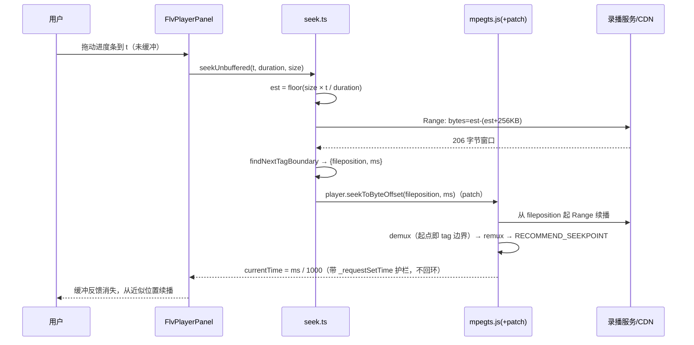

# 录播播放优化一期 - 技术提案

**功能名称**: 录播播放优化一期（时间跳转修复 + 全屏）
**关联 PRD**: `docs/product/requirements/draft/2026-09-15-recordings-seek-fullscreen-prd.md`
**技术提案版本**: v1.0
**创建日期**: 2026-09-15
**作者**: sumire workflow
**prd-branch**: `prd/recordings-seek-fullscreen`（需求总分支）
**feat-branch**: `feat/recordings-seek-fullscreen`（开发分支，实现时自需求总分支合入 main 后切出）

## 1. 概述

### 1.1 背景

录播页 F5 在线预览现态（`features/recordings/FlvPlayerPanel.tsx` + `player.ts`，见 `docs/engineering/spec/frontend-bookstore.md` 录播节）：进度条是否可拖由 `probeSeekable()`（`Range: bytes=0-0` 探测）门控，当时上游不支持 Range 故禁用。

**2026-09-15 实测上游已支持 Range**：外网 `GET /api/b/live/:roomId/recordings/:fileName` 携带 `Range: bytes=0-1023` 返回 `206`、`Accept-Ranges: bytes`、正确 `Content-Range`（CDN 分片已缓存）。探测放开后暴露卡死问题：点击/拖动时间轴到未缓冲位置，播放界面整体卡死。

**根因（源码级，基于 mpegts.js master 与 flv.js 同源代码确认）**：

1. 上游 FLV 为录制端直接 dump（实测 `onMetaData`：`encoder: Lavf60.16.100`，含 `duration`/`width`/`height` 等，**不含 `keyframes` 关键帧索引**）；
2. `handleSeek` 写 `video.currentTime` → mpegts `FlvPlayer._onvSeeking` → 目标未缓冲 → 登记 `_seekpointRecord` 并每 50ms 执行 `_checkAndApplyUnbufferedSeekpoint` → 每轮调用 `transmuxer.seek(ms)`；
3. `TransmuxingController.seek` 首行即 `if (this._mediaInfo == null || !this._mediaInfo.isSeekable()) return;`，而 `MediaInfo.isSeekable() === (hasKeyframesIndex === true)`——无关键帧索引时 **seek 静默 no-op**，目标位置永远不会有数据；
4. 校正循环因此**无限重试**（50ms 间隔），画面冻结、控件无响应，即用户可感的「整体卡住」。

补充事实：mpegts.js/flv.js 的 FLV demuxer（`parseChunks`）**无 mid-stream resync 能力**，要求加载起点为 FLV 文件头或 tag 边界——这决定了「估算字节偏移直接续播」必须先对齐到 tag 边界。

### 1.2 目标

- 修复未缓冲位置 seek 卡死：基于 Range + 码率估算 + tag 边界扫描实现「近似 seek」，任何拖动落点均可续播、不卡死；
- 播放控件新增「全屏」（Fullscreen API）与「网页全屏」（纯 CSS 视口铺满）；
- 保持既有降级语义与单例播放器语义，零侵入其它录播功能。

### 1.3 范围

- **做**：`player.ts`/`FlvPlayerPanel.tsx` 改造；新增 seek 支撑模块（偏移估算 + tag 边界扫描）；对 `mpegts.js` 的 pnpm patch（暴露按字节偏移续播入口）；全屏/网页全屏控件；单测/e2e；实现 PR 内同步 spec。
- **不做**：`servers/api`/契约/编排资源变更；上游文件格式改造（注入关键帧索引作为后续建议另立）；精确到帧的 seek；快捷键/倍速等增强；iOS MSE 降级策略变更。

## 2. 技术架构

### 2.1 系统架构图

```mermaid
graph LR
    subgraph 浏览器（/recordings 播放区）
        PANEL[FlvPlayerPanel<br/>控制条 + 全屏状态机]
        SEEK[seek.ts<br/>偏移估算 + tag 边界扫描]
        PLAYER[player.ts 单例<br/>mpegts.js + patch]
    end
    UPSTREAM[录播服务 / CDN<br/>Range 206 ✓]

    PANEL -->|拖动未缓冲位置| SEEK
    SEEK -->|Range 窗口探测<br/>对齐 tag 边界 + 读时间戳| UPSTREAM
    SEEK -->|seekToByteOffset（patch 新增）| PLAYER
    PLAYER -->|从边界偏移 Range 续播| UPSTREAM
    PANEL -->|已缓冲位置：原生 currentTime| PLAYER
```

### 2.2 技术栈

| 层级 | 技术选型 | 说明 |
|------|---------|------|
| 前端 | Next.js 16 + React 19（既有） | 仅 `features/recordings/` 内改动 |
| FLV 播放 | `mpegts.js` ^1.8.2（既有） + pnpm patch（新增） | patch 经 `pnpm-workspace.yaml` `patchedDependencies` 登记 |
| 全屏 | Fullscreen API + 纯 CSS | 无新增依赖 |
| 测试 | Vitest + Testing Library；Playwright | 纯函数单测 + 组件行为单测（mock player/mpegts） |

### 2.3 模块划分

| 模块 | 职责 | 关键技术点 |
|------|------|-----------|
| `features/recordings/seek.ts`（新增） | seek 编排与纯函数 | 码率线性估算、FLV tag 边界扫描（可单测纯函数）、并发去重（last-wins） |
| `features/recordings/player.ts`（改造） | 单例播放器 + patch 桥接 | 新增 `seekToByteOffset` 转发；保留单例/代次/归属语义 |
| `patches/mpegts.js@1.8.2.patch`（新增） | 暴露按字节偏移续播 | 复用 mpegts 跨段 seek 的既有加载机制 |
| `features/recordings/FlvPlayerPanel.tsx`（改造） | 控制条 + 全屏 | 全屏状态机、缓冲反馈、键盘可达 |

## 3. API 设计

无本站 API 变更、无契约变更。上游端点沿用现态四组；seek 仅复用已存在的录播文件端点（Range 请求）。

前端内部新增接口（`seek.ts`）：

```ts
/** 由文件大小与总时长线性估算目标时间的字节偏移（纯函数）。 */
export function estimateByteOffset(targetMs: number, durationMs: number, fileSize: number): number;

/**
 * 在字节窗口内扫描下一个可信 FLV tag 边界（纯函数）：
 * 候选条件：tagType ∈ {8,9,18}；dataSize 合法；tag 末尾 PrevTagSize === 11 + dataSize；
 * 且紧邻下一字节仍为合法 tagType（窗口不足时放宽为单重校验）。
 */
export function findNextTagBoundary(
  window: Uint8Array,
  baseOffset: number,
): { fileposition: number; milliseconds: number } | null;

/** 未缓冲 seek 编排：估算 → Range 窗口探测 → 边界对齐 → 调 player.seekToByteOffset。 */
export async function seekUnbuffered(args: {
  url: string; targetSeconds: number; durationSeconds: number; fileSize: number;
}): Promise<boolean>;
```

## 4. 数据模型

无持久化变更。运行时输入：

- `fileSize`：录播列表 API 已返回的 `RecordingFile.size`；
- `duration`：播放启动后由 `video.duration`（来自 `onMetaData.duration`）获得；duration 未知前禁止未缓冲 seek（进度条 max 亦为 0，天然门控）。

## 5. 技术实现方案

### 5.1 核心流程（未缓冲 seek）



已缓冲 seek 不变：`video.currentTime = t` 直接命中 mpegts 的 buffered 分支即时定位。

### 5.2 关键实现点

#### 实现点 1: pnpm patch——暴露 `seekToByteOffset`

- **描述**：mpegts.js 内部 `_loadSegment(segmentIndex, optionalFrom)` 已支持「从任意字节偏移开始加载」（跨段 seek 路径在用，久经 multipart 播放验证），但公开 API 无法触达，且 `transmuxer.seek` 被 `isSeekable()` 拦截。patch 在 `TransmuxingController` 增加一个方法并在 `MSEPlayer` 上转发：
  - `_internalAbort()` → `_remuxer.seek(ms)` + `insertDiscontinuity()` → `_loadSegment(0, fileposition)` → `_pendingResolveSeekPoint = ms`；
  - 不经过 `isSeekable()` 门（该门语义是"有关键帧索引才能精确 seek"，本路径为近似 seek，由调用方保证 fileposition 为 tag 边界）。
- **登记方式**：`pnpm-workspace.yaml` 增加 `patchedDependencies: { "mpegts.js@1.8.2": patches/mpegts.js@1.8.2.patch }`（工作区无根 package.json，pnpm 11 支持 workspace yaml 登记）；patch 针对包内未压缩构建产物，行数控制在数十行内、可评审。
- **风险点**：依赖升级时 patch 失效——`package.json` 将 `mpegts.js` 钉在精确版本（去 `^`），升级需同步重制 patch 并在 PR 中说明；demuxer 复用前提是会话内已播放过文件头（codecs/媒体信息已就绪），本方案 seek 均发生在播放启动后，成立。

#### 实现点 2: 偏移估算与 tag 边界扫描（seek.ts，纯函数）

- **描述**：`est = floor(size × t / duration)`（录制流码率近似恒定，偏差可接受；落点非精确为 PRD 认可形态）；随后以 `Range: bytes=est-(est+256KB)` 取窗口，`findNextTagBoundary` 自窗口头部扫描首个通过「tagType 合法 + PrevTagSize 一致性 + 下一 tag 头合法」三重校验的位置，同时读出该 tag 的 timestamp 作为续播时间基准。
- **技术细节**：扫描窗口 256KB 内必有 tag 边界（FLV tag 最大约 视频帧大小 量级，远小于窗口）；三重校验把误对齐概率压到可忽略；timestamp 让 remuxer 的 seek 基准与实际落点一致，UI 以真实续播位置刷新。
- **风险点**：VBR 波动导致估算偏移偏差较大——一期不迭代收敛（落点近似即可）；若窗口内扫描失败，降级为「从 est 直接尝试」→ demux 报错 → 走既有播放失败提示（可重试），不卡死。

#### 实现点 3: 卡死回路的消除与并发治理

- **描述**：未缓冲 seek 不再写 `video.currentTime`（避免触发 `_onvSeeking` → 50ms 校正死循环）；改由 patch 路径完成加载，mpegts 经 `RECOMMEND_SEEKPOINT` 在 `_requestSetTime` 护栏下回写 `currentTime`；
- 快速连续拖动：`seekUnbuffered` 以代次号实现 last-wins（沿用 `player.ts` 既有 generation 模式），过期探测结果丢弃；
- 拖动途中切换文件/关闭/卸载：沿用 `destroyPlayer(url)` 归属语义；
- 播放区增加 seek 中状态（`seeking` flag）：进度条展示缓冲态、播放按钮 loading，杜绝「无反馈冻结」观感。
- **风险点**：mpegts 的 lazyLoad suspend/resume 与 patched 路径交互——实现期对「长播暂停后再 seek」场景做手动验证。

#### 实现点 4: 全屏与网页全屏（FlvPlayerPanel）

- **状态机**：`fullscreenMode: "none" | "native" | "web"`；
  - `native`：`containerRef.requestFullscreen()`（容器含画面 + 控制条，控件随迁可用）；监听 `fullscreenchange` 同步状态（ESC 退出自动复位按钮态）；能力检测 `document.fullscreenEnabled` 为 false 时隐藏入口；
  - `web`：容器切换为 `fixed inset-0 z-50 bg-black`（token 色），`document.body` 滚动锁定并在退出时还原；监听 ESC 键退出；
  - 两者互斥（进入其一先退出另一个）；切换文件/关闭播放区前先复位为 `none`；
- **技术细节**：不引入第三方播放器 UI 库，沿用现有 lucide 图标与控制条结构，diff 最小；
- **风险点**：iOS Safari 的 Fullscreen API 限制——该平台本就 MSE 降级（不创建播放器），无影响；`webkit` 前缀分支仅在未来需要时补。

#### 实现点 5: Spec 同步（实现 PR 内）

- `docs/product/spec/site-pages.md` F5 节：进度条 seek 现态改为「近似 seek（无关键帧索引时码率估算落点）」+ 全屏/网页全屏能力描述；
- `docs/engineering/spec/frontend-bookstore.md` 录播节：seek.ts 模块、patch 登记与版本钉死、`seekToByteOffset` 桥接、全屏状态机；
- 根 `AGENTS.md` 无变更。

## 6. 技术决策

### 6.1 决策列表

| 决策 | 选项 A | 选项 B | 最终选择 | 原因 |
|------|--------|--------|---------|------|
| seek 修复路线 | pnpm patch 暴露字节偏移续播 + 应用层估算/对齐 | fork mpegts.js 以 git 依赖替换 | A | patch 面小（数十行）、随 lockfile 可评审；fork 引入长期维护分叉 |
| 上游协作路线 | 前端自闭环近似 seek | 等上游注入关键帧索引后精确 seek | A（B 列为后续建议） | 上游排期不可控；PRD 接受近似落点；上游注入索引后前端可平滑切精确 seek |
| 时间→字节映射 | 码率线性估算 + tag 边界扫描 | 边下边建索引 / 服务端转封装 HLS | A | 零服务端成本；转 HLS 违背纯前端约束且 GB 级转封装开销不可接受 |
| 未缓冲 seek 入口 | patch `seekToByteOffset`（复用跨段加载机制） | 自研 fetch→MSE 管线绕开 mpegts | A | 复用 mpegts 已验证的 remux/discontinuity 机制，风险最低 |
| 全屏实现 | 容器级 Fullscreen API + 纯 CSS 网页全屏 | 引入播放器 UI 库（video.js 等） | A | 现有自定义控制条已满足需求，引入 UI 库为过度设计 |
| 依赖版本管理 | 钉死 `mpegts.js` 精确版本 + patch | 保持 `^` 语义化范围 | A | patch 与版本强绑定，浮动版本会导致 patch 漂移失效 |

### 6.2 依赖与约束

| 类型 | 内容 | 说明 |
|------|------|------|
| 依赖 | 上游 Range 支持稳定 | 2026-09-15 实测 206 + `Accept-Ranges: bytes`（CDN 命中） |
| 依赖 | 录播列表 API 返回文件 `size`；`onMetaData` 含 `duration` | 估算输入，现态已满足（实测） |
| 依赖 | pnpm 11 `patchedDependencies`（pnpm-workspace.yaml） | 工作区无根 package.json |
| 约束 | 纯前端；TDD；`pnpm lint && pnpm test` 全绿 | 先测试后实现 |
| 约束 | 分支 `<type>/<slug>`；禁 rebase/squash | `prd/recordings-seek-fullscreen` → 合入 main 后切 `feat/recordings-seek-fullscreen` |
| 约束 | FLV demuxer 无 resync | seek 起点必须由应用层对齐 tag 边界（本方案核心约束） |

## 7. 项目结构

```
apps/bookstore/
├── features/recordings/
│   ├── seek.ts                # 新增：估算/边界扫描纯函数 + seekUnbuffered 编排
│   ├── player.ts              # 改造：桥接 patched seekToByteOffset；语义不变量保持
│   └── FlvPlayerPanel.tsx     # 改造：seek 缓冲反馈 + 全屏/网页全屏状态机
├── package.json               # mpegts.js 钉精确版本
├── tests/unit/                # seek 纯函数用例（构造 FLV 字节夹具）+ 播放区/全屏行为用例
patches/
└── mpegts.js@1.8.2.patch      # 新增：TransmuxingController/MSEPlayer 暴露字节偏移续播
pnpm-workspace.yaml            # 登记 patchedDependencies
tests/e2e/src/bookstore/recordings.spec.ts  # 增补控件渲染与网页全屏断言（真实流式播放仍不在 e2e 断言）
docs/product/spec/site-pages.md             # 实现 PR 内同步
docs/engineering/spec/frontend-bookstore.md # 实现 PR 内同步
```

## 8. 测试策略

### 8.1 测试覆盖要求

- **纯函数单测（Vitest）**：`estimateByteOffset`（边界：t=0、t=duration、钳制）；`findNextTagBoundary`（构造含合法 tag 序列/噪声/截断窗口的字节夹具，断言边界 offset 与 timestamp 解析）；
- **组件单测（mock player 模块）**：已缓冲 seek 直接写 `currentTime` 且不触发 `seekUnbuffered`；未缓冲 seek 调用 `seekUnbuffered`、期间展示缓冲反馈；快速连续 seek last-wins；`probeSeekable=false` 时进度条禁用提示（现态回归）；全屏状态机（mock Fullscreen API）：进入/退出/互斥/ESC 同步/关闭播放区先退全屏；
- **e2e（Playwright）**：`page.route` mock 上游（对齐既有 recordings.spec.ts 模式）：控制条出现全屏/网页全屏按钮、网页全屏类名与滚动锁定断言；真实媒体 seek 行为不在 e2e 断言（流式媒体 e2e 不稳定，沿用上一期口径）。

### 8.2 测试类型

| 类型 | 工具 | 覆盖范围 |
|------|------|---------|
| 单元测试 | Vitest + Testing Library | seek 纯函数、播放区交互、全屏状态机、降级回归 |
| 手工验证 | 真实上游（本地 dev 代理/外网） | patched seek 端到端：跳转续播、连续拖动、长播后 seek、dev 代理 Range 透传复验 |
| API 测试 | 不新增 | 无本站 API 变更 |
| e2e | Playwright | 控件渲染与网页全屏（mock 上游） |

## 9. 部署方案

### 9.1 环境规划

| 环境 | 用途 | 部署方式 |
|------|------|---------|
| 本地联调 | 既有 Aspire 编排 + dev 代理 | 复验 dev 代理对 `Range`/`206` 的透传（不透传则探测降级为禁拖并明示，不影响生产） |
| 生产 | 既有 bookstore SSG 发布 | patch 随依赖安装生效（lockfile 锁定），无新增环境变量与基础设施 |

### 9.2 配置管理

无新增配置项。`pnpm-workspace.yaml` 新增 `patchedDependencies` 登记；`apps/bookstore/package.json` 将 `mpegts.js` 钉为精确版本。

## 10. 验收标准

- [ ] 技术方案评审通过
- [ ] 满足 PRD F1（时间跳转修复）与 F2（全屏/网页全屏）全部验收标准
- [ ] 已缓冲/未缓冲/连续拖动/切换与卸载场景均无死循环、无卡死，player 全局单例语义保持
- [ ] 上游 Range 不可用时降级为禁拖 + 明示（现态语义零回归）；iOS MSE 降级零回归
- [ ] patch 文件可评审、版本钉死，`pnpm install` 后 patch 生效
- [ ] `pnpm lint && pnpm test` 全绿；e2e 录播 spec 通过
- [ ] Spec 同步：`site-pages.md`（F5）、`frontend-bookstore.md`（录播节）

## 11. 相关文档

- 关联 PRD：`docs/product/requirements/draft/2026-09-15-recordings-seek-fullscreen-prd.md`
- 上一期提案（录播页）：`docs/engineering/proposals/2026-09-14-recordings-page-proposal.md`
- 前端 Spec（现态）：`docs/engineering/spec/frontend-bookstore.md`
- 站点页面 Spec（现态）：`docs/product/spec/site-pages.md`
- 开发规范：`docs/engineering/frontend-rules.md`
- mpegts.js API：`https://xqq.im/mpegts.js/docs/api.html`
