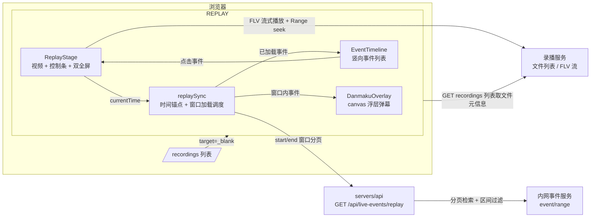
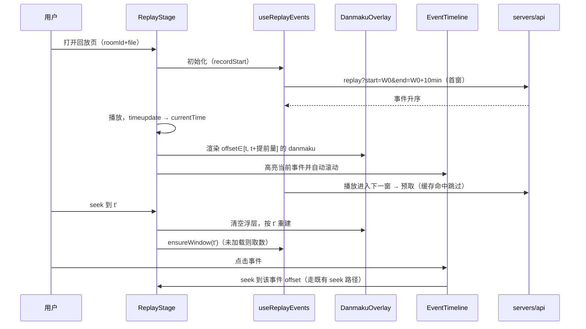

# 录播回放弹幕支持 - 技术提案

**功能名称**: 录播回放弹幕支持（Recordings Replay Danmaku）
**关联 PRD**: `docs/product/requirements/draft/2026-09-17-recordings-replay-danmaku-prd.md`
**技术提案版本**: v1.0
**创建日期**: 2026-09-17
**作者**: sumire workflow
**prd-branch**: `prd/recordings-replay-danmaku`（需求总分支）
**feat-branch**: `feat/recordings-replay-danmaku`（开发分支，实现时自需求总分支合入 main 后切出）

## 1. 概述

### 1.1 背景

录播页现态（`features/recordings/`，spec 见 `docs/product/spec/site-pages.md` 录播页节）：点击「播放」/文件名在文件项下方内联展开 FLV 播放器（`FlvPlayerPanel` + 全局单例 `player.ts` + `seek.ts` 近似 seek），纯视频无弹幕。

弹幕事件数据通路已存在：`servers/api` `liveEvents/` 域代理内网事件服务（`event/range` 分页检索），归一化为 `LiveEvent`（含 `occurredAt`），但全部端点需登录（member+）且合并已读状态与罗马音——服务于后台弹幕看板，不适合公开回放场景。

本需求（见 PRD）：录播播放改为打开独立回放页 `/recordings/replay`，左侧 16:9 视频叠加漂浮弹幕，右侧事件列表竖向滚动并随播放进度同步，支持网页全屏（含事件列表）与全屏（仅视频 + 浮层）。

### 1.2 目标

- 新增公开回放页与配套前端模块（浮层弹幕渲染、事件窗口加载、进度同步、双全屏）；
- `live-events` 域新增公开端点 `GET /api/live-events/replay`（时间区间检索、升序、剔除后台语义字段）；
- 录播列表播放入口由内联展开改为新标签页打开回放页，内联播放器退场；
- 既有 seek/降级/听直播/下载行为零回归。

### 1.3 范围

- **做**：`apps/bookstore` 新增回放页与 `features/recordings/replay/` 模块；`features/recordings/RoomRecordingsGroup.tsx`/`RecordingFileActions.tsx` 入口改造；`servers/api` 新增 replay 端点 + 契约更新；API 测试 / 前端单测 / e2e；实现 PR 内同步 spec。
- **不做**：弹幕发送；浮层弹幕设置项；SC/礼物/上船浮层特效；online_rank_count；事件列表搜索/筛选；`live-history` 契约变更。

## 2. 技术架构

### 2.1 系统架构图



### 2.2 技术栈

| 层级 | 技术选型 | 说明 |
|------|---------|------|
| 前端 | Next.js 16 + React 19（既有） | 新增回放页路由与 `features/recordings/replay/` 模块 |
| 视频播放 | `mpegts.js`（既有，含 pnpm patch） | 复用 `player.ts`/`seek.ts`，零改动复用 |
| 浮层弹幕 | canvas 2D + rAF（新增，无依赖） | 轨道分配纯函数可单测 |
| 后端 | Express 5 + TS strict（既有） | `liveEvents` 域新增路由，复用 upstream/normalize |
| 测试 | Vitest + Testing Library；Playwright；tests/api Vitest | TDD |

### 2.3 模块划分

| 模块 | 职责 | 关键技术点 |
|------|------|-----------|
| `app/(site)/(content)/recordings/replay/page.tsx`（新增） | SSG 路由壳 | `metadata` + `RECORDINGS_CONFIGURED` 守卫 + Suspense 包 `useSearchParams` |
| `features/recordings/replay/ReplayApp.tsx`（新增） | 参数解析、文件元信息解析、舞台布局 | 查询参数校验；回源文件列表定位 `createdAt`/`size` |
| `features/recordings/replay/ReplayStage.tsx`（新增） | 视频 + 控制条 + 双全屏状态机 | 复用 `FlvPlayerPanel` 全屏模式；全屏容器仅含视频 + 浮层 |
| `features/recordings/replay/danmakuOverlay.ts`（新增） | canvas 浮层弹幕渲染 | 轨道分配、速度/密度控制、rAF 调度，纯函数可单测 |
| `features/recordings/replay/replayEvents.ts`（新增） | 回放事件 API 客户端 | `start`/`end`/`type`/分页参数拼装，复用 backdoor `request()` 基址约定（公开端点不带凭据语义不变） |
| `features/recordings/replay/useReplayEvents.ts`（新增） | 时间窗口增量加载 + 缓存 | 窗口化（10min）、Map 缓存、last-wins 代次 |
| `features/recordings/replay/EventTimeline.tsx`（新增） | 竖向事件列表 | 复用 `features/danmaku/components/` 条目组件（剔除已读语义 props）；自动跟随/手动滚动/点击跳转 |
| `servers/api/src/liveEvents/replay.ts`（新增） | replay 端点路由 | 参数校验、区间过滤、升序、字段剔除、缓存 |
| `servers/api/src/liveEvents/upstream.ts`（改造） | `fetchRange` 支持时间参数透传 | 实现期实测上游；不支持则服务端分页扫描兜底 |

## 3. API 设计

契约更新：`contract/live-events.openapi.yaml` 新增公开端点（单一事实源）：

```
GET /api/live-events/replay
  security: []（公开）
  query:
    start:   string date-time，必填
    end:     string date-time，必填，end > start，end - start ≤ 12h
    type:    可重复，enum [danmaku, super_chat, gift, guard_buy]，缺省全部四类
    page:    integer ≥1，默认 1
    pageSize: integer 1–100，默认 100
  200: { total, page, pageSize, items: ReplayEvent[] }  # items 按 occurredAt 升序
  400: 参数非法（缺 start/end、格式错误、end ≤ start、区间 > 12h、type 非法、分页非法）
  502: 上游事件服务不可用
```

`ReplayEvent` schema：`LiveEvent` 去掉 `read`、`sender.nameRomaji`、`contentRomaji`（`required: [eventId, type, occurredAt, sender]`，sender 不含 nameRomaji）；契约以 `allOf`/`Omit` 等价的显式 schema 表达，不复用 `LiveEvent` 引用以避免误带后台字段。

服务端处理链（`liveEvents/replay.ts`）：

1. 参数校验（zod 手写守卫风格与既有路由一致）；
2. Redis 缓存命中即返回（键 `live-events:replay:{start}:{end}:{types}:{page}:{pageSize}`，TTL 300s；历史区间不可变，缓存安全）；
3. 向上游 `event/range` 拉取并过滤：`occurredAt ∈ [start, end]`。**上游是否支持时间区间参数实现期实测**：
   - 若支持（如 `start`/`end` 查询参数）：直接透传，服务端仅做字段裁剪与升序；
   - 若不支持：服务端分页扫描——上游返回按时间倒序，自最新页起翻页，遇 `occurredAt < start` 即终止（倒序保证其后页全部越界），收集区间内事件；扫描页数设上限（如 50 页 ≈ 5000 条/类型组合），超限截断并在响应 `total` 如实反映已扫描口径；
4. 归一化复用 `liveEvents/normalize.ts`（`type=gift` 同样展开 `["gift","gift_v2"]`），出口剔除 `read`/罗马音（不调用 `resolveReadState` 与 romaji 标注，零 Mongo/kuroshiro 开销）；
5. 区间内事件按 `occurredAt` 升序排序后分页返回。

前端客户端（`replayEvents.ts`）：

```ts
/** 按时间区间检索回放事件（公开）。窗口化调用方负责切分 start/end。 */
export async function fetchReplayEvents(params: {
  start: string; end: string; types?: LiveEventType[]; page?: number; pageSize?: number;
}): Promise<{ ok: boolean; total: number; items: ReplayEvent[] }>;
```

## 4. 数据模型

无持久化变更（不新增 Mongo 集合；Redis 新增 replay 缓存键，TTL 300s）。

运行时关键数据：

- **时间锚点**：`recordStart = file.createdAt`（录播列表 API 已返回）；`recordEnd = recordStart + duration`（duration 来自播放启动后 `onMetaData.duration`）。事件偏移 `offsetMs = Date.parse(event.occurredAt) - Date.parse(recordStart)`；
- **漂移口径**：`createdAt` 为文件创建时间 ≈ 录制开始时间，与事件墙上时钟存在秒级漂移，PRD 认可为可接受形态，不做跨文件精校准；
- **窗口化**：以 `recordStart` 为原点按 10min 对齐切窗（`windowIndex = floor(offsetMs / 600_000)`），每窗一次或多次分页拉取（pageSize=100 翻页至该窗取尽），Map 缓存窗口结果。

## 5. 技术实现方案

### 5.1 核心流程（播放同步）



### 5.2 关键实现点

#### 实现点 1: 回放页路由与列表入口改造

- **路由**：`app/(site)/(content)/recordings/replay/page.tsx` 为服务端壳（`metadata` + `RECORDINGS_CONFIGURED` 守卫），客户端组件经 Suspense 读 `useSearchParams` 取 `roomId`/`file`；SSG 静态导出下查询参数由客户端解析，无动态段；
- **文件元信息**：回放页自行调用录播服务 `GET /api/b/live/:roomId/recordings` 并按 `file` 匹配（而非信任 URL 传 `createdAt`，防参数伪造），取 `createdAt`/`size`；匹配失败展示「录播不存在或已删除」空态；
- **入口改造**：`RecordingFileActions` 主按钮「播放」与 `RoomRecordingsGroup` 文件名点击改为渲染/跳转 `<a href="/recordings/replay?roomId=…&file=…" target="_blank" rel="noopener noreferrer">`；内联手风琴播放器（`FlvPlayerPanel` 挂载点与展开态逻辑）从列表移除，`FlvPlayerPanel` 本体迁移至 replay 模块复用；
- **风险点**：现态 e2e/单测大量断言内联展开行为——实现期同步改写为「跳转链接」断言，属预期内变更面。

#### 实现点 2: canvas 浮层弹幕（danmakuOverlay.ts）

- **渲染模型**：canvas 绝对定位于视频容器内（`position:absolute inset-0`，`pointer-events:none`），rAF 驱动；每条在飞弹幕 = `{text|emote, lane, x}`，匀速左移，出画即回收；
- **发射调度**：`currentTime` 前进时，将 `offset ∈ (prevT, t]` 的 danmaku 事件入队发射；暂停时 rAF 挂起（弹幕悬停）；seek 时清空全部在飞弹幕并从新时间点重新发射；
- **轨道分配（纯函数）**：`assignLane(activeDanmakus, textWidth, videoWidth, speed)`——按轨道尾部弹幕右缘位置估算碰撞，选首个不重叠轨道；全部轨道占用且超同屏上限（50 条）时丢弃最早批次；
- **字号/速度**：字号随视频宽度缩放（基准 25px @1920），速度恒定像素/秒（不随弹幕长度变化，保证可读）；
- **emote**：图片经 `Image` 预载缓存后 `drawImage`，未载完前以 alt 文本占位；
- **风险点**：高密度时段（开播/下播弹幕潮）轨道全满——丢弃策略已定义；canvas 尺寸随容器 `ResizeObserver` 同步，网页全屏/全屏切换时重建坐标系。

#### 实现点 3: 事件窗口加载（useReplayEvents.ts）

- **窗口调度**：维护 `loadedWindows: Map<number, ReplayEvent[]>`；`ensureWindow(index)` 未命中则按 `start=recordStart+index*10min`、`end=+10min`（末窗钳制到 recordEnd）调 `fetchReplayEvents` 并翻页取尽（页数上限 20，超限记录并展示部分）；
- **预取**：播放进入窗口后半段时预取下一窗；seek 落点所在窗与相邻窗优先；
- **并发治理**：代次 last-wins（沿用 `player.ts` generation 模式），组件卸载中止在途请求；
- **duration 未知前**：仅加载首窗（end 未知，以 `recordStart + 12h` 为请求上界截断到契约上限），duration 就绪后按 recordEnd 精确化后续窗口。

#### 实现点 4: 事件列表（EventTimeline.tsx）

- 条目复用 `features/danmaku/components/` 的 `DanmakuItem`/`SuperChatItem`/`GiftItem`/`GuardItem`（传参剔除已读语义，不渲染已读操作；罗马音字段本端点不下发，条目自然不展示）；
- **自动跟随**：`currentTime` 变化时找到首个 `offset ≥ t` 的事件滚动可见并高亮；用户手动滚动（wheel/touch）暂停跟随，浮出「回到当前进度」按钮恢复；
- **点击跳转**：点击条目调用舞台暴露的 `seekTo(offsetSeconds)`，走 `seek.ts` 既有近似 seek；
- 列表不做虚拟化（窗口增量加载天然限制 DOM 规模；单场数万条弹幕场景下已加载窗口全渲染仍在千级，可接受，虚拟化列为后续）。

#### 实现点 5: 双全屏状态机（ReplayStage.tsx）

- 复用 `FlvPlayerPanel` 的 `fullscreenMode: "none" | "native" | "web"` 状态机模式：
  - `web`：舞台容器（视频 + 浮层 + 事件列表）`fixed inset-0 z-50`，`document.body` 滚动锁定，ESC 退出；
  - `native`：`requestFullscreen()` 作用于**视频 + 浮层容器**（不含事件列表）；`fullscreenchange` 同步状态；`document.fullscreenEnabled === false` 隐藏入口；
  - 互斥：进入其一先退出另一个；
- 浮层 canvas 随迁于视频容器，两种全屏下均随视频渲染（`web` 下事件列表同屏可见，`native` 下不可见——与 PRD 一致）；
- **风险点**：iOS Safari 无 MSE 本就不创建播放器（降级态），全屏入口随之不渲染。

#### 实现点 6: 服务端 replay 端点与契约

- 路由挂 `/api/live-events/replay`（`security: []`）；参数校验、上游调用、过滤升序、字段剔除、Redis 缓存（复用 `ioredis` 单实例，缓存抽象照 `infra/liveHistoryCache.ts` 范式）；
- `upstream.ts` `fetchRange` 增加可选 `start`/`end` 透传参数（实测上游支持则拼入查询串；不支持则路由层分页扫描兜底，见 §3）；归一化复用 `normalize.ts`，出口手工剔除 `read`/罗马音（不走 `resolveReadState`）；
- **风险点**：上游分页扫描兜底在大区间（12h 弹幕高峰）翻页成本高——扫描页数上限 50 页兜底截断，且前端窗口化天然把单次区间压在 10min，实际扫描量小。

#### 实现点 7: Spec 同步（实现 PR 内）

- `docs/product/spec/site-pages.md` 录播页节：F5 内联播放退场，改为回放页入口；新增回放页行为描述（布局/浮层/列表/双全屏/降级）；
- `docs/engineering/spec/frontend-bookstore.md` 录播节：replay 模块结构与同步机制；
- `docs/engineering/spec/backend-live.md`：replay 端点口径（公开、升序、字段剔除、缓存键、上游时间参数实测结论回写）；
- 根 `AGENTS.md` 无变更（`contract/` 描述已含 live-events）。

## 6. 技术决策

### 6.1 决策列表

| 决策 | 选项 A | 选项 B | 最终选择 | 原因 |
|------|--------|--------|---------|------|
| 回放页形态 | 独立路由 `/recordings/replay`（query 参数） | 列表页内剧场模式弹层 | A | PRD 明确要求打开新页面；独立路由可新标签页打开保留列表上下文 |
| 文件元信息来源 | 回放页回源文件列表按 name 匹配 | URL 参数透传 createdAt/size | A | URL 参数可伪造；回源一次开销小且有既有客户端 |
| 浮层弹幕渲染 | canvas 2D + rAF | DOM/CSS 动画 | A | 高密度弹幕下 DOM 节点动画性能差；canvas 为弹幕场景标准做法 |
| 事件取数粒度 | 10min 时间窗口增量加载 | 整场次一次拉取 | A | 单场弹幕可达数万条；窗口化内存/网络/首屏均可控 |
| 时间区间过滤 | 实测上游支持则透传，否则服务端分页扫描兜底 | 前端拉全量自行过滤 | A | 上游能力未证实，双路径保证可落地；前端拉全量不可接受 |
| 端点公开性 | 新增公开 replay 端点（剔除 read/罗马音） | 复用需登录的 `/api/live-events` | A | 回放页面向匿名访客；已读/罗马音是后台语义，公开页不应携带 |
| 事件条目组件 | 复用 `features/danmaku/components/` | 新写一套 | A | 视觉一致性 + diff 最小；已读语义以不传参剔除 |
| 全屏实现 | 复用既有双全屏状态机模式 | 引入播放器 UI 库 | A | 与上一期决策一致（见 2026-09-15 提案） |

### 6.2 依赖与约束

| 类型 | 内容 | 说明 |
|------|------|------|
| 依赖 | 录播列表 API 返回 `createdAt`/`size` | 时间锚点与 seek 估算输入，现态已满足 |
| 依赖 | 上游 `event/range` 事件含 `occurredAt` | 现态归一化已依赖；时间参数支持实现期实测 |
| 依赖 | Redis（replay 缓存） | 复用既有 ioredis 单实例，无新基础设施 |
| 约束 | 契约先行、TDD、`pnpm lint && pnpm test` 全绿 | 契约与实现同 PR |
| 约束 | 分支 `<type>/<slug>`；禁 rebase/squash | `prd/recordings-replay-danmaku` → 合入 main 后切 `feat/recordings-replay-danmaku` |
| 约束 | 公开端点参数上限（12h 区间、pageSize ≤100、扫描页数上限） | 防大范围扫库 |

## 7. 项目结构

```
apps/bookstore/
├── app/(site)/(content)/recordings/replay/page.tsx   # 新增：回放页路由壳
├── features/recordings/
│   ├── replay/
│   │   ├── ReplayApp.tsx            # 新增：参数/元信息解析 + 舞台装配
│   │   ├── ReplayStage.tsx          # 新增：视频 + 控制条 + 双全屏
│   │   ├── danmakuOverlay.ts        # 新增：canvas 浮层（轨道分配纯函数）
│   │   ├── replayEvents.ts          # 新增：replay API 客户端
│   │   ├── useReplayEvents.ts       # 新增：窗口加载 + 缓存
│   │   └── EventTimeline.tsx        # 新增：事件列表
│   ├── FlvPlayerPanel.tsx           # 迁移至 replay 复用（列表内联挂载移除）
│   ├── RoomRecordingsGroup.tsx      # 改造：移除内联播放器，入口改链接
│   └── RecordingFileActions.tsx     # 改造：「播放」改新标签页链接
├── tests/unit/                      # 轨道分配/窗口切分/偏移映射纯函数 + 组件行为用例
servers/api/src/liveEvents/
│   ├── replay.ts                    # 新增：GET /api/live-events/replay
│   └── upstream.ts                  # 改造：fetchRange 可选 start/end 透传
contract/live-events.openapi.yaml    # 新增 replay 端点与 ReplayEvent schema
tests/api/src/live-events-replay.test.ts  # 新增：200/400/502/字段裁剪
tests/e2e/src/bookstore/recordings-replay.spec.ts  # 新增：mock 上游 + 事件 API
docs/product/spec/site-pages.md      # 实现 PR 内同步
docs/engineering/spec/frontend-bookstore.md / backend-live.md  # 实现 PR 内同步
```

## 8. 测试策略

### 8.1 测试覆盖要求

- **API 测试（tests/api，契约驱动）**：200 升序 + 区间内过滤 + 字段裁剪（无 read/nameRomaji/contentRomaji）；type 过滤与 gift 展开；分页；400 全参数分支（缺 start/end、end ≤ start、区间 > 12h、type 非法、pageSize 超限）；502 上游失败；缓存命中不重复回源（fetch mock 计数）；
- **前端纯函数单测**：`assignLane`（重叠/全满/上限丢弃）；窗口切分与 `offsetMs` 映射（含 recordEnd 钳制）；`useReplayEvents` 代次 last-wins 与缓存命中；
- **组件单测（mock player/api）**：ReplayApp 参数非法/文件不存在空态；EventTimeline 自动跟随/手动滚动暂停/点击跳转；ReplayStage 双全屏互斥与 ESC 同步；MSE 降级展示；
- **e2e（Playwright，`page.route` mock 录播服务与本站 API）**：列表「播放」为 `target="_blank"` 链接；回放页三要素渲染；网页全屏类名与滚动锁定断言；事件 API 失败态。真实媒体播放与 canvas 弹幕动画不在 e2e 断言（沿用既有口径）。

### 8.2 测试类型

| 类型 | 工具 | 覆盖范围 |
|------|------|---------|
| API 测试 | Vitest + fetch（tests/api） | replay 端点契约行为 |
| 单元测试 | Vitest + Testing Library | 纯函数 + 组件行为 + 降级回归 |
| e2e | Playwright | 入口链接、布局、网页全屏、错误态 |
| 手工验证 | 真实上游（本地 Aspire 编排） | 弹幕与播放同步观感、上游时间参数实测、窗口加载节奏 |

## 9. 部署方案

### 9.1 环境规划

| 环境 | 用途 | 部署方式 |
|------|------|---------|
| 本地联调 | Aspire 编排（bookstore + api + Redis + MongoDB） | replay 端点经编排注入端点联调；录播服务仍走 dev rewrites |
| 生产 | bookstore SSG + api 既有发布 | 无新增环境变量（replay 复用 `LIVE_EVENTS_UPSTREAM_URL` 与 Redis） |

### 9.2 配置管理

无新增配置项。replay 端点缓存复用既有 Redis 实例，键前缀 `live-events:replay:`，TTL 300s。

## 10. 验收标准

- [ ] 技术方案评审通过
- [ ] 满足 PRD F1（入口改造）/ F2（回放页布局与同步）/ F3（公开事件 API）/ F4（双全屏）全部验收标准
- [ ] `pnpm lint && pnpm test` 全绿；`tests/api` replay 用例与 e2e 录播回放 spec 通过
- [ ] 既有录播列表、听直播、下载、seek、弹幕看板行为零回归
- [ ] Spec 同步：`site-pages.md`、`frontend-bookstore.md`、`backend-live.md`

## 11. 相关文档

- 关联 PRD：`docs/product/requirements/draft/2026-09-17-recordings-replay-danmaku-prd.md`
- 上一期提案：`docs/engineering/proposals/2026-09-15-recordings-seek-fullscreen-proposal.md`、`docs/engineering/proposals/2026-09-15-recordings-play-actions-proposal.md`
- 前端 Spec（现态）：`docs/engineering/spec/frontend-bookstore.md`
- 后端直播域 Spec（现态）：`docs/engineering/spec/backend-live.md`
- 直播事件契约：`contract/live-events.openapi.yaml`
- 开发规范：`docs/engineering/frontend-rules.md`、`docs/engineering/backend-rules.md`
