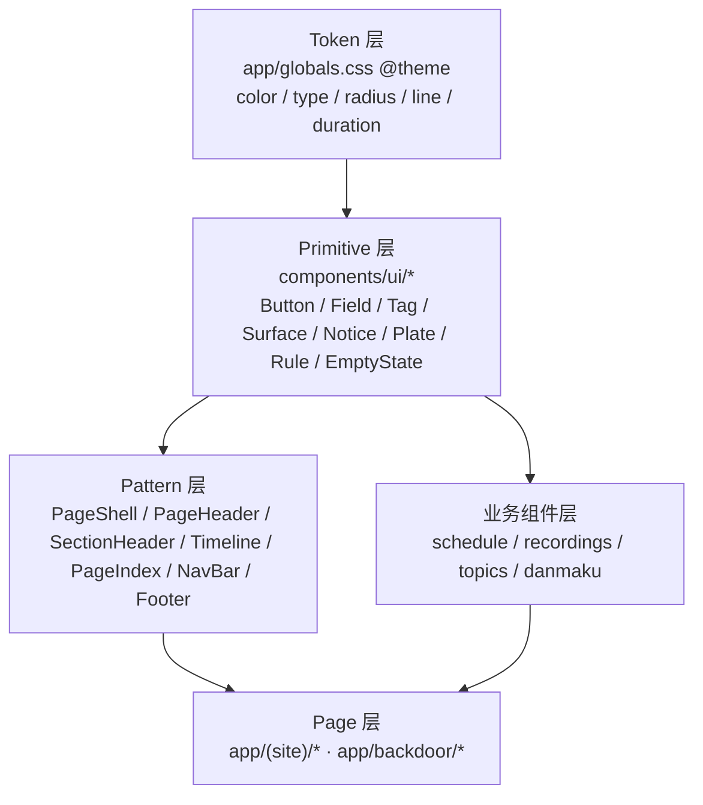

# 全站视觉系统重设计：装订（The Binding） - 技术提案

**功能名称**: 全站视觉系统重设计（Visual System Redesign：装订 / The Binding）
**关联 PRD**: `docs/product/requirements/draft/2026-11-01-visual-system-redesign-prd.md`
**技术提案版本**: v1.0
**创建日期**: 2026-11-01
**作者**: sumire workflow
**文档分支**: `prd/visual-system-redesign`
**feat-branch**: `feat/visual-system-redesign`

---

## 1. 概述

### 1.1 背景

PRD 决定以「装订」为概念重建视觉语言：把站点当作一本关于枝堇的书来排版，删除自绘藤蔓、蕾丝扇贝条、纸页角饰、发光花节点、雾气、常驻粒子与视差，改为装订线、页码、图版题注、版权页式页脚与编辑体排版。

现状代码的视觉层是**多期增量叠加**的结果，缺少统一抽象：

- `app/globals.css` 的 `@theme` 只有颜色/字阶，没有线、面、圆角、时长、焦点等语义 token；
- 装饰逻辑散落在组件里：`VineDivider`、`LaceFrame`、`PaperCard` 自带 SVG/CSS 绘制；`SectionRail` 自带树状连线；`GlowParticles` 自带 Canvas 循环；`ParallaxLayer` 自带指针/传感器监听；
- 同样的视觉决策在多处重复：按钮有 `ExternalButton`、`PrimaryButton`、若干内联 `<button>`；空态在每个页面各写一套；页头在 `/about`、`/assets`、`/calendar`、`/recordings` 各写一套；
- 页面容器宽度、gutter、圆角、阴影口径不一致（见 PRD §1.2）。

本提案给出一次**结构性收口**：把视觉决策上移到 token 与基础组件，页面只负责内容编排。这样「重设计」不是逐页改 class，而是可验证、可回归的组件迁移。

### 1.2 目标

1. 建立四层设计系统：**Token → Primitive → Pattern → Page**，依赖单向；
2. 删除全部具象装饰组件、CSS、事件链与测试，仓库只保留结构线与排版；
3. 公开站全部页面使用同一套 `PageShell / PageHeader / SectionHeader` 与同一套基础控件；
4. 后台在**不改变业务布局与交互**的前提下完成 token、基础控件、壳层对齐；
5. 全站尊重 `prefers-reduced-motion`，移除环境循环动效；
6. 零新增运行时依赖、零新增字体、零后端/契约变更；`lint / test / build` 全绿。

### 1.3 范围

**做**

- `app/globals.css` 的 token 重写、装饰 CSS 删除、焦点/选择/滚动条基础样式；
- `components/` 基础组件新增、重写、删除；
- `features/home` 首页 deck 视觉重排与粒子/视差移除；
- `features/about` 五组内容组件、`SplitSection` 重写；
- `features/assets`、`features/schedule`、`features/recordings`、`features/topics` 的壳层与控件迁移；
- `app/(site)` 全部页面与 `app/backdoor` 壳层/控件；
- 单元测试、E2E 断言、设计文档、产品/技术 spec、`AGENTS.md` 同步。

**不做**

- 后端、API 契约、数据模型、鉴权、业务状态机；
- IA、路由、导航信息结构、整页翻页机制、日历/素材/录播/棉花糖功能；
- 后台业务页的信息架构重排（只换视觉与控件）；
- 亮色主题、主题切换、字号偏好、Storybook、第三方 UI 库。

---

## 2. 现状技术盘点

### 2.1 关键文件

| 层 | 文件 | 现状 | 本期动作 |
|----|------|------|----------|
| Token | `app/globals.css` | 颜色/字阶 + `.lace-x/.paper/.vine-draw/.flower-node/.fog` + 装饰 keyframes | 重写 token；删除装饰 CSS/keyframes；保留弹幕动画 |
| 装饰组件 | `components/VineDivider.tsx` | `preserveAspectRatio="none"` 手绘曲线 + 叶 + 发光圆 | 删除，`Rule` 替代 |
| 装饰组件 | `components/LaceFrame.tsx` | 上下 `.lace-x` 扇贝条 | 删除 |
| 装饰组件 | `components/PaperCard.tsx` | `.paper` 纸纹 + 四角 SVG | 删除，`Surface/Notice` 替代 |
| 装饰组件 | `features/about/VineTimeline.tsx` | 波动藤蔓轴 + 发光节点 | 删除，`Timeline` 替代 |
| 装饰组件 | `features/home/GlowParticles.tsx` + `glowParticles.ts` | Canvas 常驻粒子 + 冲量流场 | 删除（含 `IMPULSE_EVENT`/`SCROLL_IMPULSE_EVENT`） |
| 装饰组件 | `features/home/ParallaxLayer.tsx` + `parallax.ts` + `useParallax.ts` | 指针/传感器视差 | 删除 |
| 导航 | `components/NavBar.tsx` | 固定雾面玻璃、`tracking-widest`、无焦点管理 | 重写视觉 + 移动抽屉焦点管理 |
| 页脚 | `components/Footer.tsx` | `.lace-x` + 单行 | 重写为版权页三栏 |
| 索引 | `features/home/SectionRail.tsx` + `sectionRail.ts` | 树状圆点 | 重写为 `PageIndex`（保留纯函数并改名） |
| 页面 | `app/(site)/page.tsx`、`features/home/FullpageDeck.tsx` | 8 站 deck + 粒子 + 视差 + 树状索引 | 视觉重排，移除粒子/视差，换索引 |
| 页面 | `app/(site)/(content)/about/page.tsx` | `VineDivider` + 左右交替 | 重排为固定阅读轴 |
| 页面 | `app/(site)/(content)/assets/page.tsx` | `PaperCard` 版权提示 | `Notice` |
| 页面 | `features/assets/AssetGallery.tsx` | 圆角卡片 + 泛光按钮 + 上浮 hover | 图版网格 + 下划线 tab + 全屏 Lightbox |
| 页面 | `features/schedule/*` | `immersive` 日历 + 圆角/描边混用 | 保留交互，重做视觉 |
| 页面 | `features/recordings/*`、`features/topics/*` | 各自页头/按钮/空态 | 迁移共享组件 |
| 后台 | `features/backdoor/components/*`、`app/backdoor/*` | `VineDivider` 装饰线、花体标签、独立按钮/输入 | token + 共享控件 + 壳层清理 |

### 2.2 现状问题根因

1. **缺少语义 token**：组件只能直接写 `border-vine/50`、`rounded-lg`、`shadow-[0_0_18px…]`，无法统一；
2. **装饰与内容耦合**：装饰组件内部硬编码 SVG 比例、发光、动画，页面无法只换「表皮」；
3. **样式入口过多**：按钮/输入/空态/页头各有实现，改一处漏一处；
4. **动效与可访问性口径分裂**：公开站特批「不降级 reduced-motion」，与全站规范不一致，增加分支判断；
5. **装饰元素的技术缺陷**：`preserveAspectRatio="none"` 导致曲线/叶片在宽屏拉伸；时间线轴与节点独立定位导致错位；`blur(64px)` + Canvas 常驻造成持续绘制。

---

## 3. 设计系统架构

### 3.1 分层



约束：

- Token 不依赖任何组件；
- Primitive 无业务逻辑、无数据请求、默认 Server Component；
- Pattern 可组合 Primitive，不直接写颜色值；
- Page/业务组件只编排，不重复实现按钮/输入/空态/页头；
- 依赖只能向下，禁止 Primitive 反向 import 业务模块。

### 3.2 技术栈

| 层级 | 技术选型 | 说明 |
|------|----------|------|
| 框架 | Next.js App Router + React + TS strict | 纯 SSG（`output: "export"`） |
| 样式 | Tailwind CSS v4 `@theme` + 少量 `@layer base/components` | 语义 token；不新增 Tailwind 插件 |
| 字体 | `next/font/google`（现有三套）+ `ui-monospace` 系统栈 | 不新增字体文件 |
| 图标 | `lucide-react`（现有） | 线宽 1.5 |
| 测试 | Vitest + Testing Library + Playwright | 纯函数、DOM、E2E |
| 动效 | CSS transition/animation + 现有 rAF 翻页 | 不引入动画库 |

### 3.3 目录结构（目标）

```text
apps/bookstore/
├─ app/
│  ├─ globals.css                     # token + base + 少量全局样式
│  ├─ (site)/
│  │  ├─ layout.tsx                   # NavBar + skip link + main
│  │  ├─ page.tsx                     # FullpageDeck
│  │  └─ (content)/
│  │     ├─ layout.tsx                # Footer
│  │     ├─ about/page.tsx
│  │     ├─ assets/page.tsx
│  │     ├─ calendar/page.tsx
│  │     ├─ topics/page.tsx
│  │     └─ recordings/{page.tsx,replay/page.tsx}
│  └─ backdoor/...
├─ components/
│  ├─ NavBar.tsx
│  ├─ Footer.tsx
│  ├─ NotFoundPage.tsx
│  ├─ layout/{PageShell,PageHeader,SectionHeader}.tsx
│  ├─ patterns/Timeline.tsx
│  └─ ui/{Button,Field,Tag,Surface,Notice,Plate,Rule,EmptyState}.tsx
├─ features/
│  ├─ home/{FullpageDeck,PageIndex,sections/*}
│  ├─ about/{parts/*}
│  ├─ assets/
│  ├─ schedule/
│  ├─ recordings/
│  ├─ topics/
│  └─ backdoor/
└─ tests/unit/
```

> 组件文件名沿用仓库 PascalCase；`components/ui` 与 `components/layout` 是新的分组目录，避免根目录继续堆叠。

---

## 4. Token 迁移

### 4.1 颜色

| 旧 token | 新 token | 新值 | 处理 |
|----------|----------|------|------|
| `--color-night` | `--color-night` | `#141017` | 值调整 |
| `--color-raised` | `--color-raised` | `#1b1620` | 值调整 |
| `--color-soft` | `--color-soft` | `#262029` | 值调整 |
| — | `--color-line` | `#3a323d` | 新增 |
| — | `--color-line-strong` | `#75687e` | 新增（控件边界 ≥3:1） |
| `--color-vine` | — | — | **删除**，全部替换为 `line` / `line-strong` |
| `--color-ink` | `--color-ink` | `#e9e2dc` | 改暖骨白 |
| `--color-ink-dim` | `--color-ink-dim` | `#a298a2` | 值调整 |
| — | `--color-ink-mute` | `#776d78` | 新增（仅禁用态/大号装饰，不用于小号正文） |
| `--color-paper` | `--color-paper` | `#efe9e4` | 值调整 |
| `--color-paper-dim` | `--color-paper-dim` | `#d7cfc9` | 值调整 |
| `--color-ink-on-paper` | `--color-ink-on-paper` | `#2a232b` | 值调整 |
| `--color-primary` | `--color-primary` | `#b4a6bf` | 不变 |
| `--color-primary-deep` | `--color-primary-deep` | `#8f7d9e` | 不变 |
| `--color-flower` | `--color-flower` | `#a184c9` | 降饱和；仅焦点/链接/状态 |
| `--color-eye` | `--color-eye` | `#7fb0e6` | 不变（功能语义） |
| `--color-crimson` | `--color-crimson` | `#e06a7a` | 不变（功能语义） |
| `--color-gold` | `--color-gold` | `#d8b25c` | 不变（功能语义） |

迁移方式：全仓 `border-vine` / `text-vine` / `bg-vine` / `--color-vine` 替换为 `line` 语义；用 `rg` 校验零残留。`flower` 保留 token 名以降低弹幕/后台回归面，但禁止用于大面积背景与 `shadow` 泛光。

### 4.2 字体与字阶

| 旧 token | 新 token | 值 |
|----------|----------|-----|
| `--font-serif` | `--font-serif` | 不变 |
| `--font-sans` | `--font-sans` | 不变 |
| `--font-display` | `--font-display` | 不变，但使用范围收紧 |
| — | `--font-mono` | `ui-monospace, SFMono-Regular, Menlo, Consolas, monospace` |
| `--text-display` | `--text-display` | `clamp(3.5rem, 7vw, 6.5rem)` |
| `--text-h1` | `--text-h1` | `clamp(2.25rem, 4vw, 3.25rem)` |
| `--text-h2` | `--text-h2` | `1.75rem` |
| — | `--text-h3` | `1.25rem` |
| `--text-body` | `--text-body` | `1.0625rem` |
| `--text-small` | `--text-small` | `0.9375rem` |
| — | `--text-label` | `0.75rem` |
| `--text-tiny` | `--text-tiny` | `0.8125rem` |
| — | `--tracking-label` | `0.12em` |

### 4.3 形状、线与动效

| Token | 值 | 说明 |
|-------|-----|------|
| `--radius-xs` | `2px` | 图版、卡片 |
| `--radius-sm` | `4px` | 标签 |
| `--radius-md` | `8px` | 输入、按钮、弹层 |
| `--radius-pill` | `999px` | 仅状态药丸 |
| `--shadow-overlay` | `0 24px 64px rgb(0 0 0 / 0.55)` | 仅弹层 |
| `--duration-fast` | `140ms` | hover/focus |
| `--duration-base` | `220ms` | 弹层 |
| `--duration-slow` | `480ms` | 入场/翻页 |
| `--ease-out-quart` | `cubic-bezier(0.22, 1, 0.36, 1)` | 入场 |

### 4.4 删除的 CSS / keyframes

| 名称 | 位置 | 替代 |
|------|------|------|
| `.lace-x` | `globals.css` | 删除 |
| `.paper` | `globals.css` | `Surface variant="paper"`（仅引用场景） |
| `.vine-draw` + `@keyframes vine-grow` | `globals.css` | 删除 |
| `.flower-node` | `globals.css` | 删除 |
| `.fog` / `.fog-a` / `.fog-b` + `@keyframes fog-drift` | `globals.css` | 静态径向光（Tailwind 渐变类） |
| `.animate-danmaku-flash` | `globals.css` | **保留**（后台定位功能） |
| `--animate-rise` | `globals.css` | 重命名/调整为 `enter`（480ms，8px） |
| `--animate-danmaku-enter` | `globals.css` | 保留 |

### 4.5 基础样式

```css
@layer base {
  :root { color-scheme: dark; }
  body { background: var(--color-night); color: var(--color-ink); }
  ::selection { background: color-mix(in oklab, var(--color-flower) 45%, transparent); }
  :focus-visible {
    outline: 2px solid var(--color-flower);
    outline-offset: 2px;
  }
  @media (prefers-reduced-motion: reduce) {
    *, *::before, *::after {
      animation-duration: 0.001ms !important;
      animation-iteration-count: 1 !important;
      transition-duration: 0.001ms !important;
      scroll-behavior: auto !important;
    }
  }
}
```

> 全局 reduced-motion 兜底会同时影响后台弹幕入场/定位闪光；PRD 要求全站尊重，故可接受。后台定位闪光原本已有单独降级，保留其显式规则以免被 `!important` 覆盖产生歧义。

---

## 5. 基础组件设计

### 5.1 组件 API

#### `components/layout/PageShell.tsx`

```tsx
interface PageShellProps {
  children: React.ReactNode;
  /** wide=88rem（素材/日历/录播），prose=44rem（档案/表单） */
  width?: "wide" | "prose";
  /** 是否保留顶部导航留白（默认 true） */
  withNavOffset?: boolean;
  className?: string;
}
```

- 统一 `px-5 sm:px-8 lg:px-16`、`mx-auto`、`py-24 lg:py-32`；
- 桌面（`lg+`）内容列左侧渲染 1px 装订线：`lg:border-l lg:border-line lg:pl-8`（`prose` 与 `wide` 同口径；首页各屏与 `/about` 在各自内容列上复用同一 class）；
- `id="main"` 由 `(site)/layout.tsx` 的 `<main>` 承担，`PageShell` 不重复。

#### `components/layout/PageHeader.tsx`

```tsx
interface PageHeaderProps {
  eyebrow: string;              // 如 "PROFILE"
  folio?: string;               // 如 "壹"
  title: string;
  lead?: React.ReactNode;
  actions?: React.ReactNode;
}
```

#### `components/layout/SectionHeader.tsx`

```tsx
interface SectionHeaderProps {
  folio?: string;
  eyebrow?: string;
  title: string;
  lead?: React.ReactNode;
  actions?: React.ReactNode;
  as?: "h1" | "h2";
}
```

#### `components/ui/Button.tsx`

```tsx
type ButtonVariant = "primary" | "secondary" | "ghost" | "danger";
type ButtonSize = "sm" | "md";

interface ButtonBaseProps {
  variant?: ButtonVariant;      // default secondary
  size?: ButtonSize;           // default md
  loading?: boolean;
  icon?: React.ReactNode;
  iconPosition?: "left" | "right";
}
// 渲染为 <button> 或 <a>（href 存在时），共享 className 与焦点态
```

#### `components/ui/Field.tsx`

```tsx
interface FieldProps extends React.InputHTMLAttributes<HTMLInputElement> {
  label: string;
  hint?: string;
  error?: string;
}
// 另导出 TextareaField / SelectField，共用壳层
```

#### `components/ui/Plate.tsx`

```tsx
interface PlateProps {
  src: string;
  alt: string;
  width: number;
  height: number;
  /** 图版编号，如 "01" */
  index?: string;
  /** 题注，如 "standing-02 · 立绘" */
  caption?: string;
  priority?: boolean;
  /** contain 用于立绘，cover 用于插画/宣传图 */
  fit?: "cover" | "contain";
  /** 渲染根元素；默认 figure。放进 button/链接内部时用 div（避免 figure 嵌套交互元素） */
  as?: "figure" | "div";
  className?: string;
  imageClassName?: string;
}
```

- 默认输出 `<figure>` + 1px 边框容器 + `<figcaption>`；`as="div"` 时输出 `<div>` + 内部 `<span>` 题注（不产生 `figcaption`）；
- 图片使用 `next/image`；固定 `width/height` 防 CLS；
- 无圆角、无阴影、无 hover 上浮；hover 仅 `opacity` 与题注下划线。

#### `components/patterns/Timeline.tsx`

```tsx
interface TimelineItem {
  key: string;
  date: string;        // YYYY-MM-DD
  title: string;
  note?: string;
  current?: boolean;
}
interface TimelineProps { items: TimelineItem[]; }
```

#### `features/home/PageIndex.tsx`

```tsx
interface PageIndexProps {
  sections: SectionDef[];
  index: number;
  onNavigate: (index: number) => void;
}
```

- 由 `sections` 与 `buildTree` 生成「主节点 + 子节点」的扁平页码；
- 中文数字映射 `["壹","贰","叁","肆","伍","陆","柒","捌"]`；
- 当前项 `aria-current="true"`；每项 `aria-label`（如「档案 · 喜好」）；
- 非当前项用 `ink-dim`；`ink-mute` 仅用于禁用态；
- `<1024px` 返回 `null`（移动端用顶部 1px 进度条）。

#### 其他

- `Tag`：`{ children, className? }`；
- `Surface`：`{ variant?: "raised" | "outline" | "paper"; padding?: "none"|"sm"|"md"|"lg"; className?; children }`；
- `Notice`：`{ tone?: "info" | "warning"; title?: string; children }`；
- `Rule`：`{ label?: string; className? }`；
- `EmptyState`：`{ title: string; description?: string; action?: React.ReactNode }`。

### 5.2 实现要点

- **Server-first**：除 `Button`（需要 `loading`/事件）、`Field`（受控）、`PageIndex`（点击）外，其余均为 Server Component；
- **无业务 import**：`components/ui/*` 不 import `features/*`、`lib/content`；
- **className 合并**：仓库无 `clsx`，用模板字符串 + 可选 `className`，保持零依赖；复杂条件用局部数组 `filter(Boolean).join(" ")`；
- **焦点态**：统一 `focus-visible:outline-2 focus-visible:outline-flower focus-visible:outline-offset-2`，不使用 `ring`（避免与 Tailwind 默认 ring 冲突）；
- **禁用态**：`disabled:opacity-40 disabled:pointer-events-none`，`aria-disabled` 同步；
- **加载态**：按钮保留宽度，`aria-busy="true"`，文案「处理中…」。

### 5.3 状态矩阵

| 组件 | default | hover | active | focus-visible | disabled | loading |
|------|---------|-------|--------|---------------|----------|---------|
| Button primary | `bg-primary text-night` | `bg-primary-deep` | `translate-y-px` | 焦点环 | `opacity-40` | 文案替换 + `aria-busy` |
| Button secondary | 透明 + `line-strong` | `bg-soft` | `bg-soft` | 焦点环 | `opacity-40` | 同上 |
| Button ghost | 透明 | `text-ink` | `text-ink` | 焦点环 | `opacity-40` | 同上 |
| Button danger | 透明 + `crimson/40` | `bg-crimson/10` | 同上 | 焦点环 | `opacity-40` | 同上 |
| Field | `bg-soft` + `line` | `line-strong` | — | `flower` 1px + 外环 | `opacity-40` | — |
| Tag | `line` 描边 | `bg-soft` | — | 焦点环（若可交互） | — | — |
| Nav item | `ink-dim` | `ink` | — | 焦点环 | — | — |
| Nav item active | `ink` + `primary` 下划线 | 同左 | — | 焦点环 | — | — |

---

## 6. 页面改造方案

### 6.1 全局壳

#### NavBar

- 保留现有数据源与门控：`sections.ts`、`API_CONFIGURED`、`RECORDINGS_CONFIGURED`、`tools` 注册表；
- 结构：`<header>` → `<nav>`（字标 + 桌面列表 + 移动触发）→ 移动抽屉；
- 滚动状态：`scrollY > 24` 或抽屉打开 → `bg-night/90 backdrop-blur-md border-b border-line`；
- 活动态：`aria-current="page"` + `text-ink` + `after:` 1px `primary` 下划线；
- 移动抽屉：
  - `role="dialog"` + `aria-modal="true"` + `aria-label="站点导航"`；
  - 打开时 `document.body.style.overflow = "hidden"`，关闭恢复；
  - 焦点移到第一个链接，Tab 循环，Esc 关闭，关闭后焦点回到触发按钮；
  - 点击导航项关闭；
- 移除 `tracking-widest` 与装饰性花体（除字标 `Sumire`）。

#### Footer（版权页）

- 三栏 `grid`：`站点` / `导航` / `关注`；
- 导航栏复用 `SECTIONS` 的 `navKey` 与标签，生成 `主页 / 档案 / 素材 / 日历 / 录播 / 棉花糖`（按门控过滤）；
- `关注`：`site.links` 四个外链，`ExternalLink` 图标 `aria-hidden`；
- 免责声明完整展示，`text-small text-ink-dim`；
- 顶部 `border-t border-line`，无 `.lace-x`、无 `bg-raised`；
- 移动单列，间距 `2rem`。

#### 布局与 skip link

- `app/(site)/layout.tsx`：在 `NavBar` 前加 `<a href="#main" className="sr-only focus:not-sr-only ...">跳到正文</a>`；
- `<main id="main" className="min-h-svh">`；
- 非首页 `(content)/layout.tsx` 保留 Footer。

#### PageIndex

- `features/home/PageIndex.tsx` 替代 `SectionRail.tsx`；
- 复用 `sectionRail.ts` 的 `buildTree` / `activeNode`，文件重命名为 `features/home/pageIndex.ts`；
- 渲染：`<nav aria-label="页面位置">` + `<ol>`；
- 每项 `<a href={hash}>`，`onClick` 阻止默认并 `onNavigate(index)`；
- 主节点显示页码；子节点缩进 12px；当前项显示横线 + 标签；
- `useMediaQuery("(max-width: 1023px)")` 为真返回 `null`（与现有 `useMediaQuery` 的 SSR 快照 false 口径兼容：SSR 先渲染桌面版，hydration 后收敛）。

### 6.2 首页 deck

#### FullpageDeck

- 移除 `GlowParticles`、`SectionRail`、`ParallaxLayer` 相关 import；
- 移除 `LockController` 对粒子的间接依赖（保留弹层锁定逻辑）；
- 轨道 transition 时长由 `800ms` 调整为 `480ms`（`--duration-slow`），`useFullpageScroll` 接受 `reducedMotion`；
- `reducedMotion` 为真时：`translate3d` 直接落位（`duration=0`），内容 `opacity` 120ms 切换；不派发任何冲量事件；
- 移除 `IMPULSE_EVENT` / `SCROLL_IMPULSE_EVENT` / `sumire:flow-scroll` 的派发与监听；
- 移动端（`<1024px`）顶部渲染 1px 滚动进度条：`<div class="fixed inset-x-0 top-0 z-50 h-px bg-line"><div class="h-full bg-primary" style={{ width: `${index / (sections.length - 1) * 100}%` }} /></div>`（`aria-hidden`，非交互）；
- `data-section` 保留（测试与锚点依赖）。

#### useFullpageScroll

- 入参新增 `reducedMotion: boolean`（由 `useMediaQuery("(prefers-reduced-motion: reduce)")` 提供）；
- 删除粒子事件派发；
- 其余手势聚合、边界交接、free/deck、hash 同步逻辑**不改**；
- 单测补充：reduced-motion 下 `goTo` 立即完成、不产生 rAF 帧；非 reduced 下 480ms。

#### HeroSection

- 删除 `.fog` 两个 div 与 `ParallaxLayer`；
- 背景：`before:` 静态径向渐变（`primary/6%`，`pointer-events-none`）；
- 桌面布局：`grid lg:grid-cols-12`；左列 `col-span-5` 放 eyebrow + 竖排书名 + `Sumire` + bio + 元数据行；右列 `col-span-6 col-start-7` 放 `Plate`（hero 立绘）；
- 竖排书名：

```tsx
<h1 className="font-serif text-display font-semibold leading-none tracking-[0.08em] [writing-mode:vertical-rl] max-lg:[writing-mode:horizontal-tb]">
  枝堇
</h1>
```

  - `@supports not (writing-mode: vertical-rl)` 回退横排；
  - 读屏顺序为「枝堇」，不拆分单字；
- `Sumire` 用 `font-display italic text-primary`，置于竖排书名右下；
- 元数据行：`LiveStatus` + `TodaySchedule` 改为行内紧凑形态（组件内部重写，不再药丸/卡片）；无 API 时整行不渲染；
- 小号免责声明保留在左下。

#### ArchiveSection / SplitSection

- `SplitSection` 重写为纯布局组件，删除 `heroMobilePortrait` 与全部视差逻辑，保留 `anchorContentBottom`；
- 桌面：`grid grid-cols-12 gap-8`；内容 `col-span-6`，图版 `col-span-5 col-start-8`；**固定文字左、图版右**；
- 移动：单列，图版在上（`h-[40svh]`），内容在下；`data-fullpage-scrollable` 保留；
- `anchorContentBottom` 保留（P4 历程默认可见最新条目）；
- `ArchiveSection` 取消左右交替（`portraitLeft` 恒为 false），只保留立绘选取 cycle（P1/P3/P5→standing-02、P2/P4→standing-01）；
- 每屏使用 `SectionHeader`（folio 贰~陆 + eyebrow + 标题）+ `Rule`；P1 信息表用 `dl` 两列；P2 引文用 2px `primary` 左边线；P3 `Tag`；P4 `Timeline`；P5 `Surface` 卡片 + `Button href`。

#### CalendarSection / CalendarView

- `CalendarViewPage` 页头换 `SectionHeader`；
- `CalendarView` 的 `immersive` 变体调整 class：
  - 网格线 `divide-line` / `border-line`，单元格 `rounded-none bg-transparent`；
  - 今天 `border-flower` → `bg-primary` 圆点 + `text-primary` 日期；
  - 翻月按钮由全高竖条改为 44×44 `ghost` 圆形按钮，置于左右 gutter；
  - 摘要时间 `font-mono tabular-nums`；
- 保留 `calendarDrag.ts`、`dateUtils.ts`、`mergeEntries.ts`、`DayDetailDialog` 全部逻辑；
- 后台 `panel` 变体只替换 token 与圆角/描边，不改布局。

#### AssetsSection / AssetGallery

- 筛选：`rounded-full` → 下划线 tab（`button` + `aria-pressed`），高度 `44px`；
- 网格：`Plate` 组件，`aspect-[4/5]`，立绘 `object-contain p-4`，其余 `object-cover`；
- 卡片结构：`<article class="group relative"><Plate as="div" … /><button class="absolute inset-0" aria-haspopup="dialog"><span class="sr-only">查看 {title}</span></button></article>`——避免把 `figure` 嵌进 `button`，同时保留整卡可点与键盘焦点；
- hover：`opacity` + 题注下划线，删除 `-translate-y-0.5` / `scale-103`；
- Lightbox：`createPortal` 保留；遮罩 `night/96`；图片 `Plate`；信息条 `Surface`；按钮 `Button`；焦点陷阱与 Esc 保留。

#### AssetsSection Footer

- 保持「素材站尾部全站唯一 Footer」；视觉换版权页式。

### 6.3 公开内容页

#### `/about`

- 外层 `PageShell width="wide"`（内容列内部再限制文字测量宽度 ≤34rem，保证档案分栏有足够横向空间）；
- `PageHeader`（eyebrow `PROFILE`，标题「枝堇图鉴」，引文）；
- 五节 `Section` + `SectionHeader`；删除 `VineDivider`，用 `Rule` 或纯间距；
- `ProfilePart` full 变体：`Plate` 立绘 + 信息表；`bare` 变体只保留信息表；
- `StoryPart`：`font-serif leading-loose` + `indent-8`；引文 2px `primary`；
- `TastePart`：组名 `6rem` + `Tag`；
- `JourneyPart`：`Timeline`；
- `TriviaPart`：`Surface` 两列 + `Button href` 外链；
- 移动端单列，图版在上。

#### `/assets`

- `PageShell width="wide"` + `PageHeader`；
- `Notice` 替代 `PaperCard`；
- `AssetGallery` 同首页。

#### `/calendar`

- `PageShell width="wide"` + `PageHeader`；
- 未配置 API 守卫不变；
- 日历主体同首页。

### 6.4 录播 / 回放 / 棉花糖

- 页头/容器/空态/按钮/弹层统一：
  - `/recordings`：`PageShell` + `PageHeader`；`RecordingStatusList` 的状态药丸用 `Tag` 语义（保留 `eye` 呼吸点）；分组折叠按钮 `Button ghost`；文件行 hover `bg-soft`；分页 `Button secondary`；
  - `/recordings/replay`：标题区 `PageHeader`（保留场次信息）；`FlvPlayerPanel` 控制条按钮统一为 `Button size="sm" variant="ghost"` + `aria-label`；事件列 `Surface outline`；弹幕浮层不变；
  - `/topics`：`PageHeader` + `TopicCard` 换 `Surface` + `Tag` 状态；表单 `Field`；弹窗 `Surface` + `Button`；
- 所有请求、hooks、状态机、URL 参数、空态文案不变。

### 6.5 404 / 空态

- `NotFoundPage`：`404` 用 `font-mono text-[clamp(4rem,12vw,8rem)] text-ink-mute`（`aria-hidden`，语义由 `h1` 承载）；标题 `h1`；说明；`Button href="/"`；
- `EmptyState` 接入：素材空筛选、录播无数据、回放无事件、棉花糖空列表、后台表格空态。

### 6.6 后台

#### 壳层

- `TopBar`：高 56px，`bg-raised` + 底部 `1px line`；字标中文 + `Backdoor` 小字；右侧用户/角色用 `font-mono text-label`；
- `SideNav`：宽 200px，`bg-night` + 右侧 `1px line`；活动态 `bg-soft` + 左侧 2px `primary`；无装饰线；
- `LoginCard` / `ChangePasswordCard`：`Surface raised` + 顶部 1px `primary`；`Field` + `Button primary`；错误 `role="alert"` `crimson`；
- `GuardLoading`：删除 `flower-node`，改 1px 旋转环或 3 点脉冲（`prefers-reduced-motion` 下静态）。

#### 控件

- `PrimaryButton` → `Button variant="primary"`；
- `TextField` → `Field`；
- `RoleSelect` → `SelectField`；
- 表格：`Surface` 包一层，表头 `text-label text-ink-dim`，行 `border-b border-line`，hover `bg-soft/60`，危险操作 `text-crimson`；
- 弹窗：`Surface` + `shadow-overlay` + 焦点陷阱（沿用现有实现）。

#### 不改

- 权限、会话、请求、分页、筛选、已读、SSE、弹幕看板布局与交互；
- 后台不画装订线、不使用公开站竖排。

---

## 7. 删除与迁移映射

### 7.1 删除文件

| 文件 | 说明 | 引用清理 |
|------|------|----------|
| `components/VineDivider.tsx` | 藤蔓分隔线 | `app/(site)/(content)/about/page.tsx`、`app/backdoor/(dashboard)/page.tsx`、`features/home/WeeklySchedule.tsx` |
| `components/LaceFrame.tsx` | 蕾丝边框 | `features/about/parts/ProfilePart.tsx` |
| `components/PaperCard.tsx` | 纸页卡 | `app/(site)/(content)/assets/page.tsx` |
| `components/ExternalButton.tsx` | 外链按钮 | `features/about/parts/TriviaPart.tsx` |
| `features/about/VineTimeline.tsx` | 藤蔓时间线 | `features/about/parts/JourneyPart.tsx` |
| `features/home/GlowParticles.tsx` | Canvas 粒子 | `FullpageDeck.tsx` |
| `features/home/glowParticles.ts` | 粒子纯函数 | `GlowParticles.tsx`、单测 |
| `features/home/ParallaxLayer.tsx` | 视差容器 | `HeroSection.tsx`、`SplitSection.tsx` |
| `features/home/parallax.ts` / `useParallax.ts` | 视差纯函数/hook | `ParallaxLayer.tsx`、单测 |
| `features/home/SectionRail.tsx` | 树状索引 | `FullpageDeck.tsx` |
| `features/home/WeeklySchedule.tsx` | 已无引用 | 删除 |

### 7.2 重命名 / 新增

| 旧 | 新 |
|----|----|
| `features/home/SectionRail.tsx` | `features/home/PageIndex.tsx` |
| `features/home/sectionRail.ts` | `features/home/pageIndex.ts` |
| — | `components/layout/{PageShell,PageHeader,SectionHeader}.tsx` |
| — | `components/ui/{Button,Field,Tag,Surface,Notice,Plate,Rule,EmptyState}.tsx` |
| — | `components/patterns/Timeline.tsx` |

### 7.3 引用清理命令

实现完成后必须零命中：

```bash
rg -n "VineDivider|LaceFrame|PaperCard|ExternalButton|VineTimeline|GlowParticles|ParallaxLayer|SectionRail|lace-x|flower-node|vine-draw|\.fog|fog-drift|vine-grow|vine" \
  apps/bookstore --glob '!node_modules'
```

允许保留的历史文档引用（`docs/` 下的旧 proposal 与 PRD 不修改）。

### 7.4 样式类迁移

| 旧写法 | 新写法 |
|--------|--------|
| `border-vine` / `border-vine/50` | `border-line` / `border-line-strong` |
| `text-vine` | `text-line-strong`（图形）/ `text-ink-dim`（文字） |
| `bg-vine` | `bg-line` |
| `rounded-lg`（卡片） | `rounded-xs` |
| `rounded-full`（按钮/筛选） | `rounded-md`；仅状态药丸保留 `rounded-pill` |
| `shadow-[0_0_18px…]` | 删除 |
| `font-display text-sm italic tracking-widest`（章节标签） | `font-mono text-label tracking-label uppercase` |
| `hover:-translate-y-0.5` / `hover:scale-103` | 删除，改 `opacity` |
| `text-4xl font-bold` | `text-h1 font-semibold` |

---

## 8. 测试策略

### 8.1 设计 token 测试（新增）

`tests/unit/design-tokens.test.ts`：

- 读取 `app/globals.css` 文本，解析 `--color-*`；
- 断言 PRD §3.1 的对比度：`ink/night ≥ 4.5`、`ink-dim/night ≥ 4.5`、`primary/night ≥ 4.5`、`flower/night ≥ 4.5`、`ink-on-paper/paper ≥ 4.5`；
- 断言 `--color-line`、`--color-line-strong`、`--color-ink-mute`、`--font-mono`、`--radius-*`、`--duration-*` 存在；
- 断言 `--color-vine` 不存在。

实现建议：纯 Node 计算相对亮度，不引入依赖。

### 8.2 组件单测（新增/更新）

| 测试 | 覆盖 |
|------|------|
| `ui-button.test.tsx` | 四变体、尺寸、href 渲染 `<a>`、loading 禁用与 `aria-busy`、键盘 Enter |
| `ui-field.test.tsx` | label 关联、error `role="alert"`、disabled |
| `ui-plate.test.tsx` | `figure/figcaption`、题注文本、`priority` 透传、无圆角类 |
| `patterns-timeline.test.tsx` | 日期/标题/备注顺序、当前项标记 |
| `patterns-page-index.test.tsx` | 中文页码、`aria-current`、点击回调、`<1024px` 不渲染 |
| `layout-page-header.test.tsx` | 唯一 `h1`、eyebrow、lead、actions |
| `home-deck-sections.test.tsx` | 更新：不再断言 `.lace-x`；断言 `Plate` 题注与 `SectionHeader` |
| `home-fullpage-deck.test.tsx` | 更新：移除 `glow-particles` 断言；断言 `PageIndex`、7/8 站序列 |
| `home-fullpage-scroll.test.ts` | 更新：`reducedMotion` 分支、无冲量事件 |
| `home-section-rail.test.ts` | 重命名为 `home-page-index.test.ts`，保留 `buildTree/activeNode` |
| `nav-bar.test.tsx` | 更新：`aria-current`、抽屉焦点/Esc/滚动锁 |
| `footer-link.test.tsx` | 更新：三栏、四个外链、完整免责声明 |
| `about-parts.test.tsx` | 更新：无 `LaceFrame`、`Timeline`、`Button href` |
| `asset-gallery.test.tsx` | 更新：下划线 tab、`Plate`、Lightbox 焦点 |
| `backdoor-*` | 回归：控件迁移后行为不变 |

### 8.3 删除的单测

- `home-glow-particles.test.ts`
- `home-glow-particles-canvas.test.tsx`
- `home-parallax.test.ts`
- `home-parallax-layer.test.tsx`

`home-weekly-guard.test.tsx` 保留，仅更新其中对 `GlowParticles`/`ParallaxLayer` 的 mock；`home-visual-fx.test.tsx` 不删除，改为断言「无粒子 canvas、无雾、无 `ParallaxLayer`、有 `PageIndex` 与图版题注」。

### 8.4 E2E

更新：

- `tests/e2e/src/bookstore/site.spec.ts`：
  - 删除「常驻光晕粒子 canvas / 立绘视差层」用例；
  - 删除 fog 动画断言；
  - 新增：首页无 `canvas`、无 `.fog`；装订线存在（桌面）；`PageIndex` 可点击跳转；竖排书名桌面 `writing-mode: vertical-rl`、移动横排；
  - 新增：reduced-motion（`page.emulateMedia({ reducedMotion: "reduce" })`）下翻页无位移动画、粒子/视差不存在。
- `tests/e2e/src/bookstore/calendar.spec.ts`：断言翻月按钮尺寸/可点击、今天标记；
- `tests/e2e/src/bookstore/footer-link.spec.ts`：版权页三栏与四个外链；
- `tests/e2e/src/backdoor/*`：全部跑通；`topics.spec.ts` 中 `div.border-t.border-vine` 改为新结构；
- 新增 `tests/e2e/src/bookstore/visual-shell.spec.ts`：在 375 / 768 / 1440 三档下检查无横向滚动、导航可用、正文对比度无关的结构断言（`h1` 唯一、`main` 存在、skip link 可聚焦）。

### 8.5 视觉验收（非 CI 门禁）

- 使用 Playwright 在 375 / 768 / 1440 三档截取：首页、档案 P1/P4、`/about`、`/assets`、`/calendar`、`/recordings`、`/backdoor` 登录与仪表盘；
- 截图附在实现 PR 描述中，作为评审依据；
- 不引入 `toHaveScreenshot` 基线（避免字体/平台差异导致 CI 抖动）。

### 8.6 命令

```bash
cd apps/bookstore
pnpm lint
pnpm test
pnpm build
pnpm test:e2e
```

---

## 9. 性能与可访问性验证

### 9.1 性能

| 指标 | 现状 | 目标 |
|------|------|------|
| 常驻 Canvas | 1 个（`GlowParticles`） | 0 |
| 指针/传感器监听 | 视差层多处 | 0（公开站） |
| 环境循环动画 | 雾 2 个 + 粒子 + 藤蔓生长 | 0（仅直播状态点） |
| 首屏 JS | 现有 bundle | 不增加（预期减少） |
| CLS | 0 | 0（图版固定宽高、字体 `next/font`） |

验证：

- `pnpm build` 对比构建产物大小；
- Lighthouse 移动端（本地 `pnpm start`）记录 Performance / Accessibility；
- 手动检查 320px / 200% 缩放无横向滚动。

### 9.2 可访问性

- 对比度由 `design-tokens.test.ts` 守门；
- 焦点环由基础样式统一；
- 键盘路径：skip link → NavBar → 内容 → Footer；移动抽屉焦点陷阱；弹层焦点陷阱；
- `prefers-reduced-motion` 由 `useMediaQuery` 与全局 CSS 双重保障；
- 读屏：每页唯一 `h1`、章节 `h2`、图版 `figure/figcaption`、`nav aria-label`、`aria-current`。

---

## 10. 实施计划

遵循 TDD：每个阶段先补失败测试，再实现，阶段结束 `lint/test/build` 全绿。

| 阶段 | 内容 | 主要文件 | 验收 |
|------|------|----------|------|
| P0 设计令牌 | token 重写、装饰 CSS 删除、基础样式、`design-tokens.test.ts` | `app/globals.css`、测试 | 对比度与 token 测试通过 |
| P1 基础组件 | `Button/Field/Tag/Surface/Notice/Plate/Rule/EmptyState` + 单测 | `components/ui/*` | 组件单测全绿 |
| P2 全局壳 | `PageShell/PageHeader/SectionHeader`、`NavBar`、`Footer`、`NotFoundPage`、skip link | `components/*`、`app/(site)/layout.tsx`、`(content)/layout.tsx` | 导航/页脚/404 单测与 e2e |
| P3 首页 deck | `FullpageDeck`、`HeroSection`、`ArchiveSection`、`SplitSection`、`CalendarSection`、`AssetsSection`、`PageIndex`、`useFullpageScroll` | `features/home/*` | deck 单测 + 首页 e2e |
| P4 公开内容页 | `/about`、`/assets`、`/calendar`、`AssetGallery`、`about/parts` | `app/(site)/(content)/*`、`features/about/*`、`features/assets/*` | 页面 e2e + 视觉截图 |
| P5 其它公开页 | `/recordings`、`/recordings/replay`、`/topics`、空态 | `features/recordings/*`、`features/topics/*` | 录播/棉花糖 e2e |
| P6 后台 | token 对齐、共享控件、TopBar/SideNav/登录/仪表盘/表格 | `features/backdoor/*`、`app/backdoor/*` | 后台全部 e2e |
| P7 清理与文档 | 删除遗留组件/测试、`rg` 零命中、设计文档/spec/AGENTS 同步 | 全仓 | 最终验收 |

### 10.1 分支与 PR 策略

- 需求文档分支：`prd/visual-system-redesign`（本 PRD/提案）；
- 实现总分支：`feat/visual-system-redesign`；
- 建议拆 3 个可评审 PR，依次合入实现总分支：
  1. `feat/visual-system-foundation`：P0–P2（token、基础组件、全局壳）；
  2. `feat/visual-system-public-pages`：P3–P5（首页与公开页）；
  3. `feat/visual-system-backdoor`：P6–P7（后台、清理、文档）；
- 禁止 rebase/squash，只 merge。

### 10.2 提交粒度

- 每个组件/页面一个提交，提交信息 `<type>: <描述>`；
- 删除组件与引用清理放在同一提交，保证任一提交可构建；
- 文档同步与代码同 PR。

---

## 11. 风险与回滚

| 风险 | 概率 | 影响 | 缓解 |
|------|------|------|------|
| 视觉回归面大，遗漏页面 | 中 | 页面风格不一致 | 分层迁移 + `rg` 零命中 + 截图清单 + 页面盘点表 |
| 后台回归 | 中 | 管理功能异常 | 后台只换 token/控件/壳层，不动逻辑；跑全部后台 e2e |
| 删除粒子/视差与既有「卖点」冲突 | 中 | 评审不通过 | PRD §九 已列为决策点；可退回「保留静态光晕」的折中 |
| reduced-motion 口径变更影响现有测试 | 高 | 测试失败 | 一次性更新 e2e/单测断言；全局 CSS 兜底 |
| 竖排书名在窄屏/不支持浏览器异常 | 低 | 首屏错位 | `@supports` + 媒体查询回退横排；375px 截图验证 |
| 字体加载导致 CLS | 低 | 视觉跳动 | 沿用 `next/font`；图版固定宽高 |
| Tailwind v4 任意值/token 识别问题 | 低 | 样式不生效 | 全部 token 在 `@theme` 声明；避免动态拼接 class |
| PR 过大难评审 | 高 | 评审周期长 | 3 个堆叠 PR + 分阶段提交 + 截图 |
| 弹幕/后台语义色对比度变化 | 低 | 可读性下降 | `eye/crimson/gold` 保持不变；token 测试覆盖 |

**回滚**：实现总分支未合入 `main` 前，任一阶段可单独 revert；合并后如出现严重问题，按 PR 粒度 revert（3 个 PR 独立）。本期不改数据库/契约，无数据回滚。

---

## 12. 文档同步

实现 PR 内必须同步：

| 文档 | 更新点 |
|------|--------|
| `docs/design/01-visual-identity.md` | 重写设计概念、色板、字体、图形语言（删除藤蔓/蕾丝/纸页角饰/花节点）、动效口径（全站 reduced-motion） |
| `docs/design/02-page-design.md` | 重写页面骨架、导航、页脚、首页 deck、档案、素材、日历的视觉与组件清单 |
| `docs/design/03-backdoor-design.md` | 更新 token、控件、壳层；删除藤蔓装饰线；保留后台 reduced-motion |
| `docs/product/spec/site-pages.md` | 更新全局视觉、首页/档案/素材的组件与动效口径；删除粒子/视差/雾/树状索引描述 |
| `docs/product/spec/calendar.md` | 更新日历视觉（网格、今天标记、翻月按钮） |
| `docs/engineering/spec/frontend-bookstore.md` | 更新设计系统分层、组件目录、token、reduced-motion、删除的模块 |
| `apps/bookstore/AGENTS.md` | 更新组件目录、设计系统约定、删除的组件与事件 |
| `docs/engineering/frontend-rules.md` | 更新 token 列表、圆角/描边/焦点/动效规范；删除「公开站不降级」例外 |

> 旧 proposal/PRD 是时点文档，不修改；如本期上线后旧文档被 spec 取代，按归档规则移动。

---

## 13. 验收标准

- [ ] Token 层：新色板/字阶/圆角/线/时长全部落在 `@theme`；`vine` 删除；对比度测试通过；
- [ ] Primitive 层：`Button/Field/Tag/Surface/Notice/Plate/Rule/EmptyState` 单测通过；无业务依赖；
- [ ] Pattern 层：`PageShell/PageHeader/SectionHeader/Timeline/PageIndex/NavBar/Footer` 单测与 e2e 通过；
- [ ] 删除：`rg` 零命中（§7.3）；`globals.css` 无装饰 CSS/keyframes；
- [ ] 公开站：首页 8 站、`/about`、`/assets`、`/calendar`、`/topics`、`/recordings`、`/recordings/replay`、404 全部按新视觉呈现，功能不变；
- [ ] 后台：登录/改密/仪表盘/用户/日历/弹幕/棉花糖全部 e2e 通过；
- [ ] 可访问性：对比度、焦点、键盘、触摸目标、reduced-motion 全部满足 PRD §3.6；
- [ ] 性能：无新增依赖/字体；首屏 JS 不增加；CLS=0；
- [ ] 文档：§12 全部同步；
- [ ] `pnpm lint && pnpm test && pnpm build && pnpm test:e2e` 全绿。

---

## 14. 相关文档

- 关联 PRD：`docs/product/requirements/draft/2026-11-01-visual-system-redesign-prd.md`
- 视觉识别（现态）：`docs/design/01-visual-identity.md`
- 页面设计（现态）：`docs/design/02-page-design.md`
- 后台设计（现态）：`docs/design/03-backdoor-design.md`
- 产品 spec：`docs/product/spec/site-pages.md`、`docs/product/spec/calendar.md`
- 技术 spec：`docs/engineering/spec/frontend-bookstore.md`
- 前端规范：`docs/engineering/frontend-rules.md`、`apps/bookstore/AGENTS.md`
- 前序视觉方案：`docs/engineering/proposals/2026-09-01-home-visual-v4-proposal.md`
