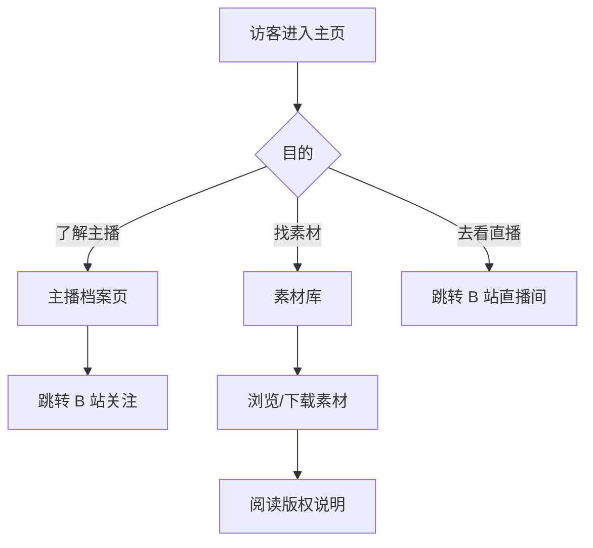

# 枝堇Sumire 粉丝站 V1

**功能名称**: 枝堇Sumire 粉丝向网站（应援站 & 工具集）
**PRD 版本**: v1.0
**创建日期**: 2026-08-11
**作者**: ash

## 背景与目标

### 1.1 背景

枝堇Sumire 是 VirtuaReal 二十八期生，2026-08-05 开始活动，2026-08-07 出道首播。出道后粉丝增长迅速（出道次日达成百人舰队，第三日突破一万粉丝），但粉丝目前缺少一个集中的非官方阵地：

- 路人观众想了解主播时，信息散落在 B 站空间、萌娘百科等各处；
- 二创作者获取立绘等素材没有统一入口；
- 粉丝社群需要的实用工具（周表、歌单、弹幕相关）目前不存在或依赖手工。

### 1.2 目标

建设一个主题鲜明、风格突出、符合枝堇人设（老书屋的藤蔓少女）的非官方粉丝网站，同时作为可持续迭代的工具集平台：

- V1 上线：品牌主页 + 主播档案 + 周边素材库；
- 架构上为后续工具迭代做好准备，但不显示任何"敬请期待"式占位；
- 全站视觉严格贴合人设（应援色 `#b4a6bf`、藤蔓、书屋、蕾丝元素）。

### 1.3 成功标准

- V1 页面在桌面与移动端均可正常访问，首屏加载迅速（LCP < 2.5s）；
- 主播档案信息与公开资料（B 站空间、官方预告）一致，无事实错误；
- 素材库中的素材可直接浏览与下载，并附有版权说明；
- 后续每个工具可作为独立迭代加入，不需要重构站点框架。

## 用户分析

### 2.1 目标用户

- **粉丝（小粉螈）**：已关注主播的观众，想深入了解设定、回顾历程、获取素材；
- **路人观众**：通过切片/推荐对主播产生兴趣，想快速了解"她是谁"；
- **二创作者**：需要官方公开的立绘、宣传图等素材进行同人创作；
- **工具使用者**（后续迭代）：制作周表的美工、整理歌切的切片man、管理弹幕的房管/粉丝。

### 2.2 用户场景

| 场景 | 用户角色 | 目标 | 痛点 |
|--|--|--|--|
| 刷到切片想认识主播 | 路人观众 | 30 秒内知道主播是谁、在哪直播 | 信息分散，B 站空间只有简介 |
| 想了解设定与喜好 | 新粉丝 | 系统地读档案：设定、喜好、历程、梗 | 萌娘百科可读性一般，无氛围感 |
| 做二创找立绘 | 二创作者 | 找到高清立绘并确认使用边界 | 素材散落在各处，无版权提示 |
| 想知道舰长礼物有什么 | 粉丝 | 查看各月大航海礼物内容（后续迭代） | 只能翻历史动态/直播 |
| 帮主播做周表图 | 美工粉丝 | 快速生成统一风格的周表（后续迭代） | 纯手工 PS，效率低 |
| 回顾唱过的歌 | 粉丝 | 按歌单找歌切播放（后续迭代） | 歌切散落在不同投稿中 |

## 功能需求

### 3.1 功能概述

V1 交付一个三页的静态粉丝站：品牌主页（第一印象与导航）、主播档案（完整人设信息）、周边素材库（素材浏览与下载），并以不显示占位的方式为后续工具迭代预留扩展能力。

### 3.2 功能列表

#### 功能点 1: 品牌主页

- **描述**: 站点门面。以立绘与氛围插画营造"雨夜老书屋"的第一印象，展示主播名称、身份一句话介绍、应援色，提供前往档案页、素材库与 B 站直播间/主页的入口。
- **用户价值**: 路人与粉丝进入站点即可感受到鲜明的人设氛围，并快速到达目标内容。
- **验收标准**:
  - [ ] 首屏展示立绘、主播名「枝堇Sumire」、一句话人设简介
  - [ ] 提供档案页、素材库的站内入口
  - [ ] 提供 B 站个人空间与直播间的外链入口
  - [ ] 移动端与桌面端布局均正常

#### 功能点 2: 主播档案页

- **描述**: 结构化展示主播公开信息，包括：基础信息（生日 4.2、种族"被人寄生的藤"、身高、所属 VirtuaReal、粉丝勋章"小粉螈"、Live2D 模型师等）、出道设定故事、兴趣喜好、历程时间线（开始活动、出道、百舰、万粉等）、逸闻梗（"妈妈"弹幕、😁 打 Call 表情等）、外部链接。
- **用户价值**: 新粉丝一站式了解主播，老粉丝回顾历程与梗。
- **验收标准**:
  - [ ] 基础信息完整且与公开资料一致
  - [ ] 设定故事以符合"旧书屋"氛围的方式呈现
  - [ ] 历程以时间线形式展示，含日期与事件
  - [ ] 所有外链可正常跳转

#### 功能点 3: 周边素材库

- **描述**: 分类展示主播相关素材（立绘、氛围插画、宣传图），支持浏览大图与下载原图，每个素材标注来源与版权说明；页面显著位置声明本站为非官方粉丝作品、素材版权归原作者所有。
- **用户价值**: 二创作者与粉丝有统一的素材获取入口，并明确使用边界。
- **验收标准**:
  - [ ] 素材按分类（立绘/插画/宣传图）展示
  - [ ] 可查看大图并下载原图
  - [ ] 页面包含非官方声明与版权说明
  - [ ] 图片加载有优化（缩略图列表、原图按需加载）

#### 功能点 4: 可扩展的站点框架

- **描述**: 站点导航与信息架构支持按"工具"维度持续扩展。后续工具上线后自然出现在导航中；V1 不显示任何未上线功能的入口或占位。
- **用户价值**: 用户看到的永远是完整可用的站点；工具逐一上线时体验连贯。
- **验收标准**:
  - [ ] V1 导航中不存在任何未上线功能的入口
  - [ ] 新增工具时只需增加对应功能，无需改动现有页面结构

### 3.3 用户操作流程

### 3.4 页面/界面描述

| 页面 | 描述 | 关键元素 |
|------|------|---------|
| 主页 `/` | 品牌门面与导航 | 立绘、名称、一句话简介、入口卡片、外链 |
| 档案页 `/about` | 主播完整档案 | 信息卡、设定故事、喜好标签、时间线、逸闻、外链 |
| 素材库 `/assets` | 素材浏览与下载 | 分类筛选、素材网格、大图查看、下载、版权声明 |

### 3.5 异常与边界情况

| 情况 | 预期行为 |
|------|---------|
| 图片加载失败 | 显示占位背景与素材名称，不破坏布局 |
| 移动端访问 | 全部页面响应式可用，素材网格自适应列数 |
| 素材版权争议 | 页面附联系方式，可下架对应素材 |
| 主播信息更新 | 档案内容可随时修订，与官方信息冲突时以官方为准 |

### 3.6 后续迭代规划

以下功能不在 V1 范围内，按优先级顺序迭代，每个迭代单独立项：

| 顺序 | 功能 | 概述 |
|--|--|--|
| 1 | 舰长礼物历史 | 按月份/活动展示大航海（舰长/提督）礼物清单与图示 |
| 2 | 周表生成器 | 输入时间与内容，生成主播风格的本周日程图 |
| 3 | 歌单 + 歌切播放 | 整理唱过的歌曲与对应歌切，站内播放 |
| 4 | 弹幕后台 | 弹幕记录查询与管理（需要后端能力，单独提案） |
| 5 | 弹幕姬 | 合并重复弹幕的前端工具 |

## 四、非功能需求

### 4.1 性能要求

- 首屏 LCP < 2.5s（4G 移动端）；
- 素材列表使用缩略图，原图按需加载。

### 4.2 安全性要求

- V1 无用户输入与后端接口；
- 外链均指向官方域名（bilibili.com）。

### 4.3 兼容性要求

- 现代浏览器（Chrome / Safari / Edge / Firefox 近两个大版本）；
- 移动端 iOS Safari 与 Android Chrome 可用；
- 尊重 `prefers-reduced-motion`。

## 五、依赖与约束

### 5.1 依赖

- 主播公开资料（B 站空间、VirtuaReal 官方预告）；
- 已有素材图片（立绘 ×2、氛围插画 ×1、宣传图 ×2）。

### 5.2 约束

- 本站为非官方粉丝作品，不得冒充官方；素材版权归主播及所属社团所有；
- 不收录任何非公开或侵权内容；
- 档案信息以官方公开信息为准，禁止二次设定。

## 六、待确认事项

- 站点域名（暂用默认部署域名）；
- 是否在主页展示"直播状态"（V1 先只做静态链接）；
- 素材库后续是否需要接受粉丝投稿。

## 七、相关文档

- 技术方案：[[../../engineering/proposals/2026-08-11-fan-site-tech-proposal.md]]
- 视觉识别：[[../../design/01-visual-identity.md]]
- 页面设计：[[../../design/02-page-design.md]]
- 参考资料：[枝堇Sumire B 站空间](https://space.bilibili.com/1150976664/)、[萌娘百科·枝堇](https://zh.moegirl.org.cn/%E6%9E%9D%E5%A0%87)
