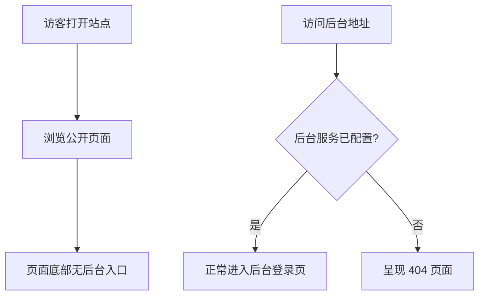

# 登录优化

**功能名称**: 登录优化（后台入口收敛）
**PRD 版本**: v1.0
**创建日期**: 2026-08-13
**作者**: sumire workflow

## 背景与目标

### 1.1 背景

堇色书屋公开站点在每个页面的底部都展示了指向后台管理区的「管理 →」链接。后台管理区仅面向极少数站点运营者，将其入口公开展示在所有访客面前没有价值，反而暴露了后台地址、增加了被无关访问与攻击试探的面。

同时，站点支持以「纯静态、不配置后台服务」的方式部署。当前在这种部署形态下，访客仍然可以进入后台登录页，页面会尝试向主站自身发起登录等请求，最终呈现的是无法理解的错误，而非明确的「页面不存在」反馈。

### 1.2 目标

- 公开站点不再展示任何指向后台管理区的入口链接；
- 未配置后台服务的部署形态下，访问后台区域时呈现 404 页面；
- 已配置后台服务的部署形态下，后台登录与管理功能保持完全可用。

### 1.3 成功标准

- 公开站点任意页面均不再出现指向后台管理区的链接；
- 未配置后台服务时访问后台区域，100% 呈现 404 页面，且不再产生发往主站自身的无效请求；
- 已配置后台服务时，既有登录与管理流程回归通过，无功能回退。

## 用户分析

### 2.1 目标用户

- 普通访客：浏览公开站点内容的粉丝；
- 站点运营者：通过后台管理区维护站点内容的少数管理人员；
- 部署方：以不同形态（含/不含后台服务）部署站点的维护者。

### 2.2 用户场景

| 场景 | 用户角色 | 目标 | 痛点 |
|--|--|--|--|
| 浏览公开站点 | 普通访客 | 获取纯净的浏览体验 | 页面底部存在与己无关的「管理 →」链接，干扰且暴露后台地址 |
| 访问后台登录 | 站点运营者 | 通过已知地址直接进入后台 | 无（后台地址对运营者保持可用） |
| 纯静态部署 | 部署方 | 只部署公开内容，不含后台 | 访客误入后台登录页，看到无意义的请求错误而非 404 |

## 功能需求

### 3.1 功能概述

收敛后台管理区的暴露面：移除公开站点的后台入口链接，并让「未配置后台服务」的部署在后台区域呈现 404 页面。

### 3.2 功能列表

#### 功能点 1: 移除公开站点的后台入口链接

- **描述**: 移除公开站点页面底部展示的「管理 →」链接，公开站点任何页面不再出现指向后台管理区的入口。
- **用户价值**: 公开页面更纯净；后台地址不再随公开页面传播，降低无关访问与恶意试探的概率。
- **验收标准**:
  - [ ] 公开站点首页及任意内容页面均不出现指向后台管理区的链接或入口；
  - [ ] 后台管理区的既有地址仍可被直接访问（在已配置后台服务的前提下），不受本改动影响。

#### 功能点 2: 后台服务未配置时后台区域显示 404

- **描述**: 当站点以「未配置后台服务」的形态部署时，访问后台区域（含登录页）应呈现与站点风格一致的 404 页面，而不是发起注定失败的请求并展示错误信息。
- **用户价值**: 部署方可以放心以纯静态形态发布站点；访客误入后台地址时得到明确、体面的「不存在」反馈。
- **验收标准**:
  - [ ] 未配置后台服务时，访问后台区域任意页面均呈现 404 页面；
  - [ ] 该形态下不再产生发往主站自身的后台类请求；
  - [ ] 已配置后台服务时，后台登录与管理功能与现状一致，无回退。

### 3.3 用户操作流程

### 3.4 页面/界面描述

| 页面 | 描述 | 关键元素 |
|------|------|---------|
| 公开站点各页面 | 页面底部不再包含「管理 →」链接，其余内容与布局不变 | 移除后台入口链接 |
| 后台区域（未配置后台服务时） | 呈现站点统一的 404 页面 | 「页面不存在」提示与返回首页的引导 |

### 3.5 异常与边界情况

| 情况 | 预期行为 |
|------|---------|
| 未配置后台服务，直接访问后台登录页 | 呈现 404 页面 |
| 未配置后台服务，访问后台区域深层地址 | 呈现 404 页面 |
| 已配置后台服务但服务临时不可用 | 维持现有错误提示行为，不在本期范围内 |
| 运营者收藏了后台地址 | 已配置后台服务时收藏地址继续可用 |

## 四、非功能需求

### 4.1 性能要求

无新增性能要求；改动不应增加公开页面的加载开销。

### 4.2 安全性要求

公开站点的交付内容中不再包含指向后台管理区的入口链接，收敛后台地址的暴露面。

### 4.3 兼容性要求

已配置后台服务的部署形态下，后台登录与管理功能的体验与现状完全一致。

## 五、依赖与约束

### 5.1 依赖

- 依赖既有的后台管理区（登录与管理功能）已上线并可正常运行。

### 5.2 约束

- 不改动后台管理区本身的功能与交互；
- 不引入新的页面入口或占位入口；
- 所有内容以官方公开信息为准，禁止二次设定。

## 六、相关文档

- [[2026-08-12-backdoor-auth-prd]]
- 技术提案：`docs/engineering/proposals/2026-08-13-login-optimization-proposal.md`
