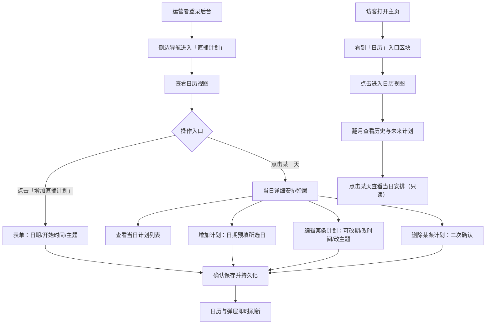

# 周表（直播日程）

**功能名称**: 周表（直播日程日历）
**PRD 版本**: v1.1
**创建日期**: 2026-08-13
**作者**: sumire workflow

> 修订记录：v1.1（2026-08-13，评审返工）——直播计划新增「开始时间」（结束时间 TBD，本期不做）；「编辑/删除」由「本期不做」调整为纳入本期；后台日历新增「当日详细安排」弹层交互（含预填日期的增加入口）；日期/时间选择器需专门设计；补充界面设计文档（`docs/design/04-weekly-schedule-design.md`）。

## 背景与目标

### 1.1 背景

枝堇每周会在官方渠道发布「本周日程」宣传图（见 `docs/design/references/promo-weekly-schedule.png`），标注一周内各场直播的**开播时间**与主题。但宣传图散落在动态中，粉丝想确认「今天播不播、几点播、播什么、前几天播了什么」时需要翻找历史动态，没有一个固定、随时可查的入口。

堇色书屋作为粉丝站，已具备公开站点（`(site)` 路由组）与后台管理区（`/backdoor`）。可以在后台维护一份「直播计划」数据，并在公开站以日历视图呈现，让粉丝随时查看历史直播记录与未来直播安排。

### 1.2 目标

- 提供一个可复用的日历视图组件，能同时呈现历史直播与未来直播计划；
- 后台新增「直播计划」模块，运营者可录入（日期 + 开始时间 + 直播主题）、编辑、删除直播计划并持久化保存；
- 日历视图组件展示后台定好的直播计划，点击某一天可查看当日详细安排；
- 主页增加有设计感的「日历」入口，点击后展示日历视图组件。

### 1.3 成功标准

- 运营者在后台录入直播计划后，数据持久化保存，刷新/重新登录后仍在；
- 运营者可在当日详细安排弹层中编辑（含改期）与删除单条计划，变更即时反映到日历；
- 公开站与后台的日历视图均能正确展示已录入的计划（含开播时间），历史日期与未来日期均可查看；
- 主页「日历」入口具备与站点视觉识别一致、大气的设计感（非裸组件堆砌），点击后可达日历视图；
- 日期与时间的选择控件经过专门设计，交互与视觉贴合站点语言，而非浏览器原生默认样式；
- 所有内容以官方公开信息为准，禁止二次设定。

## 用户分析

### 2.1 目标用户

- 普通访客：想确认直播安排、回顾历史直播的粉丝；
- 站点运营者：在后台维护直播计划的管理人员（superadmin / admin）。

### 2.2 用户场景

| 场景 | 用户角色 | 目标 | 痛点 |
|--|--|--|--|
| 确认近期直播安排 | 普通访客 | 一眼看到未来几天的直播日期、开播时间与主题 | 需翻找历史动态中的周表宣传图，无固定入口 |
| 回顾历史直播 | 普通访客 | 查看过去某天播了什么 | 无统一的历史记录视图 |
| 录入直播计划 | 站点运营者 | 把官方公布的直播安排（日期+开播时间+主题）录入站点 | 无维护渠道，公开站内容无法更新 |
| 调整直播计划 | 站点运营者 | 官方临时改期/取消时，改期、改时间、改主题或删除计划 | 录错或变更无法修正，只能任由错误信息展示 |

## 功能需求

### 3.1 功能概述

围绕一份持久化的「直播计划」数据（日期 + 开始时间 + 直播主题），提供三处能力：后台「直播计划」管理模块（录入/编辑/删除）、可复用的日历视图组件（含当日详细安排查看）、主页「日历」入口。

### 3.2 功能列表

#### 功能点 1: 日历视图组件

- **描述**: 一个可复用的日历视图组件，以月视图日历形式呈现直播计划：有计划的日期展示开播时间与主题摘要，可向前/向后翻月，覆盖历史直播（过去的计划）与未来直播（将来的计划）。点击某一天可查看当日详细安排（当日全部计划的开播时间与主题）。组件同时服务于公开站与后台，保持一致的视觉与交互：公开站语境下当日安排为只读；后台语境下当日安排弹层承载管理操作（见功能点 2）。
- **用户价值**: 粉丝与运营者用同一种视图查看历史与未来直播安排，信息口径一致。
- **验收标准**:
  - [ ] 日历以月视图呈现，支持切换上一月/下一月；
  - [ ] 有直播计划的日期在日历上可辨识，并能直接看到开播时间与主题摘要；
  - [ ] 点击某一天可查看当日全部计划的详细安排（开播时间 + 主题）；
  - [ ] 过去的计划与未来的计划均展示，视觉上可区分「已播出」与「待播出」；
  - [ ] 当日无计划时展示空态，不报错；
  - [ ] 同一组件被公开站日历页与后台「直播计划」模块复用。

#### 功能点 2: 后台「直播计划」模块

- **描述**: 后台管理区新增「直播计划」模块（侧边导航入口 + 独立页面）。页面内包含日历视图组件与「增加直播计划」按钮。点击按钮后弹出表单，要求用户输入**日期**、**开始时间**与**直播主题**，确认后持久化保存；保存成功后日历视图即时反映新计划。日期与时间通过专门设计的选择控件输入（见 `docs/design/04-weekly-schedule-design.md`），不使用浏览器原生默认控件样式。直播计划的「结束时间」本期不录入（TBD）。
- **用户价值**: 运营者获得官方直播安排的录入渠道，站点内容可持续更新。
- **验收标准**:
  - [ ] 后台侧边导航出现「直播计划」入口，登录用户可见；
  - [ ] 「直播计划」页面包含日历视图组件与「增加直播计划」按钮；
  - [ ] 点击「增加直播计划」后出现日期、开始时间与直播主题的输入表单；
  - [ ] 日期、开始时间为空或非法、直播主题为空时无法提交，并给出明确提示；
  - [ ] 日期与时间选择控件为定制设计，视觉与交互符合设计文档；
  - [ ] 确认后计划持久化保存（重启服务、重新登录后仍在）；
  - [ ] 保存成功后日历视图无需手动刷新即可看到新计划。

#### 功能点 3: 后台当日详细安排弹层（查看 / 增加 / 编辑 / 删除）

- **描述**: 后台日历视图中点击某一天，弹出「当日详细安排」弹层（dialog）：列出当日全部直播计划（开播时间 + 主题，按时间排序）；弹层内置「增加计划」按钮，点击后打开录入表单且**日期预填为所选日**；每条计划提供「编辑」与「删除」操作——编辑可修改日期（即改期）、开始时间与主题；删除需二次确认。所有变更保存后即时反映到日历视图与弹层列表。
- **用户价值**: 运营者可以按「天」管理日程，官方改期/取消时能即时修正，保证公开信息准确。
- **验收标准**:
  - [ ] 后台日历点击任意一天弹出当日详细安排弹层，展示当日全部计划（空日时展示空态）；
  - [ ] 弹层内有「增加计划」按钮，打开表单后日期已预填所选日（可改）；
  - [ ] 每条计划可编辑：日期（改期）、开始时间、主题均可修改，保存后即时生效；
  - [ ] 每条计划可删除，删除前有二次确认，删除后即时从日历与弹层消失；
  - [ ] 编辑/删除操作仅限具备权限的角色（superadmin / admin），其余登录角色只读；
  - [ ] 所有变更持久化，刷新后状态一致。

#### 功能点 4: 主页「日历」入口

- **描述**: 主页增加「日历」入口，点击后展示日历视图组件（公开站日历页）。该入口不是简单堆砌组件，而是遵循站点视觉识别（雨夜书屋氛围、藤蔓/蕾丝元素、应援色 `#b4a6bf`）设计的大气页面区块，可参照官方「本周日程」宣传图的呈现感觉，引导访客进入完整日历视图。设计细节见 `docs/design/04-weekly-schedule-design.md`。
- **用户价值**: 粉丝在主页即可感知直播日程的存在并一键进入查看；入口本身成为主页氛围的一部分。
- **验收标准**:
  - [ ] 主页出现「日历」入口区块，视觉遵循 `docs/design/01-visual-identity.md` 与 `docs/design/04-weekly-schedule-design.md`，大气、有设计感，非裸组件；
  - [ ] 点击入口后展示日历视图组件；
  - [ ] 公开站访客无需登录即可查看日历视图及其中的直播计划（含开播时间）；
  - [ ] 未配置后台服务的纯静态部署形态下，主页不出现该入口（遵循「未上线/不可用功能不留占位入口」约定）。

### 3.3 用户操作流程

### 3.4 页面/界面描述

| 页面 | 描述 | 关键元素 |
|------|------|---------|
| 主页 `/` | 新增「日历」入口区块，大气、有设计感，引导至日历视图 | 周表氛围的入口区块（藤蔓/蕾丝/应援色），点击查看日历 |
| 公开站日历页 | 展示日历视图组件，访客可翻月查看历史与未来直播计划，点击某天查看当日安排（只读） | 日历视图组件（月视图、时间+主题标记）、当日安排只读弹层 |
| 后台「直播计划」页 | 日历视图组件 + 「增加直播计划」按钮 + 当日详细安排弹层 | 日历视图组件、增加按钮、当日安排弹层（列表/增加/编辑/删除）、定制日期与时间选择控件 |

### 3.5 异常与边界情况

| 情况 | 预期行为 |
|------|---------|
| 录入/编辑时日期为空或非法 | 表单提示，不提交 |
| 录入/编辑时开始时间为空或非法 | 表单提示，不提交 |
| 录入/编辑时直播主题为空 | 表单提示，不提交 |
| 编辑时将计划改期到另一天 | 允许，计划从原日消失、出现在新日期 |
| 录入/编辑后与既有计划同日同时间同主题 | 视为重复，提示且不保存 |
| 同一天已有多场直播计划 | 允许，当日安排弹层按开播时间升序展示全部 |
| 录入/改期为过去日期 | 允许（用于补录/修正历史直播记录），日历中按「已播出」呈现 |
| 删除计划 | 二次确认后执行，不可恢复（需重新录入） |
| 编辑/删除时计划已被他人变更 | 以服务端最新状态为准，失败时提示并刷新数据 |
| 后台服务不可用 | 公开站日历视图展示加载失败提示，不影响站点其他页面 |
| 未配置后台服务的纯静态部署 | 主页不出现日历入口；直接访问日历地址呈现 404 页面（与后台守卫口径一致） |
| 未登录访问后台「直播计划」 | 按后台既有守卫跳转登录页 |
| member 角色访问后台「直播计划」 | 可查看日历与当日安排，不显示增加/编辑/删除入口 |

## 四、非功能需求

### 4.1 性能要求

- 日历视图按计划量按月/按区间拉取数据，不一次性加载全量计划；
- 主页入口区块不阻塞首屏渲染，数据加载有过渡态。

### 4.2 安全性要求

- 直播计划的新增/编辑/删除仅限已登录且具备权限的后台角色（superadmin / admin）；
- 公开读取接口不暴露任何后台管理信息；
- 输入内容（直播主题）需做长度限制与必要的注入防护。

### 4.3 兼容性要求

- 公开站保持 `output: "export"` 纯静态部署形态，日历数据在客户端运行时拉取；
- 日历视图组件与日期/时间选择控件在移动/平板/桌面断点下均可用（遵循 `docs/design/02-page-design.md` 断点约定）。

## 五、依赖与约束

### 5.1 依赖

- 依赖既有后台管理区（登录、会话、角色体系）已上线可用；
- 依赖后台 API 服务（`servers/api`）与 MongoDB 持久化设施。

### 5.2 约束

- 所有直播计划内容以官方公开信息为准，禁止二次设定；
- 录入内容包含日期、开始时间与直播主题；不含结束时间（TBD，见 6. 后续可能）；
- 未上线的功能不得在 UI 中显示占位入口；
- 日历视图组件公开站与后台复用同一份实现；
- 界面设计遵循 `docs/design/04-weekly-schedule-design.md`。

## 六、后续可能（本期不做）

- 直播计划的结束时间（TBD）与时长展示；
- 直播封面、直播链接等扩展字段；
- 与 B 站开播数据自动同步。

## 七、相关文档

- [[2026-08-11-sumire-fan-site-prd]]
- [[2026-08-12-backdoor-auth-prd]]
- 视觉识别：`docs/design/01-visual-identity.md`
- 页面设计：`docs/design/02-page-design.md`
- 周表设计：`docs/design/04-weekly-schedule-design.md`
- 官方周表参考图：`docs/design/references/promo-weekly-schedule.png`
- 技术提案：`docs/engineering/proposals/2026-08-13-weekly-schedule-proposal.md`
