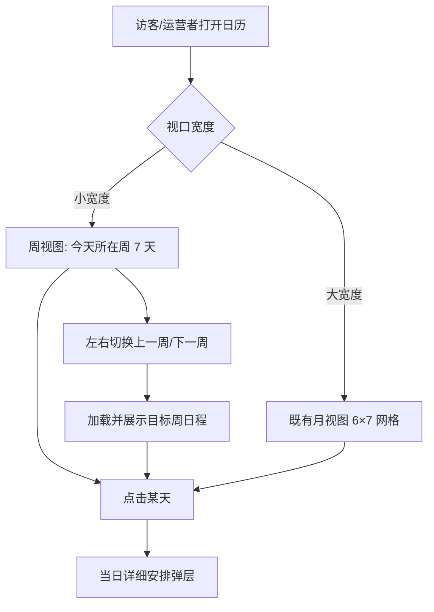

# 移动端日历周视图

**功能名称**: 移动端日历周视图
**PRD 版本**: v1.0
**创建日期**: 2026-08-15
**作者**: sumire workflow

## 背景与目标

### 1.1 背景

日历视图（公开站 `/calendar` 与后台「直播计划」页共用 `CalendarView` 组件，见 [[2026-08-13-weekly-schedule-prd]]、[[2026-08-15-weekly-schedule-v2-prd]]）目前固定渲染 6×7 月视图网格，无任何移动端断点适配。在手机等小宽度设备上，整个月的日历被压缩进屏幕宽度，单日格子极小（约 40–50px 宽），计划/历史记录摘要文字几乎不可读，「今天」「已播出」等状态标记也难以辨认。

### 1.2 目标

- 小宽度设备上，日历从「整月网格」改为「一周日程」视图：单次只展示一周（7 天），单日格子获得充足宽度与高度，条目摘要可读；
- 周视图支持上一周/下一周切换，可跨越月份边界；
- 桌面/平板等较大宽度下保持现有月视图不变。

### 1.3 成功标准

- 小宽度（手机竖屏量级）打开日历时展示当前周（今天所在周）的 7 天日程，单日格子宽高充足、条目文字可读；
- 周视图内可左右切换上一周/下一周，切换后即时展示对应周的日程，跨年/跨月/跨月界均正常；
- 大宽度设备上日历仍为既有月视图，行为与样式无回归；
- 周视图同样混合展示人工计划与历史直播记录（沿用二期口径），来源可区分、历史记录只读；
- 点击某天仍打开当日详细安排弹层，行为与月视图一致；
- 后台「直播计划」页与公开站日历页行为一致（同一组件）；
- 所有内容以官方公开信息为准，禁止二次设定。

## 用户分析

### 2.1 目标用户

- 普通访客：多数通过手机访问粉丝站，在日历中查看本周/近期直播计划与实际播出记录；
- 站点运营者：通过手机进入后台「直播计划」页快速查看或维护近期安排。

### 2.2 用户场景

| 场景 | 用户角色 | 目标 | 痛点 |
|--|--|--|--|
| 手机上看这周播什么 | 普通访客 | 打开日历看清本周每天的计划与实况 | 月视图格子过小，文字缩成一团无法阅读 |
| 手机上翻看前后周安排 | 普通访客 / 运营者 | 切换相邻周查看日程 | 月视图在手机上信息密度低且不可读，翻月成本高 |
| 桌面端浏览整月 | 普通访客 / 运营者 | 保持整月总览 | 不希望既有桌面体验被改动 |

## 功能需求

### 3.1 功能概述

`CalendarView` 组件增加响应式形态：小宽度断点以下渲染「周视图」（单周 7 天 + 周切换），断点以上维持既有月视图。数据取数、当日弹层、历史记录混合展示等既有能力在周视图中完整保留。

### 3.2 功能列表

#### 功能点 1: 小宽度下周视图

- **描述**: 在小宽度断点（手机竖屏量级，具体阈值见技术提案，建议 Tailwind `sm` 断点 `< 640px`）下，日历不再渲染 6×7 月网格，改为渲染**一周**的日程：
  - 展示周以「选中日期所在周」为准，初始为今天所在周（周一为一周首日，与月视图口径一致）；
  - 单日格子宽度为屏幕的 1/7，高度较月视图格子显著增加，条目摘要（`HH:mm 主题`）完整可读；
  - 每日格子沿用月视图视觉语言：今天标记、过去弱化、历史记录「实际播出」来源样式、空天占位；
  - 标题区显示当前周信息（所在月份 + 周区间或「x 月第 n 周」类可读标签）。
- **用户价值**: 手机用户无需缩放即可清晰阅读每天安排。
- **验收标准**:
  - [ ] 小宽度设备打开日历，默认展示今天所在周的 7 天日程；
  - [ ] 单日格子内条目摘要文字可读，同日多条（计划 + 历史记录）均能展示或给出 `+N` 收口；
  - [ ] 今天、过去、历史记录等视觉状态与月视图一致；
  - [ ] 断点以上宽度渲染既有月视图，无样式/行为回归。

#### 功能点 2: 周切换

- **描述**: 周视图提供上一周/下一周切换按钮（月视图的「上一月/下一月」在小宽度下由周切换替代）。切换后即时展示目标周日程；周可自由跨越月份与年份边界（如从 8 月第 3 周切到含 9 月 1 日的一周）。切换到的周若不含「今天」，标题区仍明确标示该周区间；提供回到本周的快捷途径（如点击标题或沿用月视图「今天」按钮的口径）。
- **用户价值**: 手机用户可以周为粒度低成本浏览前后安排。
- **验收标准**:
  - [ ] 周视图内可切换到上一周/下一周，跨月、跨年边界正确；
  - [ ] 切换后新周的计划与历史记录正确加载并展示；
  - [ ] 有回到「今天所在周」的快捷操作；
  - [ ] 切换过程无闪烁、无报错，加载态合理。

#### 功能点 3: 当日详情与既有能力保留

- **描述**: 周视图中点击某天，仍打开当日详细安排弹层（公开站只读 / 后台管理态），行为与月视图完全一致；历史直播记录混合展示、数据源降级、`API_CONFIGURED` 构建时守卫等既有能力不受本需求影响。
- **用户价值**: 两种视图下交互心智一致，无学习成本。
- **验收标准**:
  - [ ] 周视图点天打开当日弹层，只读/管理态行为与月视图一致；
  - [ ] 历史直播数据源不可用时周视图静默降级为仅展示人工计划；
  - [ ] 未配置后台服务的纯静态形态下公开日历页仍 404（沿用既有口径）。

### 3.3 用户操作流程

### 3.4 页面/界面描述

| 页面 | 描述 | 关键元素 |
|------|------|---------|
| 公开站日历页 `/calendar`（小宽度） | 周视图：单周 7 天 + 周切换 + 回到本周 | 周标题、左右切换按钮、7 天格子（计划 + 历史记录） |
| 后台「直播计划」页 `/backdoor/schedule`（小宽度） | 同一组件，周视图行为一致，管理态能力保留 | 同上 + 管理态弹层入口 |
| 以上两页（大宽度） | 既有月视图，不变 | 月标题、月切换、6×7 网格 |

### 3.5 异常与边界情况

| 情况 | 预期行为 |
|------|---------|
| 周跨月/跨年（如一周内含两个月份） | 正常展示，标题区清晰标示周区间；取数覆盖周涉及的全部月份 |
| 目标周无任何计划与历史记录 | 展示空周（空天占位样式），不报错 |
| 某日条目多于格子可展示条数 | 以 `+N` 收口（沿用月视图口径），点击该天在弹层查看全部 |
| 视口在浏览过程中跨过断点（旋转屏幕/拖窗） | 视图形态随断点切换，选中日期不丢失；月视图定位到选中日期所在月，周视图定位到选中日期所在周 |
| 历史直播数据源不可达 | 周视图静默降级为仅展示人工计划（沿用二期口径） |
| `prefers-reduced-motion` | 周切换无强制动画或尊重该设置（沿用站点约定） |
| 未配置后台服务的纯静态形态 | 公开日历页 404，不出现占位入口（沿用既有口径） |

## 四、非功能需求

### 4.1 性能要求

- 周视图为纯前端渲染切换，不新增网络请求；周切换只重新计算/渲染一周数据，感知即时；
- 月/周视图切换不得引起既有计划与历史记录的重复拉取（取数仍按可见范围触发）。

### 4.2 安全性要求

- 无新增接口与写路径，沿用既有安全口径。

### 4.3 兼容性要求

- 保持 `output: "export"` 纯静态部署形态，断点判断在客户端完成且无明显闪烁/布局跳动；
- 覆盖主流手机竖屏宽度（320px 起）；
- 桌面/平板断点下月视图零回归。

## 五、依赖与约束

### 5.1 依赖

- 依赖既有 `CalendarView` 组件与取数链路（`GET /api/stream-plans`、`GET /api/live-history`）；
- 依赖一期/二期已确立的周口径（周一为一周首日）与历史记录混合展示能力。

### 5.2 约束

- 所有内容以官方公开信息为准，禁止二次设定；
- 不新增后端接口，不改既有契约；
- 公开站与后台继续复用同一份 `CalendarView` 实现；
- 未上线的功能不得在 UI 中显示占位入口；
- 大宽度下月视图行为与样式保持现状。

## 六、后续可能（本期不做）

- 周视图的手势滑动切换（触摸 swipe）；
- 周视图与月视图之间的用户手动切换开关；
- 以「日」为粒度的更窄断点形态（如单日列表）。

## 七、相关文档

- [[2026-08-13-weekly-schedule-prd]]（一期 PRD）
- [[2026-08-15-weekly-schedule-v2-prd]]（二期 PRD：历史记录混合展示）
- [[2026-08-11-sumire-fan-site-prd]]
- 视觉识别：`docs/design/01-visual-identity.md`
- 本期技术提案：`docs/engineering/proposals/2026-08-15-calendar-mobile-week-proposal.md`
