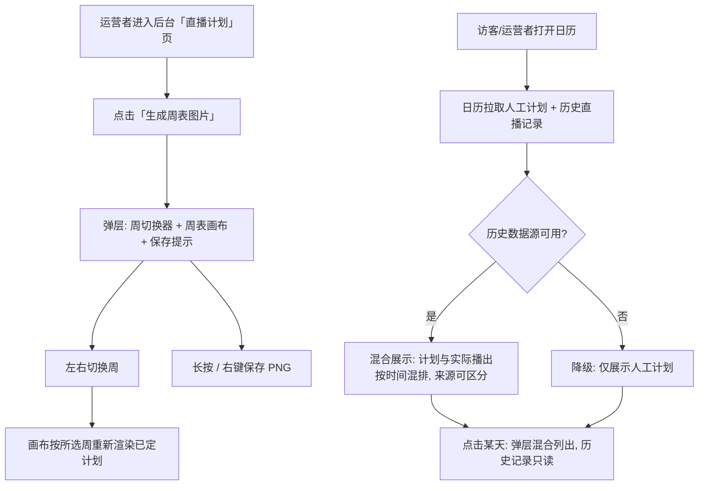

# 周表二期（周表图片生成 + 历史直播混合展示）

**功能名称**: 周表二期
**PRD 版本**: v1.0
**创建日期**: 2026-08-15
**作者**: sumire workflow

## 背景与目标

### 1.1 背景

一期（见 [[2026-08-13-weekly-schedule-prd]]）已上线直播计划的录入/编辑/删除与日历视图。运营者维护好本周计划后，仍需手工制作可发布的周表宣传图；同时日历里只有人工录入的计划，缺少与真实播出情况的比对——官方历史直播记录有现成数据接口，可直接混合展示，让日历同时回答「计划播什么」与「实际播了什么」。

### 1.2 目标

- 后台「直播计划」页面新增「生成周表图片」功能：以官方周表素材为底图，把后台已定好的直播计划文字绘制到图片上，一键预览并保存为图片；
- 日历视图（公开站与后台共用）混合展示官方历史直播记录（取最近 100 条），与人工录入的计划同屏呈现、来源可区分。

### 1.3 成功标准

- 运营者在后台打开「生成周表图片」弹层，可左右切换周（如「2026 年第 33 周」），画布即时渲染该周已定计划到素材底图上；
- 渲染文字字体贴合站点视觉识别或素材本身的衬线花体气质，文字落在素材标注的每日区域内、不溢出；
- 生成的图片可通过长按（移动端）或右键（桌面端）保存，弹层有一行小字提示；
- 图片只渲染已录入并持久化的直播计划，混合展示的历史直播记录不渲染；
- 日历中历史直播记录与人工计划混合展示，视觉上可区分来源；历史记录只读，不提供编辑/删除；
- 历史直播数据源不可用时，日历仅回退为只展示人工计划，不报错、不阻塞；
- 所有内容以官方公开信息为准，禁止二次设定。

## 用户分析

### 2.1 目标用户

- 站点运营者：维护直播计划并产出可发布的周表图片（superadmin / admin；生成图片为只读性质操作，所有登录角色可用）；
- 普通访客：在日历中同时看到计划与实际播出记录。

### 2.2 用户场景

| 场景 | 用户角色 | 目标 | 痛点 |
|--|--|--|--|
| 产出本周周表图 | 站点运营者 | 把已定计划渲染成官方素材风格的周表图片并保存发布 | 手工 PS/制图，逐条誊抄时间与主题，易错且慢 |
| 回看往期周表图 | 站点运营者 | 切换到历史周生成对应周表图 | 历史计划散落在日历里，无法快速成图 |
| 对照计划与实际播出 | 普通访客 / 运营者 | 日历中同时看到「计划」与「实际播了」 | 只有人工计划，无法得知真实播出情况 |

## 功能需求

### 3.1 功能概述

在一期「直播计划」能力之上增加两块：后台「生成周表图片」弹层（纯前端绘制，后端只复用既有计划读取接口），以及日历视图的历史直播记录混合展示（新增历史直播数据源接入）。

### 3.2 功能列表

#### 功能点 1: 后台「生成周表图片」

- **描述**: 后台「直播计划」页面新增「生成周表图片」按钮，点击后弹出 dialog。弹层内含：
  - **周切换器**：显示当前选中周（如「2026 年第 33 周」），左右按钮切换上一周/下一周，切换后即时将该周已录入的直播计划渲染到周表图片上；
  - **周表画布**：以素材 `weekly-schedules-raw.jpg`（1665×1080，已放入 `apps/bookstore/public/assets/original/`）为底图，将该周每日的计划文字（`HH:mm 主题`）绘制到素材标注的对应日区域（每日区域左上角坐标与可用大小 715×70 见同目录 `AGENTS.md`）；渲染字体须符合站点视觉识别（`docs/design/01-visual-identity.md`，中文标题用 Noto Serif SC）或与素材本身的衬线花体气质一致；
  - **保存提示**：画布下方一行小字提示「长按保存图片，或右键另存为」。
  本功能为**纯前端绘制**：后端只提供既有已定计划的读取能力（`GET /api/stream-plans`），不新增图片生成接口。画布基于所选周从已录入并持久化的计划取数；**只渲染人工录入的直播计划，功能点 2 混合展示的历史直播记录不参与渲染**。
- **用户价值**: 运营者一键产出与官方素材风格一致的周表图片，免去手工制图与誊抄错误。
- **验收标准**:
  - [ ] 后台「直播计划」页出现「生成周表图片」按钮，点击弹出 dialog；
  - [ ] 弹层内周切换器显示当前周（「2026 年第 xx 周」），左右切换后画布即时重新渲染对应周的计划；
  - [ ] 计划文字绘制在素材每日区域内（715×70），不溢出、不错位；同日多场计划均呈现；
  - [ ] 字体为 Noto Serif SC（或素材同风格衬线花体），颜色与素材底色协调、可读；
  - [ ] 画布下方有小字提示「长按保存图片，或右键另存为」，移动端长按与桌面端右键均可保存 PNG；
  - [ ] 图片仅包含人工录入的计划；历史直播记录不出现在图中；
  - [ ] 所选周无计划时仍正常渲染空底图，不报错；
  - [ ] 未配置后台服务的纯静态形态下后台本不可达，本功能随之不可用，不留占位入口。

#### 功能点 2: 日历混合展示历史直播记录

- **描述**: 日历视图组件（公开站 `/calendar` 与后台「直播计划」页共用）在人工录入计划之外，混合展示官方历史直播记录。数据源为 `http://vtuber.internal.fffdan.com/api/b/live/1727076670/history`，**仅取 `title`、`startDate`、`stopDate` 三个字段用于展示**，本期固定取**最近 100 条**（按日期取数的迭代后续再做）。历史记录与人工计划在同一张日历上混合呈现，但来源可区分（如以「实际播出」标记/不同的视觉样式），且历史记录一律视为「已播出」；当日详细安排弹层中同样混合列出，历史记录只读、不出现编辑/删除入口。数据源拉取失败时静默降级：日历只展示人工计划，页面其余功能不受影响。
- **用户价值**: 访客与运营者在日历里同时看到「计划」与「实际播出」，信息更完整可信。
- **验收标准**:
  - [ ] 日历格子与当日安排弹层中同时出现人工计划与历史直播记录，按时间排序混合展示；
  - [ ] 历史直播记录视觉上有明确的来源区分（区别于人工录入计划），且恒为「已播出」样式；
  - [ ] 历史记录只读：任何角色均无编辑/删除入口；
  - [ ] 仅使用 `title`、`startDate`、`stopDate` 三个字段，不展示数据源中的其他字段；
  - [ ] 本期取最近 100 条展示；
  - [ ] 数据源不可达/返回异常时日历仅展示人工计划，不出现错误页面或阻塞加载；
  - [ ] 历史记录不参与「生成周表图片」的渲染。

### 3.3 用户操作流程

### 3.4 页面/界面描述

| 页面 | 描述 | 关键元素 |
|------|------|---------|
| 后台「直播计划」页 `/backdoor/schedule` | 新增「生成周表图片」按钮；日历混合展示历史记录 | 生成按钮、日历（计划 + 历史记录，来源可区分） |
| 生成周表图片弹层 | 周切换器 + 素材底图画布 + 保存提示小字 | 周切换器（2026 年第 xx 周，左右箭头）、Canvas 预览、提示文字 |
| 公开站日历页 `/calendar` | 日历混合展示历史直播记录（只读） | 日历（计划 + 历史记录）、当日安排弹层（混合、历史记录只读） |

### 3.5 异常与边界情况

| 情况 | 预期行为 |
|------|---------|
| 所选周无任何计划 | 渲染空底图，画布正常展示，可保存 |
| 同日多场计划 | 全部绘制，按开播时间升序排列，文字自适应缩放入每日区域，超出以「…」收尾 |
| 计划主题过长 | 自适应缩小字号；仍超出区域则截断并以「…」收尾 |
| 字体尚未加载完成 | 等待字体就绪后再绘制（不出现缺字/回退字体的成品图） |
| 素材图片加载失败 | 弹层内提示加载失败 + 重试，不渲染残缺图 |
| 历史直播数据源不可达/超时/返回异常 | 日历静默降级为仅展示人工计划；当日弹层同样降级；不阻塞页面 |
| 历史记录字段缺失（无 title 或 startDate） | 该条丢弃，不渲染 |
| 历史记录与人工计划同日同时间 | 两条都展示，来源样式区分，不互相覆盖 |
| 历史记录跨天（startDate 与 stopDate 不同日） | 按 startDate 归入开播当日 |
| member 角色 | 可使用「生成周表图片」（只读性质）；历史记录与计划均只读，与一期口径一致 |
| 未登录访问后台 | 按既有守卫跳转登录页 |
| 未配置后台服务的纯静态形态 | 后台不可达，相关入口不出现；公开日历页 404（沿用一期口径） |

## 四、非功能需求

### 4.1 性能要求

- 周表图片渲染为纯前端操作，切换周的重新渲染应即时（< 100ms 感知，字体与底图在弹层打开时预加载）；
- 历史直播记录拉取结果应做短 TTL 缓存，避免日历翻页/切换时重复请求上游；
- 历史记录的接入不得阻塞日历既有计划数据的展示（两路数据独立加载、合并渲染）。

### 4.2 安全性要求

- 「生成周表图片」复用既有公开读接口，不引入新的写路径；
- 历史直播数据源为内网地址，不得直接暴露给公开站前端（上游地址收敛在服务端配置中）；
- 渲染到图片上的文字为运营者已录入内容，沿用一期输入校验口径。

### 4.3 兼容性要求

- 公开站保持 `output: "export"` 纯静态部署形态，历史记录数据在客户端运行时拉取（经后台 API 中转）；
- 生成图片弹层在移动/平板/桌面断点下均可用（画布自适应缩放，保存提示按端给出长按/右键措辞）；
- Canvas 绘制遵循 `docs/design/01-visual-identity.md` 的字体与色彩规范。

## 五、依赖与约束

### 5.1 依赖

- 依赖一期已上线的直播计划读取接口（`GET /api/stream-plans`）与日历视图组件；
- 素材 `weekly-schedules-raw.jpg` 已放入 `apps/bookstore/public/assets/original/`，每日绘制区域坐标见同目录 `AGENTS.md`；
- 历史直播数据源 `http://vtuber.internal.fffdan.com/api/b/live/1727076670/history` 可用（内网地址，需部署环境可达）。

### 5.2 约束

- 所有内容以官方公开信息为准，禁止二次设定；
- 周表图片为纯前端绘制，后端不新增图片生成/存储能力；
- 图片只渲染人工录入计划，历史直播记录不渲染；
- 历史记录本期固定取最近 100 条，按日期取数后续迭代；
- 未上线的功能不得在 UI 中显示占位入口；
- 日历视图组件公开站与后台继续复用同一份实现。

## 六、后续可能（本期不做）

- 历史直播记录按日期区间取数（替代固定最近 100 条）；
- 周表图片的站内直接下载按钮与分享链接；
- 计划与实际播出的自动对账/标记（如「计划但未播」高亮）。

## 七、相关文档

- [[2026-08-13-weekly-schedule-prd]]（一期 PRD）
- [[2026-08-11-sumire-fan-site-prd]]
- 视觉识别：`docs/design/01-visual-identity.md`
- 周表设计：`docs/design/04-weekly-schedule-design.md`
- 素材坐标说明：`apps/bookstore/public/assets/original/AGENTS.md`
- 一期技术提案：`docs/engineering/proposals/2026-08-13-weekly-schedule-proposal.md`
- 本期技术提案：`docs/engineering/proposals/2026-08-15-weekly-schedule-v2-proposal.md`
