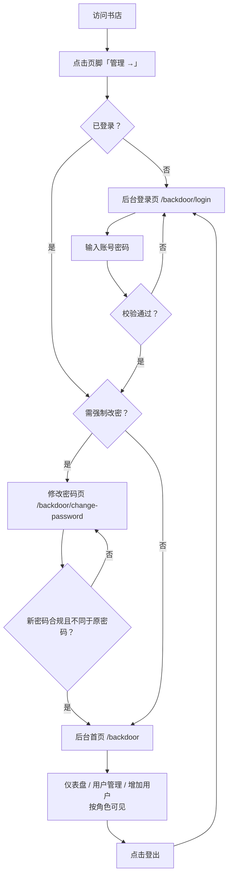

# 后台系统 V1：登入登出与用户管理

**功能名称**: 后台系统 V1——登入登出、角色体系与用户管理（不开放注册）
**PRD 版本**: v1.3
**创建日期**: 2026-08-12
**作者**: ash

## 修订记录

| 版本 | 日期 | 说明 |
|------|------|------|
| v1.0 | 2026-08-12 | 初版：登入登出 + 后台框架 |
| v1.1 | 2026-08-12 | 重写：统一章节结构；补充范围与不做清单；验收标准改为可追踪编号（AC-x）；挂接后台设计文档 |
| v1.2 | 2026-08-12 | 返工修订：后台页面归属书店应用（`apps/bookstore` 的 `/backdoor` 路由），后端仅提供 API 服务；页脚入口改为同站 `/backdoor` |
| v1.3 | 2026-08-12 | 返工修订：引入角色体系（超级管理员/管理员/成员）与用户管理；新增用户（按角色权限降级创建）；首次登录强制修改密码；密码强度规则（≥16 位，含字母、数字、符号） |

## 一、背景与目标

### 1.1 背景

粉丝站逐步积累档案、素材与工具数据，后续将出现需要管理的内容（素材上下架、档案修订、弹幕后台等）。这些管理操作需要一处与公开内容分离的入口，并限制为受信任用户可访问。随着协作可能增加，后台需要多账号与角色权限能力，同时保证账号体系不外溢（不开放注册，账号只能由有权限的管理者创建）。V1 建立访问控制骨架、角色体系与后台界面框架，为后续管理功能迭代做准备：**后台页面作为书店应用的独立路由区（`/backdoor`）实现，鉴权与用户管理等服务端能力由独立后端 API 服务提供**。

### 1.2 目标

- 提供后台系统的登入/登出能力，不开放注册；
- 建立角色体系（超级管理员 > 管理员 > 成员）与权限边界：用户管理仅超管可见，增加用户按角色权限降级创建；
- 首次登录强制修改初始密码，密码须满足强度规则；
- 后台界面与公开书店延续同一设计语言，路由（`/backdoor` 前缀）与公开内容相互独立；
- 为后续管理功能（素材、档案、工具数据等）提供可扩展的后台框架。

### 1.3 成功标准

- 未登录访问后台页面会被引导到登录页；
- 合法账号可登录并进入后台，登录后可正常访问其角色权限内的后台页面；
- 首次登录（初始密码）被强制引导修改密码，未改密前无法进入后台其他页面；
- 超管可查看用户管理并创建任意角色用户；管理员仅可创建成员角色用户；成员无创建能力；
- 登出后会话立即失效，再次访问后台需重新登录；
- 登录状态保持 7 天；同一账号允许多处同时在线、各自独立登出；
- 登录页提供明确的错误提示（账号或密码错误，不区分具体原因）。

### 1.4 范围与不做

- **做**：登录页、登出、首次登录强制改密（含密码强度校验）、受保护的后台布局（顶部栏 + 左侧导航 + 内容区）、欢迎仪表盘、用户管理（仅超管：用户列表）、增加用户（超管任意角色 / 管理员仅成员）、书店页脚「管理 →」入口、会话保持与多端独立会话；
- **不做**：自助注册、找回密码（忘记密码由超管手工处理）、删除/停用用户、修改他人密码、任何具体业务管理功能、未上线功能的占位入口。

## 二、用户分析

### 2.1 目标用户与角色

| 角色 | 标识 | 说明 | 权限 |
|------|------|------|------|
| 超级管理员（站长本人） | `superadmin` | 最高权限，初始账号 `supersumire` | 用户管理（列表）可见；可创建**任意角色**用户 |
| 管理员 | `admin` | 受信任的协作管理者 | 不可见用户管理；仅可创建**成员**角色用户 |
| 成员 | `member` | 后台普通使用者 | 仅登录/登出/修改自己密码，无创建能力 |

角色层级：超级管理员 > 管理员 > 成员。增加用户的通用规则为「只能创建自己权限范围以下的角色」，**超级管理员除外**（可创建任意角色，含其他超级管理员）。

### 2.2 用户场景

| 场景 | 用户角色 | 目标 | 痛点 |
|--|--|--|--|
| 首次使用后台 | 超级管理员 | 用初始账号登录并立即改为强密码 | 初始密码弱，需强制替换 |
| 日常管理（后续迭代） | 全部角色 | 管理素材、档案等内容 | 无统一管理界面 |
| 引入协作者 | 超级管理员 | 查看现有账号、创建管理员/成员账号 | 需要可控的账号发放 |
| 引入普通成员 | 管理员 | 创建成员账号 | 不应看到全部账号，也不能创建同级 |
| 离开后回来继续管理 | 全部角色 | 7 天内免重复登录 | 频繁登录影响效率 |
| 完成管理离开 | 全部角色 | 登出，确保他人无法进入 | 担心会话残留 |

## 三、功能需求

### 3.1 功能概述

V1 交付后台系统的登入/登出、角色体系、首次登录强制改密、用户管理与受保护的后台界面框架，均以书店应用的 `/backdoor` 路由前缀承载，与公开页面隔离。书店页脚右下角提供「管理 →」入口链接。后台暂不包含具体业务管理功能，导航按角色渲染且不出现未上线功能的占位项。

### 3.2 功能列表

#### 功能点 1：后台登录

- **描述**：提供登录页（`/backdoor/login`），用户输入用户名与密码进行登录。初始超管账号 `supersumire`，初始密码 `salamander`（仅首次使用，登录后即被强制改密，见功能点 3）。登录成功后进入后台首页；失败时提示"账号或密码错误"。未登录访问后台任意页面均跳转到登录页。
- **用户价值**：合法用户能安全进入后台，他人无法进入。
- **验收标准**：
  - [ ] AC-1 访问 `/backdoor` 未登录时跳转 `/backdoor/login`
  - [ ] AC-2 输入正确账号密码可登录并跳转后台首页 `/backdoor`（首次登录除外，见 AC-15）
  - [ ] AC-3 输入错误账号或密码提示"账号或密码错误"，不区分具体原因
  - [ ] AC-4 不提供自助注册入口，页面与接口均无注册能力（账号仅能由有权限的管理者创建）
  - [ ] AC-5 登录后刷新页面仍保持登录状态（7 天内）

#### 功能点 2：后台登出

- **描述**：后台提供登出入口。点击登出后当前会话立即失效，跳转回登录页；再次访问后台需重新登录。
- **用户价值**：离开后台时能确保会话安全结束。
- **验收标准**：
  - [ ] AC-6 后台界面可点击登出
  - [ ] AC-7 登出后跳转登录页，且再次访问 `/backdoor` 重新要求登录
  - [ ] AC-8 登出仅使当前端会话失效，不影响同一账号在其他设备的会话

#### 功能点 3：首次登录强制修改密码

- **描述**：使用初始密码的账号（初始超管 `supersumire`、以及被创建的持初始密码的新用户）第一次登录后，**必须修改密码**才能进入后台：登录成功后直接落到修改密码页，访问后台其他任何页面均被引导回改密页。新密码**必须与原密码不同**，且须满足密码强度规则（功能点 6）。改密成功后进入后台首页，该账号后续登录不再强制。
- **用户价值**：初始密码不落地长期使用，账号发放后凭据立即私有化。
- **验收标准**：
  - [ ] AC-15 `supersumire` 首次登录成功后被强制引导至修改密码页，未改密前访问 `/backdoor` 等其他后台页面均被引导回改密页
  - [ ] AC-16 新密码与原密码相同时被拒绝并提示；不符合强度规则时被拒绝并提示具体规则
  - [ ] AC-17 改密成功后进入后台首页，刷新与后续登录均不再强制改密
  - [ ] AC-18 被创建的新用户（管理员/成员）首次登录同样触发强制改密

#### 功能点 4：用户管理（仅超级管理员）

- **描述**：超管导航中提供「用户管理」页面（`/backdoor/users`），展示全部后台账号列表（用户名、角色、创建时间）。该页面与对应接口**仅超级管理员可见/可用**：管理员与成员的导航中不出现该入口，直接访问路由或调用接口均被拒绝（403）。
- **用户价值**：站长可掌握账号全貌，且账号信息不对低权限角色暴露。
- **验收标准**：
  - [ ] AC-19 超管可见「用户管理」导航并可打开列表，列表展示用户名、角色、创建时间
  - [ ] AC-20 管理员/成员导航中无「用户管理」入口；直接访问 `/backdoor/users` 页面被拒绝，调用用户列表接口返回 403

#### 功能点 5：增加用户（超管 / 管理员）

- **描述**：提供「增加用户」页面（`/backdoor/users/new`），导航对超管与管理员可见。创建时填写用户名、初始密码、角色。**角色可选范围按当前用户权限限定**：超管可创建任意角色（超管/管理员/成员）；管理员仅可创建成员；成员无此入口也无接口权限。初始密码须满足强度规则（功能点 6）。新用户首次登录须强制改密（功能点 3）。
- **用户价值**：账号发放受控，权限不外溢。
- **验收标准**：
  - [ ] AC-21 超管创建管理员/成员/超管账号均成功；创建后出现在用户管理列表
  - [ ] AC-22 管理员创建成员成功；管理员创建管理员或超管被拒绝（前端不提供选项，接口返回 403）
  - [ ] AC-23 成员无「增加用户」导航入口；调用创建接口返回 403
  - [ ] AC-24 初始密码不符合强度规则或用户名为空/已存在时被拒绝并提示

#### 功能点 6：密码强度规则

- **描述**：所有设置新密码的场景（首次强制改密、创建用户初始密码）统一执行强度校验：**长度 ≥ 16 位，且必须同时包含字母、数字、符号**。服务端校验为准，前端表单同步提示规则。
- **用户价值**：后台账号口令具备基础强度，初始弱密码不可延续。
- **验收标准**：
  - [ ] AC-25 密码长度 < 16、缺字母、缺数字、缺符号分别被拒绝并提示
  - [ ] AC-26 符合规则的密码被接受

#### 功能点 7：后台界面框架

- **描述**：登录后的后台采用标准管理界面布局：顶部栏（站点名 + 登出）、左侧导航、右侧内容区。导航按角色渲染：「仪表盘」（所有角色）、「用户管理」（仅超管）、「增加用户」（超管 + 管理员）。V1 仪表盘展示欢迎语；不显示未上线功能的占位。视觉细节见 [[../../design/03-backdoor-design.md]]。
- **用户价值**：为后续管理功能提供统一入口与一致的操作界面，且各角色只见其可用的功能。
- **验收标准**：
  - [ ] AC-9 后台布局为顶部栏 + 左侧导航 + 右侧内容区
  - [ ] AC-10 仪表盘页面展示欢迎语，无空白页或占位功能
  - [ ] AC-11 后台样式与书店视觉语言一致（深色底、应援色点缀，遵循视觉识别系统）
  - [ ] AC-27 导航按角色渲染：成员仅见「仪表盘」，管理员多见「增加用户」，超管多见「用户管理」

#### 功能点 8：书店入口链接

- **描述**：书店页脚右下角新增「管理 →」链接，指向同站后台页面 `/backdoor`（生产即 `https://sumire.live/backdoor`）。该链接是公开入口，访问后未登录即跳转登录页。
- **用户价值**：站长可便捷地从书店进入后台。
- **验收标准**：
  - [ ] AC-12 书店页脚右下角显示「管理 →」链接
  - [ ] AC-13 点击后跳转 `/backdoor`（未登录时落到登录页）
  - [ ] AC-14 链接样式与页脚风格一致

### 3.3 用户操作流程

### 3.4 页面/界面描述

| 页面 | 路由 | 可见角色 | 描述 | 关键元素 |
|------|------|---------|------|---------|
| 后台登录页 | `/backdoor/login` | 未登录 | 登录 | 站点名、用户名/密码输入框、登录按钮、错误提示 |
| 修改密码页 | `/backdoor/change-password` | 已登录（强制改密时唯一可达页） | 首次强制改密 | 原密码、新密码、确认新密码、强度规则提示、错误提示 |
| 后台首页（仪表盘） | `/backdoor` | 全部角色 | 登录后首页 | 顶部栏、左侧导航、欢迎仪表盘、登出入口 |
| 用户管理 | `/backdoor/users` | 仅超管 | 账号列表 | 用户名、角色、创建时间 |
| 增加用户 | `/backdoor/users/new` | 超管 / 管理员 | 创建账号 | 用户名、初始密码、角色选择（按权限限定）、强度规则提示 |

### 3.5 异常与边界情况

| 情况 | 预期行为 |
|------|---------|
| 未登录访问 `/backdoor` 任意页面 | 跳转到 `/backdoor/login`（页面加载后校验会话，未登录即引导至登录页） |
| 账号或密码错误 | 提示"账号或密码错误"，不泄露是账号还是密码出错 |
| 待强制改密的会话访问其他后台页 | 引导回 `/backdoor/change-password` |
| 改密时新密码 = 原密码 | 拒绝并提示"新密码不能与原密码相同" |
| 低权限角色访问用户管理/越权创建用户 | 页面拒绝访问；接口返回 403 |
| 创建已存在的用户名 | 拒绝并提示"用户名已存在" |
| 登录后会话过期（超过 7 天） | 再次访问后台自动跳转登录页 |
| 多端同时登录 | 各自独立会话，任一端登出不影响其他端 |
| 访问不存在的后台深层路径 | 未登录统一回登录页；已登录按 404 处理 |
| 登录接口被连续试错 | 触发限速，返回明确的状态码（见技术方案） |

## 四、非功能需求

### 4.1 性能要求

- 登录/登出/改密/创建用户操作响应迅速（P95 < 500ms）；
- 后台页面首屏加载轻量，无明显等待；会话校验未完成时显示加载态而非内容闪烁。

### 4.2 安全性要求

- 密码必须加密存储（bcrypt 哈希），禁止明文存储或出现在前端代码中；
- 新密码统一执行强度规则：≥ 16 位，含字母、数字、符号；服务端校验为准；
- 登录会话使用 `HttpOnly` 安全 Cookie，前端脚本不可读；生产环境 `Secure`；
- 登录接口需具备基础防爆破能力（按 IP 连续失败限速）；
- 初始超管密码仅用于首次登录，首次登录强制改密；
- 错误提示不区分账号错误与密码错误，避免账号枚举；
- 权限校验以服务端为准：页面隐藏入口只是体验层，接口必须独立鉴权（401/403）。

### 4.3 兼容性要求

- 现代浏览器（Chrome / Safari / Edge / Firefox 近两个大版本）；
- 移动端浏览器可完成登录、改密与登出（响应式布局，见设计文档）。

## 五、依赖与约束

### 5.1 依赖

- 初始超管账号凭据（初始值由本 PRD 提供，部署时以环境变量注入，见技术方案 §配置管理）；
- 后端 API 服务、Redis 会话存储与 MongoDB 持久化（见技术方案）。

### 5.2 约束

- 不开放自助注册，账号只能由有权限的管理者创建；
- 后台页面归属书店应用（`/backdoor` 路由前缀，与公开内容路由隔离），后端服务仅提供 API、不托管前端页面；
- 后台 V1 不含具体业务管理功能，不显示未上线功能占位；
- V1 不提供删除/停用用户与找回密码（遗忘密码由超管线下重置）。

## 六、待确认事项

- 角色清单当前定义为「超管 / 管理员 / 成员」三级（依据"管理员只能创建权限范围以下用户"推导出成员角色）；是否需要更多角色或更细粒度权限；
- 超管可创建其他超管账号（按"超级管理员除外"的字面规则开放）是否长期保留；
- 修改密码后是否强制其他端会话下线（V1 不做，仅当前会话继续）；
- 登录限速阈值（技术方案默认 5 次/分钟/IP，可调）。

## 七、相关文档

- 技术方案：[[../../engineering/proposals/2026-08-12-backdoor-auth-proposal.md]]
- 后台设计：[[../../design/03-backdoor-design.md]]
- 视觉识别：[[../../design/01-visual-identity.md]]
