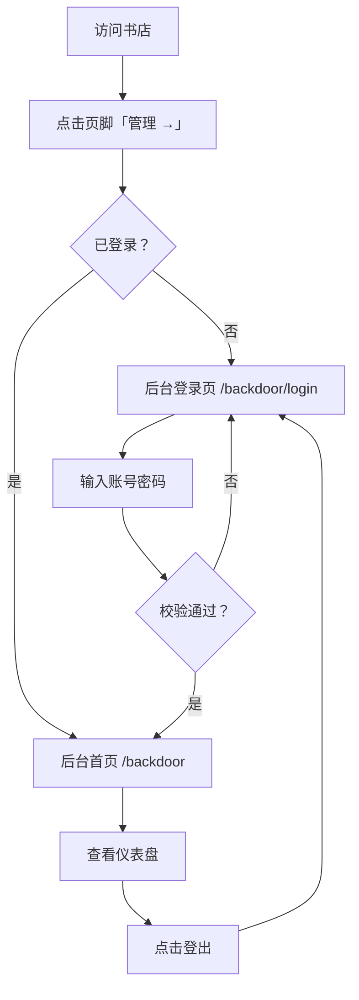

# 后台系统 V1：登入登出

**功能名称**: 后台系统 V1——用户登入登出（不开放注册）
**PRD 版本**: v1.1
**创建日期**: 2026-08-12
**作者**: ash

## 修订记录

| 版本 | 日期 | 说明 |
|------|------|------|
| v1.0 | 2026-08-12 | 初版：登入登出 + 后台框架 |
| v1.1 | 2026-08-12 | 重写：统一章节结构；补充范围与不做清单；验收标准改为可追踪编号（AC-x），与技术方案测试用例一一对应；挂接后台设计文档 |

## 一、背景与目标

### 1.1 背景

粉丝站逐步积累档案、素材与工具数据，后续将出现需要管理的内容（素材上下架、档案修订、弹幕后台等）。这些管理操作需要一处与公开站点分离的入口，并必须限制为管理员本人可访问。书店为纯静态站点（Next.js SSG），不具备服务端能力，因此后台依托独立后端服务落地。V1 先建立访问控制骨架与后台界面框架，为后续管理功能迭代做准备。

### 1.2 目标

- 提供后台系统的登入/登出能力，不开放注册；
- 后台界面与公开书店延续同一设计语言，但路由与内容相互独立、互不阻塞发布；
- 为后续管理功能（素材、档案、工具数据等）提供可扩展的后台框架。

### 1.3 成功标准

- 未登录访问后台页面会被引导到登录页；
- 使用超管账号可登录并进入后台，登录后可正常访问后台各页面；
- 登出后会话立即失效，再次访问后台需重新登录；
- 后台登录状态保持 7 天；同一账号允许多处同时在线、各自独立登出；
- 登录页提供明确的错误提示（账号或密码错误，不区分具体原因）。

### 1.4 范围与不做

- **做**：登录页、登出、受保护的后台布局（顶部栏 + 左侧导航 + 内容区）、欢迎仪表盘、书店页脚「管理 →」入口、会话保持与多端独立会话；
- **不做**：注册与自助创建账号、多管理员账号、找回/修改密码界面、任何具体管理功能、未上线功能的占位入口。

## 二、用户分析

### 2.1 目标用户

| 角色 | 说明 |
|------|------|
| 超管（站长本人） | 唯一合法用户，使用默认超管账号登录，管理站点内容 |

### 2.2 用户场景

| 场景 | 用户角色 | 目标 | 痛点 |
|--|--|--|--|
| 首次使用后台 | 超管 | 在登录页输入账号密码进入后台 | 需要一个受保护的独立入口 |
| 日常管理（后续迭代） | 超管 | 管理素材、档案等内容 | 无统一管理界面 |
| 离开后回来继续管理 | 超管 | 7 天内免重复登录 | 频繁登录影响效率 |
| 完成管理离开 | 超管 | 登出，确保他人无法进入 | 担心会话残留 |

## 三、功能需求

### 3.1 功能概述

V1 交付后台系统的登入/登出能力与受保护的后台界面框架：一个登录页、一个标准后台布局（顶部栏 + 左侧导航 + 右侧内容区）与一个欢迎仪表盘。公开书店页脚右下角提供「管理 →」入口链接。后台暂不包含具体管理功能，导航中不出现未上线功能的占位项。

### 3.2 功能列表

#### 功能点 1：后台登录

- **描述**：提供登录页，超管输入用户名与密码进行登录。默认超管账号 `supersumire`，初始密码 `salamander`（部署后应立即修改，见 §六）。登录成功后进入后台首页；失败时提示"账号或密码错误"。未登录访问后台任意页面均重定向到登录页。
- **用户价值**：唯一合法用户能安全进入后台，他人无法进入。
- **验收标准**：
  - [ ] AC-1 访问 `/backdoor` 未登录时跳转 `/backdoor/login`
  - [ ] AC-2 输入正确账号密码可登录并跳转后台首页 `/backdoor`
  - [ ] AC-3 输入错误账号或密码提示"账号或密码错误"，不区分具体原因
  - [ ] AC-4 不提供注册入口，页面与接口均无注册能力
  - [ ] AC-5 登录后刷新页面仍保持登录状态（7 天内）

#### 功能点 2：后台登出

- **描述**：后台提供登出入口。点击登出后当前会话立即失效，跳转回登录页；再次访问后台需重新登录。
- **用户价值**：离开后台时能确保会话安全结束。
- **验收标准**：
  - [ ] AC-6 后台界面可点击登出
  - [ ] AC-7 登出后跳转登录页，且再次访问 `/backdoor` 重新要求登录
  - [ ] AC-8 登出仅使当前端会话失效，不影响同一账号在其他设备的会话

#### 功能点 3：后台界面框架

- **描述**：登录后的后台采用标准管理界面布局：顶部栏（站点名 + 登出）、左侧导航（V1 仅"仪表盘"入口）、右侧内容区。V1 内容区展示欢迎仪表盘（问候语与提示语，如"欢迎回来，老书屋的店主"）；导航中不显示未上线功能的占位。视觉细节见 [[../../design/03-backdoor-design.md]]。
- **用户价值**：为后续管理功能提供统一入口与一致的操作界面。
- **验收标准**：
  - [ ] AC-9 后台布局为顶部栏 + 左侧导航 + 右侧内容区，左侧导航仅含"仪表盘"
  - [ ] AC-10 仪表盘页面展示欢迎语，无空白页或占位功能
  - [ ] AC-11 后台样式与书店视觉语言一致（深色底、应援色点缀，遵循视觉识别系统）

#### 功能点 4：书店入口链接

- **描述**：公开书店页脚右下角新增「管理 →」链接，指向后台页面 `https://api.sumire.live/backdoor`。该链接是公开入口，访问后未登录即跳转登录页。
- **用户价值**：站长可便捷地从书店进入后台。
- **验收标准**：
  - [ ] AC-12 书店页脚右下角显示「管理 →」链接
  - [ ] AC-13 点击后跳转 `https://api.sumire.live/backdoor`（未登录时落到登录页）
  - [ ] AC-14 链接样式与页脚风格一致

### 3.3 用户操作流程

### 3.4 页面/界面描述

| 页面 | 路由 | 描述 | 关键元素 |
|------|------|------|---------|
| 后台登录页 | `/backdoor/login` | 超管登录 | 站点名、用户名输入框、密码输入框、登录按钮、错误提示 |
| 后台首页（仪表盘） | `/backdoor` | 登录后首页 | 顶部栏、左侧导航、欢迎仪表盘、登出入口 |

### 3.5 异常与边界情况

| 情况 | 预期行为 |
|------|---------|
| 未登录访问 `/backdoor` | 重定向到 `/backdoor/login` |
| 账号或密码错误 | 提示"账号或密码错误"，不泄露是账号还是密码出错 |
| 登录后会话过期（超过 7 天） | 再次访问后台自动跳转登录页 |
| 多端同时登录 | 各自独立会话，任一端登出不影响其他端 |
| 访问不存在的后台深层路径 | 未登录统一回登录页；已登录按 404 处理（V1 无深层页面） |
| 登录接口被连续试错 | 触发限速，返回明确的状态码（见技术方案） |

## 四、非功能需求

### 4.1 性能要求

- 登录/登出操作响应迅速（P95 < 500ms）；
- 后台页面首屏加载轻量，无明显等待。

### 4.2 安全性要求

- 密码必须加密存储（bcrypt 哈希），禁止明文存储或出现在前端代码中；
- 登录会话使用 `HttpOnly` 安全 Cookie，前端脚本不可读；生产环境 `Secure`；
- 登录接口需具备基础防爆破能力（按 IP 连续失败限速）；
- 初始超管密码仅用于首次部署，文档中明确提示部署后应立即修改；
- 错误提示不区分账号错误与密码错误，避免账号枚举。

### 4.3 兼容性要求

- 现代浏览器（Chrome / Safari / Edge / Firefox 近两个大版本）；
- 移动端浏览器可完成登录与登出（响应式布局，见设计文档）。

## 五、依赖与约束

### 5.1 依赖

- 超管账号凭据（初始值由本 PRD 提供，部署时以环境变量注入，见技术方案 §配置管理）；
- 后端服务、Redis 会话存储与 MongoDB 持久化（见技术方案）。

### 5.2 约束

- 不开放注册，后台账号不提供自助创建；
- 后台与书店为独立路由与独立服务，互不阻塞发布；
- 后台 V1 不含具体管理功能，不显示未上线功能占位。

## 六、待确认事项

- 初始超管密码上线前是否需要修改（暂以 PRD 默认值实现，技术方案要求部署后轮换）；
- 后台是否需要后续接入更多管理员账号（V1 仅超管单账号）；
- 登录限速阈值（技术方案默认 5 次/分钟/IP，可调）。

## 七、相关文档

- 技术方案：[[../../engineering/proposals/2026-08-12-backdoor-auth-proposal.md]]
- 后台设计：[[../../design/03-backdoor-design.md]]
- 视觉识别：[[../../design/01-visual-identity.md]]
