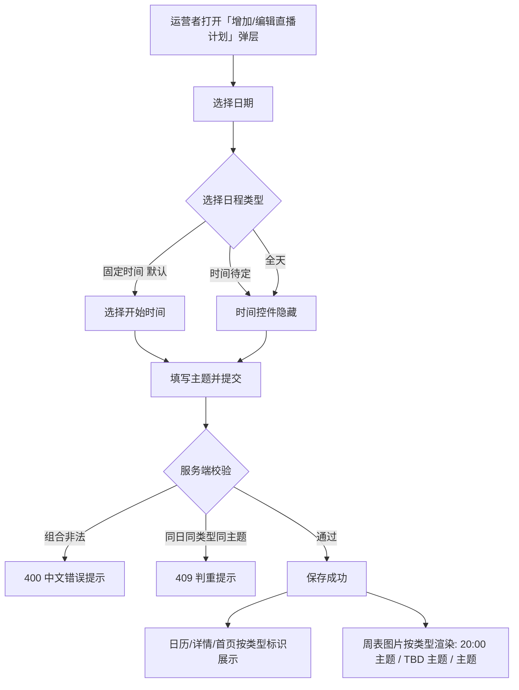

# 周表灵活时间日程（TBD 与全天日程）

**功能名称**: 周表灵活时间日程（Weekly Schedule Flexible Time）
**PRD 版本**: v1.0
**创建日期**: 2026-09-08
**作者**: sumire workflow

## 一、背景与目标

### 1.1 背景

周表后台「直播计划」（现态以 `docs/product/spec/schedule-admin.md` 与契约 `contract/stream-plans.openapi.yaml` 为准）录入日程时强制要求填写开始时间（`HH:mm`），即所有日程都必须是「固定时间」日程。实际官方公布的日程中常出现两类无法归入该模型的安排：

- **时间待定**：当日有直播/活动安排，但具体开播时间尚未公布（官方常以「时间待定」「TBD」标注）；
- **全天日程**：不绑定具体开播时刻的全天性安排（如全天活动、纪念日企划等）。

运营者目前只能用伪时间（如 `00:00`）硬凑录入，导致周表图片与日历上出现误导性的假时间。

### 1.2 目标

- 后台添加/编辑日程时新增「日程类型」选项：**固定时间**（现状）/ **时间待定** / **全天**；
- 「时间待定」与「全天」不再要求填写开始时间，全站各展示点按类型渲染（`TBD 主题` / `主题` / 类型标识）；
- 周表图片 `{schedules}` 变量、日历、当日详情、首页今日/每周日程的展示与排序口径统一。

### 1.3 成功标准

- [ ] 运营者可在后台录入「时间待定」与「全天」日程，无需填写开始时间；
- [ ] 周表图片 `{schedules}` 渲染：固定时间 → `20:00 主题`（现状不变）；时间待定 → `TBD 主题`；全天 → `主题`；
- [ ] 同日多条日程排序统一为：全天最前 → 固定时间按 startTime 升序 → 时间待定最后；
- [ ] 日历、当日详情弹层、首页今日日程与每周日程中，全天日程显示「全天」标识、时间待定日程显示「TBD」，不出现伪时间；
- [ ] 判重键扩展为（日期, 日程类型, 开始时间, 主题）：同日全天同主题、同日 TBD 同主题均判重返回 409；
- [ ] 存量固定时间日程零迁移、展示与排序行为零回归。

## 二、用户分析

### 2.1 目标用户

- 站点运营者（superadmin / admin）：按官方公开日程录入与维护直播计划；
- 普通访客：在日历、首页与周表图片中查看日程。

### 2.2 用户场景

| 场景 | 用户角色 | 目标 | 痛点（现况） |
|------|----------|------|--------------|
| 录入时间待定日程 | 运营者 | 官方只公布「某日有播、时间待定」时如实录入 | 表单强制填开始时间，只能用 `00:00` 等伪时间硬凑 |
| 录入全天日程 | 运营者 | 录入不绑定时刻的全天性安排 | 同上，且伪时间会误导访客以为零点开播 |
| 查看周表/日历 | 访客 | 看到与官方口径一致的日程（TBD / 全天） | 周表与日历上显示误导性的假时间 |

## 三、功能需求

### 3.1 功能概述

本期为直播计划数据模型增加「日程类型」维度（`fixed` / `tbd` / `allDay`，缺省 `fixed` 向后兼容存量数据），并贯通三层：后台表单（类型选择与时间控件联动）、服务端契约与校验（类型与开始时间的组合约束、判重键扩展）、全站展示（`{schedules}` 渲染规则、日历/当日详情/首页的类型标识与统一排序）。

### 3.2 功能列表

#### F1 后台表单支持日程类型

**描述**: 后台「增加/编辑直播计划」弹层（`PlanFormDialog`）在日期下方新增「日程类型」单选组，三选项：**固定时间**（默认）、**时间待定**、**全天**。

- 选择「固定时间」：保持现状——显示开始时间选择控件，`emptyField` 校验仍要求日期 + 开始时间 + 主题；
- 选择「时间待定」或「全天」：隐藏开始时间选择控件，提交时不携带开始时间；`emptyField` 校验只要求日期 + 主题；
- 编辑态按既有计划的类型回显；切换类型时已开始时间的处理：切到「时间待定/全天」清空开始时间，切回「固定时间」需重新选择。

**验收标准**:

- [ ] 表单出现「日程类型」单选组，默认选中「固定时间」，交互与视觉与后台既有表单风格一致；
- [ ] 选「时间待定」/「全天」时开始时间控件隐藏且不参与校验；选「固定时间」时开始时间必填（现状不变）；
- [ ] 三种类型均可保存成功并在日历/当日详情中正确回显；编辑既有计划时类型正确回显；
- [ ] 未选择日期或主题为空时仍按现状提示，提交按钮禁用逻辑随类型正确切换。

#### F2 周表图片 {schedules} 渲染规则

**描述**: 周表图片的 `{schedules}` 变量（`weeklyImage/scheme.ts` 的 `buildDaySchedulesText`）按日程类型渲染：

| 日程类型 | 渲染格式 | 示例 |
|----------|----------|------|
| 固定时间 | `{startTime} {title}`（现状不变） | `20:00 歌杂` |
| 时间待定 | `TBD {title}` | `TBD 突击歌回` |
| 全天 | `{title}` | `周年纪念活动` |

同日多条日程排序：**全天最前 → 固定时间按 startTime 升序 → 时间待定最后**，仍以「 / 」拼接为单行。

**验收标准**:

- [ ] 三种类型按上表格式渲染，固定时间渲染与现状逐字一致；
- [ ] 同日混合类型时按「全天 → 固定时间升序 → TBD」排序拼接；
- [ ] 仅含 TBD/全天日程的日期正常渲染，不出现空时间或 `undefined` 字样；
- [ ] 周表图片其余能力（周切换、布局、字体、保存）零回归。

#### F3 全站日程展示与排序统一

**描述**: 日历格子、当日详情弹层、首页「今日日程」与「每周日程」中：

- 全天日程显示「全天」标识（替代原时间位置），时间待定日程显示「TBD」标识；
- 排序规则与 `{schedules}` 一致：同日条目按「全天 → 固定时间按时间升序 → TBD」排列；
- 日历混合展示的历史直播记录（实际播出）保持现语义：与固定时间计划按时间混排；全天计划排在当日最前，TBD 计划排在当日最后。

**验收标准**:

- [ ] 日历格子与当日详情中 TBD/全天日程有明确类型标识，无伪时间；
- [ ] 首页「今日日程」「每周日程」中 TBD/全天日程同样带标识且排序正确；
- [ ] 历史直播记录的混排与样式（来源可区分、只读）零回归。

#### F4 服务端校验与判重

**描述**: 契约与服务端按类型施加组合校验：

- `timeType` 缺省为 `fixed`（请求未携带时按固定时间处理，向后兼容）；
- `timeType=fixed`：`startTime` 必填且须为合法 `HH:mm`；
- `timeType=tbd` / `allDay`：`startTime` 必须为空（不存值），携带 `startTime` 视为 400；
- 判重键由（日期, 开始时间, 主题）扩展为（日期, 日程类型, 开始时间, 主题）：同日全天同主题、同日 TBD 同主题同样 409；固定时间判重语义不变。

**验收标准**:

- [ ] POST/PUT 三种类型按上述约束校验，非法组合返回 400 中文错误体；
- [ ] 同日同类型同主题（TBD/全天）判重 409；同日一条 TBD 与一条全天同主题不冲突（类型不同）；
- [ ] 未携带 `timeType` 的旧客户端请求行为与现状完全一致。

### 3.3 用户操作流程

### 3.4 页面/界面描述

| 页面 | 描述 | 关键元素 |
|------|------|----------|
| 后台「直播计划」页 `/backdoor/schedule` | 表单弹层新增日程类型单选；日历/当日详情按类型标识展示 | 「日程类型」单选组（固定时间/时间待定/全天）、TimePicker 联动隐藏 |
| 生成周表图片弹层 | `{schedules}` 按类型渲染 | `TBD 主题` / `主题` / `20:00 主题`，全天→固定→TBD 排序 |
| 公开站日历页 `/calendar` | 日历格子与当日详情按类型标识展示 | 「全天」「TBD」标识，统一种内排序 |
| 首页 | 今日日程、每周日程按类型标识展示 | 同上 |

### 3.5 异常与边界情况

| 情况 | 预期行为 |
|------|----------|
| `timeType=tbd`/`allDay` 但携带 `startTime` | 400 中文错误体，不落库 |
| `timeType=fixed`（或缺省）但缺 `startTime` | 400（现状不变） |
| 非法 `timeType` 值 | 400 |
| 同日同类型同主题（含 TBD/全天） | 409 判重（编辑场景排除自身，现状口径不变） |
| 同日一条 TBD 与一条全天同主题 | 不判重（判重键含类型），两条都展示 |
| 表单内切换类型 | 切到 TBD/全天清空已选时间并隐藏控件；切回固定时间需重新选时间 |
| 存量数据（无 `timeType` 字段） | 一律按 `fixed` 处理，展示与排序零回归，无需数据迁移 |
| 同日全部为非固定时间日程 | 各展示点正常渲染，全天在前、TBD 在后，不出现空时间 |
| 主题含「TBD」等字样的固定时间日程 | 按 `startTime 主题` 原样渲染，不做特殊处理（内容与类型正交） |
| member 角色 / 未登录 | 写入口径与现状一致（member 只读、未登录跳登录），本需求不改鉴权 |

## 四、非功能需求

### 4.1 性能

- 数据量与请求模式不变（计划表低基数）；排序为应用层常量时间比较，不引入新查询或索引压力。

### 4.2 安全性

- 写路径沿用既有 superadmin/admin 受限写与输入校验；`timeType` 为枚举白名单，不接受任意字符串；
- 渲染文本仍为运营者已录入内容，沿用既有输出口径。

### 4.3 兼容性

- 契约向后兼容：`timeType` 缺省 `fixed`，旧客户端不携带该字段行为不变；`StreamPlan` 响应新增字段不破坏既有消费方；
- 存量数据零迁移（缺省即固定时间）；
- 公开站保持纯静态形态，数据仍客户端运行时拉取。

## 五、依赖与约束

### 5.1 依赖

- 既有直播计划全链路：契约 `contract/stream-plans.openapi.yaml`、服务端 `servers/api` 计划路由与 Mongoose 模型、前端 `features/schedule/` 各组件（均已上线）。

### 5.2 约束

- 契约先行：先改 `contract/stream-plans.openapi.yaml`，实现与测试以契约为准；
- 所有内容以官方公开信息为准，禁止二次设定；
- 历史直播记录不参与周表图片渲染的既有口径不变；
- 上线 PR 内同步 spec：`docs/product/spec/schedule-admin.md`、`docs/product/spec/calendar.md`、`docs/engineering/spec/backend-schedule.md`。

## 六、后续可能（本期不做）

- TBD 日程「定档」快捷操作（一键补填时间转为固定时间）；
- 周表图片中 TBD/全天日程的差异化视觉样式（如色块、图标）；
- 日程类型的筛选/统计视图。

## 七、相关文档

- 本期技术提案：`docs/engineering/proposals/2026-09-08-weekly-schedule-flexible-time-proposal.md`
- 契约：`contract/stream-plans.openapi.yaml`
- 产品 Spec（现态）：`docs/product/spec/schedule-admin.md`、`docs/product/spec/calendar.md`
- 工程 Spec（现态）：`docs/engineering/spec/backend-schedule.md`
- 周表二期 PRD（已归档）：[[2026-08-15-weekly-schedule-v2-prd]]
